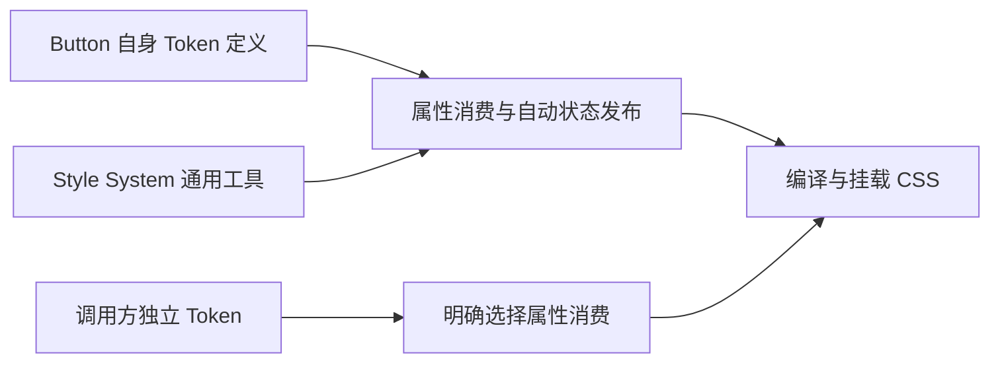

# 维护契约

- Guide 契约见 [how-to-write-guide.md](../how-to-write-guide.md)。
- Button 的调用选择见 [Button 设计规格](../../src/components/kits/Button/Button.spec.md)。
- 修改 Button 的公开语义、输入轮廓或输出协议后，必须同步本文档。

# Button 基础组件

## 业务目标

`Button` 是当前界面里的动作入口。它把动作内容、动作名、四个 Variant 分组和可合并 Status 翻译成一个原生 `button`，不接管导航、表单编排或状态成因。

```txt
调用方
  ├─ children / name：动作信息
  ├─ appearance / tone / emphasis / size：Variant 分类
  └─ loading / disabled：外部状态波
          ↓
        Button
          ↓
原生 button + data-* + ARIA / disabled
```

## 使用判断

- 保存、确认、取消、清除、删除、重试等当前位置命令使用 Button。
- 改变 URL 或页面位置时使用 Link。
- 输入值使用 Input；切换持续状态使用对应表单控件。
- `children` 承载可见动作内容；纯图形内容通过 `name` 提供动作名。

## Variant 输入轮廓

Button 有四个 Variant 分组：

- appearance（外观形式）：`filled`、`outlined`、`plain`。
- tone（动作的语义基调）：`danger`；原 accent 退出。
- emphasis（整体存在感）：`soft`、`strong`；不绑定透明、实底等实现方式。
- size：`small`、`large`、`xlarge`

具体 Variant 已知时优先使用确定描述词：

```tsx
<Button strong filled large>
  保存
</Button>
```

具体 Variant 会变化时使用不定字段：

```tsx
<Button appearance={appearance} tone={tone} emphasis={emphasis} size={size}>
  保存
</Button>
```

确定描述词让阅读者直接看到选择结果；不定字段让阅读者先看到“这一分类是不定的”。两种输入都可以响应式变化。分组字段一旦声明便接管同组输入，即使当前值是 `undefined`。同组冲突只警告，不中断运行。

省略分组时，原始选择为 `undefined`，不建立 `normal`、`neutral` 或 `medium` 候选。组件的公开映射表 `buttonMapping` 定义于 [Button.mapping.ts](../../src/components/kits/Button/Button.mapping.ts)，其中 `appearance.undefined` 初始为 `outlined`，应用可以在生成组件前更改：

```ts
import { buttonMapping } from '@edsolater/uikit'

Object.assign(buttonMapping.appearance, { undefined: 'filled' })
```

映射能力位于独立的 [variantPropsMapping.ts](../../src/components/kits/utils/variantPropsMapping.ts)，由 `createVariantPropsParser` 的第二参数接入整份组件表，按分组名读取子表，再以 `String(原始值)` 查询属性，其他 Kit 也可使用。映射只决定 DOM 输出，`details` 与 `effect` 保留原始选择；未命中映射时原样输出。`buttonMapping` 是普通对象字面量，使用 `as const` 保留字面量类型；它没有运行时冻结，也不主动触发响应式更新。

Variant 描述组件的分类选择；每个分组单选，不同分组可以组合，例如 `<Button danger strong filled>`。tone 表达动作性质，emphasis 表达存在感，appearance 表达外观，三者不互相推导。

Status 独立描述组件当前成立的情况，`loading` 与 `disabled` 可以同时成立。两类输入都支持响应式变化；区别在表达的职责，不在值是否能改变。

## Status 输入轮廓

`loading` 和 `disabled` 是独立字段，可以同时成立：

```tsx
<Button loading={isSaving} disabled={cannotSave}>
  保存
</Button>
```

Status 是外部记录加内部管理能力。外部没有声明某字段时，组件内部可以改变它；外部一旦声明该字段，内部更改仍可调用，但不再改变该状态。Button 只接住状态波并翻译表现，不判断状态为什么成立。

## 稳定输出

- appearance、tone、emphasis、size 分别输出到 `data-appearance`、`data-tone`、`data-emphasis`、`data-size`，不再输出 `data-variant`。
- 当前 Status 合并到 `data-status`。
- loading 同步到 `aria-busy`。
- disabled 同步到原生 `disabled`。
- `name` 同步到 `aria-label`。
- 默认原生 `type` 是 `button`。

## 边界

浏览器宿主须在渲染 Button 前提供 `<style id="css-root"></style>`。Button 静态导入样式模块，模块加载时登记规则；应用在所有静态样式登记后、render 前调用 `cssRoot.mount()`。组件渲染不触发编译或重复登记，卸载组件不移除静态样式。样式组合与变量覆盖见 [Style System 架构](../../src/style-system/architecture.md#button-接入)。

- Button 不内建 validator、validIf 或 enabled 判断协议。
- Button 不提供 href、target 或导航语义。
- Button 不提供 icon props；图标属于 children。
- Button 不因为视觉分类而建立运行时 Profile；分类由类型、解析器声明、注释和 DOM 属性共同表达。

## 样式定义与局部消费

Button.style.ts 消费 data-appearance、data-emphasis、data-tone 和 data-size。filled 使用填充背景，outlined 保留浅底及可见轮廓，plain 常态透明且无边界。soft、普通、strong 依次提高整颗按钮的存在感，文字和图形内容一起变化；强调不改变外观形式、语气或尺寸。当前视觉配方使用整体透明度 0.7、0.9、1，这些数值由组件样式定义，不属于 Props 固定契约。各档禁用时仍使用通用 disabledFade。

以下列出公开颜色 Token 的复用示例，供内容引用或作为新定义的输入；完整公开清单见 [Button 设计规格](../../src/components/kits/Button/Button.spec.md)。这些 Token 由 Button 自身消费并在 address 自动定义：

| Token                 | 定义内容               | 复用方式                           |
| --------------------- | ---------------------- | ---------------------------------- |
| buttonColorSource     | 背景、语气文字和边界共用的基色 | 内容引用、定义复用                  |
| buttonSurfaceColor    | 最终背景色             | 内容引用、定义复用                  |
| buttonContentColor    | 最终内容色             | 内容引用、定义复用                  |



主体定义与分类交集都在 [Button.style.ts](../../src/components/kits/Button/Button.style.ts) 的 Token state 中，rules 不再给这些 Token 重新赋值。混色参数不分别包装成控制点；尺寸、间距、阴影和存在感也在组件地址处理自身状态。常态透明度通过 clickable 消费。

局部定制创建新 Token，使用对象属性或 [Key, token] 明确接入按钮属性。直接创建新 Token 不会替换组件已有引用。手动 declare 和 [existingToken, value] 仍可执行，但属于 dangerous 操作，不作运行时或类型拦截，不作为正常定制模板。定义与消费登记后由应用挂载 CSS，不自动插入样式。
