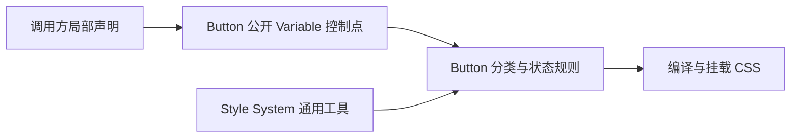

# 维护契约

- Guide 契约见 [how-to-write-guide.md](../how-to-write-guide.md)。
- Button 的调用选择见 [Button 设计规格](../../src/components/kits/Button/Button.spec.md)。
- 修改 Button 的公开语义、输入轮廓或输出协议后，必须同步本文档。

# Button 基础组件

## 业务目标

`Button` 是当前界面里的动作入口。它把动作内容、动作名、三个 Brand 分组和可合并 Status 翻译成一个原生 `button`，不接管导航、表单编排或状态成因。

```txt
调用方
  ├─ children / name：动作信息
  ├─ variant / tone / size：Brand 分类
  └─ loading / disabled：外部状态波
          ↓
        Button
          ↓
原生 button + data-* + ARIA / disabled
```

## 使用判断

- 保存、确认、取消、清除、删除、重试等当前位置命令使用 Button。
- 改变 URL 或页面位置时使用 Link。
- 输入值使用 Input；切换持续状态使用对应表单控件。
- `children` 承载可见动作内容；纯图形内容通过 `name` 提供动作名。

## Brand 输入轮廓

Button 有三个 Brand 分组：

- variant：`bare`、`solid`
- tone：`accent`、`danger`
- size：`small`、`large`、`xlarge`

具体 Brand 已知时优先使用确定描述词：

```tsx
<Button accent solid large>保存</Button>
```

具体 Brand 会变化时使用不定字段：

```tsx
<Button variant={variant} tone={tone} size={size}>保存</Button>
```

确定描述词让阅读者直接看到选择结果；不定字段让阅读者先看到“这一分类是不定的”。两种输入都可以响应式变化。分组字段一旦声明便接管同组输入，即使当前值是 `undefined`。同组冲突只警告，不中断运行。

省略分组就是默认形态。默认解析结果为 `undefined`，不建立 `normal`、`neutral` 或 `medium` 候选。

## Status 输入轮廓

`loading` 和 `disabled` 是独立字段，可以同时成立：

```tsx
<Button loading={isSaving} disabled={cannotSave}>保存</Button>
```

Status 是外部记录加内部管理能力。外部没有声明某字段时，组件内部可以改变它；外部一旦声明该字段，内部更改仍可调用，但不再改变该状态。Button 只接住状态波并翻译表现，不判断状态为什么成立。

## 稳定输出

- variant、tone、size 分别输出到 `data-variant`、`data-tone`、`data-size`。
- 当前 Status 合并到 `data-status`。
- loading 同步到 `aria-busy`。
- disabled 同步到原生 `disabled`。
- `name` 同步到 `aria-label`。
- 默认原生 `type` 是 `button`。

## 边界

浏览器宿主须在渲染 Button 前提供 `<style id="css-root"></style>`。Button 静态导入样式模块，模块加载时登记规则；应用在所有静态样式登记后、render 前调用 `cssRoot.mount()`。组件渲染不触发编译或重复登记，卸载组件不移除静态样式。样式组合与变量覆盖见 [Style System 架构](../../src/style-system/architecture.md#button-接入)。

- Button 不内建 validator、validIf 或 enabled 判断协议。
- Button 不提供 href、target 或导航语义。
- Button 不提供 icon props；图标属于 children。
- Button 不因为视觉分类而建立运行时 Profile；分类由类型、解析器声明、注释和 DOM 属性共同表达。

## 样式控制入口

Button 从组件及包入口公开三个 Variable，同一对象也由 Button 样式消费：

| 控制点 | 控制内容 | 当前操作 |
| --- | --- | --- |
| buttonSurfaceSource | 背景混色的色源 | declare |
| buttonSurfaceCanvas | 背景混色的画布 | declare |
| buttonSurfaceStrength | 色源参与背景的强度 | declare、modify；modify 为相对增量 |



控制定义与分类组合都在 [Button.style.ts](../../src/components/kits/Button/Button.style.ts) 中；三个控制点以 export 定义，其他业务配方保持私有。相对修改遵守 Variable 的最近语义父定义契约；具体选择条件由调用方表达。内部分类贡献、阴影与光标没有因此成为新的公开控制点，整体禁用淡化复用通用 clickable。

这些 Variable 已可用于 Rules 中的局部声明和组合。目前操作返回声明，由应用挂载 CSS；直接修改 JS 对象不会自动更新页面。未来动态控制沿用这些对象身份，本轮不增加自动插入 CSS 的运行机制。
