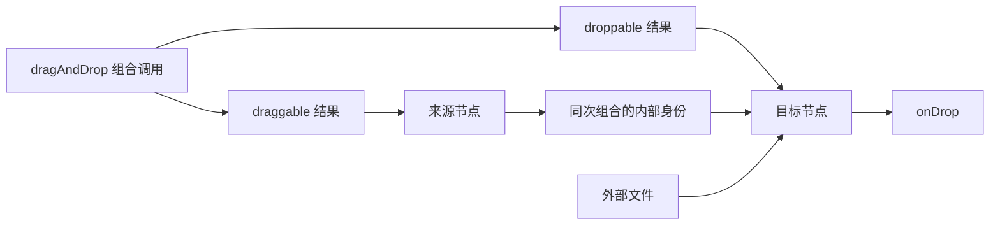

# Drag and Drop 基础能力

Drag and Drop 使用 Pointer Events 拖动页面内节点，也允许从浏览器外部接收文件。调用者提供材料和接收规则；UIKit 管理节点交互、命中与清理。



```tsx
function TransferExample() {
  const {
    plugins: { draggable, droppable },
  } = dragAndDrop({
    draggable: { payload: item },
    droppable: { onDrop: receive },
  })
  return (
    <>
      <Card is={draggable}>拖动材料</Card>
      <Card is={droppable}>接收材料</Card>
    </>
  )
}
```

`dragAndDrop` 返回可调用组合；每次调用取得 `{ plugins, controller }`，`plugins.draggable`／`plugins.droppable` 为原能力结果，`controller.draggable`／`controller.droppable` 引用两端原 Controller。组合定义可放模块顶层，组合调用必须在组件内。每次调用在内部创建一份共享身份，本次返回的拖动与接收角色据此协作。内部身份不返回给调用者，公开 Options 不再要求 `id`。独立调用 `draggable({ payload })`、`droppable({ onDrop })` 时内部身份为 `undefined`，两端都未组合时仍可协作。节点所在容器不影响分组，拖动激活时使用的身份在本次拖动期间保持不变。

需要控制某个节点时，直接使用能力结果的 `controller`：

```tsx
function ControlledDraggableExample() {
  const capability = draggable({ payload: item })
  return (
    <Card is={capability} on={{ click: () => capability.controller.disable() }}>
      拖动材料
    </Card>
  )
}
```

能力结果在组件内构建时已具备完整 Controller；节点未接入或卸载后方法保留，依赖 DOM 的方法为 no-op。快捷 `draggable` 和 `droppable` Props 仍可按各自配置动态启停，并在关闭时释放声明与节点资源。

`draggable` 使用 Pointer Events 移动原始节点，Top Layer 负责原位 Anchor、提升和恢复。`activationDistance` 决定启动距离，`activationJump` 决定是否承接阈值前位移。`droppable` 在内部身份与 `accepts` 通过后调用 `onDrop`；外部材料没有来源身份，只按目标的启用状态和 `accepts` 判断。`DropContext.kind` 区分页面内材料和外部材料：前者提供 source、payload 与 PointerEvent，后者提供 files、items、types、dataTransfer 与 DragEvent。

拖动不负责排序或集合写入，接收不将文件转成业务对象。页面内拖动不使用原生 ghost image；外部文件继续使用原生 DataTransfer。参见 [Draggable 示例](../../src/components/plugins/kits/dragAndDrop/draggable/draggable.example.tsx)、[Droppable 示例](../../src/components/plugins/kits/dragAndDrop/droppable/droppable.example.tsx) 和 [分组示例](../../src/components/plugins/kits/dragAndDrop/dragAndDrop.example.tsx)。
