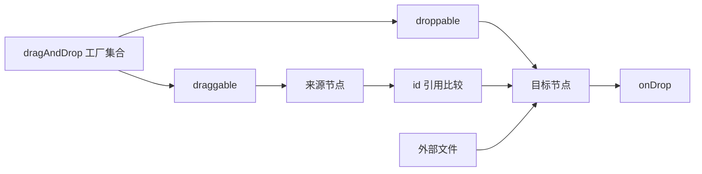

# Drag and Drop 基础能力

Drag and Drop 使用 Pointer Events 拖动页面内节点，也允许从浏览器外部接收文件。调用者提供材料和接收规则；UIKit 管理节点交互、命中与清理。



```tsx
const { draggable, droppable } = dragAndDrop
const id = {}
<Card is={draggable({ id, payload: item })}>拖动材料</Card>
<Card is={droppable({ id, onDrop: receive })}>接收材料</Card>
```

`dragAndDrop` 组织两个独立工厂。页面内拖动的两端使用同一个 `id` 对象时才可协作；两端都不提供 `id` 时也可协作。不同对象或仅一端提供 `id` 均不匹配。节点所在容器不影响分组，拖动激活时使用的 id 在本次拖动期间保持不变。

需要控制某个节点时，调用 `usePlugin(draggable, { payload: item })`，把返回的 Plugin 交给 `is`，通过返回的 controller 操作；节点未安装或卸载后成员不可用。快捷 `draggable` 和 `droppable` Props 仍可按各自配置动态启停。

`draggable` 使用 Pointer Events 移动原始节点，Top Layer 负责原位 Anchor、提升和恢复。`activationDistance` 决定启动距离，`activationJump` 决定是否承接阈值前位移。`droppable` 在 id 与 `accepts` 通过后调用 `onDrop`；外部材料没有来源 id，只按目标的启用状态和 `accepts` 判断。`DropContext.kind` 区分页面内材料和外部材料：前者提供 source、payload 与 PointerEvent，后者提供 files、items、types、dataTransfer 与 DragEvent。

拖动不负责排序或集合写入，接收不将文件转成业务对象。页面内拖动不使用原生 ghost image；外部文件继续使用原生 DataTransfer。参见 [Draggable 示例](../../src/components/plugins/kits/dragAndDrop/draggable/draggable.example.tsx)、[Droppable 示例](../../src/components/plugins/kits/dragAndDrop/droppable/droppable.example.tsx) 和 [分组示例](../../src/components/plugins/kits/dragAndDrop/dragAndDrop.example.tsx)。
