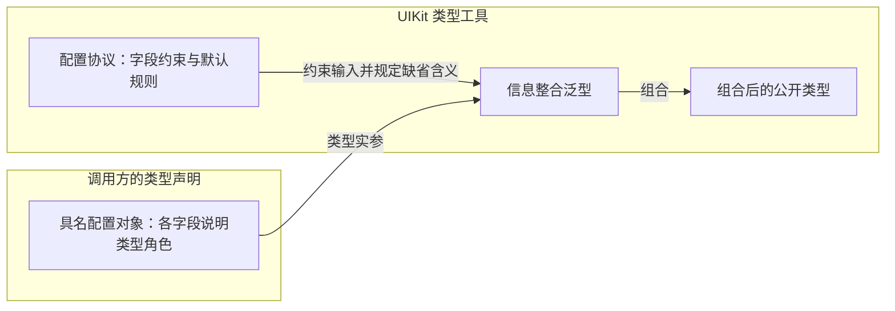

# 信息整合类泛型的设计准则

信息整合类泛型将多份既有协议或能力合成为公共协议。使用具名配置对象，让每项信息在使用处说明自己的角色，减少位置记忆和跨文件查找，便于人和 Agent 扫读、生成与维护代码。

## 当前适用的类型族

Kit 的公共输入、组件契约、实例控制、创建选项和控制器集合采用同一具名形式：

| 类型                   | 具名信息                                 | 必须提供的字段        |
| ---------------------- | ---------------------------------------- | --------------------- |
| `KitProps`             | $styleConfig、controller、domTag          | 无；整份配置也可省略  |
| `KitComponent`         | props、controller、$styleTokens           | props、controller     |
| `KitController`        | props、propDefinition、controllerMembers | props、propDefinition |
| `KitOptions`           | props、propDefinition、$styleTokens       | props、propDefinition |
| `ControllerRegistry`   | controller、$styleTokens                  | controller            |

判断依据是既有协议的合成关系，不能只数参数。元素变换、键筛选等类型保留自身关系；业务 `TableProps<Row, ColumnKey>` 与 `TableController<Row, ColumnKey>` 继续表达记录与列的关联，其内部使用 Kit 聚合时再明确各信息的名称。

Modification 表达核心实体的类型参数化，不属于本批协议合成。PluginCore 若调整形式，属于配置型接口的独立讨论，也不作为本批集合式类型的例子。状态协议与映射运算沿各自关系表达，不因泛型数量改变形状。

## 在使用处说明类型角色

样式配置与控制器是不同的信息角色，使用处直接把角色写在类型旁：

```ts
type TableSharedProps<Row, ColumnKey extends PropertyKey> = KitProps<{
  $styleConfig: TableStyleConfig<ColumnKey>
  controller: TableController<Row, ColumnKey>
}>
```

DOM 根标签使用 domTag，与其他标签、分类或标记区分：

```ts
type ButtonSharedProps = KitProps<{
  $styleConfig: ButtonStyleConfig
  controller: ButtonController
  domTag: 'button'
}>
```

配置对象只属于类型声明。controller 描述 ref 接收的控制器类型，不给组件运行时增加一个同名输入字段。组件仍先声明公共 Props 和 Controller，再由实现满足契约。

```ts
type ButtonContract = KitComponent<{
  props: ButtonProps
  controller: ButtonController
}>

type ButtonControl = KitController<{
  props: ButtonProps
  propDefinition: ButtonPropDefinition
}>
```



## 可选项与默认值

`KitProps` 的三个字段及配置对象本身均可省略：

```ts
type DefaultSharedProps = KitProps

type ControlledSharedProps = KitProps<{
  controller: ButtonController
}>
```

缺省含义由工具在定义处统一规定：

| 字段        | KitProps 缺省含义                                          |
| ----------- | ---------------------------------------------------------- |
| $styleConfig | 无具体字段的对象配置；保留统一样式输入                     |
| controller  | `{ props: object }` 通用控制形状；不会自动推导具体组件能力 |
| domTag      | div                                                        |

组件需要精确实例控制时，显式填写自身 Controller。已填写字段必须满足契约；可选表示可以不指定，不表示指定后不受约束。

其他聚合类型只省略真实可选项：$styleTokens 缺省不提供 Token 集合，KitController 的 controllerMembers 缺省不附加业务成员。props、propDefinition、controller 等必需事实继续由声明端提供。调用方无需填写位置占位类型，也没有旧位置形式的兼容签名。

## 按共同目的组织定义

具名字段用于说明角色。新增一种整合信息时，在同一配置协议中增加相应字段，让现有使用处继续通过名称表达含义。

共同协议和扩展位置本身具有价值。不能仅因某个组件当前尚未消费一项信息，就裁掉统一入口，形成逐组件模板；说明应区分已消费配置、默认行为与保留的共同结构。

配置协议、默认规则与整合类型按共同目的放在一起，在定义处可以就近找到约束。组件的 Props、自有字段协议、Controller 声明和实现继续遵守各自归属，不因具名形式改变运行职责。

## 阅读检验

- 只看使用处，能否知道每个类型承担的角色？
- 省略字段时，能否从同一配置协议找到明确的缺省含义？
- 新增角色时，是否可以沿用具名结构？
- 同类工具是否保持一致，业务泛型是否仍表达自身的真实类型关联？
