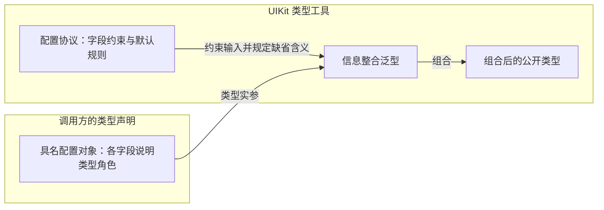

本文规定 UIKit 中信息整合类泛型的参数设计。将不同角色的类型信息组合成公共协议时，使用具名配置对象，让每项信息在使用处就能说明自身角色。

目标是降低位置记忆和跨文件查找的成本，使人能够快速扫读，也让 Agent 能按稳定结构生成、检查和扩展代码。`KitProps` 是其中一个例子，这条准则适用于项目内所有信息整合类泛型工具。

# 适用范围

信息整合类泛型接收承担不同职责的类型，再将它们组合成一个类型协议。例如，组件公共输入需要组合样式配置、控制器和 DOM 标签信息。

这类输入使用具名配置表达。信息达到三个及以上时，尤其需要避免继续增加位置参数；即使只有两项，不同角色也应直接可见。判断依据是信息的角色与组合关系，不能只数泛型参数的数量。

元素变换、键筛选等泛型按照自身的类型关系设计；本准则不把所有多参数泛型机械改成配置对象。

# 在使用处说明类型角色

位置参数要求读者记住顺序，或跳到定义处确认各项含义：

```ts
type TableSharedProps<Row, ColumnKey extends PropertyKey> = KitProps<
  TableStyleConfig<ColumnKey>,
  TableController<Row, ColumnKey>
>
```

具名配置将角色直接写在类型信息旁：

```ts
type TableSharedProps<Row, ColumnKey extends PropertyKey> = KitProps<{
  styleConfig: TableStyleConfig<ColumnKey>
  controller: TableController<Row, ColumnKey>
}>
```

上述具名形式是本准则选定的设计形态，接口实施与迁移另行进行，不表示现有 `KitProps` 已完成调整。

字段名描述当前配置的实际职责。DOM 根标签使用 `domTag`，使它与其他标签、分类或标记的含义区分开：

```ts
type ButtonSharedProps = KitProps<{
  styleConfig: ButtonStyleConfig
  controller: ButtonController
  domTag: 'button'
}>
```

配置对象属于类型声明。`controller` 描述引用接收的控制器类型，不因此给组件运行时增加一个同名输入字段。



# 可选项与默认值

是否可选由每个工具的配置协议确定。`KitProps` 的 `styleConfig`、`controller`、`domTag` 三项均可省略，配置对象本身也可省略：

```ts
type DefaultSharedProps = KitProps

type ControlledSharedProps = KitProps<{
  controller: ButtonController
}>
```

未填写字段的含义与默认值由工具统一定义，使用方无需填写位置占位类型。已经填写的字段仍须满足对应契约；可选表示可以不指定，不表示指定后不受约束。

# 统一结构与扩展

具名字段增加的文字用于描述角色，是降低理解成本的必要结构。新增一种角色时，在同一配置协议中增加对应字段，让现有使用处继续通过名称表达各项含义。

共同协议和扩展位置本身具有价值。不能仅因当前某个组件尚未消费某项信息，就裁掉统一入口，形成逐组件的特殊模板。实现与说明应准确区分已消费的配置、默认行为和保留的共同结构。

配置协议与整合泛型按共同目的组织，相关约束和默认规则应容易就近找到。人和 Agent 都应能从同一稳定位置确定字段含义，避免分别记忆不同组件或工具的参数顺序。

# 阅读检验

- 只看使用处，能否知道每个类型承担的角色，而无需查询参数顺序？
- 省略一项时，能否从配置协议找到明确的缺省含义？
- 新增角色时，是否可以沿用既有具名结构，而无需插入位置占位项？
- 同类工具是否沿用一致的表达方式，便于人和 Agent 定位、生成与修改？
