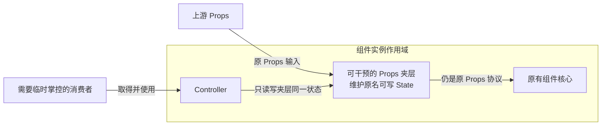

# 组件 Props 与 Controller 状态

Props 是组件构建与日常使用的声明入口。需要临时掌控时，在上游 Props 与原有组件核心之间接入可干预的 Props 夹层，Controller 只对这个夹层读写；夹层继续按原 Props 协议向核心输出。

这是当前确定的方向。先前让核心主动接入每个 State、再改造各条消费链的方案已被否定；把那些改造搬进黑盒也不等于实现了夹层方案。

## 上游 Props、夹层与原核心

所有 Prop 都进入可干预夹层，并按原名对应可写 State。State 用于夹层的实现与 Controller 接口：Controller 操作的就是夹层维护的状态，不再复制一份值或通过镜像同步。

夹层的输出仍是原有 Props 的形状和语义。原核心不需要知道新增夹层、Controller 或 State 接入机制，继续按原 Props 接口处理业务逻辑与界面。这不排除原协议本来就允许的 Source／State 形式，也不要求核心改成直接读取每个 State。

Controller 的字段沿用 Prop 原名，不添加前缀或改变大小写。例如 Prop 名为 `loading`，通过 `val(buttonController.loading)` 读取、`buttonController.loading.set(true)` 写入；Prop 本身叫 `isLoading` 时，公开字段也叫 `isLoading`。这些操作作用于夹层，不要求核心了解 Controller。

## Button 组合夹层与原核心

Button 是管理与功能组合层。这里要组合的是可干预 Props 夹层和原有组件核心，不是把状态、事件、variant、HTML、引用等核心处理重新实现一遍，再分别命名为黑盒。

夹层需要有清楚的输入输出、可干预能力和生命周期契约。它自己承担透明可操作能力，保持核心的原 Props 协议；不能靠修改 Button 核心或 Piv 的事件、DOM、variant、引用消费机制来补齐效果，也不能仅将现有杂合实现整体挪到 helper。

全部 Props 可干预的目标不因当前实现存在初始化快照而缩小，回调与引用也不例外。具体如何透明兑现仍须形成闭合方案，不能先宣称已支持未知的动态效果，更不能把目标改成只支持持续读取的字段。

## Props 完整承担日常使用

不使用 Controller，组件也应能仅通过 Props 完整、正常地构建和使用；消费者不必先创建、持有或调用 Controller。上游 Props 仍是主要声明入口。

Controller 是易用性的补充，也是理解组件后临时掌控它的逃生舱。它逐项公开夹层能力，方便读取、写入或注入临时行为；具体能力仍按组件职责补充，共享 State 说明不替代这些能力的定义。

## 函数来源与函数值

所有 Prop 都对应可写 State。原本允许计算来源的 Prop 保留其来源语义；`onClick`、`ref` 等回调函数本身也是 Prop，应作为值保存，不能因为它们是函数就自动执行，也不因此被排除在夹层之外。

保存或替换函数值沿用现有 State 协议，例如 `callbackState.set(() => nextCallback)` 保存 `nextCallback`，不在赋值时把它当作计算调用。夹层向下输出时仍须保持该 Prop 原来的回调语义。

外界可通过 Props 提供生命周期回调，也可借 Controller 临时替换回调或追加动作，类似使用过程中通过 `addEventListener` 接入行为。这里说明干预用途，不新增通用事件管理器，也不据此规定核心必须采用新的事件或引用机制。

## 可写状态与消费者约定

夹层公开的 Prop State 都可写。消费者理解组件含义，按君子协定进行临时干预；可写能力不因上游已经声明该 Prop 而被收回。

来源更新、计算重新执行和 Controller 写入沿用现有 State 与 Solid 的原生语义，不新增权限、优先级、受控拒写或写入仲裁。夹层与 Controller 共用同一状态，不维护第二份状态副本；核心继续消费原 Props 输出。

## 样式与生命周期边界

样式仍通过原 Token 暴露，逻辑与界面相关的干预通过夹层 State 暴露。Prop 的值可以引用 Token，夹层保留其原有含义与身份，样式定义继续由已有 Token 协议处理。样式落点见[样式文件写法](../style/样式文件写法.md)。

夹层与 Controller 的生命周期归组件实例作用域，在该作用域建立并清理，不借用 domRef 或 Piv 显示分支的作用域。原生元素仍由独立 domRef 接入；Controller 不因此取得直接持有 DOM 的职责。

## 方案状态与独立需求

当前夹层方案待重写，先前核心改造和消费链补偿路线不能继续作为实现依据。已有检查只是当时的行为事实，不能证明该路线符合本篇目标，也不能证明夹层已经实现。

Piv 的纯 shadowProps 支持 as／if 是另一个独立需求，见 [Piv SPEC](../../src/components/Piv/SPEC.md#声明与来源)。它不属于 Props 夹层的改造阶段、前置条件或验收内容；原 if 保留实例的目标和未决规则也不在这里重新决定。
