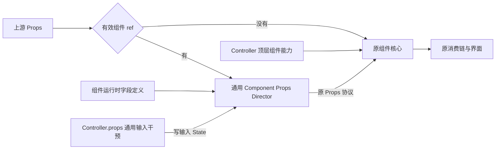

# 组件 Props 与 Controller 状态

Props 是组件构建和日常使用的声明入口，也保留已有 Source 的响应能力。Controller 在顶层公开组件自定义能力，`.props` 提供运行期特殊需要下的通用输入干预入口，不能用于替代 Props 初始化。

## 可选的通用 Component Props Director

只有创建时注入有效组件 ref，才在上游 Props 和原核心之间启用通用 Component Props Director。未注入组件 ref、ref 实际为 undefined、只有 domRef 时，直接执行原核心，不分配控制层字段 State，不登记可控实例。创建后再改变 ref 不会给普通分支补建控制层。

层能力是通用的，现有公开界面组件已统一接入；渲染、标记与控制基础设施不递归套用 kit。支持字段必须有运行时 JS 定义，不能只依赖 TypeScript 或某实例的 Object.keys。各字段拥有者在相邻Owner.prop.ts定义自己的描述与默认入口，类型接口留在原模块，组件按Props继承关系组合，另定义自身业务规则；Director 不解释具体组件的业务规则；kit 负责组件 ref 与实例集合，Piv/Dode 继续消费 DOM 声明。

## 同一字段与原 Props 协议

启用后，可干预 Prop 在 `Controller.props` 下按原名提供可写 State；only-through-prop字段直接读取上游，不创建State、不进入Controller。配置了默认来源的未声明字段在Director构建时建立Source与惰性State，其余可干预字段首次被Props或Controller读取时才建立并缓存。`Controller.props` 读写的是输入层同一 State，不复制字段值或用 Effect 镜像；它与顶层组件状态属于不同机制，不按同名自动关联。读取具体输入字段时只初始化该字段，不预读其它字段；工厂及State归Director创建时的组件作用域，不归首次读取的短命分支。

输出按原字段协议区分：state-source-view交出同一State，由原消费者val；state-value-view读取当前值并正常追踪；state-untracked读取当前值但取消本次外层依赖追踪，不缓存。only-through-prop直接转交上游Prop，不经过可写State。原核心继续消费 Props，不要求逐项接入新 State，也不修改 Piv 或原分类解析来补偿控制层。

输入视图保留上游 raw 的声明存在性；输出形状由上游声明、不可变defaultSources工厂表及omit固定。默认来源工厂在构建阶段取得稳定Source，不提前读取Source的值；raw显式undefined优先，不调用默认工厂。输入从一开始即提供同一缓存State，没有先读raw后回填的阶段。指令写入只改变 State，不动态制造 Props 声明，不改上游对象。缺省字段若需初始化入口，必须由组件定义对接原消费者，不能只证明 Controller 值已经改变。

## Button 的业务准备

Button 组合完整字段描述，只维护自身字段和分类／状态候选。DOM字段归Dode、来源字段归Piv、说明字段归KitMarker；描述与类型extends层次一致，不改变运行算法。状态解析器通过 `createState(() => props[statusName])` 建立来源关系，不在 Button 中用 Effect 同步；每个缺省group的工厂复用原VariantParser语义details，把同一候选States的结果作为初始Source。输出只省略原缺省group的候选；原已声明group保留候选，让原核心报告冲突并映射一次。Button构建时建立分组Source但不val，保持原诊断时机，来源随后实际消费。显式group包括undefined优先，运行期指令仍在同一数据流。

Button.controllers 只收集启用组件 ref 的实例，普通按钮不因全局访问器自动承担控制成本。`kit(definition, core)` 统一管理 ref 接收器交付、替换清理、集合登记和唯一 KitMarker；业务核心处理原分类、状态和 JSX。Button.controllers.style 保留原 Button Token 集合。第一个参数是供通用层消费的固定配置，包括 name、默认 description、availableProps、默认来源和样式；第二个参数是具体组件的业务函数。代码按服务对象归属：注册和注销 Controller 属于 kit，组件自身的资源属于业务函数；onMount、onCleanup 只决定执行时机。通用层不感知默认来源内部的分类、候选或状态规则；core 可选接收普通 Context 能力对象，name 与 Marker 共用身份，onCleanup 可解构且绑定该实例 owner，不需要 KitContextRoot。组件通过 `context.exposeController` 公开自己的能力，Kit 为最终 Controller 注入 `.props`；没有自定义能力的组件只公开 `.props`，不需要声明空能力对象。

## Text 与 Label 的字段边界

Text 复用 Piv 的运行时字段，移除 as 并收窄为纯文字；block／p／emphasis互斥，只在创建时选择标签。tone表达文字自身语气，不接管业务状态。Text.controllers只包含已接入ref的文字实例，说明真值的动态默认与descriptionOnly仍由原Marker协议解释。

Label 只公开 for、children、tooltip、tooltipTrigger、组件说明与 ref，不因接入 kit 增加 Piv 字段。可在特殊回调中通过 `LabelController.props` 改变标题、目标控件与说明；原来未传 tooltip 也能在运行期添加并清空，不需要额外默认来源。提示的创建、显示和清理由原 Show 与 tooltip 插件承担。Label.controllers 与其他组件集合独立；两组件均不接管样式或手写登记。

## 其余组件与泛型集合

Flow、Grid、Field、Page 等组织组件只声明原来拥有的内容与布局字段；不因接入 kit 获得 Piv 的整袋 Props。Heading、Input、Board 则按原继承关系组合字段。可省略且需要保留来源身份的字段明确允许 Source 的完成值为 undefined，这与原缺省表现一致，让未声明字段也能沿同一 State 接受指令。Grid.columns 的 ?? 默认值、Table.keys 的缺省列选择按当前值消费，不用 State 对象的真值改变原分支。

Board 与 Card 的缺省 Variant 来源仍由 Board 的解析规则推导，Card 不复制字段表；两个入口分别有自己的 .controllers，共同安全字段规则由 BoardControllerCollection 定义，Card 复用。Popover 已由 `plugins/kits/Popover` 的成对能力提供；返回对象的 `controller: PopoverController` 提供两端完整的 `PopoverTriggerController`／`PopoverBodyController` 及常用显隐操作的直接引用，不再通过 Popover 组件 ref 或 `.props` 接入。实际 Button／Card 继续拥有自己的组件 Controller、Marker 和样式，Plugin 只承担浮层功能。Input 顶层公开最终 invalid 状态；`.props.invalid`、`.props.validIf` 仍通过原有效性规则产生最终状态，顶层状态操作不绕过该规则。

泛型实例通过 ref 保留精确类型。各 `.controllers.props` 可同时包含不同 Tag、列表项或 Row，因此输入集合只提供安全的共同字段：

| 组件集合 | 留给精确实例 ref 的字段 |
| --- | --- |
| Board / Card | as、htmlProps、on、domRef、shadowProps、is |
| Loop | each |
| Table | data、keys、renderParts |

Loop.children 与 Field.children 是不重放的构建工厂，只通过 Props 提供，不进入 `Controller.props`。构建时已提供的 Loop.fallback 仍可写，供后续空列表分支读取。Popover 的 `defaultOpen` 属于 `body` 的 Plugin 配置，只用于默认打开，不是组件 `Controller.props` 字段；其事件回调在真实事件发生时读取当前配置。

这只是公开集合类型的边界，不增加另一层运行过滤或状态。Article 固定原生 `article`，Props 与 Controller 均不提供 `as`；Card 不提供 `is` 模式。普通阅读卡片的 `<Card><Article>正文</Article></Card>` 保留两个独立实例，外层引用操作 Card 容器，内层引用操作正文节点。资料卡片作为正文组成部分时也可反向组合，两种方向都不互相接管实例职责。

## 使用与生命周期

构建时必须用 Props 表达初始界面。只有回调、生命周期中的特殊需要，或 Props 表达非常迂回的复杂场景，才使用 Controller。通用输入干预使用 `button.props?.loading.set(true)`，集合入口为 `Button.controllers.props.loading.set(true)`。组件自定义能力在顶层：`val(button.loading)` 读取按钮状态，`button.setStatus?.('loading', true)` 操作未由外部声明的状态；Plugin 操作则直接使用其能力结果，例如 `popoverController.showPopover()`。状态来源通过 State 计算图跟随输入，不回写 `.props`。

onClick以state-value-view读取函数，不因读取而执行；替换沿用原State协议 `field.set(() => nextCallback)`。ref为only-through-prop，只能通过上游Props提供，不公开 `controller.props.ref` 或 `ref.set`，也不创建缓冲State。外部已声明字段仍可指令写入，来源重新计算与指令的关系遵循原生可写计算，不另建拒写、权限或优先级系统。

可干预字段有State，不等于所有创建动作运行期重放。as 首次创建固定；if 只在创建阶段决定是否启用 Show；已有条件值持续响应。domRef、插件与结构声明按原元素生命周期消费。组件ref仅按上游Prop由外层交付和清理，domRef 仍是独立真实元素入口，不触发 Component Props Director。

样式归原组件和 Token，控制层不复制样式材料或新增样式控制机制。具体接线及验收见[Button 实例与整体控制入口](../plans/261030_Button实例与整体控制入口.md)。Piv 的独立 as/if 来源契约见[Piv SPEC](../../src/components/Piv/SPEC.md)，不属于本层改造范围。

## 从包根定义组件

外部组件从 `@edsolater/uikit` 导入 `kit`、`pivPropsDefinition` 和 `componentDescriptionPropsDefinition`，按继承关系组合 `availableProps: { ...pivPropsDefinition, ...componentDescriptionPropsDefinition, ref: 'only-through-prop' }`，再补自身字段。字段仍由原 Owner.prop 拥有，不手抄通用字段，不需要深导内部文件。
