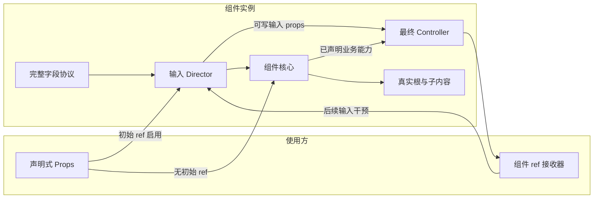

# 组件 Props 与 Controller 状态

Props 是组件的声明入口，负责初始界面与持续变化的来源。Controller 提供实例的业务操作，`.props` 提供特殊场景下的输入干预；初始化仍通过 Props 表达。

## 按目的聚合组件定义

所有公开 Kit 组件先声明 Props、字段协议与 Controller，再让实现满足声明。公开类型不从组件实现反推。

| 负责位置                  | 聚合内容                                                                                 |
| ------------------------- | ---------------------------------------------------------------------------------------- |
| `Component.prop.ts`       | 主体命名的 Props、PropDefinition 类型与值、Controller 声明，以及候选事实和紧邻的派生类型 |
| `Component.style.ts`      | 本组件的 StyleConfig 类型、箭头解释函数、Token 与样式规则                                |
| `Component.tsx`           | 组件装配、内容渲染，以及实际业务 Controller 的创建与交付                                 |
| `components/tools/kit.ts` | 公共输入、字段协议、组件创建与实例装配；KitOptions 紧邻 kit，不按类型与实现拆开          |

`KitProps<{ $styleConfig: Config; controller: Controller; domTag: Tag }>` 聚合 Piv 节点声明、组件用途说明、样式输入与组件 ref；domTag 缺省为 div。`children` 保留为统一公共输入及控制字段；当前组件使用业务值产生内容，不意味着公共协议需要删除这个入口，也不要求组件额外创建另一套内容回落。Article、Heading 与 Text 的固定根语义仍由各自声明表达。确有字段形状差异时，先核对共同模型，再处理必要的语义覆盖，避免按每个当前消费者分割公共协议。

Kit 的信息整合类型统一接收具名配置对象。`KitProps` 的 $styleConfig、controller、domTag 及整个配置对象均可省略；缺省分别为无具体字段的样式配置、通用输入控制形状和 div。组件需要精确 ref 时仍显式填写自己的 controller。其他聚合类型沿各自契约声明 props、propDefinition、controller 或 styleTokens，详见[信息整合类泛型的设计准则](信息整合类泛型的设计准则.md)。

所有 Kit 组件统一使用 `$styleConfig` 选择样式契约，公共字段表提供同一个读取入口。

`KitPropDefinition<OwnDefinition>` 只接收自有字段模式，并在内部覆盖同名公共模式。公开 `kitPropDefinition` 完整组合各字段拥有者的定义；私有 `kitCommonPropDefinition` 只拥有 ref 与 $styleConfig。组件无自有字段时，Props 和自有模式仍保留明确的空槽。

以 Flow 的现役声明为例，以下内容分别归对应文件：

```tsx
// Flow.prop.ts
export const componentName = 'Flow'

export type FlowProps = KitProps<{
  $styleConfig: FlowStyleConfig
  controller: FlowController
}> & {
  // 自有输入
}
export type FlowPropDefinition = KitPropDefinition<{}>
export const flowPropDefinition: FlowPropDefinition = {
  ...kitPropDefinition,
}
export interface FlowController extends KitController<{
  props: FlowProps
  propDefinition: FlowPropDefinition
}> {}

// Flow.tsx
export const Flow: KitComponent<{
  props: FlowProps
  controller: FlowController
}> = kit(
  {
    name: componentName,
    componentDescription: '组织内容方向',
    propDefinition: flowPropDefinition,
    $styleConfig: flowStyleConfig,
  },
  (props, { name }) => (
    <Piv shadowProps={props} class={name}>
      {props.children}
    </Piv>
  ),
)
```

`KitComponent<{ props: Props; controller: Controller }>` 为核心参数提供上下文，核心不再标注 props 或 Context 的类型。kit 检查完整字段表、读取后的输入、生成的 Controller 与 ref 接收协议；处理函数不参与公开契约的推导。无具体配置字段的组件使用 `KitProps<{ controller: Controller }>`，仍保留对象配置及其 Source 输入，允许 `{}` 和 `undefined` 清空，不接受原始字符串等值。根解释集合可以省略，也可以显式声明 `{}`。

每个组件的 `componentName` 统一定义在自身 `.prop.ts` 的元数据位置，组件实现与自有根样式引用同一身份。它不从包根汇总为同名出口，子部件和 Token 的独立名称保持各自含义。

## 创建时决定是否启用输入控制

只有创建时提供有效组件 ref，才在上游 Props 和核心之间启用 Component Props Director。未提供 ref、ref 为 undefined、只有 domRef 时，核心直接消费输入，不建立控制层字段 State，也不登记受控实例。之后添加 ref 不会补建控制层。



kit 负责同一个 Controller 的组装、登记、ref 换接和透明 ComponentIdentityMarker；Piv/Dode 负责真实节点及原生声明的消费。样式和组件用途说明通过根声明上下文传递，在真实根处消费后停止向子内容传递，不增加容器 DOM。

受控模式在实例存活期间保持不变。替换 ref 会向新接收器交付同一个 Controller，移除 ref 不注销实例，卸载才退出 `.controllers` 集合。组件 ref 与原生 domRef 各自独立。

## 字段协议决定读取与控制入口

可干预字段在 `Controller.props` 下按原名提供可写 State。原生字段由 Dode 声明，来源与节点能力由 Piv 组合，用途说明由 ComponentIdentityMarker 提供，组件只补充自有字段及确有不同语义的覆盖。

| 读取模式            | 核心取得的内容                                       | Controller.props |
| ------------------- | ---------------------------------------------------- | ---------------- |
| `state-source-view` | 与 Controller 共用的 State，交给实际消费者读取       | 可写 State       |
| `state-value-view`  | 当前值，本次读取参与响应依赖收集                     | 可写 State       |
| `state-untracked`   | 当前值，不收集本次外层响应依赖；再次读取仍取得当时值 | 可写 State       |
| `only-through-prop` | 上游原声明，不解包、不缓存                           | 不公开该字段     |

字段 State 与默认来源工厂归 Director 创建时的实例作用域。配置了默认来源的未声明字段在构建时连接来源，其余可干预字段首次读取时才建立并缓存 State；读取一个字段不会预读其他字段。

输入视图保留上游声明的存在性。显式 undefined 仍是已声明输入，不调用默认工厂；指令写入不改上游对象，也不动态制造声明。默认工厂交付稳定 Source，实际值由最终消费点读取。字段 State 同时供核心与 Controller 使用，不用 Effect 复制一份值。

组件核心只执行一次，输入干预不重放创建动作。原生 `as` 与 Text 的 block/p/emphasis、Heading 的 level 在创建时选择根标签；Piv 的 if 在字段存在时启用显隐，首次显示创建一次，之后保留同一元素。Loop.children 与 Field.children 是构建工厂，只通过 Props 提供，不进入 Controller.props。Loop.each 保留列表来源，由精确实例 ref 控制；Table.keys 按当前值决定显式列或默认字段列。

字段身份沿用 Piv 的 ID 值域与 `String` 规范。`createFormFieldBinding` 在 FormField 领域统一生成持续读取的身份来源，并把其余公共声明交给根元素；显式身份优先于字段上下文，ID 只路由给实际控件一次。FormField 和自带 Label 的 Checkbox 在需要关联时生成缺省身份；独立原生控件没有身份输入时保持无 ID。FormField 上下文传递身份 Source，标题与控件共同跟随更新。

## 业务能力与输入控制组合

组件先声明最终 Controller 的业务成员，再在核心内通过 `exposeController` 提供实际对象。kit 在 render 返回后补上 `.props` 并交给 ref。没有业务成员时无需交付空对象，框架不推断或补造业务能力。

Button 的状态能力、Input 的有效性能力继续由各自解析器拥有。`.props` 干预输入，顶层能力表达组件自己的状态和操作，两者按既有来源关系连接，不按同名自动关联。Input 的 invalid 输入与 validIf 仍经过有效性规则产生最终状态。

Button、Board、Card 的互斥分类由同一份 `as const` 候选事实定义。kit 依据 `variantGroups` 准备缺省分组来源与候选省略；组件只解析一次当前分类和节点效果，不再注入 Director 准备函数。显式分组包括 undefined 时接管候选，原冲突诊断保留。

组件资源通过 Context.onCleanup 绑定当前实例，即使解构后在事件中调用也保留原 owner。Context.name 与 Marker 使用同一身份，不依赖祖先 KitContext 或 App 根。

## 样式配置与原生样式

编写组件调用时，优先使用组件已声明的 shortcut，能直观表达意图就用最短写法。例如纵排直接写 `$col`，不必写 `$direction="column"`，更不必包进 `$styleConfig`。没有合适的 shortcut 时，再使用 `$gap`、`$columns` 等直接样式属性；只有直接属性无法满足整组动态配置或统一覆盖需求时，才使用 `$styleConfig` 逃生舱。

```tsx
<Flow $col>纵排内容</Flow>
<Flow $col $gap="2rem">带间距的纵排内容</Flow>
<Grid $columns={3} $responsive={false}>内容</Grid>
```

StyleConfig 类型由组件样式文件独立声明，平铺定义以 `satisfies StyleConfig<Config>` 校验：实际字段使用函数效果，布尔快捷可使用对象映射。kit 从 Props 的显式配置契约取得值域，支持整体和字段 Source；处理函数的参数不反过来定义应用 API。

同一配置可以由多个真实消费作用域解释。kit 定义中的 `$styleConfig` 是根作用域使用的字段子集；单元格等内部作用域各自用完整的 `StyleConfig<ScopeConfig>` 声明自己的字段解释。公共配置形状保持一处，不要求根元素接管内部节点的全部配置。

解释函数通过 `Token.set` 提交当前实例的 CSS 标量覆盖。Piv 应用和清理覆盖，共享 Token 默认值不变；省略字段沿用默认效果，清空配置撤销此前覆盖。`$styleConfig` 对象字段与直接属性同名，保留 `$` 前缀。Grid 的配置模板与响应布局分别由 Token 表达，动态模板更新不会压过窄屏退列。

Table 的紧凑模式和列宽配置共同位于 `TableStyleConfig`。根作用域解释紧凑模式，表头和单元格按当前列读取同一配置中的宽度、最小宽度，在自身样式作用域中解释，不把每列 CSS 的单位转换放进组件装配。

Flow 默认横排，通常不必写 `$row`；需要明确覆盖方向时再使用。`$row`、`$col` 是布尔快捷，false 或 undefined 不启用快捷。推荐顺序与冲突优先级是两件事：日常调用优先写 shortcut；多个写法同时存在时，显式 `$styleConfig` 来源高于直接 `$direction`，直接 `$direction` 高于直接快捷。同来源内主字段优先，同来源多个快捷按输入出现顺序后者胜出。下面仅说明冲突结果：

```tsx
<Flow $col $direction="row">横排内容</Flow>
<Flow $direction="row" $styleConfig={{ $col: true }}>纵排内容</Flow>
```

快捷直接写在同一份定义中：`$row: { $direction: 'row' }`、`$col: { $direction: 'column' }`，`$direction` 仍是原来的函数效果。对象只能指向字符串值字段，值沿目标字段的原契约校验；不能形成快捷链或从枚举自动生成。

独立 Utils 直接解释该定义与当前配置，先为每个目标选唯一有效值，再按定义中的函数顺序应用一次。组件不用调用工厂、展开另一张解释表或重复判断优先级，普通函数仍只接收本次选中的值。

聚合结果保留非枚举的来源和输入顺序信息，字段和值保持原样。工具从当前有效值中选出唯一胜者，只应用一次效果；显式主字段 undefined 清空该组且不调用效果，直接主字段 undefined 可回落快捷。Controller 替换为普通配置对象时按该对象自身的一层输入解释，不回读原 props。

原生 `style` 由 Piv 继承，是不推荐使用的底层逃生舱；Kit 不重复定义另一套 CSS style 类型。常规使用依靠组件默认样式与语义配置，实际节点声明沿 `shadowProps` 到达同一真实根。

## 泛型调用与实例集合

Board、Card、Loop、Table 的公开泛型协议在各自 .prop.ts 中先行声明，具体 ref 保留 Tag、条目或 Row/ColumnKey 的精确关联。运行装配只连接一次 TypeScript 包装后的调用形状，不增加运行转发层。

`.controllers` 可同时包含不同类型的实例，因此只提供安全共同字段；以下字段留给精确实例 ref：

| 组件集合     | 由精确实例 ref 操作的字段                         |
| ------------ | ------------------------------------------------- |
| Board / Card | as、htmlProps、on、domRef、shadowProps、is        |
| Loop         | each                                              |
| Table        | data、keys、renderParts、cellTitle、cellIntensity |

这是公开集合类型的边界，不增加运行过滤或第二份状态。Card 复用 Board 的承载字段与渲染行为，但两者各有 Marker 和实例集合。Article 固定 article 根，正文与 Card 容器分别拥有自己的实例；组合方向由信息含义决定，见[组件嵌套](组件嵌套.md)。

Popover 等 Plugin 通过能力结果的 controller 使用，不接入组件 `.props`。实际 Button、Card 或其他节点仍拥有组件身份与样式，Plugin 只负责其功能与 DOM 绑定生命周期。

## 正常使用与特殊干预

日常界面与初始状态用 Props 声明。回调或生命周期中的特殊需要可通过实例 Controller 操作，例如 `button.props?.loading.set(true)`；集合输入干预使用 `Button.controllers.props.loading.set(true)`。按钮自身状态能力使用 `button.setStatus?.('loading', true)`，不回写一份镜像输入。

函数输入按字段协议读取，不因读取而调用。通过 State 替换函数时，使用 `field.set(() => nextCallback)` 保留原可写计算协议。ref 固定为 only-through-prop，不公开 `controller.props.ref`。输入来源与指令的关系遵循原生 State，不增加拒写、权限或优先级系统。

公开组件只保留这一套声明方式，不提供 PropsOf、ControllerOf、自动输入补全、旧 Inputs 或 directorOptions 适配。具体机制见 [kit](../../src/components/tools/kit.ts)、[输入 Director](../../src/components/tools/componentPropsDirector.ts) 与 [Piv SPEC](../../src/components/Piv/SPEC.md)。
