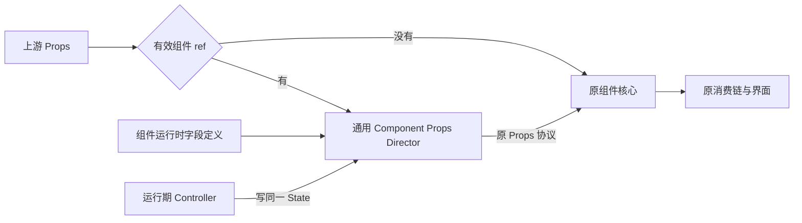

# 组件 Props 与 Controller 状态

Props 是组件构建和日常使用的声明入口，也保留已有 Source 的响应能力。Controller 是运行期特殊需要下的指令式入口，不能用于替代 Props 初始化。

## 可选的通用 Component Props Director

只有创建时注入有效组件 ref，才在上游 Props 和原核心之间启用通用 Component Props Director。未注入组件 ref、ref 实际为 undefined、只有 domRef 时，直接执行原核心，不分配控制层字段 State，不登记可控实例。创建后再改变 ref 不会给普通分支补建控制层。

层能力是通用的，Button 先接入，未来 Text/Card 可复用。支持字段必须有运行时 JS 定义，不能只依赖 TypeScript 或某实例的 Object.keys。各字段拥有者在相邻Owner.prop.ts定义自己的描述与默认入口，类型接口留在原模块，组件按Props继承关系组合，另定义自身业务规则；通用层不认识具体组件、状态、分类、ref 或 DOM。

## 同一字段与原 Props 协议

启用后，可干预Prop按原名提供可写State；only-through-prop字段直接读取上游，不创建State、不进入Controller。可干预字段首次被Props或Controller读取时才实际建立并缓存。Controller 读写的就是 Props 层同一 State，不复制字段值或用 Effect 镜像。Controller取得具体字段时只初始化该字段，不预读其它字段；工厂及State归Director创建时的组件作用域，不归首次读取的短命分支。

输出按原字段协议区分：state-source-view交出同一State，由原消费者val；state-value-view读取当前值并正常追踪；state-untracked读取当前值但取消本次外层依赖追踪，不缓存。only-through-prop直接转交上游Prop，不经过可写State。原核心继续消费 Props，不要求逐项接入新 State，也不修改 Piv 或原分类解析来补偿控制层。

输入视图保留上游 raw 的声明存在性；输出形状由上游声明、不可变defaultSources工厂表及omit固定。原缺省字段首次建State时只调用工厂一次取得稳定Source；raw显式undefined优先，不调用默认工厂。输入从一开始即提供同一缓存State，没有先读raw后回填的阶段。指令写入只改变 State，不动态制造 Props 声明，不改上游对象。缺省字段若需初始化入口，必须由组件定义对接原消费者，不能只证明 Controller 值已经改变。

## Button 的业务准备

Button组合完整字段描述，只维护自身字段和分类/状态候选。DOM字段归Dode、公共快捷字段及其默认入口归能力领域、来源字段归Piv、说明字段归ComponentMarker；描述与类型extends层次一致，不改变运行算法。受控分支为loading/disabled提供默认入口；每个缺省group的工厂复用原VariantParser语义details，把同一候选States的结果作为初始Source。输出只省略原缺省group的候选；原已声明group保留候选，让原核心报告冲突并映射一次。Button构建时建立分组Source但不val，保持原诊断时机，来源随后实际消费。显式group包括undefined优先，运行期指令仍在同一数据流。

allButtons 只收集启用组件 ref 的实例，普通按钮不因全局访问器自动承担控制成本。组件外层管理 ref 接收器交付、替换清理及集合登记；业务核心处理原分类、状态和 JSX。

## 使用与生命周期

构建时必须用 Props 表达初始界面。只有回调、生命周期中的特殊需要，或 Props 表达非常迂回的复杂场景，才使用 Controller。字段沿 Prop 原名：`val(button.loading)` 读取，`button.loading?.set(true)` 写入，`allButtons.loading.set(true)` 操作当前受控集合；Button 不保留 setStatus/hasStatus 别名。

onClick以state-value-view读取函数，不因读取而执行；替换沿用原State协议 `field.set(() => nextCallback)`。ref为only-through-prop，只能通过上游Props提供，不公开controller.ref或ref.set，也不创建缓冲State。外部已声明字段仍可指令写入，来源重新计算与指令的关系遵循原生可写计算，不另建拒写、权限或优先级系统。

可干预字段有State，不等于所有创建动作运行期重放。as 首次创建固定；if 只在创建阶段决定是否启用 Show；已有条件值持续响应。domRef、插件与结构声明按原元素生命周期消费。组件ref仅按上游Prop由外层交付和清理，domRef 仍是独立真实元素入口，不触发 Component Props Director。

样式归原组件和 Token，控制层不复制样式材料或新增样式控制机制。具体接线及验收见[Button 实例与整体控制入口](../plans/261030_Button实例与整体控制入口.md)。Piv 的独立 as/if 来源契约见[Piv SPEC](../../src/components/Piv/SPEC.md)，不属于本层改造范围。
