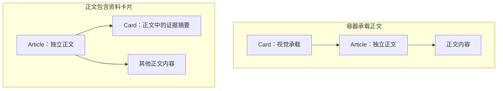

# 组件嵌套

组件嵌套应当能从外到内读成符合真实界面的关系。外层为什么包含内层，必须由这次界面中的承载、组织或内容组成关系解释；不能因为某个名称更显眼、实现更方便，或者类型与 DOM 能运行，就决定它应该放在外层。

## 先明确这次组合表达什么

先说明外层代表什么、内部对象扮演什么角色，再安排嵌套：

- 承载关系：外层提供容器，内层是被承载的内容。
- 组织关系：外层组织多个对象的位置或协作，内部对象保留自己的职责。
- 内容组成关系：内部对象是外层内容的一部分，而非服务整个外层的容器。

这些关系由具体界面决定，不是组件固定的内外顺序表。同一对组件可以表达不同关系；少见组合不等于非法，但调用处应当有足以支持其含义的真实内容。

## Card 承载独立正文

普通阅读卡片中，Card 是承载正文的视觉容器，Article 声明其中内容独立成篇：

```tsx
<Card>
  <Article>独立正文</Article>
</Card>
```

从外到内可以读成“卡片容器承载一篇正文”。背景、内边距、边框等皮肤属于 Card，正文身份及自身内容边界属于 Article。

## 正文包含一张内容卡片

如果一篇正文中包含资料摘要、证据或其他独立信息卡片，Card 就是正文的组成部分：

```tsx
<Article>
  这项结论的依据如下。
  <Card>正文中的证据摘要</Card>
  接着解释这些依据。
</Article>
```

这里可以读成“正文包含一张证据卡片”。该组合合法，适用于卡片确实属于正文内容的情况；它不表示 Card 在为整篇正文提供外层皮肤。



图中的两个方向分别表达不同界面含义，不是允许与禁止的对照。组件的样式与生命周期边界仍分别保留；具体样式所有权见 [组件职责与样式归属](组件职责与样式归属.md)，当前语义组件见 [语义组件](语义组件.md)。
