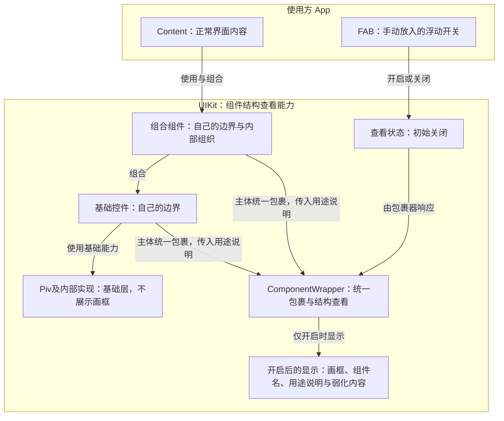

当前模式名为“组件定位框”：让使用者暂时淡去界面内容，看清组件的边界、用途和组织关系，用于研究布局与组件组合是否合理。本文路径与代码API名称保留，不表示另有一种查看模式；更高阶的“职能显现”暂不实施。

状态：已实现，并通过真实Dev及浏览器测试验收。本篇规定概念、接入方式和显示边界；实施与验证见[实现Plan](../plans/2026-10-24-组件结构查看.md)。

# 能力与开关

结构查看是组件具备的能力，FAB只是开启、关闭它的操作入口。不能把“没有放入FAB”解释为组件没有这项能力，也不能把“放入FAB”解释为立即改变内容显示。

| App中的情况 | 开关入口 | 原内容的显示 |
| --- | --- | --- |
| 没有放入FAB | 没有开关 | 保持正常 |
| 已放入FAB，未开启 | 有开关，初始关闭 | 保持正常 |
| 已放入FAB，已开启 | 有开关，可关闭 | 组件画框显形，内容弱化或模糊 |

前两种情况下，原内容没有显示差别；差别仅在于是否存在FAB这个操作入口。默认关闭，只有主动开启才显示结构，关闭后恢复正常。

FAB是Floating Action Button，即浮动动作按钮，是Button的一种特殊形式。App手动加载它，让它浮在屏幕上、处于Content之外；UIKit不因被导入或使用就自动放入FAB。开启后FAB自身仍清晰可见，能够用于关闭。

# ComponentWrapper统一包裹

Piv之上的每个UI组件统一使用`ComponentWrapper`包裹自己的主体，并把使用处传入的用途说明交给它的`description`属性。组件定义也可以用`defaultDescription`提供默认用途。基础控件与组合组件采用同一方式，不各自实现一套结构查看逻辑。

自定义组件在定义处包裹原主体；身份只定义一次，组件原有属性与行为仍由原组件负责：

```tsx
<ComponentWrapper
  componentName="ConfirmButton"
  description={props.description}
  descriptionDisplay={props.descriptionDisplay}
  defaultDescription="执行操作"
>
  <Piv>{props.children}</Piv>
</ComponentWrapper>
```

`ComponentWrapper`接收用途说明、承接真实组件边界，并响应FAB控制的查看状态，统一处理画框、标注、四种区分色与内容弱化。普通组件只接入包裹器，不重复监听FAB或维护查看开关；FAB是控制入口，不为每种组件分别发出命令。

包裹的是代码中的组件边界，不要求额外生成一个包围内容的DOM元素。不能为了接入而改变原组件的布局、原生元素关系或事件行为；多根节点等边界如何承接留给实施设计，不能用随意加一层div代替。

Piv及其内部实现不接入这个包裹器。`ComponentWrapper`自身是提供包裹能力的基础设施，不递归包裹自己，也不作为一个额外的组件画框；显示的身份仍是被包裹的组件，而不是ComponentWrapper。

用途说明有两个输入：`description`表达使用处的具体用途，`defaultDescription`表达组件定义提供的默认用途。共同优先级由Wrapper处理：外部已提供说明就采用外部说明，没有提供才回落默认值；不能由每个组件另写一套选择规则。以后确有新的共同能力时再扩展，不预先添加没有用途的属性。

# 组件层级与覆盖范围

从底向上分为三层：

| 层级 | 对象 | 结构查看中的身份 |
| --- | --- | --- |
| 基础层 | Piv及其内部实现 | 不作为待展示的组件画框 |
| 基础控件层 | Button、Input、Selector等 | 具有组件身份、用途说明及可视边界 |
| 组合组件层 | Database、MetricGroup等 | 具有自己的边界，并保留内部组件的组织关系 |

这项能力适用于Piv之上的所有UI组件，不限于某个项目或页面。UIKit现有Button、Input、Text、Heading、Card、Article、Table、Popover、Each已接入；使用项目自己的组合组件仍需在定义处接入Wrapper，不能仅靠导入UIKit自动识别。App承接组件组合与手动放置开关，不要求为不同项目另写一套查看规则。

组件、包裹器与开关的关系如下：



组件边界不等于HTML标签边界。一个组件内部使用多个元素，不意味着每个元素都要单独画框；Piv可以承接底层实现，但不因此成为结构视图中展示的盒子。

# 组件身份与用途说明

## descriptionDisplay

组件接受可选布尔属性`descriptionDisplay`，控制它在定位框模式中是否出现，而不是只控制说明文字。普通模式不受影响。

| 设置 | 开启定位框后的显示 |
| --- | --- |
| `descriptionDisplay={false}` | 本体完全透明，不显示自己的定位框和说明，仍占据原布局位置 |
| `descriptionDisplay={true}` | 显示定位框和说明；没有说明时显示组件名，内容按原模式弱化 |
| 未指定 | 普通组件及Heading为true；Text仅在外部description有内容时为true |

Text的默认值依据说明Source实际取得的内容，而不是把Source对象本身当作true；空字符串或没有说明时为false。显式值优先，例如`<Text descriptionDisplay>`即使没有说明，也会显示Text定位框。定义端通过Wrapper的`defaultDescriptionDisplay`提供默认值，其它组件不必填写。

false时保留组件节点、占位、交互协议和Source更新，父组件中的后代框也不再出现。元素根用模式专属属性令opacity为0，不快照或回写原opacity；退出或卸载开关后，移除标记即可呈现最新样式。对无元素外壳的裸文字根，使用[CSS Custom Highlight](https://drafts.csswg.org/css-highlight-api-1/)的透明文字颜色取得相同视觉结果，不增加包装元素、不修改文字数据；这不是给Text节点设置opacity。范围与清理统一归UIKit，使用项目只转交属性。

## Text与Heading

Text承载普通文字，Heading承载标题层级；两者都只接受纯文字，不承载按钮等交互组件。在定位框模式中，原文字视觉置空；仅当descriptionDisplay为true时显示定位框与标注。有description时直接显示简短说明，如“标题”“描述”，不加组件名前缀；允许显示但没有说明时，分别回落`Text`、`Heading`。说明来源的优先级仍由Wrapper统一处理。

置空不删除文字数据或DOM节点：原文字继续参与排版和Source更新，因此定位框不会因文字消失而塌陷，关闭后恢复最新文字，不是开启前的旧快照。它不扩展为通用的内容替换或职能显现模式，也不改变Button内部文字的处理。

从包根导入`Text`和`Heading`。`children`接受字符串、数字或对应Source，按文字职能选择组件，而不是把所有HTML标签交给Text的as属性。

| 写法 | 原生语义 |
| --- | --- |
| `<Text>` | span，普通行内文字 |
| `<Text block>` | div，块级普通文字 |
| `<Text p>` | p，段落 |
| `<Heading level={2}>` | h2，二级标题；level必填，可选1～6 |

Text的block与p不能同时传入，类型会拒绝双传；单个属性为false时仍使用span。两种组件均不公开as。Heading直接承载原生标题，不嵌套Text产生第二重组件身份，也不把字号当作标题级别。它们各自的.style.ts通过Style System响应同一个定位框开关，不维护新的显示状态。

## 共同标注

除Text与Heading按前述规则只显示用途外，画框内部左上角显示“组件名 · 用途说明”，不是悬在框上方。两部分回答不同问题：组件名说明这是什么盒子，`description`说明这次使用它承载什么信息。标注文字自身没有边框或背景，组件定位框仍保留。

- 组件名由组件定义提供，不要求使用处重复填写，也不依赖项目专用class名称猜测。
- `description`称为“用途说明”，由使用处说明当前用途；例如“这段回放的策略收益率”，不是当前的收益数字。
- 使用处的`description`优先于定义处的`defaultDescription`；两者都没有时只显示组件名，不编造说明。用途覆盖不改变组件原来的可见标题、文案或功能。
- 用途说明不替换正常界面的标题、标签或值，也不等同于原生HTML的title或alt。

例如，正常界面的Metric显示“收益率”和具体数值；开启结构查看后，它的框可以显示“Metric · 这段回放的策略收益率”，原有标题和数值被弱化。Metric外面的MetricGroup也有自己的框，使使用者能够分辨单项指标与指标组织。

# 画框与内容的显示约定

画框采用Outlined式描边，不挤占内容空间。组件名、用途说明和边界保持清晰，盒子里的文字、数值、图片与图表内容则弱化或模糊。Canvas保留原尺寸及边界，不要求UIKit理解画布中的业务曲线。

标注的宽高受所属画框约束：文字可以在框内换行，但不能超出框自身。不能按文字长度撑大标注，也不能为了避让其它标注而移到框上方或框外；原组件的框与布局不能为容纳说明而改变。

只使用四种低饱和、偏冷灰的区分色。灰蓝、灰青、灰紫和冷灰是配色方向，具体色值尚未冻结。颜色仅帮助区分彼此，不表示组件类型、层级、成绩或状态；相邻、嵌套的框优先错色，同一组件在本次查看期间保持颜色稳定。

低饱和不等于难以辨认：描边可以轻，组件名和用途说明仍须易读。标注不能随着内容一起模糊；也不能只把整个父组件设成半透明，让内部的边框和名称同时失去清晰度。

切换只改变查看方式，不清空数据、不重建组件，也不改变真实布局、宽高、间距、换行、滚动位置和已有控件状态。不以空数据页、固定尺寸占位块或加载骨架代替当前界面的真实结构。

由“只改变查看方式”推导的业务边界是：切换本身不重新请求业务数据或发出业务命令，不干预页面原有的数据更新。

# 本设计的边界

本能力用于查看现有组件组合，不增加属性编辑、拖拽改布局、业务诊断、评分、数据查询或其他项目专用功能。FAB手动接入不授权改写App的启动框架；也不把查看能力做成每个项目各自维护的页面功能。

当前系统关系见[Architecture](../../Architecture.md)。公开能力为`ComponentWrapper`、`ComponentDescriptionProps`、`ComponentWrapperProps`及`StructureViewFab`。

# 使用入口

使用方从包根导入组件，在App的Content之外手动放入开关。普通组件只需传具体用途，不需要再次传组件名：

```tsx
import { Button, StructureViewFab } from '@edsolater/uikit'

<>
  <Button description="确认当前选择">确认</Button>
  <StructureViewFab />
</>
```

`description`和`defaultDescription`接受现有`Source`输入，可随使用处更新。未定义外部说明时采用默认值；显式空字符串只显示组件名。结构查看不会改变正常按钮文案。

用途已明确的示例不必为展示该属性而填写description；当前Button示例的按钮使用默认说明，仍接受外部description。Text的区域较多、各有不同职能，因此该示例分别提供简短用途，帮助区分标题、描述、表格列与行、尺寸分组。

在UIKit仓库运行`bun run dev`，打开`/examples/button`。页面右下角显示“打开组件定位框”，点击开启后显示“关闭组件定位框”，再次点击恢复。外部关联项目从包的`dist`读取能力，更新UIKit后需执行`bun run build`。
