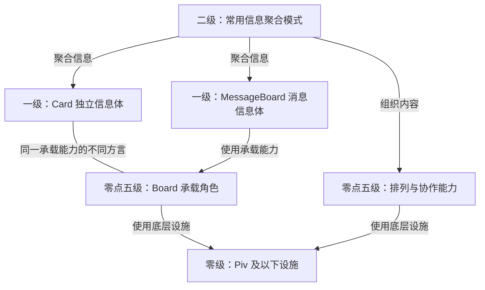
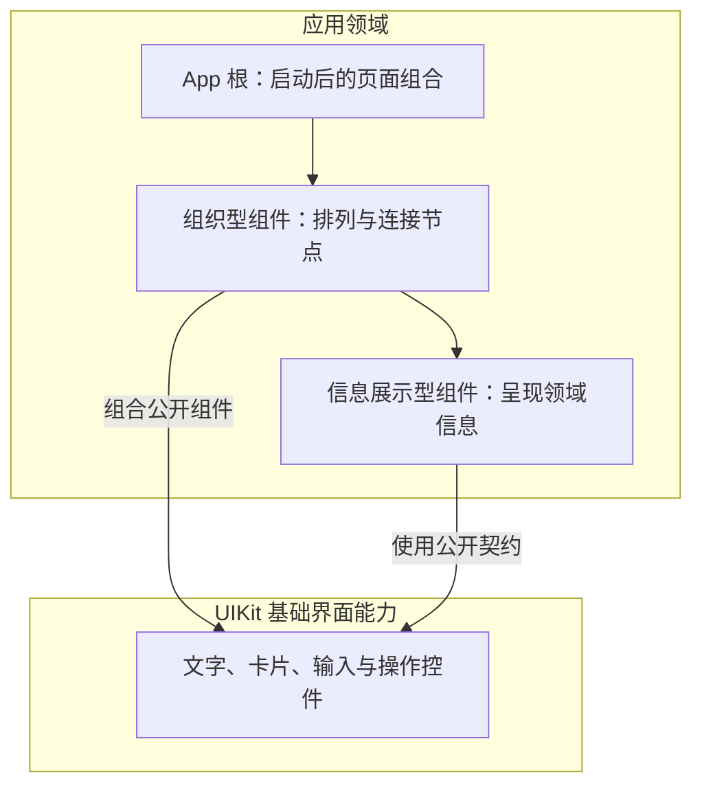

先确定内容属于哪个领域，再决定文件、目录和样式落点。文件名不是收纳标签；进入文件后，内容必须兑现名称所表达的职责。本篇说明 UIKit 与应用组件的归属，不替代共享领域规则。

# 先确定领域，再创建文件

依据 [领域边界](D:/mycode/ai-rules/rules/Code-领域边界.md)、[文件与目录](D:/mycode/ai-rules/rules/Code-文件与目录.md) 与 [领域目录与分组目录](D:/mycode/ai-rules/rules/Code-领域目录与分组目录.md)，创建或移动内容前先回答：它完成什么问题，由谁定义规则和生命周期，通过什么公开结果被使用，哪个文件准确描述这项责任。

一个文件只实现一个母体领域。共同使用某个 API、都与生命周期有关、放在一起容易导出，都不足以证明归属相同。也不能为方便容纳新内容，把现有文件的职责说明扩大成杂项集合。

例如 `createEffect.ts` 表达响应式副作用；`createRoot` 建立响应式根作用域，不是创建副作用。本项目将其公开接入放在 `foundation/render.ts`，由该文件承接渲染与根作用域接入。业务使用 UIKit 公开出口，不因此取得基础能力的定义权。此例不意味着把所有生命周期函数机械搬到 render。

`components/` 可以只是 App 内组件的查找分组，不因建立目录就产生新领域，也不因此需要聚合 `index.ts`。请求会话、文件解析等非界面职责不放进去。

# 业务组合与基础实现的边界

以下边界引自 [Data Viewer 项目硬边界／UIKit 与渲染边界](D:/mycode/data-viewer/doc/项目硬边界.md#uikit-与渲染边界)，按本次用户要求用于组件写法；不引入该项目的数据表业务范围或临时目录结构。

> 业务页面和业务组件只组合组件，不写原生 HTML、Piv、CSS、class 或 style；App 全局背景是样式例外。

基础组件内部 DOM 统一由 `Piv as` 创建，通过 `htmlProps` 表达原生属性、`on` 表达事件，保留原生语义与响应式。不得为每个 HTML 标签增加一层无独立职责的别名组件。

Props、组件内部消费与 Controller 共用可写 State 的设计约定见[组件 Props 与 Controller 状态](组件Props与Controller状态.md)。该文负责公开入口与状态事实的关系，并区分已确认设计和当前实现；样式所有权仍按本文边界判断。

因此，业务标题使用 Heading，正文使用 Text，操作使用 Button，输入使用 Input；先核对现有契约，再补确有缺口的基础能力。业务里把 `div` 机械换成 `Piv as="div"`，仍然越过了这条边界。

# 零级、零点五级、一级与二级组件

嵌套关系由实际界面的承载、组织或内容组成关系决定，不给组件制定固定内外顺序，见 [组件嵌套](组件嵌套.md)。语义组件按内容身份分组，默认不提供容器皮肤，当前列表仅 Article，见 [语义组件](语义组件.md)。普通阅读卡片写成 `<Card><Article>正文</Article></Card>`；正文内的资料卡片也可以放在 Article 内。两者保留独立边界，不使用载体选择或 Card 内容模式。

| 层级 | 定义与职责 | 例子 |
| --- | --- | --- |
| 零级 | Piv 及其以下的实现设施 | Piv 与内部 DOM 实现 |
| 零点五级 | 不独立承载信息，提供组织、排列、承载或协作能力，可被一级与二级使用 | Board、Flow、Grid、Loop、KitMarker |
| 一级 | 一个完整的信息体，按信息意义已不可再细分；内部可以有多个节点或依赖 | Card、MessageBoard |
| 二级 | 将一级信息体聚合为有整体意义的常用模式 | Page 组织页面信息与动作 |

层级表达意义与使用角色，不按 import 数量、DOM 数量或文件深度计算。多个内部节点不代表多个独立信息体，依赖其他组件也不自动成为二级；将组件堆在一起同样不能证明形成了二级模式。不是信息载体的组件归零点五级，不因有可见边框、容器或操作结果而变成一级。

Card 与 Board 是同一承载能力的两种方言：独立表达一个信息体时叫 Card，属于一级；作为其他信息体的底层承载时叫 Board，属于零点五级。Board 不独立作为信息单元出现，而由 MessageBoard 等组件使用。两种身份共享承载实现与样式，不复制材质，也不为改名增加无意义的 DOM 或嵌套身份。

二级模式内部具有完整意义的信息体应当单独定义；先查已有组件，不因一个内部 HTML 标签就新建组件。排列、连接和传递能力保留自己的零点五级身份，不能把多个独立信息体压进一个样式文件后称为一级。

样式所有权不由等级决定；UIKit 每个组件部分一次 `rules()` 与 Token 要求由 [样式文件写法](../style/样式文件写法.md#每个组件部分登记一次样式) 统一维护。组件可有多个实际部分，不因此要求拆成多个组件。

# 每个界面组件都声明自己的边界

Piv 之上的 UIKit 界面组件必须在定义入口使用 `KitMarker` 包裹完整主体，包括零点五级基础能力、一级信息体、Page 等二级组合和已独立成立的内部组件。组合层不能因为子组件已有 Marker 而省略自己的边界；同一个入口也不重复登记身份。

Marker 不增加 DOM，不能为接入改写表单、表格、多根节点或 children 的原生关系。Piv 及其内部 DOM 实现、Marker 自身、结构查看控制器与显示设施保持基础自排除，不能递归包裹。具体接入与默认关闭行为见 [组件结构查看](组件结构查看.md#kitmarker统一标记)。

`description` 表达结构查看中的用途说明。可见内容使用准确的内容名称：Page 的副标题是 `subtitle`，Link 的内容是 `children`。调整接口时同步全部调用方，不把原可见文字静默转成调试标注，也不保留两套含义冲突的别名协议。

# 组织层不拥有子组件的样式

样式所有权沿实际组件边界判断，不只看样式文件是否与 TSX 相邻。父组件可以拥有自己根节点的布局；调用子组件时通过公开 Props 或 Token 表达需求，不能通过后代选择器、通配符或子组件私有 class/DOM 改写其字号、颜色、间距和交互状态。

## 基础组件的职责分界

| 主体 | 完整用途与边界 |
| --- | --- |
| Flow | 按方向顺序排列内容，允许指定自身宽度或在父布局中伸展；不负责分栏、导航语义和多个间距档位 |
| Grid | 按列数等宽分栏或按明确列模板排列；默认小屏单列，可显式保持指定列结构，不接管子项外观 |
| Field | 关联可见标题、辅助tooltip与一个控件，提供该实例稳定的字段 id；不拥有控件值 |
| Select / TextArea | 提供选择或多行编辑及原生表单行为；不再内置标题和字段组织外壳 |
| Checkbox | 一个带可点击标题的二态选项；checked 是选择事实，label 是内容，不为拆分而另造 Field 包装 |
| NavigationRegion | 一个有名称的导航区域；导航项由调用方组合，不重新解释业务目录数据 |
| Link | 导航到 href，内容由 children 提供；不强制入口卡片或副标题皮肤 |
| Board / Card | 共享承载能力，分别用于底层承载与独立信息体；不混入消息状态或业务流程 |
| Details | 保持原生 details / summary 的展开阅读语义，不强制内容皮肤与排版 |
| MessageBoard | 以 Board 承载一个消息反馈，定义消息状态与反馈语义，不接管其他内容布局 |
| Page | 组合可选标题、副标题、动作及正文；未提供标题区内容时直接保留正文，内部布局复用 Flow |

同类用途优先复用已有主体。新增中转层、配置袋或上下文不能代替职责分离；私有交互协作也不因回调数量多就必须转为 Context。UIKit 准入要检查名称、输入、结果及实际调用是否能说明完整用途，不能只检查能渲染、已包 Marker 或各部分只有一次 `rules()`。

Page 组合 Heading、Text、Flow：Heading 的文字样式由 Heading 定义；页面内部区域与动作排列通过 Flow 表达。Page 不得登记 `.Page .Heading` 一类覆盖子组件的规则。原 `.heading` 是 Page 自己的 header 容器，并非 Heading 组件；该内部布局现由 Flow 承接。一级组件自己的内部 DOM 仍由其完整职责解释，不能把一级内部节点与独立子组件混为一谈。

验收从父入口沿实际调用找到子组件定义，再核对样式选择器作用的节点。仅搜索 `.Heading` 不足以证明归属正确，类名不同也不证明没有越过组件边界。

# 组件的两种职责

先用 [UI 组件身份](D:/mycode/ai-rules/rules/Code-UI组件身份.md) 确认它是用户可以指出的完整界面节点，再判断它承担的职责。以下描述用途，上面的等级描述信息意义与使用角色；不能从“使用了其他组件”直接推导等级。

| 职责 | 它决定什么 | 样式边界 |
| --- | --- | --- |
| 组织型组件 | 子节点的组合、数据与动作连接、选择关系，以及空间排列 | 业务通过布局组件的公开参数表达排列；基础布局组件拥有实际布局样式，不定义子节点的外观与交互状态 |
| 信息展示型组件 | 一个明确对象如何被读懂，例如模块输入输出关系、检查结论与依据 | 业务组合 UIKit 或已确认的页面基础组件；独特展示所需的 DOM 与样式归实现该展示能力的基础组件 |

组织型组件可以拥有自身布局或承载材质，但不因此拥有子节点的外观。信息展示型组件也不等于只读组件：它可以承接与该信息直接相关的选择、展开或提交动作，基础控件的行为和外观仍由 UIKit 承担。

例如模块审查区组织“模块选择”和“模块详情”的位置；模块详情解释当前模块的输入、输出和边界。组织层不应再定义内部按钮的 hover、focus、选中背景，详情层也不应重写通用按钮或输入框。

# UIKit 与应用的落点

按钮、输入、文字、标题、卡片等通用表达优先核对 UIKit 的实际出口与契约。通用能力缺口由 UIKit 所属主体解决；不能在每个业务组件中复制一套外观和交互。

Plan 模块连接、原文定位、核对依据等知识由应用拥有，不因使用 UIKit 而搬入 UIKit。没有独特展示需求时，直接组合现有组件，不额外建立专用样式。

应用自己的组件放在该 App 的 `components/`；App 根文件留在应用入口。根样式只服务根自身，不能通过后代选择器给子组件重新画外观。非组件领域文件按自身职责落位，不能统一装进 components。

公共 UIKit 暂不提供 Form。确有原生表单提交需要的项目，在自己的 UIKit 扩展层拥有对应基础组件，保留校验、回车提交与字段取值职责；业务页面仍只组合组件，不因此直接编写表单 DOM。

只有已经确认基础组件确实拥有必要样式时，才创建它的 `.style.ts`，写法见 [样式文件写法](../style/样式文件写法.md)。不存在“一份 TSX 必须配一份 style”的要求。业务组织层通过组件契约表达必要布局，不直接写布局样式；App 全局背景例外不能扩展为业务外观例外。

# Example 与截图

UIKit 的每个组件都必须有可运行的 Example，表达它完成什么、责任边界在哪里，以及调用方怎样使用它。公开组件在主体旁维护 `.example.tsx` 并登记到现有 `/examples` 目录；内部专属组件也必须在所属主体的 Example 中体现其职责与效果，不机械建立独立页面。Board 按其非独立身份，在 MessageBoard 等实际消费示例中体现，不单独建立信息单元展示页。

目录明确标识零级、零点五级、一级和二级。一级与二级展示信息体及聚合模式；零点五级展示组织或协作能力，不能与信息体混标。Loop、KitMarker 等仍保留可发现的示例，不能因它们不是信息载体而删除演示。

Example 用最少的真实场景展示必要输入、组件组合或动作，以及可观察的结果。交互组件必须能够操作；布局和展示组件必须能看出其组织关系或表达的信息。不能只放一个空组件，也不能只罗列 Props，让读者猜用途和用法。

组件实现负责能力，Example 负责使用示范，目录负责发现，截图负责预览；各自责任分离。Example 通过公开契约组合组件，不复制内部实现，不承载业务流程或改写子组件样式。每个场景只保留说明当前职责所需的内容与控制，不堆砌功能、包装或配置。

用现有缩略图命令从对应 Example 生成真实截图，须能辨认该组件用途，不得借用其他组件的图片。新增或修改组件时，同步维护示例、入口与截图；验收必须实际运行示例，核对用途、边界、用法和结果是否清楚，以及职责是否分离、内容是否精简、代码与样式是否干净。缺少 Example，或示例不能说明这些内容，组件不得通过验收。

# Plan 必须说明归属依据

涉及新文件或职责迁移时，Plan 应写明主体解决的问题、定义端、准确落点、允许包含的内容与不能混入的职责，并引用实际负责的领域规则。目录树只能表达位置，不能代替这些判断。

验收分别核对实际路径和实际职责。文件放进 components 不代表组件身份成立，创建了相邻 style 不代表样式归属正确；类型检查和页面可用也不能证明领域划分正确。

检查工具可以报告缺少归属声明、实际路径违反已声明约束等确定问题。内容是否符合领域仍需对照职责审查；审查未完成或发现跨域内容时，不能呈现已通过。不能把“路径合法”写成“领域正确”。
