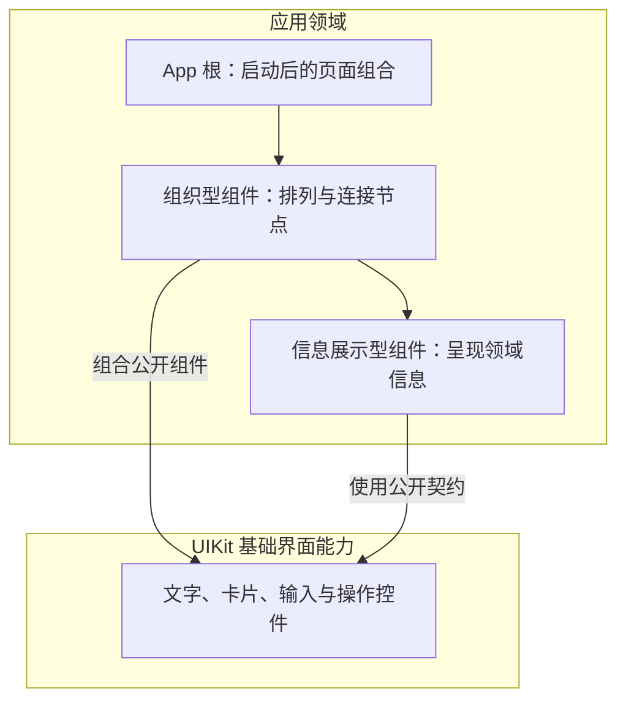

先确定内容属于哪个领域，再决定文件、目录和样式落点。文件名不是收纳标签；进入文件后，内容必须兑现名称所表达的职责。本篇说明 UIKit 与应用组件的归属，不替代共享领域规则。

# 先确定领域，再创建文件

依据 [领域边界](D:/mycode/ai-rules/rules/Code-领域边界.md)、[文件与目录](D:/mycode/ai-rules/rules/Code-文件与目录.md) 与 [领域目录与分组目录](D:/mycode/ai-rules/rules/Code-领域目录与分组目录.md)，创建或移动内容前先回答：它完成什么问题，由谁定义规则和生命周期，通过什么公开结果被使用，哪个文件准确描述这项责任。

一个文件只实现一个母体领域。共同使用某个 API、都与生命周期有关、放在一起容易导出，都不足以证明归属相同。也不能为方便容纳新内容，把现有文件的职责说明扩大成杂项集合。

例如 `createEffect.ts` 表达响应式副作用；`createRoot` 建立响应式根作用域，不是创建副作用。本项目将其公开接入放在 `foundation/render.ts`，由该文件承接渲染与根作用域接入。业务使用 UIKit 公开出口，不因此取得基础能力的定义权。此例不意味着把所有生命周期函数机械搬到 render。

`components/` 可以只是 App 内组件的查找分组，不因建立目录就产生新领域，也不因此需要聚合 `index.ts`。请求会话、文件解析等非界面职责不放进去。

# 业务组合与基础实现的边界

以下边界引自 [Data Viewer 项目硬边界／UIKit 与渲染边界](D:/mycode/data-viewer/doc/项目硬边界.md#uikit-与渲染边界)，按本次用户要求用于组件写法；不引入该项目的数据表业务范围或临时目录结构。

> 业务页面和业务组件只组合组件，不写原生 HTML、Piv、CSS、class 或 style；App 全局背景是样式例外。

基础组件内部 DOM 统一由 `Piv as` 创建，通过 `htmlProps` 表达原生属性、`on` 表达事件，保留原生语义与响应式。不得为每个 HTML 标签增加一层无独立职责的别名组件。

因此，业务标题使用 Heading，正文使用 Text，操作使用 Button，输入使用 Input；先核对现有契约，再补确有缺口的基础能力。业务里把 `div` 机械换成 `Piv as="div"`，仍然越过了这条边界。

# 组件的两种职责

先用 [UI 组件身份](D:/mycode/ai-rules/rules/Code-UI组件身份.md) 确认它是用户可以指出的完整界面节点，再判断它承担的职责。以下是职责区分，不是要求为每段 JSX 增加一种组件类型。

| 职责 | 它决定什么 | 样式边界 |
| --- | --- | --- |
| 组织型组件 | 子节点的组合、数据与动作连接、选择关系，以及空间排列 | 业务通过布局组件的公开参数表达排列；基础布局组件拥有实际布局样式，不定义子节点的外观与交互状态 |
| 信息展示型组件 | 一个明确对象如何被读懂，例如模块输入输出关系、检查结论与依据 | 业务组合 UIKit 或已确认的页面基础组件；独特展示所需的 DOM 与样式归实现该展示能力的基础组件 |

组织型组件也是组件，但不是一套独立视觉皮肤。信息展示型组件也不等于只读组件：它可以承接与该信息直接相关的选择、展开或提交动作，基础控件的行为和外观仍由 UIKit 承担。

例如模块审查区组织“模块选择”和“模块详情”的位置；模块详情解释当前模块的输入、输出和边界。组织层不应再定义内部按钮的 hover、focus、选中背景，详情层也不应重写通用按钮或输入框。

# UIKit 与应用的落点

按钮、输入、文字、标题、卡片等通用表达优先核对 UIKit 的实际出口与契约。通用能力缺口由 UIKit 所属主体解决；不能在每个业务组件中复制一套外观和交互。

Plan 模块连接、原文定位、核对依据等知识由应用拥有，不因使用 UIKit 而搬入 UIKit。没有独特展示需求时，直接组合现有组件，不额外建立专用样式。

应用自己的组件放在该 App 的 `components/`；App 根文件留在应用入口。根样式只服务根自身，不能通过后代选择器给子组件重新画外观。非组件领域文件按自身职责落位，不能统一装进 components。

只有已经确认基础组件确实拥有必要样式时，才创建它的 `.style.ts`，写法见 [样式文件写法](../style/样式文件写法.md)。不存在“一份 TSX 必须配一份 style”的要求。业务组织层通过组件契约表达必要布局，不直接写布局样式；App 全局背景例外不能扩展为业务外观例外。

# Plan 必须说明归属依据

涉及新文件或职责迁移时，Plan 应写明主体解决的问题、定义端、准确落点、允许包含的内容与不能混入的职责，并引用实际负责的领域规则。目录树只能表达位置，不能代替这些判断。

验收分别核对实际路径和实际职责。文件放进 components 不代表组件身份成立，创建了相邻 style 不代表样式归属正确；类型检查和页面可用也不能证明领域划分正确。

检查工具可以报告缺少归属声明、实际路径违反已声明约束等确定问题。内容是否符合领域仍需对照职责审查；审查未完成或发现跨域内容时，不能呈现已通过。不能把“路径合法”写成“领域正确”。
