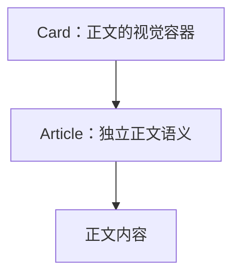

# 语义组件

语义组件声明内容的身份，并提供该身份必要的原生语义和内容边界。它们默认不提供背景、内边距、边框、圆角或阴影等容器皮肤；需要视觉容器时，显式组合 Card 等组件。

## 当前列表

| 组件                                                         | 内容身份                                     | 原生根    | 默认内容规则                           |
| ------------------------------------------------------------ | -------------------------------------------- | --------- | -------------------------------------- |
| [Article](../../src/components/kits/Article/Article.spec.md) | 独立成篇、能够脱离周围结构理解的完整阅读主体 | `article` | `margin-trim: block`，裁剪首尾块外边距 |

当前只有 Article，不按原生标签逐一建立组件，也不提供 Group 命名空间。

## 与视觉容器组合

```tsx
<Article>独立正文</Article>

<Card>
  <Article>需要视觉容器的独立正文</Article>
</Card>
```

第二种写法表达 Card 容器承载独立正文，生成外层 Card 根节点与内层 `article`。两者保留独立样式、组件标记和实例引用。Article 不选择载体或透传 Card 的视觉属性，Card 也不通过 `is` 声明正文模式。

若 Card 是正文中的资料卡片，也可以写在 Article 内，表示内容组成而非整篇正文的外层承载。一般判断见 [组件嵌套](组件嵌套.md)，不把当前常规用法变成固定顺序限制。



组件与样式的通用边界见 [组件职责与样式归属](组件职责与样式归属.md)，原生字段与实例输入见 [Article 规格](../../src/components/kits/Article/Article.spec.md)。
