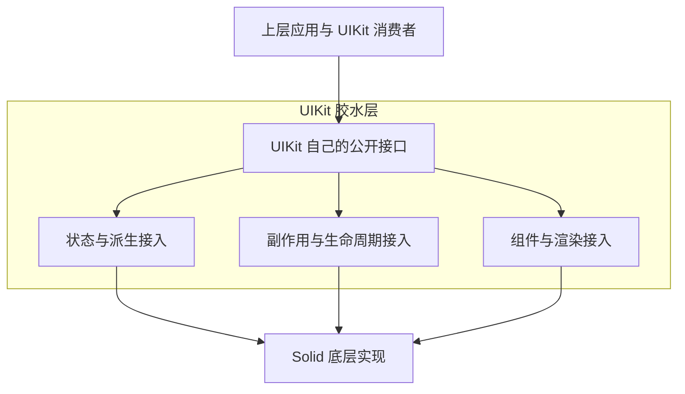

# 计划状态与目标

- 状态：部分实施。2026-10-10 已建立 Foundation 接入边界；完整计划验收与 Solid 2 迁移尚未完成。
- 建立时间：2026-10-08T20:19:45+08:00（Asia/Shanghai）。
- 建立时交付：只建立本 Plan，不修改源码、配置、依赖或其他任务的文档。
- 撰写与执行依据：[Plan 撰写与实行契约](../how-to-write-plan.md)。

**先建立 UIKit 自己的胶水层，将 Solid 的依赖和实现放在胶水层之下。上层应用使用 UIKit 的入口，保持现有运行逻辑和可观察行为。后续能够顺畅迁移 Solid 2，是这个边界成立的一项表现。**

# 用户已经确定的要求

1. 状态与 effect 由 UIKit 暴露自己的入口；上层使用这些入口，不绕过它们直接引用 Solid 的对应能力。
2. 第一阶段可以只转发现有 Solid 实现。入口的价值是集中依赖与变化位置，不要求现在创造新的响应式语义。
3. 建立胶水层时不改变现有逻辑。可以调整导入来源、出口和实现归属，状态、派生、副作用及生命周期的行为保持一致。
4. 后续底层实现发生变化时，由胶水层吸收适配；上层应用无需因 Solid API 变化而再次迁移。
5. 当前主线程在处理其他任务。本轮只写待办 Plan，不开始实施，不修改或覆盖其他任务的文件。

# 当前事实与待补齐的边界

截至建立时间，已核对以下代码。2026-10-10 目录迁移后，下表链接指向现役落点；表中运行方式仍记录建立时的事实。当前边界见 [Foundation 入口](../../src/foundation/SPEC.md)。

| 位置 | 当前职责与事实 | 本计划需要处理什么 |
| --- | --- | --- |
| [createState 领域](../../src/foundation/createState/index.ts) | 已公开 `State`、`StateView`、`Source`、`val()` 与派生、跟随能力 | 复用现有状态接口，补齐 Solid 实现的接入边界 |
| [state.ts](../../src/foundation/createState/state.ts) | 通过 `createSignal` 保存状态；`.map()` 创建另一份 State 并持续写入 | 第一阶段保留这条运行逻辑，将底层依赖留在胶水层内部 |
| [createReactiveRunner.ts](../../src/foundation/createState/createReactiveRunner.ts) | `createReactionFn()` 使用 `createRoot` 和 `createComputed`，提供结果读取与手动释放 | 核对它与 effect、派生、生命周期的关系，保留同步执行和释放行为 |
| [hooks](../../src/hooks/index.ts) | 部分 hook 仍直接使用 Solid signal、memo、effect 与生命周期 API | 将直接引用改为 UIKit 自己的入口，保留各 hook 原职责 |
| [Piv](../../src/components/Piv/Piv.tsx) | 集中消费 DOM 声明；消费者仍直接使用 `createRenderEffect`，plugin 使用 Solid 渲染与挂载能力 | 将 Solid 专属接入收进胶水层，保留渲染阶段、字段订阅及清理关系 |
| [kitContext](../../src/components/kits/kitContext.tsx)、组件与 plugins | 仍使用 Solid context、控制流、列表和生命周期能力 | 在依赖清单中明确其接入归属，避免只处理 state/effect 名称却留下旁路 |
| [发布入口](../../src/index.ts)、[构建配置](../../vite.config.ts)、[类型配置](../../tsconfig.json) | 负责公共出口、JSX 编译与依赖接入 | 核对类型与构建边界；第一阶段继续使用当前 Solid 版本和编译方式 |

这份表是实施前的阅读入口，不是完整依赖清单。开始实施时重新读取当前源码、出口与 Git 差异，避免采用其他任务已经改变的旧事实。

# 胶水层的候选组织

以下是 Agent 提出的实施组织方式，具体新增文件名与内部出口在依赖盘点后确定；不将候选路径当作已经实现的架构。

- 状态领域建立时沿用 Hooks 中的 createState 目录，2026-10-10 已迁至 `src/foundation/createState/`，派生与跟随组合留在 Hooks，由 `State / StateView / Source / val()` 及现有派生入口承接调用方。memo 可以作为内部实现，不要求单独公开 Solid 的同名 API。
- effect 建立 UIKit 自己的稳定入口，经 `src/hooks/index.ts` 与包根出口公开。普通副作用、渲染阶段副作用、清理与释放需要保留各自行为；不为了统一名称将它们全部替换成同一种 effect。
- 生命周期、context、控制流、列表、渲染入口与 JSX 类型中的 Solid 接入也必须有明确归属。可以利用 UIKit 已有组件设施和内部接入模块承接，不强行塞入 State 对象或普通 effect 回调。
- Solid 专属 API 与类型只允许出现在确认过的胶水层内部接入位置；调用方引用 UIKit 的接口。JSX 编译器生成的渲染依赖与工具配置由 UIKit 的框架接入统一管理，核验时与手写源码引用分别检查。
- 第一阶段沿用现有回调形态与实现方式。拆分 effect 的读取与执行阶段、改用原生 memo、改变异步模型等，不作为本阶段的附带重构。

# 实施顺序

## 1. 盘点依赖与行为基线

- [ ] 重新读取入口规则、[Architecture.md](../../Architecture.md)、相关源码职责说明、公开出口和当前 Git 差异，记录本计划允许修改的文件。
- [ ] 查找 Solid 根包与子路径的运行时导入、类型导入、重导出、动态导入和类型补丁；覆盖 hooks、组件、plugins、本地应用、Example、Story、测试及工具配置。
- [ ] 按状态、派生、副作用、生命周期、组件与渲染接入标明每项依赖的消费者及拟接管位置。固化少量真实接入位置，避免用无限扩大的例外清单保留旁路。
- [ ] 记录现有可观察行为与已有验证结果：初始化、读写可见时机、派生更新、effect 执行与清理、组件卸载、DOM 字段更新和 plugin 结构插入。区分已有失败与本计划引入的回归。

## 2. 建立 UIKit 入口，继续使用当前 Solid 实现

- [ ] 在状态领域复用现有协议与读取入口，集中底层状态和派生依赖，不新增平行 State 体系。
- [ ] 建立自己的 effect 入口与所需内部接入。第一版允许直接转发，保持当前执行阶段、依赖追踪、回调返回值、嵌套关系和资源释放行为。
- [ ] 将必要的生命周期、渲染与类型接入收进胶水层，复用已有 UIKit 能力；只处理盘点证明存在的需求，不建立框架注册器或多后端系统。
- [ ] 通过所属领域出口和 `src/index.ts` 公开稳定接口，内部实现不成为上层必须使用的入口。

## 3. 接管调用方，关闭直接引用旁路

- [ ] 逐项替换胶水层之外的直接 Solid 引用。上层的条件、计算、状态写入、事件处理、DOM 动作与清理逻辑保持原样。
- [ ] 同步迁移 Source、Accessor、JSX 等相关类型的引用归属，使调用方不需要 Solid 专属类型知识来使用 UIKit 接口。
- [ ] 复查测试、Example、Story 和本地应用，确保它们同样能通过 UIKit 的稳定入口使用被封装能力。
- [ ] 对照依赖清单检查现役源码、声明产物与构建输出。剩余 Solid 引用必须来自已确认的内部接入或编译工具接入，并能解释其职责。

## 4. 验证胶水层已经收口

- [ ] 用既有测试验证原行为；仅在现有验证缺少实际风险覆盖时补充行为测试，不测试转发次数、函数身份或文件布局。
- [ ] 执行相关类型检查、库构建及受影响的单元／浏览器测试；涉及 Storybook 接入时验证其构建。命令从实施时的 `package.json` 确认。
- [ ] 检查依赖边界：上层手写源码不直接引用 Solid 的被接管能力；公共接口和类型的使用方式由 UIKit 定义；实际订阅、执行和清理仍沿原行为运行。
- [ ] 从包根公共入口走完“创建状态 → 派生读取 → effect 消费 → DOM 更新 → 清理”的实际链路，证明入口可使用、行为未改变。
- [ ] 将已经成立的职责、允许接入位置及运行链写回对应领域说明和架构文档，明确胶水层之外不能直接引用被接管的 Solid 能力。

## 5. 后续以 Solid 2 迁移检验边界

- [ ] 胶水层验收后，在后续迁移任务中重新核对 Solid 2 的官方契约与工具链，集中修改底层接入实现和必要配置。
- [ ] 以“上层继续使用原有 UIKit 接口与逻辑”验证迁移效果；底层时序、派生、副作用及清理差异由胶水层适配。
- [ ] 如果迁移迫使上层直接改用新的 Solid API，回查胶水层是否漏接责任或泄漏底层协议；不能仅凭构建成功宣布无感迁移完成。

第 5 步是后续待办，不与第一阶段建立胶水层同时执行，也不在本次写 Plan 时升级依赖。

# 第一阶段验收条件

| 要求 | 满足证据 |
| --- | --- |
| UIKit 拥有自己的入口 | 包根与所属领域出口可用；状态、派生和 effect 消费者经自己的入口运行 |
| Solid 留在胶水层之下 | 直接引用清单全部有负责位置；胶水层外没有被遗漏的运行时、类型或生命周期旁路 |
| 现有逻辑与行为一致 | 同一输入下，状态结果、派生结果、执行时机、DOM 结果和清理行为与基线一致 |
| 胶水层保持最少必要职责 | 第一版可转发；没有借机改变响应式语义、创建第二套状态事实或公开整套 Solid API |
| 与其他任务互不覆盖 | 实施差异属于明确的依赖接管范围；保留其他任务已有与并发产生的修改 |

Solid 2 迁移成功不是第一阶段完成的前置条件；胶水层的入口、依赖边界和行为保持必须先取得证据。

# 实施前未决问题

- effect 的准确名称、回调与清理协议，以及普通 effect、渲染阶段 effect、手动 runner 的内部边界：从当前消费者契约确定，第一阶段不预设改为 Solid 2 的两阶段回调。
- Solid 专属内部接入模块和组件／渲染接入的准确路径：依赖盘点后确定；不为统一目录机械搬迁全部组件。
- 调用方实际依赖的同步读写、初始化和释放行为是否已有充分验证：实施前补查，不能把未验证行为写成保证。
- Solid 2 下维持原有公共行为所需的适配与工具链改动：留到第 5 步查证；确实需要改变公共契约时另行裁决，不夹带在胶水层建立中。
