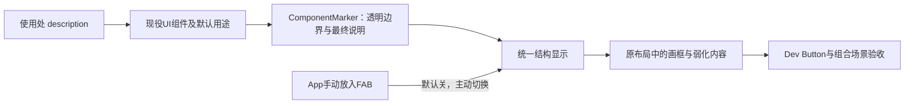

# 目标与位置

实现[组件结构查看](../guide/组件结构查看.md)这一跨项目UI能力，让用户在UIKit Dev的Button示例中用手动FAB切换，看到真实组件画框及用途说明。Guide拥有概念，本Plan负责施工及验收；不改变UIKit的整体启动与业务框架。

状态：已实现并完成独立复查、正式构建及真实Dev验收；详细过程与既有失败见[Run](../../agents/run/2026-10-24-组件结构查看.md)。

规划全局图：



本Plan覆盖这张图的全部链路，交付正式包能力与现有Dev入口，不增加独立演示App。

# 不可移动合同与父需求覆盖

用户要求及本轮实施方法分开：前者为下表合同；透明根节点收集、单层覆盖绘制、定义端静态身份等为Agent为保留布局和显示清晰度选择的方法，不代表用户要求增加新业务。

| 结果与边界              | 唯一责任                           | 材料与变换                                                                                  | 最小运行证据／失败条件                                                  | 当前状态                                                  |
| ----------------------- | ---------------------------------- | ------------------------------------------------------------------------------------------- | ----------------------------------------------------------------------- | --------------------------------------------------------- |
| 全部Piv之上组件具备能力 | ComponentMarker、现役kits         | 原主体及定义端身份；统一包裹，不包Piv／内部／Marker自身                                    | 7现役可视组件全部接入；少接或把Piv当框则失败                            | 已满足：七kit源码与组合browser用例；自定义组件按Guide接入 |
| 外部说明覆盖默认说明    | Marker公开属性与组件转交          | description优先，缺省用defaultDescription；两者无值只显示组件名                             | 响应式更改与默认／外部覆盖测试；初始化快照或改文案则失败                | 已满足：默认、动态、空值及异步说明用例                    |
| 手动FAB，初始关闭       | 浮动按钮及唯一查看状态             | 未加载无开关；加载未开启正常；开启才加结构效果                                              | 三态对照；导入自动加FAB或默认显示结构则失败                             | 已满足：三态用例与真实Dev开关                             |
| 四种冷灰框与清晰标注    | 统一绘制及自身样式                 | 真实边界→描边、框内左上角组件名和最终用途；说明可换行但宽高不越框，内容弱化，颜色无业务含义 | Dev可读、四种配色、长说明受框约束；只画原生标签、标签外置或越界则失败   | 已满足：长文bounds、Canvas像素用例与成果截图              |
| 保留真实布局和状态      | Marker透明返回、显示层            | 不加布局DOM、不清数据重建、不接管原事件／ref                                                | 表格原生结构、Input值与焦点、点击／禁用／popover、同DOM边界；回退则失败 | 已满足：组合用例与Dev开关前后相同bbox                     |
| Dev里实际可见           | Button.example、原ExampleDashboard | 正式Button及外部description、手动FAB                                                        | 打开真实`/examples/button`并点击验证，不用临时假页面代替                | 已满足：5173真实入口已打开，成果截图已保存                |
| 仅UIKit范围             | 本轮diff及文档                     | 新增功能，不修改bcoin／FNKit，不重启用户旧服务，不写Git                                     | 差异审查及服务记录；扩业务或改其它项目则失败                            | 已满足：完整差异及独立复查，原服务保持                    |

用户授权本轮启动UIKit Dev；仅启动本轮所需实例，优先使用已有对应Dev，不能停止其它项目的端口。不开研究、训练或模拟交易。

# 责任与代码落点

现况：Piv与Dode共用真实元素；kits有Button、Input、Card、Article、Table、Popover、Each。KitContext只作祖先payload通信并要求根，不承担DOM边界或结构查看。Foundation现有Source、State、Effect、children、生命周期及浏览器帧工具负责复用。

```text
src/components/【目录】
    ComponentMarker/【新增】：组件定义端身份、用途优先级、活实例真实边界、清理
    结构查看能力目录【新增，具体文件随职责命名】：唯一开关状态与统一覆盖绘制
    浮动查看按钮【新增】：手动加载的Button特殊形式，只切换查看
    kits/{Button,Input,Card,Article,Table,Popover,Loop}【更新】：统一Marker及description转交
    index.ts【更新】：公开正式能力，不自动挂载
src/app/example-dashboard/【保留】：原Dev与导航不动
src/components/kits/Button/Button.example.tsx【更新】：作为App消费点，在内容外手动放入FAB；真实示例说明外部用途与默认回落
docs/guide、README、Architecture【更新】：验收后描述真实能力与入口
```

Marker不得更改Piv的创建/插件协议，也不创建另一套通用Context或组件树查询框架。定义端需明确提供静态组件身份；不要求页面使用者重复填写名称，不扫class猜名字。说明支持现有Source契约；一般值与动态输入统一在最终消费处读取。

Marker以起止Comment界定真实范围，透明返回原内容，统一收集已挂载边界，关闭时不持续测量绘制。FAB拥有本地开关State；开启后一个显示层处理内容弱化与清晰画框，避免父子累乘模糊或把框一起淡化；同根Article/Card和Popover顶层surface、多根及动态列表须有真实消费。按绘制需要维护活实例Set，不保存业务数据或已销毁实例，不引入全局类型目录。

既有Button外观、原生属性、ref、禁用和提交语义保持。FAB清晰可关，不因复用Button把自身遮住。实现不能以调低所有内容透明度、固定假尺寸或只显示根框掩盖边界错误。

# 顺序与验收

1. 独立来源／约束审查本Plan；能力复用与重复识别各自完成初查。把实际基线与过程写入`agents/run/2026-10-24-组件结构查看.md`。
2. 实现Marker、查看状态与绘制、手动FAB，接入全部7种现役UI主体；聚焦测试优先识别用途覆盖、三态、原生结构、清理和已销毁实例残留。
3. 原Dev App手动放入FAB，Button保留原示例并新增真实用途示例；不改变示例导航职责或新增页面。
4. 聚焦单元／必要浏览器测试与一次包构建；真实浏览器打开Dev Button，切开／关、观察框与内容、确认外部说明及关闭后恢复。组合场景验证嵌套、原生表格、Input状态与Popover，不以截图或测试数量代替消费者。
5. 两项独立能力审查复查实际差异；完成需求反查、注释／职责与大规模领域审计；Guide、README、Architecture仅在真实验证后记为已实现。

可证伪问题只有一个：组件结构是否真实、统一可见，而原界面在关闭前后保持？聚焦证据足够排除本轮风险后结束工程验证，不新增用户未要求的编辑器、拖拽、业务诊断、快捷键或持久化策略。

# 依据、分工与未决

遵守UIKit AGENTS、[统一任务分工](../../../ai-rules/rules/Agent-任务分工.md)、[代码编写](../../../ai-rules/rules/Code-代码编写.md)、[修改验收](../../../ai-rules/rules/Code-代码修改验收.md)及[UI组件身份](../../../ai-rules/rules/Code-UI组件身份.md)。总监负责合同、浏览器和最终验收；structure_view_implementation负责代码和聚焦验证；structure_view_reuse独立检查复用／约束及来源；structure_view_simplify独立识别重复，成品阶段专注精简，容量限制下合并职责如实记入Run。

方向未决：无；具体节点测量、绘制载体及Popover top-layer可见性由实现者在上述不变量内解决并用真实浏览器验证，不能靠避开原组件来裁短覆盖。精确四配色可在低饱和冷灰约束内选取。description缺省回落默认值，显式空字符串代表不提供说明文字、仍显示组件名，不猜测用户用途。

作者反向审计：新增能力与此前命名维护不同，不借旧代码净减标准限制必要功能；也不借此扩大其它组件业务。合同覆盖用户全部要求，包括全部组件接入、手动开关与默认说明。来源、成品及真实Dev验收已通过。

独立来源复审：structure_view_reuse已核实7kits、公开复用契约及完整合同，允许实施；ComponentMarker定义端静态身份不占Button.name语义。实际边界与显示效果仍须运行验收。ButtonExample作为App消费点手动放入FAB，保留原Dev导航，是不扩启动框架的更小落点。

实施中用户可见裁决：标注必须在框内左上角，内容可换行但不得超出所属框。此裁决取代外置及跨框避让方法，不改变原布局和其它合同。标签直接使用真实框的尺寸约束，不再维护按文长外撑或移到框外的算法。

# 实施结论

Marker负责真实边界和说明回落，Overlay负责统一显示，FAB负责手动操作；七kit仍保留原主体职责。正式显示全部经过Piv，没有扩张Piv协议、App启动框架或其它项目。7项新增browser测试、最终build及diff检查通过；独立复用与精简复查通过。

真实Dev开关前后按钮节点与尺寸保持；长说明在48px高按钮内换为两行35.14px，画框和标签贴合原位置。既有Button显式submit单测仍失败，禁用Marker的反事实同样失败，本轮没有修复或掩盖该无关行为。运行身份、失败修正与截图见Run。

# Text补充：定位框内文字显示为空

用户后续裁决：当前模式称“组件定位框”，不是更高阶的“职能显现”；后者暂不实施。新增Text组件，开启定位框时不显示内部原文字，只留下真实定位框及框内组件名；关闭恢复正常。原有框内标注、布局保持及默认关闭继续生效，Button自身文字处理不在本轮修改范围。

本节为新增施工范围，前文7种kit的验收保留为上轮事实。本轮开始时Text尚不存在，定位框开关已改为“打开组件定位框／关闭组件定位框”。

| 结果                       | 落点与职责                                                                          | 验收                                                 |
| -------------------------- | ----------------------------------------------------------------------------------- | ---------------------------------------------------- |
| 可用的Text组件             | `kits/Text/Text.tsx`以Piv承载纯文字、Marker登记身份；`components/index.ts`公开导出 | 默认span及h2/p等原生语义、动态文字均可用             |
| 开启后文字显示为空         | Text自己的相邻CSS复用Overlay已开启这一现有事实；不增加另一份开关状态                | Text原内容不可见，独立Overlay中的Text框和名称仍可见  |
| 位置不塌、关闭恢复最新文字 | 原文字保留排版与Source更新，仅视觉置空，不删除或缓存旧DOM文字                       | 开关前后尺寸相等；开启期间数据变化，关闭呈现最新值   |
| 当前Dev可见                | ButtonExample的标题、介绍和独立文字接Text，保留原标签及样式                         | 真实`/examples/button`可切换查看，Button内部内容不变 |

实现手段采用Text局部可见性控制，不是递归清空textContent，也不是将数据改为空；否则会破坏真实布局或最新内容恢复。Text只承载文字，不把任意交互子树放入其中。默认不设用途说明，标注为Text；使用方主动传入description仍遵守共同协议。

实施顺序：独立初查及本节来源复审→Text与消费点→聚焦browser测试和一次构建→主Agent真实Dev观察及独立成品复查→更新Guide与Architecture。过程、失败和实际证据追加到`agents/run/2026-10-24-Text组件定位框.md`。

停止条件：上述四项有实际证据且无本轮回退即交付，不扩展保留／模糊／替换三态、DOM改写框架或其它项目。状态：来源复审、代码实施、独立成品复查及真实Dev验收已完成。

本轮结果：Text以Piv和Marker组合，不新增查看状态或Canvas分支；ButtonExample的14处独立文字已接入，保留原tag/class。真实Dev对比修改前后及开启时48处对象（14文字区域、34按钮），位置、宽高、文本及原生标签完全一致；开启后14处Text原文字不可见且保留14个Text标注，Button内部文字未改。新增2项Text browser用例与既有7项定位框browser用例共9项通过，最终构建通过；详细失败修正和证据见本轮Run。

# Text用途标签与示例说明精简

用户最新裁决只改变以下范围，不撤销其他组件的说明协议、Text视觉置空或定位框几何要求：

| 要求                                                  | 修改落点                                                                   | 验收                                                    |
| ----------------------------------------------------- | -------------------------------------------------------------------------- | ------------------------------------------------------- |
| Button示例无需外部用途说明，但组件继续接受description | 仅删除ButtonExample中Button的显式description；保留接口、默认说明及覆盖测试 | 示例无该属性，既有Button说明覆盖测试继续通过            |
| Text的不同职能需简短中文说明                          | 为现有14处Text补description，如标题、描述、表头和行名                      | 定位框内能分辨不同文字区域的用途，正文继续置空          |
| Text有说明时只显示说明，无说明时仍显示Text            | Marker统一说明消费与回落，Text在定义端选择省略名称前缀的格式              | 普通、动态、空值/缺省说明均正确；其它组件仍按原格式显示 |

Marker只增加定义端必要的标签格式选择，不按组件名称猜特殊行为，不增加formatter框架或第二说明状态；Text仍转交原Source。Article/Card的外部说明及其它示例、模式行为都不在本轮更改范围。过程与结果继续追加到Text的Run。

顺序：独立复用及精简初查、来源复审→最小代码与已有测试断言补充→聚焦9项browser和构建→真实Dev及独立成品复查→更新当前Guide。状态：已实施，9项browser与构建通过，真实Dev验收完成；独立复查记录见Text的Run。

实际差异限于Marker定义端descriptionOnly选项、Text选择此格式、已有Text用例及ButtonExample。示例14个说明均为2～3字，默认说明和外部description能力未从Button删除。真实Dev中14个Text区域分别显示短用途，没有Text前缀；48处原文字及按钮的tag、text和bbox与行动前相等。Article/Card标注保持原样，不扩展为其他组件的普遍隐藏名称规则。

# Text的block属性

用户最新裁决：UIKit Text只需布尔block，缺省或false渲染span，写block即渲染div；不再由Text选择h2/p等标签。此裁决替代前述四Tag的as接口，description、纯文字Source、定位框视觉隐藏及恢复不变。Viewer自己的富内容Text和上轮仅核查的index转导出不在本轮修改范围。

| 责任           | 修改与接管                                                                    | 验收                                                           |
| -------------- | ----------------------------------------------------------------------------- | -------------------------------------------------------------- |
| 行内／块级Text | TextProps退出as/TextTag，公开block?:boolean；原Piv按block选span/div           | 默认、显式false为SPAN，true为DIV；不保留as别名或兼容路径       |
| 示例原有语义   | 11处div Text改block；h2/p由Piv语义容器保留，内Text用默认span                  | 标题、段落和按钮外观、位置保持；新span的文字范围不冒充原h2外框 |
| 示例字号保持   | `.example-card-head span`只收窄为直接子span，防新增标题内span误吃类别小字样式 | 标题字号、段落间距及既有类别外观不变                           |
| 已有定位能力   | 更新相邻browser消费者，不删除说明更新／空值回落／隐藏恢复用例                 | Text有说明仅用途、无说明Text，开关仍恢复最新文字               |

删除责任已核：TextTag/as的现役源码调用仅ButtonExample及相邻Text browser；span/div由block接管，h2/p原生语义归消费处Piv。不删除文件、测试能力、日志或恢复入口，不修改index公开写法。预计4个源码／测试／样式文件的小改动，不扩展新Heading组件或样式模式。

顺序：独立初查及来源复审→最小实施→聚焦9项browser、类型与构建→真实Dev比较h2/p与按钮、打开定位框→当前Guide及Run同步。状态：实施、独立复查及真实Dev验收完成。

实际结果：4个源码／测试／样式文件完成接管，9项browser及包含类型检查的包构建首次通过。真实Dev中类别、h2、p及34个按钮共37个对象的文字、位置、尺寸、字号和间距与行动前完全一致；Text实际为3个span及11个div。开启定位框后14处文字视觉隐藏，短用途标注保持；Guide已更新为block接口，过程证据见Text的Run。

# Text段落与Heading语义组件

用户已授权落实文字语义族：Text承载普通文字，增加p布尔属性；标题由独立Heading承担。本节补充block接口，替代上一节“h2/p由示例Piv外壳承接”的临时消费者结构，不恢复Text的as或TextTag，不扩展Label等其他组件。

| 对象与落点                     | 当前方案                                                                                              | 验收                                                                        |
| ------------------------------ | ----------------------------------------------------------------------------------------------------- | --------------------------------------------------------------------------- |
| Text及相邻browser              | 缺省span、block为div、p为p；用互斥联合禁止同时传入block/p，保留纯文字Source及descriptionOnly          | 三标签与false分支正确；类型拒绝双传；原隐藏、更新与恢复用例继续有效         |
| 新Heading主体及相邻CSS/browser | 直接使用Piv和Marker，level必填1～6决定h1～h6；descriptionOnly回退Heading，文字Source下传             | 原生标题等级正确，只有Heading身份，无嵌套Text框；开关保留尺寸并恢复最新文字 |
| 各组件的文字隐藏               | Text.css保持；Heading自己的4行CSS复用同一Overlay开启状态，仅隐藏自身文字                              | 不新建状态、通用文字模块或模式；无FAB及未开启时原样                         |
| ButtonExample                  | 原Piv h2内Text改Heading level=2，原Piv p内Text改Text p；保留原文字、短说明及全部按钮                  | 37个原类别／h2／p／按钮的tag、text、bbox及字号间距与行动前一致              |
| 公开出口及当前说明             | components/index只新增Heading的export*；Guide和Architecture描述两种文字语义及接口，README同步接入数量 | 根入口可导入Heading；原具名出口争议不在本轮修改范围                         |

level必填与类型互斥是本轮的最小实现选择：调用处明确文档层级，不添加非法运行时输入的额外校验。Text和Heading各自选择局部文字显示，不因四行同形CSS引入新抽象或迁移现有文件。

删除责任：示例的两层临时Piv容器退出，h2职责由Heading根承接、p职责由Text p根承接；不删除文件、Source、description、测试能力或日志。组件定位框的大框、标签无边框无背景的最新约定保持。Viewer、FNKit、服务、研究数据与Git索引不动。

实施顺序：独立初查及本节来源复审→主体、消费者与聚焦测试→包构建及类型检查→真实Dev正常排版／定位框验收→Guide及Architecture同步、Run追加实际证据。测试和构建通过且原布局保持、两种身份与恢复均可见后结束，不扩大组件族。状态：实施、独立复查及真实Dev验收完成。

实际结果：类型检查、Marker七项／Text两项／Heading一项共十项browser与包构建通过；删除Heading无必要的标签局部变量后，类型检查、Heading聚焦及构建再次通过。真实Dev的37个原元素与行动前tag、text、bbox、字号和间距完全相等；文字节点现在是13个Text和1个Heading，Heading为独立h2且不嵌套Text。开启后14处原文字均隐藏，短用途标注及无边框／无背景保持。Guide、Architecture与README已同步，详细过程及原链警告见Text的Run。

# descriptionDisplay与模式内透明

用户新增共同布尔属性descriptionDisplay：定位框模式中为false时，组件本体完全透明，自己的框和说明也不出现；布局占位、节点与数据更新继续保留。普通模式不变。其它组件含Heading缺省true；只有Text缺省取外部description的真值，显式descriptionDisplay优先。本节补充前述文字隐藏规则，不撤销Text／Heading的语义接口或标签无边框、无背景约定。

| 责任与落点        | 实施方案                                                                                                                                                          | 验收                                                                                  |
| ----------------- | ----------------------------------------------------------------------------------------------------------------------------------------------------------------- | ------------------------------------------------------------------------------------- |
| Marker共同协议   | ComponentDescriptionProps新增可选boolean；定义端defaultDescriptionDisplay提供默认。显式值优先、定义默认其次、最后true；Text定义端以JSX动态boolean表达外部说明真值 | false不被默认吞掉；Text空／缺省说明不显示，有说明显示；Heading缺省仍显示              |
| 受管默认消费      | Overlay挂载期间的无DOM消费者使用Foundation既有Effect读取显示值；RAF只读已归一boolean，待定时不冒充true或false                                                     | 无FAB不触发新的说明消费；动态／异步说明可正确切换，不在RAF裸读Source                  |
| 元素透明与框过滤  | 沿现有范围帧扫描，为false根元素及其原生浮层根加模式专用属性，CSS opacity为0；false边界的Comment Range同时排除其后代框与说明                                       | 元素占位、原opacity Source及事件协议保持；父false时子框不漏出；开关／卸载恢复最新样式 |
| 裸文字根          | 实际Expression与多根Marker含无元素外壳的文字，不能直接设opacity。仅对这些false裸Text根建立透明色CSS Highlight Range                                              | 原Text节点、内容、兄弟关系不变，范围不扩邻居；关闭仅清本次登记，不清其它Highlight     |
| UIKit与Viewer透传 | 9种kit、当前Viewer本地基础与组合组件把共同属性传给既有Marker／Button；本地Text采用相同默认                                                                       | 不能只改类型，实际显式值可送达；不加页面信息、外壳、CSS业务样式或新控件               |
| 当前说明          | Guide、Architecture及Viewer接入说明同步共同属性与Text默认；Run保存失败与测量                                                                                      | 不把本体透明误写成只取消label；明确裸文字是等效透明而非Text节点opacity                |

裸文字使用[CSS Custom Highlight规范](https://drafts.csswg.org/css-highlight-api-1/)现成的Range与透明文字颜色，不增加DOM、文字替换、兼容层或选择高亮优先级策略。专用属性而非快照回写inline opacity，避免覆盖隐藏期间的样式Source更新；既有帧循环负责动态根与清理，不加MutationObserver、组件树或第二个模式开关。

预计UIKit约14个生产文件及3个聚焦测试、Viewer约32个生产文件；大部分只是把新增共同属性转给原Marker。核心行为仅归Marker／Overlay，Text只声明定义端默认。index、Piv协议、页面内容、研究数据与服务进程不动；不执行Git写操作。

顺序：独立初查与本节来源复审→统一机制及真实消费者→聚焦browser／类型与包构建→真实UIKit和当前Viewer正常／开启／关闭对照→独立成品复查及文档收口。最小证据覆盖默认与显式覆盖、动态说明、原opacity更新恢复、父子／多根／原生浮层及裸文字；正常控件和图表布局保持即结束，不扩其它模式。状态：实施、两独立复查及真实Dev验收完成。

实际范围为12个UIKit生产文件、3个相邻browser文件及32个Viewer生产文件；估计数量不作为新增目标。UIKit的12项browser、类型检查与包构建通过，Viewer原15项测试、类型检查与构建通过。首轮fixture失败及无popup时Highlight未登记的真实缺陷已修复，并完整保留在Run。

当前Viewer原端口5175经用户明确允许先停旧进程再原地重启，未增加端口或实例；关联API及其它前端进程未动。重建依赖前实测仍加载旧UIKit，重建后67个无说明Text的opacity均为0且无Text标注，其它组件正常显示。关闭后标记清空，沿原渐变恢复opacity为1；76个控件及8张Canvas共84个对象与行动前位置、尺寸和输入值完全一致。UIKit Dev有说明的Text仍显示原短用途。当前Guide、Architecture、Viewer说明及Text SPEC已同步，成果与运行身份见Run。

# 组件样式迁回style.ts

用户明确组件样式必须使用.style.ts，CSS只服务App背景、reset等根级美化。本轮纠正本Plan引入的三份组件CSS；不借此迁移全库历史CSS、修改按钮外观或更换页面布局。AGENTS把读取时机前移到组件及样式修改之前，现役样式契约明确组件CSS禁区，历史Plan和Run保留当时错误实现的记录。

| 原责任                                                                  | 正式接管                                                                                        | 验证                                                           |
| ----------------------------------------------------------------------- | ----------------------------------------------------------------------------------------------- | -------------------------------------------------------------- |
| StructureView.css：FAB、Overlay、Canvas、标注、模式内opacity与Highlight | 当时迁至同目录StructureView.style.ts并原样表达；当前由ComponentMarkerStructureViewTrigger.style.ts与StructureViewOverlay.style.ts分别承接激活器与内部显示，入口静态导入 | FAB与画布几何、标签无框／无背景、false本体透明与裸文字行为保持 |
| Text.css与Heading.css：开启模式时隐藏文字                               | 各自同名.style.ts，原body:has条件及visibility声明不变；主体改静态导入                           | 默认值、用途、空内容、Source更新及关闭恢复保持                 |
| 三个相邻browser的原CSS加载                                              | 复用现有Button浏览器测试的cssRoot宿主／挂载方式，render前提交已静态登记样式                     | 原12项浏览器行为仍可验证，不在组件render内挂载或编译           |

Style System现有rules支持完整选择器，包括:has、::backdrop、::highlight；`[key('opacity'), '0 !important']`仍是单属性值，不是整段CSS逃生口。不新增Style System能力、层叠层、Theme、Variable或样式框架。生产App已有静态导入完成后render前cssRoot.mount的入口，不添加第二挂载点。

删除责任已审计：三份CSS的全部声明由上述三个.style.ts逐项接管，四处实际导入全部改向；不删除Source、日志、测试、产物或恢复能力。旧页面CSS、其它历史组件CSS与Git索引不动，不声称全库已完成CSS迁移。

顺序：独立初查与本节来源复审→三个样式模块和四处导入迁移、相邻测试接挂载→原12项browser、类型及包构建→编译结果逐声明与真实UIKit／Viewer样式对照→原CSS退出、成品复查和当前文档同步。三个旧文件及引用无残留，行为与视觉对照保持后停止；不扩研究、服务或页面。状态：已实施，独立复用／精简成品复查通过。

三份.style.ts接管10个选择器、44条声明，正式编译结果与迁移前逐项等价；类型检查、原12项browser及包构建通过。UIKit Dev刷新后定位与标签正常；Viewer旧预构建仍引用已退出的CSS而白屏，按既有授权仅原地重启5175并重新预构建后恢复，未新增端口或修改数据API。正常模式84个控件／Canvas的位置、尺寸、输入与原baseline完全相同；开启后67个无说明Text透明且无Text标注，Heading文字隐藏，标签无边框／背景。Guide与Architecture已同步，具体证据见既有Run。

# 全框白色模糊遮罩

用户明确遮罩覆盖整个组件定位框内部，不只垫在名称后面；采用伪元素、半透明白和backdrop-filter，伪元素层级为负一级。此裁决取代此前“所有范围只统一淡化一次”的视觉方法，但不取消既有Text／Heading置空及descriptionDisplay语义，也不恢复名称的小边框。白色覆盖与模糊强度先以90%白、4px模糊作实现取值，按真实页面检查是否达到当前遮蔽目的，不新增配置接口。

本轮目标是让子框蒙层盖住背后的父框标签，自己的名称与定位描边保持清楚；只改正式UIKit的查看层及相邻样式／测试，Viewer只消费公开产物。真实DOM、数据、Source、控件状态和布局均不改。

现有真实范围及开关继续负责测量和显示资格。每个实际rectangle都有独立的全尺寸显示宿主，同完整矩形仍合并且名称分行；一个组件的名称只在首矩形出现，其它矩形也有遮罩和描边。宿主内隔离层叠，::before为inset:0、z-index:-1的白色背景模糊层，与自身名称按真实DOM中的父到子顺序绘制，不能把所有遮罩放在所有名称之下而保留原叠字。边界在本帧按起始哨兵的文档序排序一次，不以JSX构建／登记顺序代替真实位置；预先构建子组件再传入父组件也是必须覆盖的合法反例，不为此建立组件树。样式全部使用.style.ts与现有rules/key。

Canvas退出原统一白色填充，只保留全部真实矩形的冷灰描边并置于遮罩上方，防止描边被白层洗掉。原FAB透明洞必须同时对新伪层生效：复用同一帧一次测得的controlBounds，在伪元素自身裁出对应区域，不能裁整Overlay或宿主而改变后代Backdrop Root，也不移动原FAB、增加Portal或第二开关。矩形范围与controlBounds属于同一帧测量，不增加新的观察器或相互同步的状态。

删除责任：原Canvas白色填充由逐框伪元素接管，Canvas所有多矩形描边、FAB清晰可点击、模态inert与原标签裁切由新结构继续承担；不删除截图、测试或说明，只更新与新裁决直接冲突的现役断言和文档。旧Plan与Run保留当时理解。

独立复用／约束及精简初查后，先复审本节再施工。验证必须同时覆盖全框高度、同原点不同尺寸的父子遮蔽、多矩形、同矩形分行、伪元素负层／模糊、标签无小边框、FAB洞及关闭恢复；沿原browser测试补最小反例，再做类型与包构建。真实UIKit Dev和5175核对原布局、输入、滚动／对话框与开关，必要时只沿既有授权原地重建5175缓存。不新增端口、不改API、研究或模拟任务。上述证据及独立成品复查通过即停止；状态：已实施，两独立成品复查与真实页面验收通过。

Marker9及Text3／Heading1回归、类型与包构建通过；预构建子组件的绘制顺序反例先失败，改用真实文档序后通过。UIKit Dev与Viewer已显示全高伪层及清晰描边，原Flow／NumberInput叠字在同坐标处被子遮罩隔开。Viewer正常模式84个控件／Canvas与行动前值和几何完全相同；模态原关闭动作及FAB开关正常，关闭后恢复。具体原地重建缓存、反例失败与截图保存在既有Run，不用本轮结果回写历史记录。
