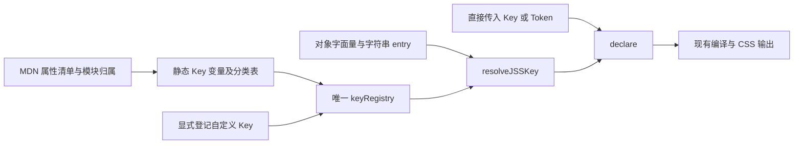

状态：已完成，独立实现、复用、重复能力与精简审查通过。
类型检查、构建、490 项单元测试及 224 项浏览器测试通过，见
[实施详情](../../agents/运行方案/261026_Key显式注册表与分类迁移_实施详情.md)。
以下保留制定时的任务边界、批量清单与验收合同。

## 目标与依据

使 `rules('.Button', { paddingTop: '2px' })` 在没有导入任何 `$Key` 变量时，
仍能独立解析并在 tree shaking 后输出 `padding-top: 2px`。
Key 的可查找性由明确的完整注册表决定，不再依赖哪些构造函数碰巧执行过。

用户已接受完整表的固定体积，并要求 Key 变量从 Pieces 迁入 `key-registry/`。
本轮是已确定规则下的批量建表、搬迁和接线，不重新设计 Rules、Token 或组件样式。

分类依据保留用户最后两项要求：

- 按 MDN 规范模块分组。
- 主属性及其延伸族放在一起，例如 `animation` 与 `animation-*`。
  这项要求补充模块分组，不能把所有模块替换成按第一个单词拆出的文件。

当前 `key.ts` 在 `key()` 中调用 `registerGlobalJSSKeyInStorage()`，
私有 `names` Map 因而取决于哪些 Key 已经创建。
此前真实具名导入的打包反例已经出现 `paddingTop` 未登记错误；
导出整个 namespace 后再挑方法的测试没有覆盖这个反例。

## 全局链条与本轮定位

本 Plan 承接已完成的 [Rules 输入统一展开与隐式声明](261026_Rules输入统一展开与隐式声明.md)，
接管其中字符串名称的来源及 Key 的归属。Rules 的递归展开与隐式 declare 继续使用原实现。



MDN 只用于制定、核验这次静态清单；运行时不联网、不扫描源码、不动态发现 Key。
直接传入的 Key／Token 保持原对象身份，不为查表先转成字符串。

## 固定输入与批量映射

以下三张表是本 Plan 的配套数据，必须一起交给执行模型：

| 文件                                                 | 用途                                                        |
| ---------------------------------------------------- | ----------------------------------------------------------- |
| [properties.csv](261026-key-registry/properties.csv) | 每个 CSS 属性对应的变量名、目标文件、分类表、模块、族和来源 |
| [modules.csv](261026-key-registry/modules.csv)       | 全部模块文件、分类表名称和各文件属性数量                    |
| [old-keys.csv](261026-key-registry/old-keys.csv)     | 已有 44 个 Key 变量从原文件到目标文件的迁移对应关系         |

`properties.csv` 每行是一条定义，字段含义如下：

| 字段       | 执行含义                                         |
| ---------- | ------------------------------------------------ |
| `cssName`  | `key()` 的原样参数，也是分类表的对象键           |
| `variable` | 导出的 `$camelCase` 变量名；旧变量保持原名       |
| `file`     | 从仓库根开始的准确目标文件路径                   |
| `registry` | 该文件末尾导出的分类对象名称                     |
| `module`   | 该属性本次采用的模块英文标识，与目标文件主名一致 |
| `family`   | 同文件中的连续排列族；不是额外目录或文件         |
| `source`   | 对应 MDN 属性页，用于查证                        |

固定来源为用户指定的
[MDN Properties](https://developer.mozilla.org/en-US/docs/Web/CSS/Reference/Properties)
左侧 Properties 属性树，快照日期为 2026-10-26。
展开后的实际无浏览器前缀属性共 **569 项**；侧栏导航标题、通配符和浏览器前缀不是表项。
不能把正文索引、MDN data 的全部条目或截图可见的几行替代这个范围。

模块信息参考 [MDN data](https://github.com/mdn/data/blob/main/css/properties.json)，
新属性及多归属项用对应 MDN 属性页补齐。数据用于确定分类，不作为运行依赖。
浏览器支持程度和是否实验性不决定这次是否收录；收录名称也不意味着实现浏览器兼容层。

### 分类裁决已固定，执行者不再猜

文件以规范模块为单位；同模块内按 CSV 的行序输出变量和表项，
保证聚合属性与延伸项连续。完整目录以 `modules.csv` 为准。

| 属性族或易混项                                | 固定落点及理由                                                          |
| --------------------------------------------- | ----------------------------------------------------------------------- |
| `animation`、`animation-*`                    | `animations.ts`；动画族收在一起，包括关联滚动时间线的动画属性           |
| `margin`、`margin-*`；`padding`、`padding-*`  | `box-model.ts`；物理和逻辑方向成员分别与自己的主属性相邻                |
| `background`、`background-*`；边框族          | `backgrounds-and-borders.ts`；分别连续，不拆为孤立的前缀文件            |
| `border-collapse`、`border-spacing`           | `table.ts`；表格边框模型，不因字符串以 border 开头而误搬                |
| `inset`、`inset-*`；`top/right/bottom/left`   | `positioned-layout.ts`；定位族归一                                      |
| `column-rule*`、`row-rule*`、`rule`、`rule-*` | `gaps.ts`；采用当前 MDN 的 CSS gaps 归属，修正旧 metadata 的多栏归属    |
| `column-height/width/wrap`                    | `multi-column-layout.ts`；不误放 Box Sizing                             |
| `align-content/items/self`、`justify-content` | `box-alignment.ts`；不因多个布局使用而重复定义                          |
| `content` 与 `content-visibility`             | 各随对应模块；没有主属性与延伸关系，不能仅按名称合并                    |
| `color-interpolation`                         | `svg.ts`；采用其 SVG 规范来源                                           |
| `user-modify` 及 8 个旧 `box-*` 属性          | `non-standard.ts`；没有当前规范模块归属的明确例外，不建立浏览器厂商分类 |

上述跨模块合族是为落实用户聚合规则而作出的具体映射裁决，
不是宣称 MDN 本来只给出了这些唯一归属。
不得另写“所有属性取首个连字符前缀”的分类算法。
`text-*`、`scroll-*` 等同样只能按已给映射处理，不能自行全族合并。
非规范例外共 9 项：`user-modify`、`box-align`、`box-direction`、`box-flex`、
`box-flex-group`、`box-lines`、`box-ordinal-group`、`box-orient`、`box-pack`。
这些无前缀名称属于指定来源集，因此保留；不并入现代 Flexbox，
也不把 MDN data 中的 Mozilla Extensions 厂商分类当作规范模块。
早期临时 `agents/run/key-registry/catalog.json` 的 145 个前缀文件方案已退出，
不得用它生成目录。

## 改前与目标职责

改前：

```text
src/style-system/
    key.ts：Key 构造、隐式登记、私有名称表及查找混在一起。
    pieces/keys/：13 个文件，定义 44 个现成 Key；导入才有机会登记。
    index.ts：只汇总其中部分分类的公开变量。
```

目标：

```text
src/style-system/
    key-definition.ts【新增，文件】：承接纯 Key 构造及其定义类型。
    key-registry/【新增，目录】：按规范模块承接全部现成 Key 定义。
        animations.ts【新增，文件】：动画族变量及动画分类字面量。
        box-model.ts【新增，文件】：盒模型变量，内含连续 margin 和 padding 族。
        backgrounds-and-borders.ts【新增，文件】：背景及边框变量和分类字面量。
        index.ts【新增，文件】：静态组合唯一 keyRegistry，汇总导出 Key 变量。
    key.ts【更新，文件】：名称解析、显式扩展登记、目标识别及原属性读取能力。
    index.ts【更新，文件】：接入 registry 公开出口，移除旧 Pieces Key 出口。
    pieces/mixins/【目录】：只更新原 Key 导入位置，保留效果实现。
    test/【目录】：更新迁移引用及显式登记契约，补真实字符串打包反例。
    architecture.md【更新，文件】：实施完成后记录静态注册表的现役职责。
    doc/当前接口与扩展协议.md【更新，文件】：实施完成后说明纯创建与显式登记。
```

上面只展开关键模块；其余全部新增分类文件由 `modules.csv` 精确列出。
旧 44 个声明是职责迁移，不是另建一套同名 Key；对应关系见 `old-keys.csv`。
原 13 文件被拆分归入规范模块后，删除 `pieces/keys/`，不留转发文件或重复定义。

### 每个模块的机械写法

以下只示意 `box-model.ts` 的部分成员；完整内容按 CSV 输出，不能只写示例：

```ts
import { key } from '../key-definition'

export const $padding = key('padding')
export const $paddingTop = key('padding-top')
// 其余成员按 properties.csv 的该文件行序继续。

export const boxModelKeys = {
  'padding': $padding,
  'padding-top': $paddingTop,
  // 每个变量对应一项，不能在这里再次 key()。
}
```

每个属性只调用一次 `key()`，字面量引用同一变量。
现有专属 `join` 或有效说明随声明迁移，不能因统一模板而丢失。
各模块只从 `key-definition.ts` 取得构造，不从 `key.ts` 或总入口反向导入。
`key-registry/index.ts` 静态导入分类对象，按 `modules.csv` 行序展开组合
`keyRegistry`，并 `export *` 汇总模块变量。
不增加 class、懒加载器、自动扫描器、构建插件或注册装饰器。

## 名称解析与必须保留的行为

1. 将 `JSSKeyObject`、`JSSKeyDefinition` 和 `key()` 的实现移入
   `key-definition.ts`。`key()` 只删除隐式登记动作，保留 `name`、
   `toCSSString` 和 `join` 构造含义。`key.ts` 再导出它们，保留现有正常入口。
2. `key.ts` 直接依赖唯一 `keyRegistry`。删除私有 `names` Map；
   内建名称及显式扩展都进入同一个对象，不维护第二份可变注册表。
3. 内建表保存 CSS 原名。解析先查自身表项，再将严格 camelCase 输入转换为
   CSS 原名查表；只有表内存在的属性才成立为别名。
   `paddingTop` 与 `padding-top` 必须得到同一个 `$paddingTop`。
   `padding-topColor` 这类混合拼写仍拒绝，不能当作新的合法别名。
4. 表项读取使用自身属性判断，避免原型上的 `constructor`、`toString`
   被误当成已登记 Key。继承属性不得成为登记内容。
5. 已有 Key／Token 输入原样返回。未登记但格式合法的原生 kebab 名及
   非空 `--自定义属性` 继续按原规则直通；未知 camel 名继续报错。
   不新增 `paddingY` 等属性简写，不替用户决定方向映射。
6. 保留当前函数名 **`registerGlobalJSSKeyInStorage`**。
   它显式添加自定义 Key 的原名与原算法生成的别名；保留冲突拒绝、
   校验全部通过后写入、同一原名首个对象优先的行为。
   内建原名已存在时，新补的 alias 必须引用原对象，不能拿新对象替换 `join`。
   冲突检查也必须看到内建 camel 别名，即使该别名没有单独存为对象键：
   例如显式登记 `key('paddingTop')` 必须与已有 `padding-top` 拒绝冲突。
7. 自定义 Key 直接作为 entry 目标时无须登记；只有想通过字符串查找它才显式登记。
   `propertyName`、`keyPriority`、重复声明组合、Token 资源及撤销行为继续有效。

循环依赖必须在源头断开。导入方向为
`key.ts → key-registry/index → 模块定义 → key-definition`；
分类模块不得反向触及解析器。

## 执行顺序与阶段交付

### 1. 核对清单并建立能失败的行为验证

读取本 Plan、三张 CSV 和仓库入口，保留当前工作区改动。
特别保留 `key.ts` 中用户已改好的显式登记函数名；不回滚、暂存或提交。
施工开始时才创建 `agents/运行方案/261026_Key显式注册表与分类迁移_实施详情.md`。

先在现有打包测试中补真实消费者：打包入口源码只具名导入
`rules`、`compileCSS`，使用 `{ paddingTop: '7px', lineHeight: 1.5,
scrollMarginBlockStart: '13px' }`，以及同名 kebab entries。
再以 `boxShadow` 与 `box-shadow` 各贡献一个阴影，检查组合结果。
消费者不能导入 `$Key`、分类表、注册表或完整 namespace。
采用原测试已有的 Bun browser/minify 打包，再执行输出模块。

这条测试应在旧实现中因未登记名称失败；语法、路径、临时文件错误不算有效红灯。
确认失败点后再进入源码批量变更。

### 2. 批量生成定义与组合表

按前述模板和 CSV 创建全部分类文件及总表，接通纯构造与解析。
逐行核对：569 个 CSS 原名各一份定义、一个表项、一个公开 `$变量`；
模块的数量及每个文件行数与 `modules.csv` 相符。
可以用一次性脚本批量写入，脚本放 `agents/run/key-registry/`；
交付源码必须是可直接阅读的静态 TS，不能运行时解析 CSV 或请求 MDN。

### 3. 迁移旧变量与调用方

依 `old-keys.csv` 将 44 个声明及有效说明归入对应模块。
旧声明先由目标接管，再删旧文件；不要两边都构造同一个属性。
Mixin、测试及其模板字符串中的旧路径改为新的 registry 出口。
`src/style-system/index.ts` 用 registry 汇总出口替代三条旧 Pieces Key 导出。
业务规则、Token、组件参数和样式配方不改变。

当前已发现的引用集中在四个 `pieces/mixins` 文件、五个领域测试及总出口；
执行者仍须 `rg` 核对实际调用方，不把这个数字当成跳过其他引用的依据。

### 4. 更新受到契约改变影响的验证和现役说明

在 `样式登记经依赖解析生成CSS.test.ts` 中：

- 旧的“调用 key 就产生名称冲突”改成显式登记后检查冲突，保留冲突后原映射有效的验证。
- 删除 `padding-block` 的构造预热，直接使用对象 `paddingBlock`。
- `entry-total` 需要通过字符串消费自定义 `join` 时，先显式登记；保留实际 CSS、
  Token 资源及 remove 断言。

补一份来自独立 MDN 快照的 569 名称 fixture，验证每项原名与 camel 别名
都解析到同一 Key 对象，且属性输出名正确。不能从生产 `keyRegistry` 自己生成预期全集。
必须检查解析结果是 Key 对象；只比较最终属性名会让漏表后走字符串 fallback 的错误蒙混过关。
fixture 放 `src/style-system/test/fixtures/mdn-css-properties.json`，
领域测试命名为 `参考CSS属性名称与别名保留同一Key.test.ts`，注明来源、日期及排除前缀规则。
从已审核的 `properties.csv` 固定 `cssName` 数组即可交付外部来源快照，
不要依赖被忽略的 `agents/run/` 文件才能运行正式测试。

保留独立于字符串裁剪反例的自定义协议验证：纯 `key()` 不登记，直接对象 entry 可组合；
显式登记后 canonical、alias、原对象保持同一身份；默认阴影逗号组合与自定义 `join` 均生效。
登记已存在的内建原名不得替换原对象；登记与其 camel 别名相撞的不同原名必须失败，
失败后已有原名和别名仍指向原对象。
不能用这条带 `$Key` 导入的测试替代第一阶段仅具名导入两个函数的反例。

实施完成后，只更新前述架构及接口文档中的现役归属、创建与登记说明。
已完成 Plan 保持原文。此次不重写其他设计文档。

## 验收与停止条件

| 要证明什么     | 通过信号                                                           | 不能代替它的证据                                |
| -------------- | ------------------------------------------------------------------ | ----------------------------------------------- |
| 分类与范围正确 | 三张 CSV 对应的定义、模块、顺序及 44 个旧变量逐项覆盖，无缺失重复  | 只核对总数，或仅检查 animation 示例             |
| 字符串独立可用 | 仅导入 rules/compileCSS 的 minify 消费者正常输出三个属性及合并阴影 | 导入整个 namespace、Key 预热或禁用 tree shaking |
| 原名与别名一致 | 569 项都返回同一 Key 对象；漏项不能落入字符串直通而假通过          | 仅检查输出字符串相同                            |
| 自定义能力保留 | 直接对象消费、自定义 join、显式登记及冲突拒绝仍正确                | 只让内建属性测试通过                            |
| 迁移真正完成   | `pieces/keys` 不存在，现役代码和文档无旧路径引用，旧声明只保留一份 | 留转发层或同时构造两份 Key                      |
| 没有范围扩张   | 差异限于注册表、构造/解析接线、引用、必要测试与两份现役说明        | 借迁移重构 Button、Token 或 Mixin 效果          |

推荐先运行最小红灯，再实施；最终按依赖顺序执行：

```powershell
bun run type-check
bun run build
bun run test:unit
bun run test:browser
git diff --check
rg -n 'pieces/keys' src docs Architecture.md README.md
Test-Path -LiteralPath src/style-system/pieces/keys
```

发布包测试需要最新 `dist`，因此正式全量测试之前先 build。
`rg` 命中的已完成历史 Plan 不修改；逐项区分历史叙述与现役引用。
表格覆盖校验和行为测试分开：行为测试不绑定模块文件名或内部调用次数。
稳定通过且没有新改动、新失败信号后停止，不反复扩大测试范围。

发现清单缺失、变量撞名、来源与固定分类矛盾或必须改变既定行为才能通过时，
停止受影响部分并交回具体条目；不能自动删项、重新分类、放宽验收或增加兼容层。
普通导入位置、格式及内部类型写法由执行者在上述合同内完成。

## 分工、当前状态与交接

按 [仓库入口](../../AGENTS.md)、[Plan 写法](../how-to-write-plan.md)、
[Plan 落地契约](../how-to-apply-plan.md)、
[任务分工](D:/mycode/ai-rules/rules/Agent-任务分工.md)、
[第一性原理](D:/mycode/ai-rules/rules/Code-第一性原理.md)、
[行为测试](D:/mycode/ai-rules/rules/Code-如何编写测试.md)执行。

本轮主 Agent 撰写 Plan，映射执行者生成三张清单，独立来源审查者核对原意、
分类及范围，精简者检查有无额外工程。代码施工由用户另行指定模型启动。
禁止使用 ChatGPT 6 Astra；不因任务是批量操作降低独立核验与行为验收要求。

当前没有需要用户再决定的主体分叉。Plan 的审查只证明交接内容成立，
不表示注册表已实现，也不表示上述测试已经通过。

本次审查发现并修正了 background-blend-mode 的族归属、
非标准属性伪装成规范模块及测试名称不准确三项问题；最终复审通过。
完整映射核验为 569 个属性、54 个文件分类、44 个旧变量，
与选定来源集差集为零，变量名无重复，模块数量及归属相互一致。
独立精简审查确认没有额外扫描、加载或生成框架需要删除。
