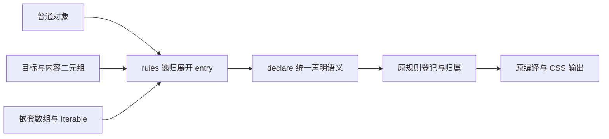

状态：已完成，独立需求、实现与精简复查通过，运行证据见[实施详情](../../agents/运行方案/261026_Rules输入统一展开与隐式声明_实施详情.md)。本 Plan 实现用户已确认的入口语义：对象字面量适合字符串属性名，二元组及其他可展开输入保留 Key／Token 目标身份；所有 entry 统一隐式经过 declare，再登记。它承接现有 [Token 设计](../../src/style-system/doc/Token设计.md)及规则登记能力，不重做 Token 迁移或业务配方。

## 目标与当前缺口

业务只表达“目标与内容”，不必为相同的声明含义重复手写 declare。对象、单个 entry、嵌套数组及标准 Iterable 都是该含义的输入形式，不能按形式产生不同声明语义。

当前 rule.ts 已递归展开普通对象与 Iterable，但二元组直接进入登记，绕过 declare；公开类型仍不完整支持对象及字符串目标。因此裸 Token entry 的显式 undefined 与手写 declare 不等价，类型与运行时也存在两套可接受输入范围。

## 全局链条与负责位置

本轮只接管 E 与 D 的连接及相应公开类型。对象自身的可枚举字符串属性按 Object.entries 展开；二元组保留目标对象，不先调用 JS 字符串化。字符串目标通过已有 Key 名称解析，后续编译与 CSS 坍缩继续由原链条承担。

| 载体 | 本轮职责 |
| --- | --- |
| src/style-system/rule.ts | 表达递归输入类型；先识别 entry，再展开对象／Iterable；每个 entry 经 declare 归一后收集，全部校验完成才登记 |
| src/style-system/operations/declare.ts | 接受已有合法字符串、Key、Token 目标；保持目标对象身份和 Token 声明语义；现成声明或修改产物不二次包成基础内容 |
| 现有规则及 Token 行为测试 | 从公开入口验证多种写法等效、根据地／状态／undefined、顺序与资源撤销；保留原子失败和循环检测 |
| 现役规则 API／行为说明 | 同步新的输入范围、隐式声明和目标身份；不改已完成历史 Plan |

## 明确的行为边界

- 单个 entry、对象及任意层标准 Iterable 可以混合，按输入顺序展开。条目只在真正组成目标与内容配对时作为 entry 消费，内容本身不被误当外层声明集合拆开。
- 对象写法和字符串 entry 使用已有 CSS 属性名称、已登记别名及自定义属性规则；对象 Key 的 JS 属性键限制由二元组形式解决，不要求 Token 改写 toString，也不把 Token 先转为名称再重建目标。
- 原始 [Token, undefined] 与 declare(Token, undefined) 等价，保留显式无基础声明；普通属性 undefined 继续不输出，集合中的裸 undefined 继续作为空项略过。
- 已有 declare、modify 和 Mixin 返回的 entry 仍可混合消费；声明语义归一必须幂等，不把现成的 CSS 声明或修改操作包成另一份普通基础值。必要识别由声明／操作的拥有者承担，rules 不新增 Token 编译分支。
- 同目标重复贡献、原始顺序、根据地状态、注册、按需资源和句柄 remove 归属继续有效。非法项、递归循环或迭代器抛错时整批不登记，已有其他登记不受影响。
- 不执行任意函数来猜测 entry；内容生产函数继续由原内容协议消费。裸字符串不是声明集合，类实例需要真实 Iterable 能力，不新增通用对象猜测或属性简写框架。
- 用户已确认 paddingY 只是输入写法示例。本轮沿用现有 CSS 属性和已登记别名，不新增属性简写或决定方向映射。

## 实施与验收

1. 独立从用户原话审查本 Plan，确认目标不是单纯放宽类型，也不是只有 Token 特判后仍绕过 declare。
2. 独立测试者先补可证伪行为：裸 Token entry 与显式 declare、混合对象与 Iterable、保留自定义 Key 的 join、已有修改产物及显式 undefined。现有非法／循环／迭代器与撤销测试按原目的复用，避免重复铺矩阵。
3. 实现者将输入差异前置收束，复用已有遍历、Key 解析及声明协议；不新增平行声明模型、兼容包装框架或编译后补救。
4. 聚焦单元及真实浏览器反例转绿，必要静态正负例验证公开类型与输入一致；运行类型检查、构建、全库单元和 Style System 浏览器回归。
5. 再从需求意图、Plan 和实现三方反查：业务写法是否真正简化、对象身份及声明含义是否保留、有没有重复识别／包装或无必要抽象。处理全部实证问题后收口，不为挑刺发明新需求。

终局必须证明实际效果等价，不以 declare 的调用次数、私有 kind 字段或节点结构作为正确性替代。没有相关失败信号时不扩展业务重构。

## 分工与记录

依据[仓库入口](../../AGENTS.md)、[Plan 落地契约](../how-to-apply-plan.md)、[任务分工](D:/mycode/ai-rules/rules/Agent-任务分工.md)、[第一性原理](D:/mycode/ai-rules/rules/Code-第一性原理.md)及[代码注释](D:/mycode/ai-rules/rules/代码注释/规则.md)。使用 Sol，不使用 Astra；源码、行为测试与独立审查分离，主 Agent 负责文档、阶段放行及运行核验。受四实例容量限制，独立来源审查兼任约束核对。

临时反例与日志放 agents/run/rules-entry/；施工开始后的永久实施详情依 Plan 契约放 agents/运行方案/，与临时任务文件区分。保留现有工作区改动，不回滚、暂存或提交。本轮没有主体未决项。
