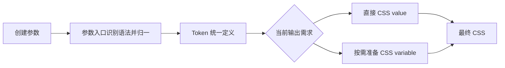

# Token 参数归一与 CSS 准备边界

状态：已完成，独立来源、职责与精简审查通过，验证结果见[本轮实施详情](../../agents/运行方案/261026_Token参数归一与CSS准备边界_实施详情.md)。本 Plan 是 [Token 迁移计划](261026_Token统一内容与CSS坍缩.md) 完成后的增量修复，只负责下列缺口，不复述或重新执行原迁移。领域依据为 [Token 设计](../../src/style-system/doc/Token设计.md) 及用户本轮“从根源看参数语法、由 parser 负责”的裁决。

## 问题、根因与修复

| 层次       | 当前事实                                                                             | 本轮改变                                                                                                      |
| ---------- | ------------------------------------------------------------------------------------ | ------------------------------------------------------------------------------------------------------------- |
| 输入语法   | 无 default 的普通对象被当成任意基础数据；token({ size: '2px' }) 输出 [object Object] | 值输入与定义对象在参数入口明确分类；普通对象和数组数据通过 default 字段显式承载，不保留旧任意对象直接包装入口 |
| 规范化结果 | 只有 default 的简写仍生成 state:{}，使同义写法取得不同 CSS 身份                      | 只有实际状态项才形成隐式 state；无状态简写归一为 undefined，七个 key 保留                                     |
| CSS 准备   | 纯值路径也无条件取得 CSSCustomProperty                                               | 需要声明身份时才取得名称/声明材料，纯值走直接内容输出路径                                                     |
| 验证       | 只比较字段与 default，漏掉跨写法的局部取值位置                                       | 先复现失败，再用等价输出和真实浏览器局部覆盖拒绝错误实现                                                      |

已确认的浏览器反例：同一来源根值 2px、当地显式覆盖 9px，直接形式的加 1px 得到 10px，只有 default 的简写却把公式放到 root，得到 3px。修复后同义输入都必须得到当地的 10px。

## 本轮定位与职责

本次只收紧参数入口 P 与 CSS 准备分支 K，不更换已完成的生命周期、声明、修改或资源算法。

- src/style-system/token/args-parser.ts 唯一负责创建输入的形态识别与七字段归一。
- src/style-system/token/core.ts 接收规范化基础定义；普通直接输入的类型签名与运行时语法保持一致，不能继续用宽泛任意对象入口隐藏歧义。
- 已有 Token、可坍缩表达式虽是 JS 对象，仍按已定的值引用语义消费；生产函数继续延迟求值，不因对象语法重构复制来源配置。
- 原始对象和数组仍可作为 default 的数据，由特殊输出方法解释。相关格式器、列表、颜色、动画与 CSS 函数创建器的必要调用改为显式 default 包装，能力不删，数据不多包一层 Token。
- src/style-system/token/compilation.ts 只在真实声明身份需求下取得 CSSCustomProperty。晚到 modify、root 缺省和注册等已定行为保持，不在下游追加“空 state 补救”。
- 现役文档仅同步此次输入语法及例子；已完成迁移 Plan 与历史资料不回改。业务抽象及视觉策略不进入本轮。

## 执行顺序

1. 独立审查本增量 Plan 对应上述问题；通过后同步 Token 设计与受影响例子。
2. 独立测试施工者先补输入等价、无状态直出、局部覆盖 10px、既有 Token 引用与函数延迟、显式 default 的格式化数据及非法裸对象拒绝等测试，记录当前失败。
3. 实现施工者集中修 parser 与创建签名，并接线必需的对象/数组调用；随后按实际身份收紧 CSS 材料准备。不能只改空 state 或在每个调用方添加例外。
4. 核对必要连带调用与格式能力未丢失；聚焦测试通过后执行类型检查、构建、全库单元与 Style System 浏览器回归。
5. 从真实代码与结果反查职责是否集中；只记录有证据的缺口，不以新增兜底层掩盖语法不完整。

## 验收与范围

- token(v)、token({default:v}) 等逻辑配置相同的输入，解析结果及消费效果等价；显式 name 或真实 state 的不同配置不被错误要求等价。
- 没有状态项时不凭空生成 state；实际状态简写与显式 state 仍保留、合并并按约定覆盖。
- 同一表达式在当地覆盖下，无状态两种形式都得到 10px，不因参数写法迁到 root。
- 普通对象/数组不再悄悄被当成直接基础数据并输出 [object Object]；必须通过定义对象的 default 承载。非法定义在入口明确失败。
- 已有 Token/表达式对象仍是直接值引用，函数不提前执行；default 中的对象、数组、空项、0、false 及 formatter 继续正确输出，当前 default 替换能力保留。
- 纯值路径不建立 CSS 自定义属性材料；具有 name/state/address/registration 或声明/modify 需求时仍取得一致身份与正确声明。
- 不增加旧模型兼容分支、不引入新的值类或构造框架；不改变对象一次生命周期、修改收敛、CSS 原生作用域和资源撤销等行为。
- 实际影响包括通用内容创建器和对应测试中的裸数据传参迁移；只改必需引用，不顺带重写 Button 或其他业务抽象。若静态检查发现真实业务调用受影响，仅做语法接线并记录理由。
- 类型检查、构建、全库单元、Style System 真实浏览器通过；审查不能仅凭测试绿认定架构已收口。

## 分工与记录

依据 [仓库入口](../../AGENTS.md)、[Plan 落地契约](../how-to-apply-plan.md)、[任务分工](D:/mycode/ai-rules/rules/Agent-任务分工.md)、[第一性原理](D:/mycode/ai-rules/rules/Code-第一性原理.md) 及 [测试写法](D:/mycode/ai-rules/rules/Code-如何编写测试.md)。

本轮沿用 Sol 施工与独立审查，不使用 Astra。独立审查者从用户语义检查增量方向；测试者先落失败行为，执行者修源码与必要调用，主 Agent 负责文档、阶段放行、独立运行与结果。当前没有需用户重复裁决的主体问题。

实施事实另记于 [本轮实施详情](../../agents/运行方案/261026_Token参数归一与CSS准备边界_实施详情.md)。原迁移 Plan 只作为基础链接，本次不改写其完成原文。
