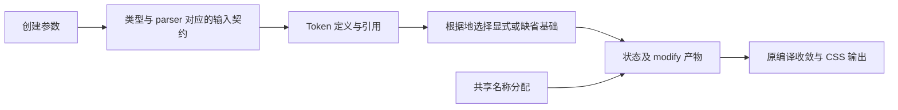

# Token 声明、命名与输入契约修复

状态：已完成。三项根因及修后反查发现的命名、资源身份问题已修复，独立复查与运行证据见[实施详情](../../agents/运行方案/261026_Token声明命名与输入契约修复_实施详情.md)。本 Plan 承接[原始 Token 迁移](261026_Token统一内容与CSS坍缩.md)及[参数归一修复](261026_Token参数归一与CSS准备边界.md)，只修再次业务复查发现的下列缺口；两份已完成 Plan 不回改。用户本轮要求是继续挑刺业务不满足项及绕路实现，避免在旧结构上叠补丁；领域依据为 [Token 设计](../../src/style-system/doc/Token设计.md)。

## 本轮问题与根因

| 问题                         | 实际失败                                                                                         | 责任调整                                                                                                                                    |
| ---------------------------- | ------------------------------------------------------------------------------------------------ | ------------------------------------------------------------------------------------------------------------------------------------------- |
| default 保障参与显式声明竞争 | 先消费自动建立 2px，后续 onCompile 在它前面插入显式 9px，最终仍为 2px；状态基础也错误            | 根据地选择先区分显式声明与自动保障；有显式就选择显式，显式之间继续遵守既有顺序。沿原绑定重访及撤销接管基础，不在最终 CSS 排序补救           |
| modify 自建名称空间          | 内部 size-modify-1-base 与合法显式同名 Token 碰撞，使后者 99px 消失                              | base、step、identity、candidate、present 全部共用已有名称分配器，保存稳定身份；不按后缀加排除规则、不建立第二个名称注册表                   |
| 类型入口仍宽于运行时语法     | 空对象、显式 TokenData 泛型裸数据能通过类型检查却被 parser 拒绝；简写和显式 state 的类型边界不同 | 直接输入类型准确表达实际内容协议与延迟内容；定义首参保留 default 的原始数据类型，状态简写与显式配置共享相同状态契约。不能靠泛型恢复非法入口 |

默认保障不是另一条显式赋值；内部编译名称不是用户可互相覆盖的公开名称；多种参数写法不是多套数据规则。这三项区分在各自责任入口完成，不把补偿继续传给消费者。

## 在原链条中的位置

本轮只修 P、D 与 M 的名称分配。Token 的统一对象模型、对象生命周期、编译波、CSS 原生作用域、注册与资源归属仍由现有链条承担。

## 载体与实施顺序

1. 独立审查本 Plan 与原始业务要求及已复现事实，再补失败测试。测试以正式入口和浏览器结果拒绝错误实现，不固定新内部名或私有构造次数。
2. 创建签名和状态简写在 token/core.ts、args-parser.ts 收敛；精确协议类型复用 content.ts 的真实协议能力，不引入另一种值对象。有效 Token、表达式、继承协议、可调用协议、合法 producer、显式 default 数据及格式器能力保留。
3. token/declare.ts 在根据地选择阶段落实显式优先；已有控制节点与 base/state 产物的身份分类一并核实，保障能沿现有释放机制撤销。
4. token/modify.ts 的内部名称统一走 custom-property-names.ts；具体缓存归属以实际操作或定义的稳定身份决定，重复编译同一输入不得因无关全局序号变化而持续产生不同 CSS。
5. 聚焦反例通过后，独立复查职责，再运行类型检查、构建、全库单元及 Style System 真实浏览器回归。结果及必要连带调用记录于实施详情。

## 验收与边界

- 显式根据地基础无论在自动保障之前还是之后进入 AST，都优先于 default；显式 undefined 不被补回，状态在选定基础上展开。多个显式声明的既有等级与源序继续有效。
- 用户显式名称与旧实现任一类内部名称形状相同时，公开值及修改结果均正确；注册、多个修改、共享 ID、跨地址及撤销行为保留。所有内部名由统一分配责任避让，不只修一个 base 后缀。
- 同一有效输入重复编译得到稳定 CSS；没有修改时不创建修改产物。
- 直接值和定义写法对合法引用与 producer 均有效；裸数据的空对象、宽泛泛型及数组不能绕过入口约束。状态简写和显式 state 接受相同的实际状态内容，不能一个形式承诺无法编译的输入。
- 不新增 formatter 自动应用于所有状态的业务含义，不重写生命周期、编译调度或 Join，不借机删除必要资源账本，不重构 Button 或业务抽象。
- 先形成有效红灯，再修实现；最终运行与独立职责、精简复查通过后才完成。没有证据的复杂性疑虑保持为未确认，不为凑问题添加抽象。

## 分工

实施事实见[本轮实施详情](../../agents/运行方案/261026_Token声明命名与输入契约修复_实施详情.md)。

依据[仓库入口](../../AGENTS.md)、[Plan 落地契约](../how-to-apply-plan.md)、[任务分工](D:/mycode/ai-rules/rules/Agent-任务分工.md)、[第一性原理](D:/mycode/ai-rules/rules/Code-第一性原理.md)及[代码清洁](D:/mycode/ai-rules/rules/Code-代码清洁.md)。沿用 Sol 测试、实现及独立审查，不使用 Astra；主 Agent 负责文档与阶段放行。受四实例容量限制，独立来源审查兼任约束核对，执行者与审查者仍分离。
