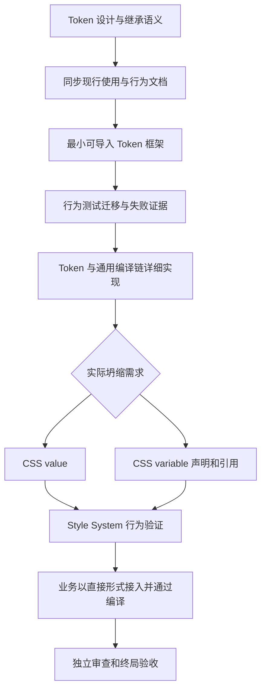

# Token 统一内容与 CSS 坍缩

状态：已完成。文档、最小框架、行为测试、详细实现、业务编译接入按顺序落地；全库单元、Style System 真实浏览器、类型检查和构建通过。业务抽象与视觉设计不属于本轮完成判断。父需求与领域定义以 [Token 设计](../../src/style-system/doc/Token设计.md) 和本轮用户明确顺序为准。本文负责从现行内容模型迁移到统一 Token 的完整区段；不存在另一个平行 Token 迁移 Plan。

## 目标与授权

将 Style System 的两套内容模型替换为 Token。非 CSS 坍缩部分不继续保留独立的旧创建入口、类型、目录转发或兼容包装。直接值、表达式引用、状态和可覆盖内容统一由 Token 表达。内容输出时才区分 CSS value 与 CSS variable。

用户已授权修改相关文档、建立框架、改写行为测试、实现代码、接入业务并运行验证；施工队不使用 Astra。本轮先后顺序是硬约束，不因批量替换方便而把详细实现放到测试之前。

## 全局图与本轮定位

本文从设计输入承接到终局验收，不把未完成的测试或代码另转为后续 Plan。业务抽象重设计不属于本轮。

## 范围与保留能力

- 现役 Style System 文档、对外入口及内部类型、内容工具、材料、声明和修改能力、编译生命周期与 CSS 输出，以及其行为测试。
- 旧独立用途变体和定义调整操作退出；用途与加工用普通函数读取定义并返回 Token。旧加工历史字段和附带声明列表退出。
- 默认 root 根据地、缺少声明才补 default、已有显式基础优先、状态基于根据地选定基础展开等既有语义继续有效。
- 保留格式化数据、列表分隔、合法零值、嵌套引用、CSS 层叠、资源共享与撤销、规则句柄、内容编译波及提交失败保护等现役能力，由统一模型接管，不借迁移删除。
- 生命周期有明确接管变化：现有 onCompile 按节点消费位置记录，目标按接受编译的对象每次编译调用一次。共享对象不再为不同位置重复执行生命周期；确需位置独立行为时，以独立的引用或内容对象表达，保留显式消费隔离，不恢复同一对象多次回调。
- 不批量重写历史 Plan，不修改业务含义、组件 Props 或用户无关代码，不回滚、暂存或提交用户工作。
- Button.style.ts 等业务调用最后改成直接的基础表达以接入 Token；仅要求它们编译通过，不将已有业务抽象、视觉配方或抽象优雅性作为本轮正确性目标，也不新增共享业务配方框架。

## 领域与载体

| 领域           | 责任与代码载体                                                                                                  |
| -------------- | --------------------------------------------------------------------------------------------------------------- |
| 定义及参数解析 | 统一 Token 类型、创建入口与七个基础参数字段；接管现有定义和内容包装，不依赖旧对象转发                           |
| 引用与计算工具 | Token 作为可坍缩表达式自然被消费；格式化与子内容组合接管旧内容包装能力，嵌套不复制来源配置                      |
| 声明和 modify  | 在 address 建立基础和状态；modify 按明确条件修改目标，促成 CSS variable 身份                                    |
| 编译器         | 扫描、对象生命周期、AST 变化、波次、相关修改完成条件和最终 CSS 输出；优先复用现有 compiler 的通用队列与归属协议 |
| 材料与效果     | pieces 以 Token 和普通函数提供基础材料，Mixin 继续表达所选效果，不保留内置用途成员表                            |
| 行为测试       | 同目录单元契约和 test/ 的多文件协作、真实浏览器 CSS 结果；删除的是已取消语义的断言，不是必要验证能力            |
| 业务           | Button 及其他调用只做新入口、直接表达和必要类型适配，不承担核心模型的兼容层                                     |

施工前完整盘点真实引用；具体新文件落点和内部方法签名在相应领域确定，不能为预定目录制造转发层或空壳。旧源码的实际路径只用于定位迁移来源，不要求目标保留旧命名。

关键接管位置如下：统一入口及创建解析放在 src/style-system/token/{index,core,args-parser}.ts，接管现有 src/style-system/variable/{core,args-parser}.ts 与 src/style-system/value.ts。声明与修改职责从 src/style-system/variable/{declare,modify}.ts 迁入 Token 领域；src/style-system/operations/declare.ts 与 modify.ts 保持操作入口，adjust.ts 退出。src/style-system/content.ts 保持通用编译协议。src/style-system/compiler/style-nodes-to-content-nodes/node-compilation.ts 负责对象编译通知，resource-compilation.ts 负责首次扫描规则共享，compilation.ts 负责推进与收敛；输出继续由 compiler/content-nodes-to-css-string.ts 承担。编译位置内容记录由 compiler/compiled-value.ts 接管为中性的内容记录，不保留另一类领域主体。具体内部拆分在不改变这些职责的前提下确定。

## 实施顺序与阶段验收

1. **文档**：以 Token 设计定稿内容同步现行 API、行为、样式写法及架构说明，特别是 onFirstScan、onCompile、默认根地址、显式声明优先及坍缩完成条件。文档不能把尚未实现的接口伪称已经发布。通过标准是不存在继续指导旧模型的现役文档契约。
2. **最小框架**：建立可实际导入的 Token 类型、参数入口和统一配置形状。只为测试接入提供最小定义，不在此阶段偷偷完成状态发布与修改链。通过标准是测试能导入新主体并识别缺失行为。
3. **行为测试**：先根据用户约定迁移并补齐可观察行为测试，记录合理失败。普通函数替代内置变体和调整；退出 priority 等已取消语义断言。测试不要求保留旧节点结构或辅助字段。没有骨架之前不将导入失败冒充行为失败。
4. **详细实现**：实现直接输出、命名声明、状态与引用、格式化、扫描和编译生命周期、modify 与 AST 收敛；逐段使测试通过。不得恢复旧类、别名包装或并行的第二套模型来取得绿灯。
5. **业务与终局验证**：Style System 行为通过后迁移必要业务调用，直接展开基础表达，仅要求类型检查和构建通过。随后由独立审查反查用户目标、旧责任接管、代码差异与实际证据。

## 核心验收

- 五种创建形式归一为 default、name、state、address、registration、onFirstScan、compileWaveIndex。特殊定义可以提供 onCompile，不能以基础字段列表禁止协议方法。
- _kind 由系统维护，可读取但调用方按约定不修改，不强制 readonly 或运行时写保护。
- name、state、显式 address、registration 或 modify 促成 CSS variable；无这些需求直接 CSS value，需要名称时自动生成。root 缺省不使所有普通值变为 CSS variable。
- token(existingToken) 和普通表达式自然引用，不复制定义，不按参数位置增加来源判定。
- onFirstScan 按同一对象每次编译只调用一次，不受 compileWaveIndex 限制；onCompile 是可操作 AST 的 void 生命周期方法，按接受编译的对象每次编译调用一次，compileWaveIndex 控制最早允许时机。独立引用对象有自己的生命周期与显式消费隔离，不把多个引用误计为同一对象的多次回调。
- 所有会影响相关 Token 的修改，包括生命周期引入的操作，都在坍缩前读取完成；不固定激活波数，也不因先读引用后读修改而生成不一致身份。
- 根据地显式覆盖、状态规则与固定状态、同址修改顺序、跨地址 CSS 原生行为、注册与继承限制均有对应行为验证。
- 重复编译不把先前自动名称误作用户显式配置；资源撤销不破坏共享使用，失败不覆盖上次成功 CSS。
- 非 CSS 坍缩部分不保留旧领域模型或旧出口；旧格式化、组合和生命周期能力被接管，业务调用能够通过编译。

## 验证与停止

按阶段执行聚焦单元测试、Style System 浏览器测试，然后运行项目类型检查和构建；框架阶段失败与测试阶段失败如实记录，不把全项目尚待迁移的错误写成核心语义已失败。终局不得遗留仍在走旧模型的正式入口、活动测试或必要业务调用。

不为了保留业务抽象而扩大核心设计，也不为了测试通过删去本计划保留能力。发现影响用户目标或已定语义的新冲突时，停止受影响段落并说明具体证据；实现细节、路径和夹具选择由施工者解决，不重复询问既定决定。

## 规则与分工

依据 [仓库入口](../../AGENTS.md)、[共享入口](D:/mycode/ai-rules/AGENTS.md)、[任务分工](D:/mycode/ai-rules/rules/Agent-任务分工.md)、[Plan 落地契约](../how-to-apply-plan.md)、[代码编写](D:/mycode/ai-rules/rules/Code-代码编写.md) 与 [测试写法](D:/mycode/ai-rules/rules/Code-如何编写测试.md)。

使用 Sol 施工实例：独立约束/需求/精简审查，核心实现，行为测试；主 Agent 负责文档、阶段交接、运行验证汇总及最终判断。代码落盘由施工实例承担，包括材料和业务接入，可在测试阶段结束后明确分配外围生产代码以避免文件冲突。核心与测试职责分离，阶段之间明确放行。独立来源审查先从用户要求反查计划，而非按作者摘要认定正确。

尚未发现需要用户新增裁决的主体问题。独立来源审查已从用户原话及 Token 设计核对全文，通过当前实施顺序、接管边界及验收。实际落点、命令、结果和偏差记录到 Agent Run，不把本计划改成流水。

实施事实记录：[Token 迁移实施详情](../../agents/运行方案/261026_Token统一内容与CSS坍缩_实施详情.md)。
