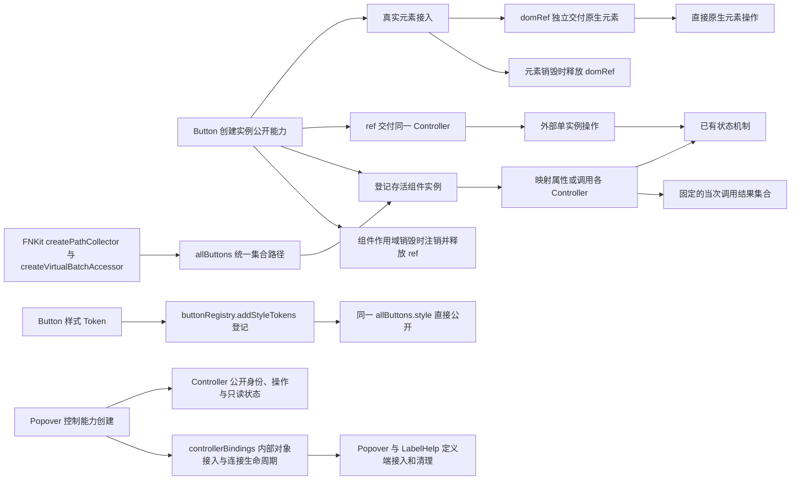

# Button 实例与整体控制入口

本计划负责下方全局图从实例公开能力到外部操作的连续区段，以 Button 落实 Kits 组件控制器，统一 Piv 的原生元素入口，并将 Popover 的公共控制能力与组件接入能力分离。通用路径和批量访问能力正式归入 FNKit，UIKit 通过包公开出口组合；其他 Kits 的公开 ref 后续迁移，本轮不新增 Popover 组件 ref。

## 目标与全局图

用户最终确认：对象称为 Controller，组件通过 `ref` 交付它；原生元素独立通过 `domRef` 交付，不属于 Controller。`createRef` 与组件 ref 配对，`createDomRef` 与 domRef 配对；Piv 只提供 domRef。整体入口采用统一可调用的批量访问器，Controller 成员路径及其方法调用结果保持集合能力，不设置方法白名单。访问器使用函数 target 与 Array.prototype 原型；FNKit isArray 识别为数组，原生 Array.isArray 为 false。原生数组方法直接返回原生结果。

Button 已有 loading、disabled 的状态操作，Piv 原有 ref 承接 DOM。本轮分开两种接收职责，复用状态、绑定和清理机制，不另建可任意改写 Props 的控制面。

## 范围与责任

| 领域与载体 | 本轮改变 |
| --- | --- |
| hooks 的 createRef | 私有 State 保存引用，返回稳定的 Partial Controller 代理和接收回调；退出时清空引用 |
| hooks 的 createDomRef | 复用 createRef 的直接引用能力，限定为原生元素，移除无人消费的 loaded 返回值 |
| Piv／Dode 的 domRef 协议 | 替换原 DOM ref 类型、绑定及插件声明，保留原初始化和清理时序，不留旧 ref 别名 |
| FNKit 的 [createPathCollector](../../../fnkit/src/structure-path-collector.ts) | 正式承接纯路径职责，唯一负责无限路径收集和读取／调用委托，不保存业务数据 |
| FNKit 的 [createVirtualBatchAccessor](../../../fnkit/src/collection-virtual-batch-accessor.ts) 与 isArray | 直接接收 Iterable 集合，处理数组接口、成员访问与调用结果；复用 getByPath，保留嵌套 parent this |
| components/utils 的 Controller 注册器 | 空创建 [accessor, registry]；第一项 accessor 直接公开为 allButtons，registry 保存存活 Controller 的 Set、维护注册清理并登记原样式 Token |
| Button 主体与公共入口 | 组件作用域登记并通过 ref 交付 Controller，onCleanup 注销与释放；外部 domRef 由 Piv 接收原生元素；allButtons.style 引用现有 Token |
| Loop、Popover、Label 与结构查看设施 | 迁移实际原生引用入口，保留列表更新、浮层监听和焦点行为 |
| Popover 的 createPopoverController | Controller 承载可公开身份、状态与操作；controllerBindings 负责内部对象接入和连接生命周期 |
| 相邻 Example、测试、规格及架构入口 | 展示分离后的实例、DOM 和整体操作，核对真实效果与生命周期 |

ButtonController 公开既有 setStatus、hasStatus；allButtons 全量映射其公开能力，成员属性、深层路径及方法调用结果通过批量访问器继续消费。原生数组方法直接绑定本次映射快照，使用原生签名和返回值，不重新包装结果或手写类型重载；固有数组成员优先于同名实例成员。VirtualBatchAccessor 类型直接组合原生数组、成员路径与调用能力。数组操作不改变注册集合。Button 将 tuple 第一项直接导出为 allButtons，第二项 buttonRegistry.addStyleTokens(buttonStyle) 仅登记原样式集合，不返回入口。创建只声明 Controller 类型，组件在公开使用 style 前完成登记，保留原 Token。原生 focus、click 等操作通过独立 DOM 引用使用。

外部已声明的 loading、disabled 继续由外部 Source 控制，Controller 不强行覆盖。预先取得的路径继续跟随当前实例；空集合也可继续访问或调用，结果仍为空集合。方法立即执行一次，结果集合固定为当次返回值，读取结果不重放操作，不等待 Promise 或解包状态。未来实例不继承旧操作。当前入口不引入 Context、ID 查询、白名单、方法缓存或操作队列。

createPathCollector 作为 FNKit 的单独函数拥有路径递归，默认调用返回当前路径，通过 get、apply 和目标创建接点处理终端行为。createVirtualBatchAccessor 只消费路径、直接传入的集合和结果，数组及 Controller 职责不进入路径收集器；输入不接受 getter。UIKit 注册器从 `@edsolater/fnkit` 导入 createVirtualBatchAccessor，并直接传入 Controller Set。

用户明确授权这次跨库破坏性改名及无兼容迁移：FNKit 原节点数据承载、加载、标记和缓存职责退出，旧入口不留别名；UIKit 临时副本及相邻测试移出，正式实现、导出、索引和测试由 FNKit 唯一承接。不发布或修改版本，不扩展到其他项目。

组件 ref 由 Button 自身作用域交付，onCleanup 注销并释放；Piv 不定义或消费 ref。外部 domRef 沿 props 交给 Piv 接收原生 button。if 关闭只释放 DOM 引用，Controller 与组件 ref 继续有效，隐藏期间仍接受实例和整体操作；只有 Button 作用域销毁才注销并释放组件引用。保留 ComponentMarker、点击插件、分类、样式所有权和独立 Source Token。

Popover Controller 提供可供外部关联的 popoverId、triggerId，showPopover、hidePopover、togglePopover 和只读 isOpen。身份即使在内部使用，也不因此成为 bindings。controllerBindings 只聚合 popoverDomRef、triggerDomRef，供 Popover 与 LabelHelp 定义端将内部对象接入 Controller，并建立、释放连接。isOpen 复用既有 stateView 建立只读边界，继续跟随内部同一状态；不把原 State 仅强转为只读类型，也不增加可写状态镜像。

## 实施与验收

1. 建立引用接收与 Controller 注册机制，将 Piv 原生入口统一为 domRef，再接入 Button，迁移全库真实 DOM ref 消费和插件声明。
2. Example 展示 `button.setStatus?.(...)` 与 `buttonElement.focus?.()` 分别访问组件和原生能力。引用不公开通用取值入口，方法与 getter 保留实际对象的 this。Popover 在真实 domRef 接收时建立原生监听并清理，不围绕 State 解包原生元素。
3. 浏览器验证两个入口同时消费、状态操作、实例隔离、整体转发、外部状态归属，以及 if 隐藏后 Controller 继续有效、DOM 重现当前状态、外层 Show 销毁组件才注销和新实例不继承历史命令。既有 Piv、Popover、Label、结构查看检查保留初始化、浮层和焦点效果；类型检查与构建核对公开出口和全部调用方。
4. Popover 与 LabelHelp 从 Controller 读取身份、状态和操作，通过 controllerBindings 完成内部元素接入；既有 Popover 默认打开及 Label 浮层、焦点场景保持。类型检查核对 tuple 全部调用者，不增加只为检查对象字段而存在的测试。
5. FNKit 原有节点底座改为 createPathCollector，createVirtualBatchAccessor 直接消费集合，相邻场景验证空路径后接入、深层方法 this、固定调用结果，以及原生 map 的返回值与参数交接；公开 index 和 reference 同步，不留兼容入口。不重复验证原生 Array 自身的算法和类型推导。
6. FNKit 构建正式包后，再核对 UIKit 链接依赖的类型和构建，既有 Button 浏览器场景消费批量操作与查询结果。FNKit isArray 为 true、原生判断为 false；基础分类变更运行 FNKit 现有单元测试，不新增证明脚本。

原生 ref 旧别名残留、销毁后仍被整体操作、命令改变外部控制状态，均属于不通过。相关检查完成后停止，不新增证明脚本、内部字段断言或重复测试。

## 状态与约束

已完成 ref 与 domRef 分离、Button 控制器接入及 Popover 的 controllerBindings 分离，独立来源审查和实现审查通过；验证与实际改动见[实施详情](../../agents/run/261030_Button实例与整体控制入口_实施详情.md)。适用[仓库入口](../../AGENTS.md)、[任务分工](../../../ai-rules/rules/Agent-任务分工.md)、[第一性原理](../../../ai-rules/rules/Code-第一性原理.md)、[代码清洁](../../../ai-rules/rules/Code-代码清洁.md)、[测试写法](../../../ai-rules/rules/Code-如何编写测试.md)与[组件职责和样式归属](../guide/组件职责与样式归属.md)。执行负责人实施，独立实例分别检查约束语义及复用精简。
