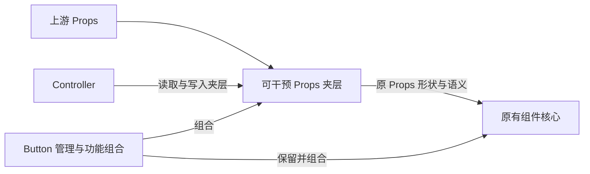

# Button 实例与整体控制入口

**当前状态：先前核心改造方向不通过，待按可干预 Props 夹层重新形成方案。** 本 Plan 仍是该目的的唯一计划；把先前改造拆成黑盒或整体搬进 helper，不构成这次方向纠正。

本轮只修改文档，不修改功能代码或测试，不执行 Git 回退、暂存或提交。用户已说明代码需要回退，但本轮没有选择具体版本或回退范围，也不宣称回退已经执行。

## 目标与全局关系

上游 Props 向下传递时，在它与原有组件核心之间接入可干预 Props 夹层。Controller 只对夹层读取、写入和注入临时行为；夹层向核心输出的仍是原 Props 协议。核心不需要知道新增夹层或 Controller，也不为它改写事件、DOM、variant、HTML、引用等消费机制。

State 可以用于夹层实现和 Controller 接口；所有 Prop 以原名提供可写状态，不创建镜像或第二份状态。原核心继续按已有 Props 协议工作，包括该协议原本允许的 Source／State 形式，不被要求主动读取新增 State。完整约定见[组件 Props 与 Controller 状态](../guide/组件Props与Controller状态.md)。

Props 应独立支撑组件完整构建与日常使用。Controller 是临时逃生舱，消费者理解组件后按君子协定操作；保留函数值语义、原名映射、组件实例作用域，不增加权限或写入仲裁。

## 被撤销的前提

先前方案要求核心直接消费每个 State，再为未传字段、事件、variant、DOM 和引用等链路补齐动态消费。这改变了核心的处理职责，不是只在 Props 流动中插入夹层。

因此，新方案不再把这些核心机制的抽取、拆分或改写列为施工路线。即使把它们放进有名称的黑盒，只要仍要求核心为 Controller 改变消费协议，就没有兑现当前目标。

全部 Props 可干预仍是目标，不能以旧核心中的初始化快照为由排除某些字段，或将范围缩成只支持持续读取的 Prop。如何由夹层透明兑现需要在方案中闭合，不能用修改核心补偿，也不能先宣称未知动态能力已经成立。

## 待重写方案必须明确的关系

| 关系 | 需要说明的契约 |
| --- | --- |
| 上游 Props 与夹层 | 全部字段如何进入可干预入口，原名、函数值和既有来源语义如何保留 |
| Controller 与夹层 | 如何直接操作同一状态，不复制状态、不引入权限或写入仲裁 |
| 夹层与原核心 | 如何输出原 Props 形状与语义，使核心无需感知或配合新增接入机制 |
| 实例作用域 | 夹层与 Controller 如何归属组件实例并清理，不转移到元素或 Piv 分支作用域 |
| Button 的管理职责 | 如何只组合夹层与原核心，而不是重新实现或包装核心消费算法 |

本轮不指定新的 hook、代码 API、schema、注册器、动态 tag 策略或回退版本。方案尚未闭合，不能按先前核心改造细节继续施工。

## 独立的 Piv 需求

纯 shadowProps 支持 as／if 的目标与当前阶段限制由 [Piv SPEC](../../src/components/Piv/SPEC.md#声明与来源) 承接。它是独立需求，不作为本 Plan 的夹层阶段、前置条件或验收内容；既有 if 脱离保留实例目标及未决交互边界保持。

## 验证事实与后续判断

先前类型检查、构建、单元与浏览器检查通过的事实保留在[实施详情](../../agents/run/261030_Button实例与整体控制入口_实施详情.md)。这些检查说明当时的行为，不证明核心改造路线被接受，也不证明新的夹层已实现。

后续首先检查主线是否保持上游 Props → 可干预 Props 夹层 → 原核心，Controller 是否只操作夹层，是否仍在要求核心为新增 State 接入改消费机制。方向成立后，再按闭合方案验证全部 Props 干预、来源与函数值语义、原 Props 协议、同一状态和实例生命周期；不把独立 Piv 需求混入这项验收。

## 状态与约束

当前方向纠正后的方案仍待重写，本轮交付仅是文档。本轮没有改动功能源码、测试或 Git 暂存状态，没有代选回退范围，也没有执行或宣称代码已回退。

依据[仓库入口](../../AGENTS.md)、[任务分工](../../../ai-rules/rules/Agent-任务分工.md)、[第一性原理](../../../ai-rules/rules/Code-第一性原理.md)、[代码清洁](../../../ai-rules/rules/Code-代码清洁.md)与[组件职责和样式归属](../guide/组件职责与样式归属.md)。作者维护当前授权文档，独立实例检查思想主线、职责与范围；本轮只做文档及链接检查，不运行测试或构建。
