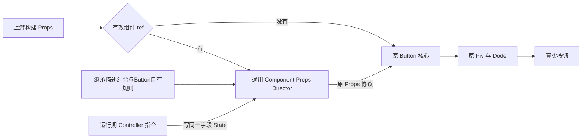

# Button 实例与整体控制入口

## 目标与当前决策

本 Plan 是 Button 可干预 Props 的唯一现役计划。Props 表达构建声明，也保留原有 Source 响应能力；Controller 仅用于运行期回调、生命周期中的特殊指令，或 Props 表达非常迂回的复杂需求。初始化必须通过 Props 表达。

只有创建时提供有效组件 `ref` 接收器，才启用通用 Component Props Director。未提供组件 ref、ref 实际为 undefined、只有 domRef 时，直接执行原 Button 核心，不建立字段 State、默认准备或控制器登记。先前无条件为每个 Button 建立全部字段 State、修改 Piv 与分类解析器补偿的方案已退出。

## 全局关系与本轮边界

本 Plan 持有从上游 Props 到 Button 核心的全局图，并负责可选控制层及 Button 接线。Piv/Dode、其helper及原Variant/Status解析器的运行函数体保持原样；各字段拥有者在相邻Owner.prop.ts维护自己的描述常量；它们不识别 Controller，不承担本层的适配责任。

Button 内部业务函数保留 `Button` 名称；外层 `ButtonPropsDirector` 按本轮命名裁决作为公开 Button 导出。外层管理组件 ref 和集合登记，核心只保留原分类、状态和 JSX 组合。样式仍由 Button.style.ts 拥有，ComponentMarker 边界不增加或移除。

## 通用层与 Button 定义

通用 `componentPropsDirector.ts` 接受上游 Props、完整运行时字段定义和不可变默认来源工厂表，返回原名 Controller State 及 Props 视图。未来 Text/Card 可复用；通用层没有 Button、variant、status、ref 或 DOM 字段名。

运行时定义区分三种State视图：state-source-view直接交同一State给原消费者；state-value-view在原消费处读取当前值并正常追踪；state-untracked读取当前值但取消本次外层依赖追踪，不缓存或冻结。only-through-prop字段直接读取上游，不建立可写State、不进入Controller；ref采用此模式。不能统一提前解包所有字段，再修改底层规避诊断。

各字段首次被 Props 或 Controller 读取时，使用现有 createState 的惰性可写计算建立并缓存；不因支持35字段就立即分配35个State。工厂及State统一归Director创建时捕获的组件作用域，首次读取即使发生在短命显示分支或回调，也不改变归属。普通函数作为值保存，替换用 `set(() => nextCallback)`。Controller 取得某字段时只初始化它，再返回原 State，避免首次指令被原生惰性初始化覆盖。没有镜像 Effect、第二份字段值、响应式存在性集合或写入优先级。

输入视图始终保留 raw 的属性存在性；输出视图使用 raw 加 defaultSources 已定义的字段，减去组件指定的 omit。默认工厂表在进入Director前完整确定；原未声明字段首次建State时调用对应工厂一次取得稳定Source，raw显式undefined也不调用工厂。输入从第一刻就读取同一缓存State，捕获输入Source不会绕过Controller；不存在准备后回填默认值的阶段。读取或指令写入不会动态改写声明形状，上游对象保持原样。未知字段透传，反射保持自有属性与继承属性的区别。

Button.prop.ts组合35个支持字段的JS描述，按Props类型extends的顺序继承Dode的9个DOM字段、公共能力的2字段、Piv自己的4个来源字段及ComponentMarker的2个说明字段，只手写Button自有18字段。描述常量统一放在各自相邻Owner.prop.ts中，类型接口留在原模块，以type-only导入通用协议检查完整性；不进入底层消费算法。Button的候选与状态配置供核心和默认来源定义共用。只有受控分支准备以下必要入口：

- loading/disabled 默认 Source，使原 StatusParser 初始化时消费同一字段 State；未声明也能运行写入。
- 每个缺省group的默认工厂复用该组原VariantParser的语义details，不传mapping，继续读取同一candidate States。输出只省略原缺省group的candidate，原已声明group保留candidate交核心报告原冲突。Button在调用核心前明确建立4个分组Source对象而不val，保持构建期诊断并由核心实际消费同一来源；不是只警告丢结果的额外解析。原核心映射一次，raw显式group包括undefined仍优先。
- draggable/droppable的默认undefined入口由公共能力领域描述，经Piv继承后由Button组合，使原快捷能力的创建阶段来源筛选接入这些动态Source；默认不创建插件实例。其它持续字段沿原消费链直接读取，无需制造存在性。

默认来源工厂定义在Director创建前完整确定，实际来源按字段建立；Button分组Source的建立在组件ref交付前完成。group 与 candidate 指令沿同一条原生数据流；不复制候选选择算法，不把已映射的 HTML 值再次映射。

## 生命周期与公开入口

ButtonController除only-through-prop字段外，按Prop原名公开可写State，不恢复 setStatus/hasStatus 别名。外部已声明的来源也可被指令写入；后续来源重新计算仍遵循原生 State 语义，不回写上游。

allButtons 只包含启用组件 ref 的当前实例，普通按钮不为集合控制承担缓冲成本。style 仍是原 Token 集合，命令不影响未来实例。

组件ref只能通过上游Prop提供；Prop换接时由外层原生响应式动作清理旧接收器并交付同一Controller，禁止controller.ref.set，实例卸载释放引用和登记。domRef 属于真实元素，独立于组件 ref，不触发控制层。

as 仍在首次实际元素创建时固定；if 是否建立 Show 仍由初始声明决定，已声明条件可持续更新。插件、domRef、shadow 结构按原元素生命周期消费。State 可写不等于追溯重放创建动作；没有 if 的普通路径不会因后来赋值补装 Show。

## 实施与验收

先完成通用层与 Button 运行时定义，再接 ref 门控和外层管理，最后迁移 Example/领域说明及真实行为测试。载体为 components/utils/componentPropsDirector.ts 及相邻测试、Button.prop.ts、Button.tsx、Controller 浏览器测试、Example 和领域 SPEC。Piv、Dode和原分类/状态解析器的算法不在改动范围；继承字段的相邻Owner.prop.ts描述归原拥有者。

必须验证普通按钮及 domRef-only 不登记；受控缺省状态、分类、确定描述词、内容、class/id/htmlProps/name 与事件替换真实进入 DOM；外部 Source 后续更新不断流；ref 换接与隐藏重建/卸载清理；allButtons 只操作受控实例。不能以 State 自身变值替代真实消费者证明。

完成小规模无头功能、类型和构建后，比较本轮冻结的精简前Director与当前实现创建10000个同输入、每实例都带真实组件ref的Button；历史不利结果留在Run证据，不与本轮跨批混算。用 CLI Playwright headless，不使用 Computer Use。旧新各独立浏览器进程，创建返回立即保存耗时，再校验数量和真实内容；可以关闭专属进程释放资源，避免强制 GC 或巨量响应节点显式销毁。整组由外部父进程守护，100 秒硬上限覆盖卡住的 renderer 与关闭阶段；先以小型自检验证只结束专属子进程树。超时保留 partial，不扩堆、不追加重跑，不把未完成样本当速度数字。

实际命令、哈希、结果和偏差只写 agents/run/。功能失败或触犯禁止边界则不宣称完成；性能不利结果照实报告。当前为已授权实施计划，完成状态以本轮证据为准。

## 规则与分工

依据[仓库入口](../../AGENTS.md)、[任务分工](../../../ai-rules/rules/Agent-任务分工.md)、[第一性原理](../../../ai-rules/rules/Code-第一性原理.md)、[代码清洁](../../../ai-rules/rules/Code-代码清洁.md)、[组件职责与样式归属](../guide/组件职责与样式归属.md)及[Plan 写法](../how-to-write-plan.md)。独立约束与复用/精简实例核职责、必要性和真实消费；未参与写作者阅读全文复述。本轮不写 Git/index，保留用户其它修改。
