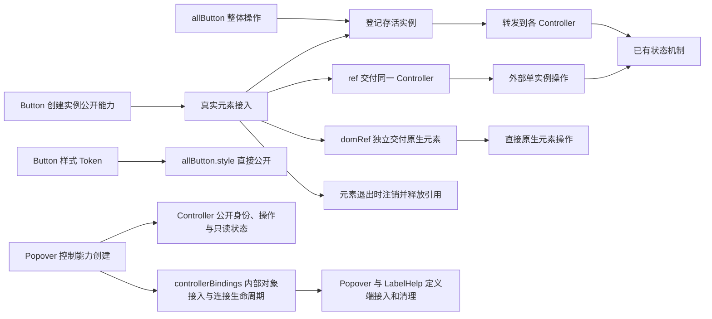

# Button 实例与整体控制入口

本计划负责下方全局图从实例公开能力到外部操作的连续区段，以 Button 落实 Kits 组件控制器，统一 Piv 的原生元素入口，并将 Popover 的公共控制能力与组件接入能力分离。其他 Kits 的公开 ref 后续迁移，本轮不新增 Popover 组件 ref。

## 目标与全局图

用户最终确认：对象称为 Controller，组件通过 `ref` 交付它；原生元素独立通过 `domRef` 交付，不属于 Controller。`createRef` 与组件 ref 配对，`createDomRef` 与 domRef 配对；Piv 只提供 domRef。整体入口通过 Proxy 将操作转发到当前所有实例。

Button 已有 loading、disabled 的状态操作，Piv 原有 ref 承接 DOM。本轮分开两种接收职责，复用状态、绑定和清理机制，不另建可任意改写 Props 的控制面。

## 范围与责任

| 领域与载体 | 本轮改变 |
| --- | --- |
| hooks 的 createRef | 私有 State 保存引用，返回稳定的 Partial Controller 代理和接收回调；退出时清空引用 |
| hooks 的 createDomRef | 复用 createRef 的直接引用能力，限定为原生元素，移除无人消费的 loaded 返回值 |
| Piv／Dode 的 domRef 协议 | 替换原 DOM ref 类型、绑定及插件声明，保留原初始化和清理时序，不留旧 ref 别名 |
| components/utils 的 Controller 注册器 | Set 保存存活 Controller，Proxy 只转发明确列出的命令，保留方法的实例 this |
| Button 主体与公共入口 | ref 交付不含 DOM 的 ButtonController；内部 domRef 负责登记与注销，外部 domRef 正常合并；allButton.style 引用现有 Token |
| Loop、Popover、Label 与结构查看设施 | 迁移实际原生引用入口，保留列表更新、浮层监听和焦点行为 |
| Popover 的 createPopoverController | Controller 承载可公开身份、状态与操作；controllerBindings 负责内部对象接入和连接生命周期 |
| 相邻 Example、测试、规格及架构入口 | 展示分离后的实例、DOM 和整体操作，核对真实效果与生命周期 |

ButtonController 公开既有 setStatus、hasStatus；allButton 只转发无返回值的 setStatus。多个实例的查询不伪装成一个结果。原生 focus、click 等操作通过独立 DOM 引用使用，不机械包成 Controller 方法。

外部已声明的 loading、disabled 继续由外部 Source 控制，Controller 不强行覆盖。整体命令仅作用于调用当时的存活实例，未来实例不继承命令。当前全局入口不引入 Context、ID 查询、操作重放或 setProps、setDefaultProps。

组件 ref 由 Button 消费，Piv 不定义或消费 ref。内外 domRef 沿既有声明合并共同接收实际 button；if 关闭或组件卸载后分别清理。保留 ComponentMarker、点击插件、分类、样式所有权和独立 Source Token。

Popover Controller 提供可供外部关联的 popoverId、triggerId，showPopover、hidePopover、togglePopover 和只读 isOpen。身份即使在内部使用，也不因此成为 bindings。controllerBindings 只聚合 popoverDomRef、triggerDomRef，供 Popover 与 LabelHelp 定义端将内部对象接入 Controller，并建立、释放连接。isOpen 复用既有 stateView 建立只读边界，继续跟随内部同一状态；不把原 State 仅强转为只读类型，也不增加可写状态镜像。

## 实施与验收

1. 建立引用接收与 Controller 注册机制，将 Piv 原生入口统一为 domRef，再接入 Button，迁移全库真实 DOM ref 消费和插件声明。
2. Example 展示 `button.setStatus?.(...)` 与 `buttonElement.focus?.()` 分别访问组件和原生能力。引用不公开通用取值入口，方法与 getter 保留实际对象的 this。Popover 在真实 domRef 接收时建立原生监听并清理，不围绕 State 解包原生元素。
3. 浏览器验证两个入口同时消费、状态操作、实例隔离、整体转发、外部状态归属，以及 if／卸载注销和新实例不继承历史命令。既有 Piv、Popover、Label、结构查看检查保留初始化、浮层和焦点效果；类型检查与构建核对公开出口和全部调用方。
4. Popover 与 LabelHelp 从 Controller 读取身份、状态和操作，通过 controllerBindings 完成内部元素接入；既有 Popover 默认打开及 Label 浮层、焦点场景保持。类型检查核对 tuple 全部调用者，不增加只为检查对象字段而存在的测试。

原生 ref 旧别名残留、销毁后仍被整体操作、命令改变外部控制状态，均属于不通过。相关检查完成后停止，不新增证明脚本、内部字段断言或重复测试。

## 状态与约束

已完成 ref 与 domRef 分离、Button 控制器接入及 Popover 的 controllerBindings 分离，独立来源审查和实现审查通过；验证与实际改动见[实施详情](../../agents/run/261030_Button实例与整体控制入口_实施详情.md)。适用[仓库入口](../../AGENTS.md)、[任务分工](../../../ai-rules/rules/Agent-任务分工.md)、[第一性原理](../../../ai-rules/rules/Code-第一性原理.md)、[代码清洁](../../../ai-rules/rules/Code-代码清洁.md)、[测试写法](../../../ai-rules/rules/Code-如何编写测试.md)与[组件职责和样式归属](../guide/组件职责与样式归属.md)。执行负责人实施，独立实例分别检查约束语义及复用精简。
