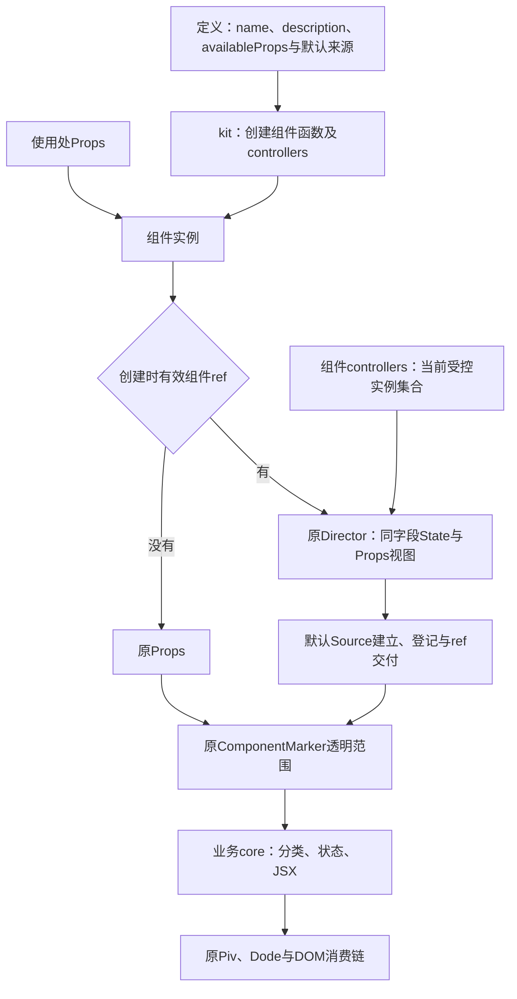

本 Plan 用 `kit(definition, core)` 统一组件定义，先声明组件身份与协议，再直接阅读分类、状态和 JSX 本体。用户已授权实现 `src/components/utils/kit.ts`，业务先接 Button，观察接法与效果；不迁移其它组件。

# 目标与当前裁决

Button 原入口逐个安排 ref 门控、Director、四组 Source 准备、registry 登记、ref 换接和 ComponentMarker。kit 接管这些共同接线，业务核心只消费原 Props 和可选的通用能力对象。减少模板的标准是本体清楚、责任连续，不能通过隐藏业务来取得短代码。

最新裁决覆盖早先 core 在前、kits/kit.tsx 路径及独立第三份 Button definition 的草案：精确使用 `utils/kit.ts`、定义在前、core 在后。定义对象中的 `name` 是共同机制的唯一身份，`description` 是定义端默认用途，`availableProps` 复用现有 Director 字段协议。外部 Props 的用途说明继续优先。默认来源和样式选项也在同一对象中。第一个参数是定义期确定、供通用层消费的配置契约，可以包含工厂；第二个参数是具体组件自己的业务函数。代码归属取决于服务对象：Controller 注册和注销属于 kit，具体组件的资源属于 core，不能按 onMount、onCleanup 等执行时机划分。

[Button 实例与整体控制入口](261030_Button实例与整体控制入口.md)继续持有 Controller 原能力与验收，本 Plan 接管定义入口，不删除或放宽其行为要求。

# 全局关系与本轮位置



当前涉及文件：

```text
src/components/
├─ utils/
│  ├─ kit.ts：定义契约、共同实例流程与Context能力
│  ├─ componentPropsDirector.ts：字段State与Props视图、默认来源构建，公开原options类型
│  └─ controllerRegistry.ts：原Set与批量入口，根style类型按Token命名空间收束
├─ kits/Button/
│  ├─ Button.tsx：kit定义与业务core
│  ├─ Button.prop.ts：继承Owner.prop、候选、默认来源与输出选择
│  └─ Button.style.ts：Button唯一样式拥有者，原对象保留
├─ ComponentMarker/：原透明范围、用途与结构查看
└─ index.ts：公开kit与定义所需协议
```

kit 没有独立 UI 身份，不新增 DOM、Marker 层或样式文件；不改变 Piv、Dode 和分类／状态解析器的运行函数体。既有 KitContext／KitContextRoot 仍只负责祖先数据，kit 不要求 App 提供根，不将定义身份混入祖先查询。

# 公共 API 与定义归属

```tsx
export const Button = kit(
  {
    name: 'Button',
    description: '执行动作',
    availableProps: buttonPropsDefinition,
    directorOptions: getButtonPropsDirectorOptions,
    styleTokens: buttonStyle,
  },
  (props: ButtonProps, context) => {
    const { variantShadowProps } = parseButtonVariantProps(props)
    const { statusShadowProps } = parseButtonStatusProps(props)
    return <Piv /* 原属性与子内容 */ />
  },
)
```

core 的第二参数可以省略；传入时是普通能力对象，可整体使用或解构，不依赖 `this`。当前选定最小能力为 `name` 和 `onCleanup`：前者供 clickable 使用同一身份，后者将资源清理登记到组件实例 owner，包含后续事件中创建的资源。这个最小集合是依据已有机制选择的实施方案，不表示用户钦定了具体能力字段。能力本身不创建 Controller，也不要求核心手动启用共同包装。

```ts
interface KitRenderContext {
  readonly name: string
  readonly onCleanup: (cleanup: () => void) => void
}
type KitCore<Props> = (props: Props, context: KitRenderContext) => JSX.Element
interface KitDefinition<Props, Definition extends PropsDefinition<Props>, Style = undefined> {
  name: string
  description?: ComponentDescriptionProps['description']
  availableProps: Definition
  marker?: (props: Props) => Pick<ComponentMarkerProps,
    'defaultDescriptionDisplay' | 'descriptionOnly'>
  directorOptions?: (input: Props) => PropsDirectorOptions<Props, Definition>
  styleTokens?: Style
}
type KitComponent<Props, Controller, Style = undefined> = {
  (props: Props): JSX.Element
  readonly controllers: Omit<VirtualBatchAccessor<Controller>, 'style'> &
    (Style extends undefined ? {} : { style: Style })
}
```

`KitDefinition` 的说明直接复用既有 `ComponentDescriptionProps['description']`；`availableProps`、默认来源、omit 与输出视图复用 Director 协议，不造另一套元数据。`PropsDirectorOptions` 只是为 Director 原第三参数命名，字段读取与同State协议保留；未声明字段的默认来源统一在Director构建时建立，Source值仍按需读取。

包根同时公开原拥有者的 pivPropsDefinition、pivDefaultSources 与 componentDescriptionPropsDefinition，供外部继承组件组合完整表；不再向外导出更低层协议，也不新造字段合并 helper。

公开 `kit` 签名同时要求完整字段表、`ref: 'only-through-prop'`、接收对应 Controller 的 ref，以及 `DirectedProps<Props, Definition> extends Props`。错误接收器、让 ref 进入 Controller、把 State 视图交给只接受普通值的核心都应在编译期拒绝。实现中只有 directed.props 到 Props 的单处断言，用于表达泛型函数体不能继承的条件类型证明，不能扩大成 any 或在使用方逐个强制类型。

`marker` 保留真实的定义端展示协议：Text 现有默认展示选择需要 getter，且可选 descriptionOnly。kit 逐字段延迟转交，不展开或快照。默认用途只来自顶层 description，marker 不另提供 defaultDescription。例如未来 Text 可返回 `{ descriptionOnly: true, get defaultDescriptionDisplay() { return Boolean(val(props.description)) } }`；此例不授权迁移 Text。

`styleTokens` 可选；提供时 `.controllers.style` 是原集合及原 Token，身份不变。不提供时没有 style 自有命名空间，公开类型也不暴露该根入口。底层 Proxy 仍会收集任意路径，不能把类型省略解释为读取必得 undefined。Controller.style 保留单体 State 含义；根 `.controllers.style` 从批量类型先 Omit，再加入精确 Token 类型。数组方法、数字索引与成员调用结果仍沿用 FNKit；不将根对象的 Omit 处理推广到任意函数访问器，不修改 FNKit。

# 实例流程与责任接管

模块定义时建立该组件独立 registry 和 `.controllers`，可选登记原 style 对象。每个实例单独捕获 owner、提供 Context 能力；不同定义、不同实例不混用生命周期。

创建时取消跟踪读取原 ref。无 ref、值为 undefined 或仅有 domRef 时，直接把原 Props 交给 core；不调用 directorOptions／初始化，不创建字段 State、不登记。创建后新增 ref 不追溯启用 Director。

初始 ref 有效时，依次执行 directorOptions → Director 建立默认来源 → 登记 → 响应式 ref 交付，再进入共同 Marker 与 core。换接清理旧接收器并交付同一 Controller，不重建核心或 Director；销毁清理接收器和登记。if 隐藏只释放原 DOM，组件 owner、Controller 和登记仍存活，隐藏期间的字段指令在再显示时生效。

两分支都只由同一个原 ComponentMarker 包住完整 core 结果。通过 `createComponent` 与惰性 children 在 Marker 消费时执行核心，取消外层跟踪；Marker 当前只消费 children 一处，因此核心只执行一次。不能声称 createComponent 本身缓存组件，也不能先执行 core 再包装已产生节点。

Button 的旧 ButtonPropsDirector、手写 ref／registry 与 Marker 全部退出。核心保留 Variant／Status 解析、clickable 与原 Piv JSX；默认来源的建立统一归 Director，保留构建期警告且不 val。Button 不再提供初始化回调，kit 与 Director 均不感知分组、候选、loading、disabled 或默认来源内部的业务规则。

四种字段模式、缺省字段可写、Source 持续更新、普通函数身份、getter 与存在性、初始 as／if、插件、domRef 与 shadow 的生命周期均沿原链保留。没有 wrapper 插件链、公共业务中间件或额外 Root。

# 验收与停止条件

静态验收核对 Button 入口是否直接呈现定义与业务本体，旧共同接线是否完整撤除；同时查唯一 Marker、实际 Piv／插件依赖与 Button.style.ts 所有权，不能以类型通过替代。

行为验收继承原 Button Controller 与 Example：无 ref、undefined、domRef-only 不登记；缺省与显式字段、group／candidate、loading／disabled、children、class、id、htmlProps、name、事件替换到达 DOM；Source 后续更新、函数保值、ref 换接、隐藏与卸载、创建结构语义不回放。kit fixture 补充无 App 根、多根透明范围、默认无定位层、两个定义隔离、核心单次执行、Context 解构及后续登记归原 owner、用途覆盖和动态 marker getter。

类型验收检查原 Props 调用、Controller 全集与缺省字段、ref 排除与接收器关联、错误字段模式拒绝、无样式定义与精确 Token 命名空间，以及数组／索引／成员调用结果协议。`Button.controllers` 的集合行为和原 style 对象身份必须真实通过。

功能、类型和构建通过后，仅做一组新旧各 10000 个实际组件 ref 的 Button 测量。新旧各独立 CLI Playwright headless 浏览器进程，创建返回先保存耗时再校验数量与真实内容；整组外部父进程 100 秒硬预算含关闭。先验证专属进程树守护。禁用 Computer Use，不强制 GC、不增堆、不重跑超时样本，不扩大 100000；原始样本与 partial 保存在 agents/run/kit-integration。不能用旧无 ref 样本抵消当前结果。

# 实施与验证状态

后续职责修订：删除组件自定义初始化回调，默认来源由 Director 构建；受控集合统一改为 Component.controllers，不保留 Button.all 或 allButtons 别名。本次相关单元 8 项、浏览器 10 项、类型检查与构建均通过，不追加压力测试。证据位于 agents/run/kit-revision/。下述全量与性能结果属于首次迁移的历史证据，不代表此次修订后的重新测量。

已实现 kit 与 Button 首次接入。类型检查与构建通过；原 Button Controller 七项与 kit 三项真实浏览器通过，完整浏览器中的 Marker／结构查看用例也通过。新单元类型用例验证精确样式类型、数组／索引／成员结果协议，错误 ref、错误字段模式与可写 ref 编译负例均生效。

全量并非全绿：单元 522／524 通过，浏览器 270／281 通过。将冻结 Button、Director、registry 原文通过只读加载替换，在原测试路径和输入上复跑失败文件：基线重现同两项单元失败和同十一项浏览器失败，失败名称集合一致。原问题涉及 jsdom submit、样式聚合及旧尺寸／精度／交互预期；全量另有 Example view transition 的未处理拒绝。未扩大修改这些原有问题，也不将其报告为通过。对照见 agents/run/kit-integration/baseline-comparison.json。

真实 /examples/button 的单体 loading、批量复位、结构查看开启与关闭均通过，默认无 Overlay，无 pageerror。已目视普通与定位截图，布局保持、按钮标注为单一 Button 身份。证据为 agents/run/kit-integration/example.json、button-example.png、button-structure.png。

唯一 10000 实际组件 ref 测量已完成：迁移前 1407.8 毫秒，kit 后 1359.4 毫秒；两边 DOM、Marker、Controller 均为 10000，外部整组含关闭 5277 毫秒，未触及 100 秒预算。新旧各独立 Edge，均无页面错误；单组不作统计显著提速结论。原始结果在 agents/run/kit-integration/performance.json，守护自检在 watchdog-self-test.json。迁移前原文仍保留在 before，未改变基线。

完整命令结果及证据入口见 agents/run/kit-integration/README.md；没有使用 Computer Use，没有强制 GC、增堆、超时重跑或扩大到十万。
独立约束检查者与精简者已完成 API 前置及最终差异复查，公共出口补齐后均通过，无遗留意见；约束检查者已阅读最新全文并完整复述思想。比例适当的验证完成，本轮施工与验收收口，不再扩展组件或追加压力测试。

本轮依据 AI Rules 的[执行](../../../ai-rules/rules/Agent-AI-Rules执行.md)、[理解意图](../../../ai-rules/rules/Agent-理解意图.md)、[任务分工](../../../ai-rules/rules/Agent-任务分工.md)、[第一性原理](../../../ai-rules/rules/Code-第一性原理.md)、[代码清洁](../../../ai-rules/rules/Code-代码清洁.md)、[SolidJS 组件编写](../../../ai-rules/rules/SolidJS组件编写/规则.md)、约束检查与精简，以及本项目[组件职责与样式归属](../guide/组件职责与样式归属.md)、[组件结构查看](../guide/组件结构查看.md)、[样式文件写法](../style/样式文件写法.md)、[Plan 写法](../how-to-write-plan.md)和[Guide 写法](../how-to-write-guide.md)。
