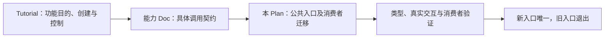

# Plugin 能力声明与 Popover 连接 API 迁移

状态：文档归位及迁移审阅稿，尚未开始代码迁移。用户已确定目标表达，本轮仅授权整理文档；此前“先不要急着实现”的边界继续有效。

本 Plan 负责[全局图](#全局图与本轮位置)中的公共能力声明及调用迁移：把已确定的 Tutorial 原则转成待实施的入口、消费者和出口变更。通用原理只维护在 Tutorial，Popover 自身 API 只维护在 Doc，本篇不重复维护第二份定义。

## 目的与文档分工

用户选择以更多显式声明换取阅读清晰：JSX 保留 Button、Card 等内容层次，`is` 表达节点功能。最新裁决统一使用 `usePlugin(definition, options)` 创建并直接取得 `[Plugin 或角色集合, Controller 或控制集合]`；单节点与多角色都可以使用，返回对象不再调用。

| 信息 | 负责文档 | 本次处理 |
| --- | --- | --- |
| 组件与 Plugin 的区别、直接调用与 usePlugin 创建、一次配置 | [使用 Tutorial](../tutorial/什么时候应该使用hooks什么时候应该使用plugin.md) | 作为通用原则的唯一正文，退出“仅连接才 use”和返回角色工厂的旧方案 |
| 状态和控制怎样交给外部 | [状态与控制 Tutorial](../tutorial/外部获取plugin内部状态并使用.md) | 统一二元返回，保留“不通过宿主回流”的有效判断，不再把单节点控制排除在 usePlugin 之外 |
| Popover 的目标调用、返回值、效果与技术 | [Popover Doc（迁移前当前位置）](../../src/components/kits/Popover/Doc.md) | 保留自身契约，后续随能力归入新目录；当前链接不表示旧目录应继续存在 |
| trait 改名、旧入口退出及新能力接管 | 本 Plan | 记录范围、阶段、删除与验收，不冒充已实施 |

## 全局图与本轮位置



本轮已整理 Tutorial 与 Doc；公共入口和消费者迁移仅形成计划，验证与最终清理均未发生。几何修复由[背板与内容统一定位 Plan](261104_Popover背板与内容统一定位.md)负责，本篇接收它的整体定位要求，不把全局 API 改名塞入该 Plan，也不转移其原定 Rule Detail 验收。

## 已确定的目标

- 既有公共 `trait` 能力入口及其直接契约、类型、调用和说明统一迁移到 `is`，不新增长期并行别名。
- 可以直接通过 `is={focusable(options)}` 创建并附加功能；需要提前持有实例或取得 Controller 时，使用 `const [plugin, controller] = usePlugin(focusable, options)`，再将第一项对象放入 `is`。同样配置和宿主下功能等价，不表示执行两次创建共享同一实例。
- `usePlugin(popover, options)` 返回 `[{ popoverTrigger, popoverBody }, { popoverTriggerController, popoverBodyController }]`；角色是已创建对象，直接使用 `is={popoverTrigger}`、`is={popoverBody}`，不再调用。两侧 Controller 可分别注入不同业务组件，仍共享一组关系。
- `is` 接受 Plugin 对象或对象数组，例如 `is={[popoverBody, focusable(options)]}`；不能接整个二元结果或 Controller。
- `usePlugin` 完成一次创建与配置。示例配置按用户原文记录 `triggerMargin: '4px'`、`anchorPosition: 'top'`，以及 focusable 的 `keyboardShortcur: 'ctrl + R'`；不继续采用“父级默认值，返回角色工厂再配置”的旧分层。
- Tooltip 对外描述当前宿主的完整说明功能，内部承接整组 Popover，不要求用户另配 Trigger、Body 或关闭按钮。
- 公共内容组件不再替调用者制造入口、Card、标题或正文；复杂内容保持在正常 JSX 中。
- Popover 唯一领域目录确定为 `src/components/plugins/kits/Popover/`，保留用户指定的大小写。旧 `src/components/kits/Popover/` 不需要且不应该继续存在，完成接管后整目录删除，不保留私有实现、转发、兼容别名或空目录。

全局 `trait → is` 是迁移事项，不能只更新 Tutorial 示例就报告完成。内部“Plugin”领域名不因公开 prop 改名就机械替换成 `is`；现有其他公开入口的合并或退出需在施工盘点时明确，不能借全局改名扩大为无依据的全库词语替换。

## 改前与目标职责

```text
改前（现有入口及本轮撤销的文档方案，源码消费尚待盘点）
├─ trait：节点能力声明入口
├─ Popover / PopoverSurface：公共组件接入及 ref 取控制的写法
├─ 前轮文档目标：usePopoverPlugin 返回角色工厂，再提供本地配置
└─ 旧 Tutorial：仅连接才 use、不统一二元返回等推荐

目标
├─ is：节点就地声明功能
├─ usePlugin(definition, options)：一次创建，返回 [Plugin, Controller]
│  ├─ 单节点：focusablePlugin / focusableController
│  └─ Popover：角色对象集合 / 角色 Controller 集合
├─ tooltip(...)：当前节点完整说明，内部组合 Popover
└─ is：直接接受已创建对象，也可组合对象数组
```

两侧 Controller 是同一关系的控制面；不得各维护一份打开状态再建立同步。背板仍须与正文共同移动，箭头仍须指向目标；不能为了迁移 API 接受居中箭头候选的精度退化。

## 目录归属：通用 Plugin 基础设施与能力个体

这次目录调整是领域归属变化，不是在原 UI 组件目录里换一套调用语法。Popover 是给节点附加功能的能力，不能继续以一个 UI 内容组件领域存放。

```text
改前
src/components/
├─ kits/Popover/                    旧公共组件、Surface 及相关文件
└─ plugins/                        Plugin 基础设施与既有能力

目标
src/components/plugins/
├─ usePlugin.ts                    通用创建与统一二元返回
├─ 其他通用 Plugin 定义、解析等基础设施
└─ kits/                           具体能力个体的集合
   └─ Popover/                     唯一的 Popover 能力领域
      ├─ 能力定义、角色及角色 Controller
      ├─ 必要的私有呈现与能力样式
      ├─ 相邻测试与 Example
      └─ Doc.md
```

图中未给出的内部文件名留待源码盘点，文字职责不代表要为每一项新建一个文件或目录。已经确定的是两层归属：

- `src/components/plugins/` 外层承担通用 Plugin 定义、解析、创建及 `usePlugin` 等设施；这些设施服务不同能力，不能塞入某个具体能力目录。
- `src/components/plugins/kits/Popover/` 承担 Popover 这个能力个体的实现、必要呈现、测试及说明；`kits` 在此表示能力个体集合，不表示它重新成为 UI 组件。

Popover 使用外层通用设施，外层不依赖某个具体 Popover。Button、Card 等仍属于界面组件领域，它们通过 `is` 接受能力，不成为 Popover 的内容实现。若有仍成立的通用显隐或连接辅助，按其职责迁到新领域或通用层复用，绝不留在旧 `src/components/kits/Popover/`。

旧目录中源码、Props 声明、样式、测试、Example、Doc 和其他配套文件，都必须逐项迁移、由新声明接管或因职责退出而删除。不能只移动主文件，又留下可被导入的旧目录；现役文档链接和消费者路径也必须一并更新。

## 更新、删除与接管

目录归属已经确定，以下列出待实施的职责接管范围。内部文件与声明尚未逐项盘点，不能把此表当作已查证的完整源码清单；这些细节在恢复施工后查证，新增公共参数不得依靠旧实现猜测。

| 对象 | 待更新或删除 | 接管者及理由 |
| --- | --- | --- |
| 节点能力声明中的 `trait` | 更新所属 Props、运行接线、类型、示例、测试和已知消费者；完成后删除旧入口、旧出口及兼容别名 | `is` 接管同一能力入口。改名本身不创造第二条插件运行通道 |
| 通用 Plugin 创建入口 | 核对并更新既有 `usePlugin` 的公开协议、类型及消费者，统一为二元返回，第一项为已创建对象或角色集合 | 单节点和多角色共同使用一条创建协议，不额外保留专属的 usePopoverPlugin 创建语法；此名称若仅存在于旧文档，撤销提案，不虚构源码删除 |
| 通用 Plugin 解析与创建设施 | 核对定义、解析及 usePlugin 的实际职责，通用设施归 `src/components/plugins/` 外层 | 为不同能力服务；具体 Popover 只消费这些设施，不把它们复制进自己的 kits 目录 |
| Popover 能力定义 | 在 `src/components/plugins/kits/Popover/` 定义传给 `usePlugin` 的 `popover`，创建配对角色对象与分离 Controller | 该目录是能力个体，拥有连接和配对生命周期；通用 usePlugin 留在外层负责创建及控制出口 |
| 旧 Popover、公开 Surface 组件及其组件 Props/ref 用法 | 迁移调用后退出公共组件出口；有效能力迁入新目录，无消费者的旧组件、Props 及专属内容样式删除 | Trigger/Body Plugin 接管交互与定位；Button、Card 接管内容及外观；旧 `src/components/kits/Popover/` 不保留私有实现或包装转发层 |
| 旧显隐 Controller 与 DOM bindings | 核对 `createPopoverVisibilityController` 的职责和其他消费者，将仍需要的唯一实现迁入新的能力领域或相应通用层；无用旧声明删除 | 两侧控制面接管必要操作及引用，一份原生实际状态保持唯一；不能以私有复用为由留下旧目录 |
| 返回角色工厂及旧默认配置层 | 退出“父级默认、角色再次调用覆盖”的文档与相应待迁移协议；返回结果不接受二次创建调用 | 一次创建参数承接本组配置。角色相关字段的语义仍需明确，但不因此保留第二层调用和同步来源 |
| Tooltip 的显式浮层接入 | 使用整组 Popover 能力封装说明交互，保留独立 `tooltip(...)` 用法 | Tooltip 接管对当前宿主的完整目的；调用者不重复组装内部关系 |
| 旧 Tutorial 的 hook creator、state-first 或不统一 tuple 推荐 | 本轮替换为 usePlugin 统一二元返回与直接对象用法；不因此删除或改名未盘点的源码工厂 | 新 Tutorial 接管创建和控制原则；普通数据 hook 的用途不被 Plugin 入口规则限制 |
| 旧目录的测试、Example 与 Doc | 将仍有效内容归入新能力目录，更新 Tutorial、Doc、Plan 和其他现役说明中的链接；失去对象的内容删除 | 相邻验证和能力说明随实际拥有者迁移；当前 Doc 尚在旧路径，只代表迁移未实施 |
| 旧材质、公开导出及消费者 | 按实际职责和消费迁移或退出，所有活动导入和导出改由新领域提供 | 不将旧 Props 整包搬入创建参数，不以旧路径别名维持第二条正式调用链 |
| `src/components/kits/Popover/` 整目录 | 所有有效职责、文件、出口及消费者接管后，清空并删除整个目录 | 终态只有 `src/components/plugins/kits/Popover/` 作为 Popover 能力领域；无旧实现、转发文件、兼容层或空目录残留 |

生产领域与目录已按用户裁决固定，不再作为“优先候选”留待重新选择。源码盘点只确定内部声明、具体文件和材质的接管方式，不得据此继续保留旧组件目录。Popover 的连接与角色仍不得反向要求业务组件提供私有结构。

## 实施顺序与停止边界

1. **冻结具体接口与盘点旧责任。** 从 Tutorial 和 Doc 接收已定思想；核对 `trait` 的全部直接入口、usePlugin 协议与消费者，以及旧 `src/components/kits/Popover/` 的所有文件、出口、导入和现役文档链接。交付精确接管与删除表；未确定的配置字段和 Controller 成员不得靠批量搬运旧 Props 决定。
2. **迁移统一能力入口。** 在同一条运行链上完成 `trait → is`，迁移示例和已知消费者，退出旧别名。不能以示例读起来正确代替真实运行链完成。
3. **统一创建协议并在新目录接管 Popover。** 完成外层 usePlugin 与 `src/components/plugins/kits/Popover/` 的能力实现、角色对象及两个 Controller；配置只在创建时提供。迁移调用、Tooltip 内部接入、验证与说明材料后，删除旧公共组件链及整个旧目录，不先破坏尚未接管的消费者。
4. **按原效果验证并清理。** 验证回退、箭头、整体滚动、内容变化、原生开闭、宿主引用清理及真实消费者；核对旧目录实际不存在、活动导入与文档链接不再指向旧路径。同步实际架构，清除本轮临时文件后结束。

代码实施和运行目前暂停。本轮不会因文档归位顺带执行全局改名、改导出、重启服务或再次验证 UI。恢复施工后按[统一任务分工](../../../ai-rules/rules/Agent-任务分工.md)确定执行和审查，临时文件只放 `agents/run/`。

## 验收与清理终态

| 检查 | 拒绝的失败方式 |
| --- | --- |
| 调用层次 | 又引入一个替调用者制造内容的公共 Popover 包装层 |
| 能力目录归属 | 具体 Popover 未归入 `src/components/plugins/kits/Popover/`，或在其内部复制通用解析体/usePlugin；外层通用设施反向依赖具体能力 |
| 入口唯一 | `is` 只是新别名，旧 `trait` 仍被公开推荐或继续参与同一条输入链 |
| 一次创建与配置 | 返回角色仍是需再次调用的工厂，或继续保留父默认值与角色二次配置层 |
| 单节点 Controller | 单节点必须借宿主回流控制能力，或 usePlugin 仍只允许处理多节点连接 |
| 两侧 Controller | 必须经宿主 ref 回流，或两端复制状态再同步 |
| Tooltip | 因内部有多个节点就要求外部 use；只允许配置某一角色而失去完整快捷功能 |
| 类型与调用契约 | 二元顺序或集合形状错误；把整个返回值交给 is；把返回对象当函数再次调用；对象数组组合或 Controller 拆分与 Doc 不同 |
| 可见效果 | 背板与正文分离、箭头不再跟随目标、翻向错误或阅读交互丢失 |
| 完整退出 | 旧组件出口、示例、Doc、类型、测试或消费者仍沿旧路径；`src/components/kits/Popover/` 仍存在任何实现、转发、兼容文件或空目录 |

终态是：一套能力声明入口、一组连接事实、各角色明确的控制面，既有业务内容节点仍直接可读；通用 Plugin 设施在外层，Popover 个体只在 `src/components/plugins/kits/Popover/`，旧组件目录不存在。Tutorial 解释原则、Doc 定义具体能力、Plan 记录迁移；三者不互相复制整篇正文。

迁移后，现役 API 文档、生产导入和正式出口不得继续指向旧目录；本 Plan 的改前说明与明确标注的历史记录可以保留旧路径，不能把历史文字引用误当成运行依赖，也不能借此保留旧目录。

具体字段尚未确定不代表上述思想未决；代码未迁移也不能冒充契约未确定。本轮文档可以交付，代码计划仍为审阅稿。不得报告接口已可导入使用或全局改名已完成。

## 依据与审查

遵循[仓库入口](../../AGENTS.md)、[Tutorial 目录职责](../tutorial/SPEC.md)、[Guide 写法](../how-to-write-guide.md)、[Plan 撰写契约](../how-to-write-plan.md)，并按[理解意图](../../../ai-rules/rules/Agent-理解意图.md)、[处理需求](../../../ai-rules/rules/Agent-处理需求.md)、[AI Rules 执行](../../../ai-rules/rules/Agent-AI-Rules执行.md)区分用户已定思想、当前实现与迁移步骤。

前轮五篇文档由主 Agent 编写，`/root/plan_review` 核对来源与归属，`/root/simplicity_review` 检查必要性和重复。本轮只更新本篇 Plan，由主 Agent 自查，原 `/root/plan_review` 按 Plan 的单篇特化要求核对全文并复述，不另开其他审查角色。恢复代码实施时重新按任务分工选角色；文档审查不替代源码与运行验收。

状态记录：前轮统一 usePlugin 二元返回的文档已完成审查。本轮将用户明确的能力目录和通用层分工写入目标树、接管清单及整目录退出验收；目录边界与接管要求已核对，最终全文由原实例复述。本次未搬代码、未搬 Doc，也未运行程序，代码计划仍为审阅稿。
