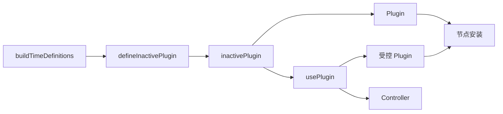

# Plugin 能力声明与 Popover 连接 API 迁移

## 当前授权与范围

用户已授权将试点思想推广为唯一正式 Plugin 系统。使用 FNKit `map` 逐项构建多元定义；试点节点控制职责由正式 `usePlugin` 接管，新旧并行及 legacy 命名退出。原始 inactivePlugin 调用后得到可直接交给 `is` 的 Plugin；需要控制时 `usePlugin` 返回 `[Plugin, Controller]`。不恢复组件 Controller 注入、Host 传递或 ref 自动推导。

用户已裁决以共享对象 `id` 取代 Scope：`draggable({ id, payload })` 与 `droppable({ id, onDrop })` 仅在 id 引用相同时协作；两端均未提供 id 时继续协作，有无 id 或不同 id 不匹配。拖动激活时固定来源 id，外部文件由目标的 enabled 和 accepts 判断，不再受 Scope 隐式拒绝。删除 Scope、Capability、祖先边界、旧出口和示例，将跨组隔离验证转交拖放测试；真实命中查找及节点生命周期继续保留。Popover/Tooltip 产品重构仍不在本轮范围。

进一步收缩已失去独立职责的 Piv 转发层：由 `handlePivPlugin` 在节点处直接执行 Plugin，删除 `runPlugin` 及其未使用 Tag 的 `PivPlugin` 别名和公开出口；结构插入测试归实际工具 `helpers`。现有 Piv 声明顺序、节点清理与结构行为不变。

此前 Plugin 系统的正式迁移已完成，本轮在其基础上替换 Scope。

最新裁决撤销把 Plugin 功能成员挂到组件 Controller 的方案。撤除为它增加的 pluginHost 和 Card、Board、Piv、kit 之间的宿主传递，恢复这些组件原有的 context、Controller 和 ref 职责。不得把自动推导或同名成员投影迁到其他层。

## 主体与调用

节点执行参数统一为普通 `PluginContext` 对象，包含 `element`、`onCleanup` 和 `addProps`；`pluginCore` 的同一参数对象另含 `pluginOptions`。`addProps` 将补充 Props 送入 Piv 现有合并链，调用者直接 Props 优先；不能改变 `as`、`if` 或 `children`。无需位置占位参数，也不保留旧 `declare` 别名。

| 主体 | 责任 |
| --- | --- |
| `defineInactivePlugin` | 接收一个 `buildTimeDefinitions` 对象，包含名称和单个 `pluginCore`，返回配置工厂；定义阶段不创建节点资源 |
| `defineInactivePlugins` | 接收一个 `buildTimeDefinitions` 对象，以名称组织多个 core，逐项委托单数定义，返回各自的配置工厂 |
| inactivePlugin | 接收一次 `pluginOptions`，返回 Plugin 值，不执行节点算法 |
| Plugin | 在实际节点安装时执行 core；原始值可直接交给 `is` |
| `usePlugin` | 接收一个 inactivePlugin 和本次配置，返回 `[Plugin, Controller]`；Plugin 直接交给 `is` |
| Controller | 指向当前已安装 Plugin 的功能成员；未安装或卸载后成员不可用 |

单数定义的 `buildTimeDefinitions` 采用 `{ name, pluginCore }`；复数定义对象以各能力名对应其 core。



节点声明仍进入现有 Piv 合并和绑定链；节点资源与清理归实际节点。结构插入算法作为普通 Piv 工具供 tooltip 和结构插件显式调用，不将结构工具塞进 PluginContext。子 Plugin 由父 core 直接调用并取得返回成员，不新增 Instance、Declaration、`.create()`、全局注册或节点查找机制。

```tsx
const [clickPlugin, clickController] = usePlugin(clickable, {
  onClick: event => console.log(event),
})

<Card is={clickPlugin}>信息</Card>
<Button on={{ click: () => clickController.focus?.() }}>聚焦</Button>
```

也可以直接写 `is={clickable(options)}`。`usePlugin` 应在组件实例内调用；一对受控 Plugin 和 Controller 同时对应一个节点，卸载后可以重挂。复用 `createRef` 的现有可选控制入口；同一受控值同时安装多个节点须明确拒绝，不能让后安装的节点覆盖先前引用。原始 Plugin 的每次节点执行仍独立。

多元定义当前只提供 raw 角色工厂，例如 `const { draggable, droppable } = dragAndDrop`；直接使用 `is={draggable({ id, payload })}` 或 `is={droppable({ id })}`，若需要控制单个角色，再将该角色交给 `usePlugin`。本轮不引入 `[PluginMap, ControllerMap]` 或额外连接对象工厂。

当前 `usePlugin` 的 options 是本次实际配置，不返回增强工厂。原来依赖增强工厂第二次调用来覆盖或 merge 默认配置的路线已撤；没有两组实际配置来源时不另造默认配置层或 merge API。

## 本轮职责与清理

- `clickable` 复用正式 hoverable 节点算法，维持焦点、按压、键盘和点击行为，试点与旧实现合并至领域正式文件。
- 保留 dragAndDrop 两角色及真实节点命中算法；共享 `id` 接管 Scope 的组隔离，外部文件由 enabled/accepts 判断。
- 移除仅用于组件 Controller 注入的 `pluginHost.ts`、额外 host 传递、名称冲突扫描和 ref 自动类型投影；Piv 保留真实节点执行、声明合并与清理接线。
- 删除旧 createPlugin/instance 和旧 usePlugin 分支，以新 `usePlugin` 与节点执行链接管全部现役能力、消费者和测试，不留兼容运行旁路。
- 保留同一节点内声明优先级、各节点状态隔离和原有可见文案；失败安装释放通过 `onCleanup` 登记的资源，其他 Foundation 与结构资源沿实际节点 owner 生命周期清理。

## 验收

验证跨 DOM 容器同 id 允许、同容器不同 id 拒绝、未分组双方协作、拖动期间节点移动不改变身份，以及禁用/清理和外部文件 enabled/accepts。检查 Scope 源码、导出、路由、示例、样式和现役说明退出；执行对应测试、类型检查与构建。不以本轮替换代替后续 Popover/Tooltip 产品阶段。

完整退出目标包含旧 Scope 截图和缩略图；当前两张旧截图及 `scope.webp` 的删除被自动策略拒绝，资产清理和旧目录完整退出尚未完成。具体命令、原因及残留路径见实施记录。

后续 Popover/Tooltip 阶段仍须完成既定能力迁移：Popover 领域归入 `src/components/plugins/kits/Popover/`，原 `src/components/kits/Popover/` 完整退出，不保留旧路径别名；验收整体滚动、箭头与翻向效果，检查包括 RuleDetail 动态内容在内的真实消费者。该阶段不在当前施工范围。

施工依据与记录：[仓库 Agent 入口](../../AGENTS.md)、[Plan 落地](../how-to-apply-plan.md)、[任务分工](../../../ai-rules/rules/Agent-任务分工.md)、[代码修改](../../../ai-rules/rules/Code-代码修改.md)、[实施记录](../../agents/run/261105-inactive-plugin-pilot/实施记录.md)。
