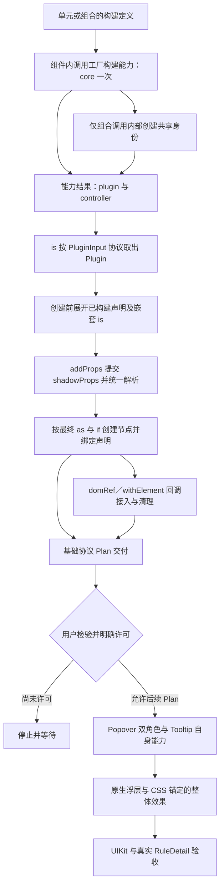

# is 声明解析与 Plugin 调用协议统一

## 状态、授权与交接闸门

本轮只更新本 Plan，不修改生产源码，不运行实现、测试或浏览器实验。本文是基础协议统一的唯一现役 Plan，当前待实施；历史试点证据不等于新协议已经实现。原合并 Plan 已由本文及 [Popover 与 Tooltip 能力重构](261106_Popover与Tooltip能力重构.md) 接管并退出，不保留第三份现役计划。

本 Plan 从创建前声明解析入手，统一 is／Plugin／shadowProps，再完成完整 Controller、能力结果、组合身份及 usePlugin 退出。不能继续保留“先创建 DOM、后执行 Plugin”的旧前提，否则 addProps 的 as／if 无法参与结构选择。

**本 Plan 交付后必须立即停止，等待用户亲自检验、明确认可并允许执行后续 Popover／Tooltip Plan。** 测试通过、Agent 审查通过、Plan 获认可、程序换手、用户未回复，均不构成后续许可。即使收到“按 Plan 执行”，也先只执行本文，不自动启动另一份 Plan。

范围内包括旧 Tooltip／Popover 为适配新基础协议所必需的调用调整；不得创建新 Popover 双角色、重写 Tooltip 阅读交互、改浮层几何或材质、迁移旧 Popover 目录。上述产品改造及 RuleDetail 最终效果验收由后续 Plan 承担，未因拆分删除或提前判定通过。

执行前重新读取[仓库入口](../../AGENTS.md)、[Plan 落地](../how-to-apply-plan.md)、[任务分工](../../../ai-rules/rules/Agent-任务分工.md)、[代码修改](../../../ai-rules/rules/Code-代码修改.md)。本文固定 API、职责和验收，内部普通拆分不得成为新框架。

## 全局运行图与本 Plan 定位

本 Plan 负责图中 A 至 I：从能力定义、配置与声明输入走到基础协议交付。图中 J 是用户许可闸门，L 至 N 由后续 [Popover 与 Tooltip 能力重构](261106_Popover与Tooltip能力重构.md) 负责。本图只在本文维护，后续 Plan 引用对应环节，不另建平行总图。



当前源码仍然是旧的中间状态，不能作为目标协议的限制：

- `plugins/tools/defineInactivePlugin.ts` 的调用产物仍是 Plugin 函数；Controller 由 `usePlugin` 另行提供。
- `plugins/tools/defineInactivePlugins.ts` 仍返回静态角色工厂集合，没有“每次组合调用”的内部共享身份。
- Piv 当前执行队列通过函数与普通对象分支区分 Plugin／内部补充声明，尚不支持新的能力结果对象。
- 当前 PivShadowProps 包含 as／if，插件 addProps 使用的 ShadowProps 却排除它们；PluginContext 又直接传 element，实际执行位于 DOM 创建后。这是本次要退出的处理顺序与双类型限制，不能当成目标设计。
- 拖放已移除 Scope 活动源码，但 `DraggableOptions`、`DroppableOptions` 仍要求调用者自行传递组 `id`。
- 旧 `components/kits/Popover/` 和 Tooltip 的 Surface 路线仍在。它们的产品重构只属于后续 Popover／Tooltip Plan。
- 用户已确定的目录保持：定义工具在 `plugins/tools/`；拖放组合 Kit 在 `plugins/kits/dragAndDrop/`，其下有 draggable、droppable 子领域。

已删除的 Scope、`runPlugin`、`PivPlugin`、Host、组件 Controller 功能注入及自动 ref 推导不得重新引入。旧 Scope 的两张截图与 `scope.webp` 曾被自动策略拒删，资产及旧目录尚未完全退出；保留这个事实，不借本 Plan 改写成已清空，也不换工具绕过拒绝。

## 统一 is、Plugin 与 shadowProps，再完成调用 API

### 0. 声明与节点接入的职责

用户已明确：Plugin 就是注入 Props；addProps 直接提交 shadowProps，二者是同一套声明契约；Plugin 的解析在 shadowProps 的统一解析之前。Plugin 不接收 element，接入真实节点使用声明中的 domRef；withElement 只是注册该声明的快捷方式。

本文的“构建”专指每次调用 `inactivePlugin(pluginOptions)` 创建一份能力结果，不是 TypeScript 编译，也不是调用 `defineInactivePlugin` 注册定义。每份结果只在这次构建运行一次业务 `pluginCore`，准备完整 Controller 并注册 addProps／withElement 声明。is 解析、DOM 挂载或重挂、状态更新都不得重新运行这份结果的 core；再次显式调用 inactivePlugin 才是另一次构建。

**激活位置是 API 调用契约：defineInactivePlugin／defineInactivePlugins 的定义可以放模块顶层；调用它们返回的 inactivePlugin／inactivePlugins 激活能力，必须在组件之中，组件内的 JSX 内联调用合法。** 禁止在模块顶层执行 `const capability = clickable()` 或组合调用。不增加 getOwner 检查、运行时守卫、自动 root 或 owner 兼容层。

```tsx
// 合法：模块顶层只定义能力，不激活。
const clickable = defineInactivePlugin({ name: 'clickable', pluginCore })

function Example() {
  const capability = clickable()
  return <Card is={capability}>信息</Card>
}

function InlineExample() {
  return <Card is={clickable()}>信息</Card>
}

// 非法：模块顶层激活能力。
const capability = clickable()
```

```text
能力配置：inactivePlugin(pluginOptions)
  → pluginCore 运行一次，准备完整 Controller，收集 addProps／withElement 声明
  → 返回 { plugin, controller }

节点渲染：Piv 收到直接 Props、shadowProps 和 is
  → 识别 is，通过纯提交协议展开已构建声明，加入 shadowProps 来源
  → 对声明中的 is 继续展开，保留所在来源的优先级
  → 统一解析 shadowProps 与直接 Props，得到 as／if 等最终声明
  → Dode 按结构声明创建节点并绑定属性、事件和内容
  → 消费最终 domRef（含 withElement 注册项），接入真实元素；退出时执行对应清理
```

“先解析 Plugin”不表示不查看 shadowProps：为了找到其中的 is，允许遍历声明来源；不能在其中的 Plugin 尚未展开时，就先确定最终 as／if 或创建 DOM。父声明携带子能力仍走同一入口，不另建子 Plugin 执行系统。直接 Props 的既有优先级、shadowProps 的数组／嵌套优先级保持，不因先收集 Plugin 就把全部产物简单追加到最高或最低位置。

目标中只保留一套补充声明契约，使用 ShadowProps 承载；它包含 as、if、domRef、is 及既有其他补充属性，children 仍由直接 Props 提供。PivShadowProps 的有效结构能力由统一契约接管，删除重复定义、旧导出与旧说明，不保留同义别名。addProps 是提交动作，不拥有另一套删减后的类型。

```tsx
// 两个入口提交的都是同一类补充声明。
<Piv shadowProps={{ as: 'button', if: visible }} />

// pluginCore 内部：不需要 element 或单独的节点执行参数。
addProps({
  as: 'button',
  if: visible,
  is: childCapability,
  domRef(element) {
    // 这里接入元素；监听等资源按现有协议返回清理函数。
    return bindExistingBehavior(element)
  },
})
```

`visible`、`childCapability`、`bindExistingBehavior` 仅表示业务值、子能力结果和既有接入函数，不是新增公共 API。DOM 读写、监听、观察器和附属结构的 createPivStructure 调用均移到 domRef 接入；优先复用声明式 on、style 等既有字段，不把所有属性绑定重写进 domRef。多个 domRef 仍由现有消费者统一执行和登记清理。

withElement 的唯一语义是 `withElement(callback)` 等价于 `addProps({ domRef: callback })`，不创建 ElementContext、额外注册器或另一套生命周期。callback 仅接收 element 一个参数，返回 void 或清理函数；实际节点接入时调用，退出时由现有 domRef 消费者执行返回的清理。if=false 没有节点就不调用；重挂时对新节点重新调用同一回调，不重新运行 core 或重新构建 Controller。

```ts
// 以下两种写法语义等效。
addProps({ domRef: callback })
withElement(callback)

// callback 只接收实际节点；清理由现有 domRef 链消费。
function callback(element) {
  return bindExistingBehavior(element)
}
```

core 只构建一次不表示把响应式声明求值为快照。收集时保留 Source、getter、on 回调及 Controller 的既有动态语义，属性更新和事件执行仍由原声明消费者处理；不能通过重跑 core 刷新，也不能为“只构建一次”冻结原本可更新的状态或回调。

if 的 Source、缺省 if 与显式 if=undefined 的区别，以及 as 的选择时机、动态快捷能力和动态 is 的声明消费，都沿用既有契约；前移解析不冻结配置，不另设节点重建、优先级或清理排序机制。

### 1. 主体和最小类型

下面定义的是目标协议，不是当前代码已经具备的能力。

```ts
// Plugin 是带协议标识的声明提交能力，不执行节点接入。
// 参数仍是具名对象；不含 element 或节点 onCleanup。
type Plugin = {
  (context: PluginContext): void
  readonly [pluginMarker]: string
}

type PluginContext = {
  /** 解析器内部提交已构建的声明；不运行业务 core。 */
  addProps: (props: ShadowProps<PivTag>) => void
}

/** 节点接入回调；唯一参数是实际元素，返回 void 或节点退出时的清理。 */
type PluginElementCallback = (element: HTMLElement) => void | (() => void)

// core 在配置时使用的上下文；与 Plugin 的提交上下文不是同一职责。
type PluginCoreContext<Options extends object> = {
  /** 本次能力构建的配置；声明消费时保留其动态读取契约。 */
  pluginOptions: Options
  /** 收集统一 ShadowProps；包含 as、if、domRef 和 is。 */
  addProps: (props: ShadowProps<PivTag>) => void
  /**
   * 等价于 addProps({ domRef: callback })，不立即调用 callback。
   * 有节点时接入，退出时执行其清理；无节点不调用，重挂重新调用。
   * callback 仅接收 element，返回 void 或清理函数。
   */
  withElement: (callback: PluginElementCallback) => void
  /** 组合构建内部共享身份，不是公开配置。 */
  id?: object
}

type PluginCore<Options extends object, Members extends object> =
  (context: PluginCoreContext<Options>) => Members

// is 只关心 plugin；附加字段不参加节点属性合并。
type PluginInput = Plugin | {
  readonly plugin: Plugin
  [extra: string]: unknown
}

// 单元能力每次调用至少返回这两个字段，未来可增加字段。
type PluginResult<Members extends object> = {
  readonly plugin: Plugin
  readonly controller: Members
}

type InactivePlugin<Options extends object, Members extends object> =
  {} extends Options
    ? (pluginOptions?: Options) => PluginResult<Members>
    : (pluginOptions: Options) => PluginResult<Members>
```

固定含义：

- `defineInactivePlugin(buildTimeDefinitions)` 仍接收一个 `{ name, pluginCore }` 对象，返回一个 inactivePlugin 函数。
- `inactivePlugin(pluginOptions)` 返回普通对象，至少包含 `plugin` 和 `controller`。不能返回 tuple，不能让这个对象再承担一次配置调用。
- `pluginCore({ pluginOptions, addProps, withElement, id })` 在每次 inactivePlugin 构建时只运行一次，准备功能状态、提交声明并返回完整 Controller；不接收 element 或节点 onCleanup，不得再返回一层 `{ plugin, controller }`。id 是可选内部组身份，只由组合包装传入，不加入公开 Options。
- 返回的 Plugin 在 is 解析时仅提交本次收集的声明，不再次执行 core 或重建 Controller；保留的 Plugin 函数只是内部纯提交协议，不是第二次业务逻辑运行。PluginContext 只需要 addProps。节点接入与清理由声明的 domRef 承担，不恢复位置参数、Provider、祖先 Context 或全局管理器。
- `PluginResult.controller` 是完整、稳定的功能控制入口，类型为 `Members`，不是 `Partial<Members>`。从能力调用返回起，约定的方法和状态就存在；未安装或卸载只影响节点接入，不使方法消失。`is` 不读取它，不将它挂到组件 Controller。
- `PluginInput` 必须允许能力结果中的 `controller` 及未来附加字段，不能因为额外属性而拒绝一个有效的结果对象。

### 构建与提交的最简交接伪代码

下面只表达业务 core 的唯一执行位置、声明收集及快捷方式；声明提交后由既有解析和 domRef 消费流程处理。

```ts
function defineInactivePlugin({ name, pluginCore }) {
  return function inactivePlugin(pluginOptions) {
    const declarations = []
    const addProps = props => declarations.push(props)
    const withElement = callback => addProps({ domRef: callback })
    const controller = pluginCore({ pluginOptions, addProps, withElement })

    // 此函数只向解析器提交声明；不是第二次业务 Plugin 运行。
    const plugin = Object.assign(
      ({ addProps: submit }) => declarations.forEach(props => submit(props)),
      { [pluginMarker]: name },
    )
    return { plugin, controller }
  }
}
```

组合构建按下文 core 包装注入 id；不把 id 或 withElement 放到解析器的 PluginContext。declarations 保留原声明引用及动态读取，不在收集时提前 val／展开 getter。字段 withElement、callback 唯一参数与清理返回、addProps 的创建前语义都须在定义处写 JSDoc，并在解构及调用位置验证 hover 可见。

### 2. 单元的外部调用

以下示例中的 `save`、`item`、`receive` 表示调用方的业务处理或数据，不是要新增的 UIKit API；实际迁移使用原示例已有的业务内容。

```tsx
function Example() {
  const cardClickable = clickable({ onClick: save })
  const capability = clickable({ onClick: save })

  return <>
    <Card is={cardClickable}>信息</Card>
    <Button on={{ click: () => cardClickable.controller.focus() }}>
      聚焦卡片
    </Button>
    {/* 组件内可以内联激活，也可以只传已激活结果的 Plugin。 */}
    <Card is={clickable({ onClick: save })}>内联能力</Card>
    <Card is={capability.plugin}>直接传 Plugin</Card>
  </>
}
```

能力调用返回时已具备完整 Controller 及其有效初始状态，方法直接调用。节点监听和 DOM 绑定仍由声明的既有接入与退出流程消费，方法不因此消失。

旧的“状态和方法只能在 DOM 创建后执行 core 才产生，再通过 Partial 引用暴露”的限制退出。core 在配置时准备状态和完整方法，Plugin 负责提交准备好的声明，domRef 负责节点资源；不能用假节点、`as Members`、非空断言或任意方法代理伪造完整性。构建定义仍是 `{ name, pluginCore }`，不增设 createController／prepare 等公开字段。不增加引用去重、环检测、多宿主管理、相同节点判断或调用计数；只提交和消费声明，外界的调用按既有契约自然产生结果。

#### createRef 与组件 ref 的边界

Plugin Controller 与外部 Ref 是两个协议，不能互相套用可选性。本 Plan 同时落实以下目标签名，保留 Receiver 原有的清理返回约定：

```ts
function createRef<T extends object>(): [
  reference: Partial<T>,
  receive: RefReceiver<any>,
]

// 组件仍只提供它自己的完整 Controller。
// 例如 Button 的 ref 仍接收 ButtonController，不感知 Plugin 成员。
function RefExample() {
  const [button, receiveButton] = createRef<ButtonController>()
  // Plugin 的控制入口直接来自组件内激活的结果，不经过这个 Partial 引用。
  const capability = clickable({ onClick: save })
  return <>
    <Button ref={receiveButton}>按钮</Button>
    <Card is={capability}>信息</Card>
    <Button on={{ click: () => capability.controller.focus() }}>聚焦</Button>
  </>
}
```

`any` 仅用于 `createRef` 返回的 Receiver 所接收的值，让调用者在 `createRef<T>()` 指定自己的引用类型；不把通用 `RefReceiver<T>`、组件的 ref 参数或 Plugin Controller 改成 `any`。外部 reference 沿用 `Partial<T>` 表示节点尚未提供引用或已释放；调用者访问此外部引用时所需的存在性判断，不适用于能力结果的完整 Controller。组件不新增 Controller 泛型、Plugin 成员交叉类型或自动推导设施，也不负责把 Plugin Controller 注入自身。

### 3. 组合能力的定义、配置和返回值

`defineInactivePlugins(buildTimeDefinitions)` 的输入仍按角色名组织 core，内部仍委托单数构造；**返回值改为可调用的 inactivePlugins 函数，不能继续返回模块级静态角色集合。**

```ts
const dragAndDrop = defineInactivePlugins({
  draggable: draggablePluginCore,
  droppable: droppablePluginCore,
})

```

组合定义可位于模块顶层；下面的组合激活必须在组件内。返回的 `draggable`／`droppable` 各自已是结果，可读取其 `.plugin`、`.controller`，不能再调用 `draggable()`。

```tsx
function TransferExample() {
  const { draggable, droppable } = dragAndDrop({
    draggable: { payload: item },
    droppable: { onDrop: receive },
  })

  return <>
    <Card is={draggable}>拖动材料</Card>
    <Card is={droppable}>接收材料</Card>
  </>
}
```

这份角色配置形状是本文对已确定职责的具体化：角色名对应角色 Options，不添加 `defaults`、覆盖策略、第二次角色调用或 merge 配置层。角色 Options 的必填字段保持必填：例如 draggable 的 payload 不可因组合包装而变成可省略。所有角色均可缺省配置时，组合才允许无参数调用。

内部准备过程必须能对应到以下伪代码；类型推导按实际 Options 和 core 返回成员保留，不能用公开 `any` 抹掉角色差异：

```ts
function defineInactivePlugins(buildTimeDefinitions) {
  return function inactivePlugins(pluginOptions = {}) {
    const id = {} // 只属于这一次组合调用，不返回给调用者。

    return map(buildTimeDefinitions, (pluginCore, name) => {
      const inactivePlugin = defineInactivePlugin({
        name,
        pluginCore(context) {
          return pluginCore({ ...context, id })
        },
      })
      return inactivePlugin(pluginOptions[name])
    })
  }
}
```

伪代码中的 `pluginCore(context)` 是配置时执行的 core 包装，context 属于 PluginCoreContext；只在这里补入本组 id，不把 id 加到 PluginContext，也不让 Plugin 再执行 core。

- 继续复用 FNKit `map`，不再手写 entries／map／fromEntries。
- 每次组合调用生成新的内部对象身份；本组各角色共享此身份，其他组不共享。
- `is`、组件和调用者都不创建、传递或返回这个组 ID。移除公开拖放 Options 的 `id` 字段，内部匹配改从 core 的上下文取得 id。
- 组内共享配合所需的内部身份；各角色按单元构建流程准备自己的状态与 Controller。
- 每次组合为每个角色返回一份结果；示例保持原有内部拖放与独立外部文件目标的用途。
- 保留独立 `draggable({ payload })`、`droppable({ onDrop })`：未组合时内部 id 为 undefined，延续原默认协作。外部 DataTransfer 没有来源组身份，只按目标 `enabled`／`accepts` 判断。

### 4. is 的识别与展开边界

不能用 `typeof input === 'function'` 直接把普通回调当 Plugin，也不能把任意 `{ plugin: ... }` 对象当有效输入。

```ts
function readPlugin(input) {
  if (isPlugin(input)) return input
  if (hasProperty(input, 'plugin') && isPlugin(input.plugin)) {
    return input.plugin
  }
  throw new TypeError('需要 Plugin，或包含有效 plugin 的对象')
}
```

`isPlugin` 根据既有 `pluginMarker` 和可执行协议识别。沿用 FNKit 的实际检查工具，不增加另一套品牌、解析器、反射注册或按函数返回值猜测类型的机制。

数组中的每一项遵守同一协议；内联激活同样位于组件内：

```tsx
function CombinedExample() {
  return <Card is={[clickable(), tooltip({ content: '说明' })]}>信息</Card>
}
```

当前混合队列把 DOM 后 Plugin 执行与补充声明展开揉在一起，须改为创建前收集能力产物、再统一消费声明。公开 is 输入严格识别 PluginInput；shadowProps 是声明来源，按声明处理，不能误报为非法 Plugin。**不能把 `{ plugin, controller }` 整个对象当作 ShadowProps 合并进节点。**

`addProps` 的优先级、Source 更新、事件合并和节点清理规则保持。`controller` 或未来附加字段不传给 DOM、不进入 Props 合并。

### 5. 文件与职责接管表

| 文件或范围 | 要更新／删除什么 | 由谁接管与完成状态 |
| --- | --- | --- |
| `src/components/plugins/tools/defineInactivePlugin.ts` | 每次构建执行 core 一次，收集声明并返回完整结果；新增 withElement 快捷字段与回调 JSDoc，说明组件内激活契约；Plugin 仅提交声明；移除 element／节点 onCleanup 参数 | core 在配置时准备完整 Controller，Plugin 提交 shadowProps，domRef 接入资源；不搬入旧 usePlugin 的 Partial／卸载后方法缺席语义 |
| `src/hooks/createRef.ts` | 仅将 createRef 返回的 Receiver 输入放宽为 any，保留外部引用 Partial 与清理约定 | 调用者用泛型指定引用类型；组件继续提供自己的完整 Controller，不改组件声明，不扩大通用 RefReceiver 的输入协议 |
| `src/components/plugins/tools/defineInactivePlugins.ts` | 静态 map 改为返回可调用组合；内部每次准备共享 id | FNKit map 逐项委托单数构造；不另造组执行器或全局身份表 |
| `src/components/plugins/tools/usePlugin.ts` | 删除函数、文件与公开出口 | 已由单元／组合调用接管，不保留别名、弃用壳、包装器或另一份同义 hook |
| `src/components/plugins/tools/usePlugin.test.ts` | 有效行为测试转到定义工具的相邻测试，再删除旧主体测试文件 | 可重命名为 `defineInactivePlugin.test.ts`；组合与输入验证放对应既有测试位置，不复制同样断言 |
| `src/components/Piv/Piv.tsx`、`plugin/handlePivPlugin.ts`、`plugin/publicCapabilities.ts` | 将 Plugin 展开前移到结构选择前；统一 ShadowProps 并删除 PivShadowProps；同步所有公开 is 类型、快捷入口、相关类型出口和说明；删除不再需要的重复类型 | Piv 收集／组织声明，Dode 创建／绑定节点；保既有来源优先级，不重建 runPlugin，不扩组件泛型 |
| `src/components/Piv/Dode.tsx`、`domRef.ts` | Dode 接收创建前已准备的结构与声明，不再通过拿到 element 的 setup 才求出 Plugin 产物；domRef 消费 withElement 的等效声明并沿用现有清理 | 消除结构选择与晚到补充声明的割裂；不复制 DOM 绑定器，不新增节点重建系统 |
| `clickable` 及父子能力组合、其余 Plugin core | 将 element 使用和节点资源迁入 domRef／等效 withElement；状态和 Controller 在构建时一次准备；子能力声明通过 is 提交 | `const child = hoverable(options)`，`addProps({ is: child })`，通过 child.controller 使用成员；不再直接执行 child.plugin(context) 获取成员 |
| `plugins/kits/dragAndDrop/` | 组合调用、内部 id、示例和类型／浏览器断言同步 | 公开配置不再要求 id；保留真实命中、Pointer、TopLayer、取消及外部文件处理 |
| Card Example、Button 内置 clickable、Help／Label 的 tooltip、topLayer、tabularNum、Piv 结构示例和测试 | 全部现役消费迁移；原 usePlugin tuple 改为能力结果的 `.controller` | 信息、功能及组件 Marker 保持；父子调用、快捷 Props、条件节点也必须实际可用 |
| 当前 Tooltip 与旧 Popover 目录 | 本 Plan 只做新产物协议所必需的调用适配，复用已有验证检查实际回归 | 保持 Tooltip 的 hover／focus、150ms 离开关闭、数字 0 与动态内容；不改 Surface／Geometry／Paint 或提前创建新角色，视觉重构留后续 Plan |
| `src/components/index.ts`、Architecture、Plugin SPEC、Tutorial、Guide | 新出口和例子同步；现役使用说明删除 usePlugin 调用 | 不重写旧 Run／历史 Plan 的事实，不在文档中继续推荐旧入口 |

### 6. 实施顺序与交付验收

1. 先落实统一 ShadowProps 及创建前的 Plugin 展开：core 配置时准备状态／完整 Controller 与声明，Plugin 只提交声明，domRef 负责节点接入；贯通 Piv／Dode 的结构选择和绑定。先用 as／if、domRef／withElement 等效性及构建一次的实际行为验证职责，不只改类型。
2. 完成单元结果、PluginInput、数组、嵌套 is 及快捷入口，迁父子能力；删除 element／节点 onCleanup 与 Partial Controller 暴露方式。createRef 只按上文放宽 Receiver 输入，组件声明保持不变。
3. 完成可调用组合与内部身份，迁移拖放例子、匹配与测试。不得把公开 id 换一个名称继续要求调用者传。
4. 迁完所有现役消费及说明，删除 usePlugin 文件／测试旧主体／出口。清理临时兼容代码，按最终 API 做验证。
5. 向用户交付最少可读示例：单元内联、单元带 Controller、组合一对节点、两次组合互相隔离。列出真实改动、旧设施退出结果、测试证据和任何受阻项，然后停止。

本 Plan 必须通过的行为与类型边界：

- 定义允许模块顶层；单元与组合的激活示例、现役调用和说明均在组件内，JSX 内联合法。模块顶层激活只作为非法用法说明，不为位置契约新增运行时检查或 owner 兼容设施。

- 每次 inactivePlugin 构建仅运行一次 core；defineInactivePlugin 定义阶段不运行，is 展开、挂载／重挂和状态更新不重跑。分别构建的结果独立，不能把重挂调用 withElement 回调误判成 core 重跑。
- withElement 与 addProps({domRef: callback}) 行为等效：callback 仅收到 element，void 返回可用，清理由既有 domRef 流程消费；if=false 不调用，节点接入时调用。
- Source 与 on 回调更新、Controller 状态仍有效，不通过重跑 core 更新，也不因构建一次冻结；定义处与解构／调用处的 withElement、callback 清理及 addProps hover 说明可读。
- 能力结果返回时 Controller 已完整，公开方法可直接调用；节点接入与退出不使方法消失。核对实际成员与已有行为，不能只靠类型断言。
- createRef 的 Receiver 能接收 any，调用方引用类型仍由泛型指定，原清理行为保持；Button／Card 等仍只提供自身 Controller，无新增 Plugin 推导或注入。
- `is={result}`、`is={result.plugin}` 和混合数组都有效；额外字段不影响识别，也不会进入 DOM。
- 普通回调、含普通回调的 `{ plugin }`、缺少有效 plugin 的对象均被拒绝，不能意外执行。
- addProps 与 shadowProps 能提交相同的 as／if；在 DOM 创建前完成来源优先级解析，实际标签正确，if=false 不创建宿主或运行 domRef，随后变真时正确接入，变假时释放节点资源。
- 嵌套 shadowProps／is 的声明全部参与同一解析链，直接 Props 与数组优先级保持；不存在已构建声明展开后 as／if 被悄悄丢弃的路径。
- Plugin 参数没有 element；节点接入通过 domRef，声明的消费时机与顺序沿用既有契约，退出时释放其登记的资源。
- 父子能力、内部 ShadowProps、用户 Props 优先级、动态快捷能力和清理不回归；复用既有 Tooltip 验证检查 hover／focus、150ms 关闭、数字 0 与动态内容，不提前重构或另造测试体系。`addProps` 在解构与调用处的 hover 说明保持可见。
- 同次组合的内部拖放允许，不同调用的组合拒绝；跨 DOM 容器不影响组身份。未组合和外部文件行为符合上文。
- 缺失 payload、角色名拼错、Controller 方法拼错和过期的 tuple／二次角色调用应得到类型错误，不能靠类型逃逸通过。

从仓库根目录执行 `bun run type-check`、相邻定义工具与 Piv 的相关单测、迁移后的 draggable／droppable 和 Dashboard 浏览器测试，以及 `bun run build`。以当次文件与日志为准，不能引用旧协议的通过数量冒充本次结果。测试验证实际行为，不锁定临时函数或 CSS 字符串形状。

退出检查至少覆盖生产源码、出口、Examples、现役 Tutorial／Guide／SPEC 与发布声明：不应残留 usePlugin／useNewPlugin／useLegacyPlugin 的定义、调用、导出或兼容文件；不应残留公开传组 id 或模块顶层激活能力的推荐用法；不应残留 is／挂载／更新重新执行业务 core 的链路、旧 element／节点 onCleanup 参数或 withElement 独立生命周期设施。允许历史记录准确保留旧名字；不能用全局文本替换改坏 TS `declare`、HTML `scope` 或无关领域。

**本 Plan 的最终状态只能先标为“已交付，等待用户检验”。不得自行写成“用户已认可”。用户明确指出不认可时继续修本 Plan；未获得明确许可时，不开始后续 [Popover 与 Tooltip 能力重构](261106_Popover与Tooltip能力重构.md)。**

## 未决、交接与完成判定

本轮没有实施任何目标协议。构建、声明提交、解析与节点消费按本文职责和既有契约落实。实现若出现具体错误，再依据实际源码与框架契约处理；不增加公开定义字段，不靠类型断言伪造完整方法。

下一执行程序先完成本文；按当时真实 Git 状态保护用户修改，不自动暂存、回退或整理无关文件。修改、删除接管、当次验证和偏差按有效仓库入口记录。历史[实施记录](../../agents/run/261105-inactive-plugin-pilot/实施记录.md)只作事实参考，不代替本文验收。

施工交付时结论必须是“本 Plan 已交付，等待用户检验”，同时列出未完成或受阻项。用户未明确认可并许可时，不得开始 [Popover 与 Tooltip 能力重构](261106_Popover与Tooltip能力重构.md)；用户不认可则继续修本文。后续 Plan 的浏览器技术验证、完整旧设施退出及 RuleDetail 外部验收仍由后续 Plan 负责。
