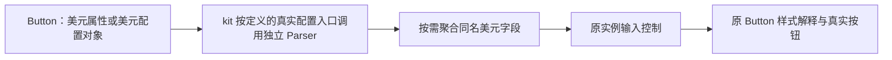

本计划只让 Button 采用统一的美元前缀样式输入，交付可运行的样板供用户查看。其他组件的迁移等待用户确认，不在本轮实施。

本计划持有下方[全局图](#全局图与范围)，负责 Button 样式声明到实例样式消费的连续区段。首版聚合器已随 `d332797` 提交；其[原 Plan](261117_StyleConfig支持美元前缀属性.md)和完成记录保留，本轮不回写历史判断。

# 用户要求与目标调用

用户明确：直接美元属性为优先写法，配置对象只作为逃生舱；配置入口本身和其中的样式字段均带美元前缀；Parser 独立，kit 只使用它；无样式输入不创建聚合视图。最新范围进一步限定为只修改 Button 的实现，保持简洁，其他组件先不迁移。

Button 当前唯一配置控制点是内容间距。目标常规调用：

```tsx
<Button $gap="1rem">保存</Button>
```

必要时整组配置或覆盖才使用逃生舱：

```tsx
<Button $gap="1rem" $styleConfig={{ $gap: '2rem' }}>保存</Button>
```

最终间距为 `2rem`。写法优先直接属性，值的覆盖优先级仍然是显式配置更高；这是两个不同判断。

# 全局图与范围



本轮唯一迁移主体是 Button。公共接线的修改只为使它运行；Flow、Grid、Table 等的定义、调用、示例和样式不迁移。FNKit、My Playground 等仓库不修改。

# 协议与最少必要职责

- `ButtonStyleConfig` 的一级字段改为 `$gap`，相同 handler 键也改为 `$gap`；函数仍只设置已有 `buttonGap` Token，不改变样式效果。
- Button 公开 Props、Controller 与 kit 定义的配置入口统一为 `$styleConfig`。直接 `$gap` 和对象内 `$gap` 复用同一值域，不加第二套字段映射。
- Parser 在接收的实际配置入口下按需聚合。`$styleConfig` 是容器，不能再作为普通样式字段收入自身；显式配置按字段存在性覆盖，包含值为 undefined 的字段。
- 没有直接样式字段、也没有组件所声明的配置入口时，直接返回原 props，保持对象身份。已有样式声明可持续动态读取；不为了初始完全无声明后凭空追加字段而给所有实例加 Proxy。
- 已有整体/字段 Source、普通回调身份、合法空值与实例清理继续由原链承担。Controller 操作同一 `$styleConfig` State，不增加别名 State 或同步 Effect。

其他组件当前仍拥有 `styleConfig` 入口和去前缀聚合，不能为 Button 的试点强迫它们一起迁移。kit 在组件定义处依据实际使用的配置入口确定字段名一次，并将字段名交给 Parser 和配置绑定层。这里复用的是实际字段协议，不另加 mode、迁移标记、handler 猜测、实例 fallback 或 Button wrapper。Button 不因误传普通 `styleConfig` 而切回其他组件的协议。

这项公共接线不可省略：当前 Parser 固定消费普通 `styleConfig` 且去掉 `$`；只改 Button 的类型和 handler 会失去实际间距效果，直接全局替换又会迁移其他组件。按真实定义字段接线可同时保持 Button 可运行和本轮范围。

# 结构与信息流

改前已存在的关键载体：

```text
src/components/kits/Button/【目录】：按钮动作与外观。
    Button.prop.ts【文件】：公共输入、字段协议与 Controller。
    Button.style.ts【文件】：gap 配置与已有 buttonGap Token 消费。
    Button.tsx【文件】：通过 kit 组合定义和原生按钮渲染。
src/components/tools/【目录】：组件输入与样式接线。
    kit.ts【文件】：创建组件并接入 Parser、输入控制、根声明。
    parseStyleConfigProps.ts【文件】：美元属性去前缀聚合普通 styleConfig。
    styleConfig.ts【文件】：按配置字段调用解释函数并收集实例覆盖。
```

目标关键修改：

```text
src/components/kits/Button/【目录】：本轮唯一迁移组件。
    Button.prop.ts【更新，文件】：公开美元配置入口和原 Controller/字段协议。
    Button.style.ts【更新，文件】：配置及 handler 键使用美元前缀，Token 与解释行为保持。
    Button.tsx【更新，文件】：用真实美元配置入口声明样式定义，业务渲染保持。
    Button.controller.browser.test.tsx【更新，文件】：验证直接输入、逃生舱及 Controller 的同一按钮效果。
src/components/tools/【目录】：只补 Button 可运行必需的公共接线。
    kit.ts【更新，文件】：从真实配置入口连接类型、Parser 与原消费链。
    parseStyleConfigProps.ts【更新，文件】：按实际字段聚合，并在无输入时返回原对象。
    styleConfig.ts【更新，文件】：按实际配置入口读取，解释及实例覆盖算法不变。
    kit.test.ts【更新，文件】：验证 Button 新输入值域和未迁移组件原契约。
    parseStyleConfigProps.test.ts【更新，文件】：验证按需聚合、容器排除和对象身份。
Architecture.md【更新，文件】：说明 Button 试点及其余现役组件边界。
```

具体类型辅助声明和测试落点可在上述归属内决定，不为满足目录图新增抽象。执行时先由 Button 调用交付 Props，kit 根据组件定义调用 Parser；Parser 给出统一配置视图，再由原 Director、bindStyleConfig、Piv 消费。Marker、根 DOM、Button 的 Variant/status 和点击能力保持原职责。

# 实施顺序与验收

- 先落实 Button 类型、配置与 handler 的同名协议，公共类型拒绝普通 `styleConfig`、对象内普通 `gap` 和错误的 `$$gap`；其他组件原调用类型继续成立。
- 再按实际配置入口接通独立 Parser 与原样式消费，验证没有样式声明时严格返回原对象；已有样式声明的 Source 更新继续有效，普通字段身份不变。
- 最后在真实浏览器验证 Button 的 `$gap`、`$styleConfig` 更高优先级、显式 undefined、Controller 写入/清空及原生按钮/Marker 生命周期。原有 Button 行为测试继续通过，并运行未迁移组件相关回归、类型检查与发布构建。
- 验收必须看到真实按钮间距，不只检查对象或类型。配置容器不能出现在 DOM，也不能被当成样式字段；若出现按实例猜协议、额外状态、业务重复解析或被迫修改其他组件，停止当前方法并回查公共接线。
- 完成后交付 Button 具体源码和验证结果，等待用户查看；不主动迁移其他组件、不自动提交。

# 规则、分工与状态

依据[仓库入口](../../AGENTS.md)、[共享入口](../../../ai-rules/AGENTS.md)、[统一分工](../../../ai-rules/rules/Agent-任务分工.md)、[Plan 撰写](../how-to-write-plan.md)及[Plan 落地](../how-to-apply-plan.md)执行。样式归属按[样式文件写法](../style/样式文件写法.md)、[组件职责](../guide/组件职责与样式归属.md)和[结构查看](../guide/组件结构查看.md)验收。

主 Agent 组织范围和 Plan；`/root/style_parser_implementation` 实施；`/root/plan_constraints` 独立核对约束、语义、精简和意图。能力复用与重复能力审查沿相应独立实例取得必要结论，不把执行者自查冒充独立审查。命名与解释行为的机械修改不扩展到其他组件能力。

实施事实追加到 `agents/运行方案/261117_Button样式输入统一美元前缀_实施详情.md`，临时材料归 `agents/run/`；本计划不承载命令流水。

当前已取得写前独立约束检查，用户已授权 Button 实施。成文后的独立复审完成后开工；功能效果仍需真实验证，不以 Plan 审查代替。
