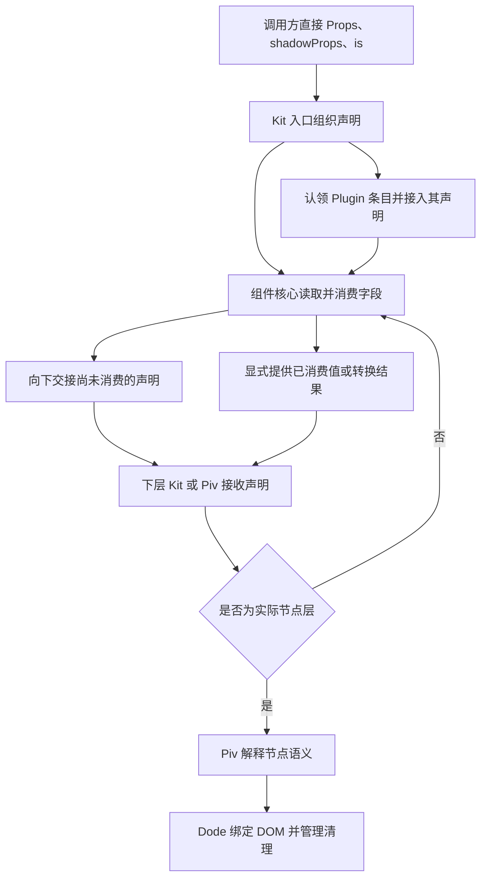

# 状态与本轮位置

- 本文是本次目的的唯一现役 Plan。公共能力和 Button 试接已完成；用户现已授权迁移 UIKit 全部其他现役组件，并删除已被接管、不再需要的旧设施。
- 本轮接通各组件入口解析、当前层消费和显式转交，修复实际调用链中的行为与警告；不再沿用 Button 阶段允许其他组件暂不适配的限制，也不通过兼容分支或修改错误测试期望取得通过。
- 全组件迁移后的 API 修正由本文继续承接：Director 直接提供完整输入、控制与设施借读入口，Kit 退出原始 State 回调和最终 Proxy 补偿。声明工具接收字段拥有者的完整累加策略，统一建立惰性来源；本轮不同时重写消费身份或输出回接机制。
- 公共解析工具原微基准有明显新增开销，性能未验收。全组件迁移不能把既有功能验证写成整体性能已通过，实际结果继续进入实施详情。
- 本文持有下方[全局规划图](#全局规划图)，负责从外部声明进入 Kit，到组件消费、下层交接及 Piv 最终绑定的连续区段。所有阶段和验收均由本文承接，不另开平行 Plan。
- 计划可先执行机制验证，再依据验证结果实施；尚未验证的消费时序和性能不能表述成已经可行。

# 从使用结果出发

以下用法已由公共入口和 Button 试接验证，本轮将同一协议落实到其余现役组件。`buttonCapability` 是在组件作用域内构建的现有形态能力结果，其声明包含 Button 字段和节点字段。

```tsx
<Button
  size={undefined}
  shadowProps={{ size: 'large', disabled: true }}
  is={buttonCapability}
  $gap="1rem"
  $styleConfig={{ $gap: undefined }}
/>
```

- 调用方能通过公共 `shadowProps` 和 `is` 提供当前组件的输入。Button 核心直接读取 Kit 处理后的 `props.disabled`，无需再调用解析函数。
- Button 读取、消费的字段不再由 `shadowProps` 自动交给下层；未消费的声明可以继续交接。Button 要让下层使用已消费的值，必须显式提供该值或其转换结果。
- 高优先级直接声明的 `size: undefined` 覆盖补充声明的 `size: 'large'`；具体 `$styleConfig` 中的 `$gap: undefined` 覆盖快捷方式 `$gap="1rem"`。存在性按声明判断，不按值是否为空判断。
- Kit 认领一个 Plugin 条目后，下层不再认领同一条目。该 Plugin 提供的字段继续各自参与消费，例如 Button 消费业务字段，Piv 消费尚未被消费的节点声明。
- Button 等业务组件通过 Kit 公共契约获得 `shadowProps`、`is`，不在各自 Props 中重复声明，也不在第二个 context 参数中手动取解析工具。

# 目标依据与边界

- 用户明确要求提取 `shadowProps` 和 `is` 的关键能力，使 Piv、Kit 及其他组件都能复用；旧 PIV Kit 只参考独立工具的组织思路，不移植旧的字段、Controller、优先级或 `selfProps` 方案。
- 用户明确要求读取消费、已消费声明不再自动下传、Plugin 数组逐项认领，以及显式 `undefined` 的覆盖语义。
- 用户明确强调性能，并指定下层遵守协议：不绕过正常消费流程读取已消费字段，不枚举、展开原始 Props 来恢复这些声明。因此不实现防御性的访问隔离，不以所有 JavaScript 操作都看不见字段作为验收。
- 整体目的覆盖 UIKit 内的声明工具、Kit、Piv、Plugin 契约、全部受影响组件、现役调用方和相关说明、验证。按实际职责分类迁移，不为每个已经正确接入的组件制造补丁。
- 不修改 FNKit 或其他消费项目，不新增共享 UI 组件，不改变具体组件的样式职责。
- 现有 Source、Controller、Marker、DOM 绑定和清理能力必须继续承担原责任。声明消费不能用复制值、提前求值或重建组件来维持表面结果。

# 全局规划图

下图描述目标链路；公共入口已经实施，本轮继续完成所有组件的实际交接与旧路径退出，本文覆盖全部节点。



# 首次提取前事实与本轮迁移起点

- 以下原有事实记录首次提取前职责；公共声明工具、Kit/Piv 接入、Button 及必要 Foundation/Director 修正现已落地，阶段结果见实施详情，不把这些起点描述当作当前尚无能力。
- 本轮核对到 28 个现役 Kit 组件定义，包括 Button；统一入口已经组织 shadowProps／is，仍须审查每层是否先消费自身字段、按需显式重供节点声明，以及多层组合时的字段归属。
- FormFieldBinding 的 7 个调用方仍经 `rootProps: omit(props, 'id')` 转交，Help 仍用 omitProps 过滤 label。额外视图脱离公共消费登记，FNKit omit 还缓存初始字段集；当前消费协议可接管这些过滤责任，字段业务计算与显式交付继续保留。
- Board、Card、Loop、Table 自定义泛型入口需要核对补充声明与业务字段的类型关联。非 Kit 的 Piv/Dode、Marker、Overlay、KitContext 和插件正文按原职责审查，不机械增加 Kit 或身份边界。
- 全套起点为 614 个单元用例通过，浏览器 396 通过、2 失败；现有失败是 Article 控制 class 后丢失 shadow 累加、Field 控制 label 后标题为空，另有实际输入读取警告。失败与警告属于本轮须调查的调用链，不更改预期隐藏。

- [kit.ts](../../src/components/tools/kit.ts) 的 `KitProps` 继承 `PivProps`；公共入口存在，但类型仍限定为 Piv 补充声明。Kit 当前先做样式快捷方式归一，再按初始 ref 决定是否接入 Props Director，随后创建 Marker 和组件核心，没有先为组件核心展开 `shadowProps`、`is`。
- [mergePivProps.ts](../../src/components/Piv/plugin/mergePivProps.ts) 同时收集嵌套 `shadowProps`、展开 `is` 并建立读取视图；其中 `as`、`if` 和其他字段的合并行为带有 Piv 语义，不能整体改名后直接作为所有组件的字段规则。
- [createInactivePlugin.ts](../../src/components/plugins/tools/createInactivePlugin.ts) 在配置调用时运行一次 core，返回 `{ plugin, controller }`；`PluginAddProps`、`Plugin` 与 Piv 的 `ShadowProps` 类型绑定。接入阶段的 `readPlugin` 只取得声明，不运行 core。
- [componentPropsDirector.ts](../../src/components/tools/componentPropsDirector.ts) 按字段建立 State，使用存在性判断和读取视图；普通读取、字段探测与 Controller 显式写入当前承担不同责任，提取时不能混成一种消费动作。
- [Button.tsx](../../src/components/kits/Button/Button.tsx) 先读取自己的分类、状态和事件，再以 `shadowProps` 将 Props 及转换结果交给 Piv。未来必须保留这一业务职责，同时让上游补充声明能先被 Button 读取。
- [parseStyleConfigProps.ts](../../src/components/tools/parseStyleConfigProps.ts) 已明确具体配置覆盖快捷方式，包括显式 `undefined`；本次保留该选择。
- [FNKit reference](../../../fnkit/reference.md)、[公开出口](../../../fnkit/src/index.ts)及 [object-merge-view.ts](../../../fnkit/src/object-merge-view.ts) 已核对。现有合并视图会收集并缓存完整 Key 集，没有逐层消费及动态 Plugin 条目交接契约，不能直接代替本次能力；数组、集合、基础判断继续优先复用已核实的 FNKit 能力。

# 选择的责任划分

## 公共工具组织声明，组件解释字段

- 在 `src/components/tools/propsDeclaration/` 承接公共声明能力，解除声明解析对 Piv 的反向依赖。该目录中的 `shadowProps.ts` 负责来源组织和交接，`plugins.ts` 负责 `is` 条目识别、认领及声明接入，两者能独立调用，也能递归配合。
- 公共类型以接收层 Props 为参数；Plugin 声明不再只能表达 PivProps。现有能力结果、Controller 和构建时运行一次 core 的协议保留，不新增另一套 Kit Plugin 工厂。
- 递归处理 `shadowProps` 内的 `is`、Plugin 声明内的 `shadowProps` 和嵌套 `is`，统一保留来源关系；调用方无需反复手排解析顺序。
- 普通组件字段按来源优先级选择声明，直接声明优先，补充数组后项优先，每份声明优先于自身嵌套声明；显式 `undefined` 也终止低优先级回退。同份来源中 `is` 与 `shadowProps` 的相对位置先以当前收集顺序为保留基线，不顺带翻转。
- class、style、事件等需要累加的字段沿其拥有者契约处理，不把所有业务字段变成数组；Piv 保留节点字段的专属解释。明确的 `undefined` 覆盖要求不能被旧合并器的“跳过空值”规则抵消。

## 消费状态属于这次传递，不属于原始对象

- 原始声明、字段值、Plugin 对象及数组可以共享，不删除调用方原对象字段，不把“已消费”永久写到可复用 Plugin 对象上。
- 当前层的业务读取触发认领；同层重复读取仍取得本层持有的值。向下交接不再提供本层已认领字段对应的自动声明，低优先级同名声明也不能因此重新出现。
- Plugin 逐项认领，不能因第一个条目被认领就丢弃整个 `is` 数组；未认领条目继续可用。Plugin 条目的认领与它提交的字段消费分别处理，不能重传原 `is` 又重传展开结果。
- 已消费值显式传给子组件时形成新的声明交付；同一原始 Props 或 Plugin 用于互不相关的实例，不得因一次消费导致其他实例缺字段。
- 只在正常字段读取、存在性探测和声明交接协议中维护可用性；不增加防止任意原对象访问的全量过滤、深复制或隔离代理。

## Kit 自动接入，内部转交不抢占业务消费

- Kit 在任何依赖声明的归一、默认来源计算及核心读取之前组织声明。业务字段、样式快捷方式、variant 分组和 Director 的业务输入从组织后的来源读取，不能仍只看原始直接 Props。
- ref 保留当前 `only-through-prop` 和初始输入控制协议；本次不顺带扩大补充声明对 ref 的注入、覆盖范围。内部引用接线与消费机制分开核对。
- 组件作者拿到的仍是普通 Props 读取方式；公共工具由 Kit 内部编排，不向第二个 context 参数追加必调解析工具。
- 区分内部探测、建立 Source、转交引用与真正消费。Kit 不得为了判断声明、建立 Director 或接线，就把业务字段提前认领；同样不得为了枚举字段而批量触发 getter。
- Marker 对 label、descriptionDisplay 的使用和根样式配置的消费必须有明确转交：若某字段在上层已消费，所需 aria-label 或根样式必须显式进入根声明，不能因自动消费而消失。保留 `ElementDeclarationsContext` 的实际根交接及终止规则，不另建平行根声明通道。
- Piv 使用公共工具，仍负责 label 到原生无障碍声明、as／if 及节点合并规则；Dode 继续只处理实际 DOM。Piv、Dode 的专属字段消费不能因提取工具而转移给业务组件。

# 结构与旧责任接管

## 改前关键载体

```text
src/components/
    Piv/plugin/mergePivProps.ts：收集声明、展开 Plugin、合并 Piv 字段。
    Piv/Piv.tsx：解释 Piv 输入并转交 Dode。
    plugins/tools/createInactivePlugin.ts：构建能力并保存 Piv 补充声明。
    tools/kit.ts：组合公共输入、样式配置、Director、Marker 与核心。
    tools/componentPropsDirector.ts：按字段读取契约接入可写 State。
    tools/parseStyleConfigProps.ts：归一快捷方式，具体配置优先。
```

## 目标关键载体

```text
src/components/
    tools/
        propsDeclaration/【新增，目录】：拥有公共声明组织、认领与层间交接。
            shadowProps.ts【新增，文件】：组织来源、字段消费及剩余声明交接；按字段策略选择原始参与者并构建惰性累加来源。
            plugins.ts【新增，文件】：识别并逐项认领 is，将 Plugin 声明交给来源组织。
        kit.ts【更新，文件】：统一接入声明流程，提供组件核心输入及公共类型。
        componentPropsDirector.ts【更新，文件】：接收声明解析器，直接交付完整受控 Props、Controller 与设施借读入口；按需缓存 State 与来源视图。
        parseStyleConfigProps.ts【更新，文件】：适配声明来源与消费，保留具体配置覆盖快捷方式。
    Piv/
        Piv.tsx【更新，文件】：使用公共能力，保留节点解释与原生声明交付。
        Piv.prop.ts【更新，文件】：公共入口协议由公共拥有者提供，节点规则仍归 Piv。
        plugin/mergePivProps.ts【更新，文件】：退出公共来源收集与 Plugin 展开，仅保留必要的 Piv 字段规则；无剩余责任则删除。
    plugins/tools/createInactivePlugin.ts【更新，文件】：解除声明类型对 Piv 的固定绑定，保留构建生命周期。
    kits/【目录】：审查全部现役组件，接管旧过滤视图，显式交付本层消费后的字段与效果。
        FormField/FormField.tsx【更新，文件】：保留字段身份来源，删除不再需要的 rootProps 过滤视图。
        Help/Help.tsx【更新，文件】：用正常消费和显式 label 声明接管 omitProps 转交。
        Board/Board.prop.ts【更新，文件】：泛型入口保留原生 Tag 与当前组件补充字段关联。
        Card/Card.prop.ts【更新，文件】：独立主体沿用公共输入，保留精确 Tag 与 ref 契约。
        Loop/Loop.prop.ts【更新，文件】：泛型输入保留 Item 与当前层补充声明关联。
        Table/Table.prop.ts【更新，文件】：泛型输入保留 Row／ColumnKey 与补充声明关联。
    index.ts【更新，文件】：公开可独立使用的声明能力及必要类型。
src/foundation/
    createState/
        createAsyncSignal.ts【更新，文件】：保留原值依赖和来源实体，传递原生来源 accessor。
        state.ts【更新，文件】：在现有 State 实例内部保存来源 accessor，不增状态或公开模式。
        state-source.ts【新增，文件】：仅供设施读取原来源，区分 literal undefined 与 Source 的空值。
    render.ts【更新，文件】：实际过滤调用退出后移除孤立 omitProps 转接。
Architecture.md【更新，文件】：实施通过后更新真实调用链和责任位置。
docs/guide/组件Props与Controller状态.md【更新，文件】：说明 Kit 自动处理、消费与显式再交付。
src/components/Piv/SPEC.md【更新，文件】：退出 Piv 独占来源解析的描述，保留节点契约。
```

- 两个新文件是职责改变后的实现，不标成旧文件的原样迁名；具体函数签名可由实施在上述边界内确定。
- 受影响组件、Plugin 构造工具与测试调用方在实施时完整盘点。按普通根组件、字段控件、多层组合、泛型入口和内部设施分类接管；完整文件差异、未改依据和运行记录写入实施详情。
- 旧设施仅在实际责任已被当前消费协议接管、现役调用已退出后删除。KitContext 的祖先查询、Piv 节点策略、独立默认合并等能力不能因为不属于新解析入口或缺少本轮调用就顺手删除。
- 已确认的受控来源分层由同一字段记录接管：原始参与者计算只取得 Source 实体并认领，稳定惰性完成来源负责最终值；直接 State 仅在实际读写时构建。Foundation 内部出口沿原信号读取，不复制最后写入 payload、不扩 writtenKeys 的声明种类镜像。
- 根包现有公开声明类型和调用方由新协议接管；不为旧 Piv 私有路径或旧 PIV Kit 接法建立兼容层。现有单元／组合能力的行为和 DOM 清理由原设施继续承担。

# 实施依赖与验证门

## 机制验证先于批量迁移

- 在 `agents/run/` 构造最小的两层组件原型，验证共享原始声明、读取自动消费、显式再交付和 Plugin 条目认领；不先建设完整新设施。
- 必须覆盖同步读取、Source 延迟读取、子层先读取后父层才读取的实际时序，以及动态来源增删。不能暗中把自动消费限定为“同步初始化期间有效”，也不能提前求值所有 Source 来换取顺序。
- 这一步须产出具体消费时序和结果证据，解释如何避免父层重复读取、子层重复认领与错认领。若当前组合中无法同时保持自动消费、Source 动态性和低成本，停止受影响迁移，带最小反例回到本 Plan 修订，不自行降低语义。
- 验证通过后，选择最少的传递状态及现有读取视图接入方式；不预设必须新增一层 Proxy 或必须原地修改。

## 建立公共能力并接入 Kit、Piv

- 先交付独立的 shadow props、is 工具及公共类型，再接入 Kit 的非受控／受控两条路径和 Piv。公共入口只组织声明，Piv 字段规则由原拥有者承接。
- 核对 Director、variant 默认来源、样式归一、Marker、根声明传递的读取行为，分别明确谁消费、谁只是探测或接线；使用者不可绕过消费协议直接读取原来源。
- 每个实际调用链通过后再迁移其他调用方。已构建 Plugin 不重跑 core，事件和 domRef 不重复接入，声明退出时仍执行原清理。

## 完成调用方迁移与旧路径退出

- 用户现已授权本阶段：在 Button 试接基础上迁移全部其他现役组件，不能把统一 Kit 入口已经存在当作所有调用方自动完成迁移。
- 按公开入口、Kit 定义、Piv 直用、单元及组合 Plugin、现有 JSX 转交盘点调用方，完成接管。消费过的字段只经明确声明继续传递，不恢复整体对象展开。
- 先验证字段身份、label 和节点集合等共享字段的真实交接，再扩展至同类组件；独立新 [State 派生统一使用 derive](261117_State派生统一使用derive.md) 不在此自动展开全仓批改，本轮新增或调整的派生使用现有 derive 表达。
- 现有组件结构、ComponentIdentityMarker 边界、组件依赖及样式所有权保持正确；若为适配修改组件，实施前读取本仓库规定的样式与组件指南。
- 退出 Piv 独占的公共解析和重复入口，更新现役文档；历史 Plan 仅作为历史依据，不批量回写。

# 验收结果与拒绝条件

| 验证对象 | 必须观察到的结果 | 拒绝的结果 |
| --- | --- | --- |
| Kit 输入 | 各组件自身字段可由 shadowProps 或 is 提供，核心直接读取，泛型关联完整 | 只在 Piv 生效，或每个业务组件手动调用解析工具 |
| 字段消费 | 父层读取后，子层正常解析不再取得该声明；本层重复读取稳定 | 下层重复消费、低优先级同名值复活或本层读第二次丢值 |
| 显式再交付 | 父层主动提供的同名值由子层正常消费 | 因上游已消费而屏蔽新声明 |
| Plugin 条目 | 认领项不再认领，剩余项可用，注入字段各自消费 | 丢整组、重复展开、重复事件或 domRef，或重新运行 core |
| 声明存在性 | 显式 undefined 覆盖低优先级；具体配置优于快捷方式 | 把 undefined 当作缺失回退 |
| 惰性与动态性 | 未用字段不求值、不建消费 State；Source、来源及 Plugin 增删保持更新和清理 | 全量扫描求值、冻结字段形状、动态来源重复应用 |
| 内部接入 | ref、Controller 写入、variant、Marker、aria-label、根样式履行原责任 | 内部探测误消费、无障碍名称或样式丢失、核心重建 |
| 实例隔离 | 相同原始输入或 Plugin 用于独立实例时各自正常消费 | 全局消费标记污染其他实例 |
| 节点行为 | Piv／Dode 的标签选择、if 复用、监听与清理正确 | 只过类型而节点结构或生命周期改变 |

- 以上通过正常协议验证，不要求原对象的任意 `get`、`has`、`ownKeys`、展开操作全面模拟字段不存在。
- 本轮完成标准是全部现役组件的适用行为通过，并提供实际接管与未改依据；不再允许以“其他组件未迁移”暂留当前协议失败。内部设施按自身边界验收，不为凑全量而强加无职责包装。
- 沿现有邻近单元和浏览器测试增加能识别上述真实失败的场景；不按新增函数逐一配镜像测试。实施检查使用仓库现有 `bun run test:unit`、`bun run test:browser`、`bun run type-check`、`bun run build`，先跑受影响范围，再完成必要整体检查。
- 交付结果是可独立复用的两项声明能力、统一接入它们的 Kit/Piv、迁移后的调用方与上述行为证据；文档或类型声明本身不证明行为成立。

# 性能验证

- 同环境比较改前与候选实现：无补充声明的普通组件、只有 shadowProps、带 is 的两层交接，以及动态增删／反复挂卸载场景。
- 比较初始化与更新耗时、每实例新增对象／Proxy／集合的实际分配、来源遍历和字段 getter 调用次数、卸载后的存活资源。采用相同工作量、预热及重复测量，报告波动和相对差异，不宣称共享或 Proxy 天然更快。
- 无声明实例避免支付与完整来源规模相关的成本；未消费字段不得因传递而求值。禁止整份 Props 拷贝和逐层全量 Key 扫描作为消费手段；可依据实际声明变化组织来源，但不能每次读取重建整套来源。
- 若测得稳定退化，先定位新增分配和重复遍历，比较更直接的共享／交接方式；不能通过取消自动消费、冻结 Source 或跳过清理换取速度。暂不虚构绝对耗时阈值，记录有足够重复证据的差异，无法消除的明确代价交用户裁决。

# 未决、停止与分工

- 用户语义已经确定，无需再次询问是否采用自动消费、显式 undefined 覆盖或是否建立防御隔离。
- 尚未验证的是延迟／交错读取如何完成认领，以及所选表示的实际性能。它们先由机制验证解决；若出现无法同时满足约束的具体反例，停在相应验证门，不先批量迁移。
- 本轮全组件迁移已获实施授权；消费时序、动态声明、节点生命周期和性能须取得实际验证，计划审查不代替实现验收。当前实施事实、验证和未完成项由[实施详情](../../agents/运行方案/261117_Props声明公共解析与逐层消费_实施详情.md)维护。
- 本轮主 Agent 负责成文与对用户交付；独立实例 `plan_constraints` 已在写作前交付约束，成文后检查全文并复述思想。实施分工遵循[任务分工](../../../ai-rules/rules/Agent-任务分工.md)，有 Plan 的代码施工由独立执行实例承担，能力复用、重复识别及语义审查按其触发条件启用。
- 依据[仓库入口](../../AGENTS.md)、[AI Rules 入口](../../../ai-rules/AGENTS.md)、[理解意图](../../../ai-rules/rules/Agent-理解意图.md)、[处理需求](../../../ai-rules/rules/Agent-处理需求.md)、[AI Rules 执行](../../../ai-rules/rules/Agent-AI-Rules执行.md)、[第一性原理](../../../ai-rules/rules/Code-第一性原理.md)、[自主判断边界](../../../ai-rules/rules/Agent-自主判断边界.md)、[约束检查者](../../../ai-rules/rules/Agent-角色-约束检查者.md)及[让文本更易读](../../../ai-rules/rules/Document-让文本更易读.md)核对范围、必要性与成品表达。
- 文档按[Plan 写法](../how-to-write-plan.md)、[Guide 写法](../how-to-write-guide.md)、[名称抓手](../../../ai-rules/rules/Agent-名称抓手.md)和[文件命名](../../../ai-rules/rules/Agent-文件命名.md)检查。UIKit Plan 中引用的 Markdown／结构目录文件在本仓库缺失；本次实际参考可取得的 [Markdown 撰写契约](../../../my-playground/docs/how-to-write-markdown.md)与[结构目录](../../../my-playground/docs/guide/结构目录.md)，不修订规则入口。
- 审查记录：首次写作与 Button 阶段已完成独立审查；用户最新授权全组件迁移，本次写前约束检查已核对同目 Plan 更新、旧责任接管与暂存区保护，同一检查者继续复核本次全文和实施结果。这不表示全组件行为或性能已验收。
