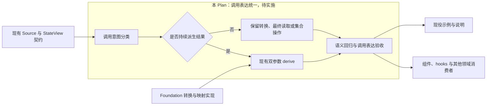

- 本 Plan 负责 UIKit 调用侧的派生表达：阅读代码时，看到 `derive` 就能识别“从已有来源持续得到另一个结果”。当前只交付计划，后续盘点和修改尚未执行。
- 本 Plan 持有下方唯一[规划全局图](#规划全局图)，负责“调用意图分类”到“调用表达与语义验收”的连续区段；接收现有 Source、StateView 和 derive 能力，向组件、hooks、样式等消费者交付一致的派生表达。
- [Props 声明公共解析与逐层消费](261117_Props声明公共解析与逐层消费.md)负责 shadowProps／Plugin、消费权与 Kit 接入。本 Plan 使用其现有输入协议，不接走其他组件的能力迁移，也不代替其性能验收。

# 目标与行动前事实

- 用户指出 `statusStates[statusName].map(Boolean)` 也应使用 derive，希望派生意图直接可见；此前错误的 `stateView` 与 `val` 组合属于同一审查目标。
- [stateUtils.ts](../../src/hooks/stateUtils.ts)已有 `derive(source, mapper)`，经 Foundation 映射产生只读 StateView，mapper 返回的 Source 由现有映射层展开为完成值。无需再设计派生入口。
- 现有 `derive(source)` 原样返回 Source，不新建 StateView，也不创建计算。保留其真实含义，不能将 `derive(() => …)` 当成新增 getter 派生形式。
- [Status 解析器](../../src/components/kits/utils/parseStatusProps.tsx)仍使用 State 的 `.map(Boolean)`；[Variant 解析器](../../src/components/kits/utils/parseVariantProps.tsx)已经通过双参数 derive 表达持续选择。这些是方向依据，不代表全仓已经盘点。
- 本次没有确定待改调用数量。后续从 `src` 各领域及现役 Example、测试示例、文档取得实际清单，逐项依据用途判断。

# 从使用方式确定边界

```ts
// 改前：要先知道 State.map 的含义，才能识别这是派生。
const disabled = statusStates.disabled.map(Boolean)

// 目标：derive 直接表达从既有状态得到只读结果。
const disabled = derive(statusStates.disabled, Boolean)

// 改前：从既有 Props 字段派生，却手写构建与取值组合。
const size = stateView(() => val(props.size))

// 目标：Props getter 或来源可以替换时，从持有字段的对象持续读取。
const size = derive(props, (source) => source.size)
```

- 最后一个例子不能机械改成 `derive(props.size)`：它提前取得字段来源，且单参数 derive 只返回该来源，无法表达持续读取 getter 或替换来源。
- 这类已经有真实来源和映射关系的 stateView／val 组合属于改写对象；不能借“保留真实计算构造”把它原样留下。
- mapper 应使用真实输入；不能为了出现 derive 而传入无关对象，再从闭包绕回实际来源。
- 多来源计算先明确输入对象及值读取责任。选择条件确实需要当前标量时，mapper 内的 `val` 可以保留；普通比较、事件消费和最终取值不因含有 `val` 就成为待改派生。
- 普通函数仍是数据。不得把函数输入改成隐式执行，也不借此次统一改变 Promise、State、getter 或异步边界协议。

# 规划全局图



- Source 表达输入，derive 表达调用侧派生，Foundation 继续拥有转换、等待、递归完成值和去重；消费者取得原有结果及生命周期。
- 图中“待实施”不写入现役 Architecture 充当已成立事实。原 Props 提取计划沿自己的链路继续验收，本图只引用已经具备的输入能力。

# 范围与保留行为

- 后续审查覆盖 UIKit `src` 内生产调用、相邻 Example 与测试示例，以及描述当前用法的文档；按 components、hooks、style-system、color-system、app 等实际领域完整归类，不因起点是 Button 就缩成单组件替换。
- 调用侧候选包括 State／StateView 的直接映射、用 stateView 手写的持续计算，以及其他同责组合；能自然表达为真实 Source 加 mapper 的派生使用 derive，每处先判断其语义再改写。
- `stateView` 的真实来源转换或计算构造、需要写入口的 `createState`、数组或集合的 `.map`、普通最终 `val` 消费继续承担自己的责任。不能自然表达为 Source 加 mapper 的计算，依据实际职责保留或记录未决，不制造 dummy source 凑形式。
- Foundation 内部的 State.map、mapStateView、stateView 实现和它们的 API 契约测试保留；它们是 derive 的基础实现，不能反向依赖 hooks 或为了统一关键词递归改写自己。
- 现役调用示例若需要示范 State.map 的底层契约，明确其用途；历史 Plan、历史运行记录和生成产物不批量回写。`dist`、vendor、依赖目录及外部项目不纳入改写。
- 不新增 derive 调用形式、Getter API、Source 包装层、兼容路径或同值镜像。发现现有工具的真实能力缺口时，停止该类改写并带反例回到负责边界判断。
- 保留动态 getter、Source 替换、显式 undefined、Promise 等待与错误、函数数据、完成值去重、消费权及 owner 清理。统一表达不能提前求值或扩大认领范围。
- 本 Plan 不授权其他组件迁移 shadowProps／Plugin 消费协议，不调整样式所有权、ComponentIdentityMarker 或 UI 行为。

# 领域与载体

## 改前关键结构

```text
src/hooks/stateUtils.ts【文件】：拥有 derive 两种现有调用形式，组合 Foundation 映射。
src/foundation/createState/【目录】：拥有来源转换、映射结果缓存与真实响应式读取。
src/components/kits/utils/parseStatusProps.tsx【文件】：使用 State.map 得到布尔状态视图。
src/components/kits/utils/parseVariantProps.tsx【文件】：使用 derive 持续解释分组来源。
src/hooks/SPEC.md【文件】：记录 hooks 领域职责与入口。
```

- 当前同一派生意图可能经不同调用形式表达。缺口在调用侧阅读与选择的一致性，现有 derive 的能力和两种形式不是本 Plan 的待造设施。

## 目标关键结构

```text
src/【目录】：后续按实际领域盘点并更新派生调用，不改变领域拥有权。
    components/【目录】：组件及工具的派生表达改用现有 derive。
        kits/【目录】：本次目标包含真实派生调用，不承接原计划的消费协议迁移。
            utils/parseStatusProps.tsx【更新，文件】：布尔状态派生使用 derive(state, Boolean)。
    hooks/【目录】：组合能力的调用与说明保留真实输入和来源关系。
        SPEC.md【更新，文件】：说明调用侧派生使用 derive，以及与基础转换的边界。
docs/plans/261117_State派生统一使用derive.md【新增，文件】：拥有此次统一表达的决策与验收。
```

- 其他领域的具体待改文件由后续盘点确定，完整修改清单进入实施详情；不为规划完整而虚构文件或新函数。
- Foundation 和 `stateUtils.ts` 是执行链路依赖，不预设修改其实现。若文档需要补充现有契约，写在原负责说明处，不复制整套状态协议。

# 实施依赖与责任接管

- **先分类**：取得全范围候选，将真实派生、纯转换、最终消费、集合操作和底层实现分开；每项记录所属领域及处理依据。文本命中只是候选，不能以正则结果代替语义判断。
- **再试改**：从 Status `.map(Boolean)` 和持有动态字段的对象派生开始，用现有双参数 derive 接管原计算。完成关键回归后再修改同类调用，不一开始批量替换。
- **再扩展**：按分类覆盖各领域生产调用及现役示例，保持 getter 和多来源的真实依赖。原 State.map 或 stateView 计算的结果、订阅和清理由既有 derive→Foundation 链路接管，不建立第二套状态。
- **最后退出**：所有真实派生候选都有改写结果，或有与本目标一致的保留依据；现役示例和说明不再把普通调用侧派生写成另一套首选入口。Foundation API 本身继续存在，不把调用侧退出写成删除基础 API。
- 各阶段通过后才继续依赖它的改写；失败属于该阶段未通过，不能用类型检查或批改数量掩盖行为差异。

# 验证、结果与停止条件

- 结果是语义保持且阅读时能直接识别的派生调用、对应的现役说明，以及实际处理清单。实施开始时再创建 `agents/运行方案/261117_State派生统一使用derive_实施详情.md`，记录调用方、保留理由、验证和偏差；本轮不预填实施详情。
- 典型验收结果：状态值为 true 时，`derive(statusStates.disabled, Boolean)` 得到 true；上游改变后结果随之更新，订阅者无需认识 State.map。Props getter 返回新 Source 后，`derive(props, source => source.size)` 继续跟随新来源。
- 沿现有邻近测试验证普通值、State、动态 getter 和换源、显式 undefined；Promise 完成后返回 State 的连续更新、fresh Promise 不重复生产、普通函数不执行、同值换源去重和等待中释放 owner 必须保留。
- 涉及消费 Props 的改写须验证：只认领实际负责字段、同层重复读取稳定、未消费字段仍可交接、受控惰性 State 不被提前求值。原 Props 计划的交接行为不能因表达统一退化。
- 测试覆盖实际失败方式，优先复用既有行为回归；不按每处语法替换增设镜像测试。使用受影响单元和真实浏览器验证，再完成全仓 typecheck、build 及必要跨领域回归。
- 完成盘点后反向检查剩余 stateView／`.map`／`val` 候选的真实意图；要求是没有遗漏的调用侧派生，不要求这些关键词全仓归零。
- 出现新增无关 Source、mapper 忽略真实输入、提前 getter／认领、无限 Promise 重试、通知次数变化、清理丢失或新增响应式警告时，停止该类改写，先在真实拥有者定位原因。
- 不以 `as unknown`、`never`、整包 untrack 或兼容分支取得通过。能力不足且需要改变 API、输出或生命周期时，停止受影响阶段并请求同范围裁决。
- 语法统一不证明性能改善。保留既有惰性和必要缓存；如改变计算节点、分配或调用次数，依据实际影响测量并记录，不用移除基础缓存换取统一表达。

# 状态、未决与规则分工

- 当前是新 Plan 审阅稿，只有本文件写作获授权；后续全范围盘点、代码和文档改写均未实施。
- 未决事实是实际候选清单及复杂多来源调用的逐项归类，不阻碍本计划方向审阅；若某类无法用现有两种形式保持原行为，阻断该类施工，不自行新增形式。
- 先前派生修正已提供现有 Source／Val 能力，本 Plan 不重述其完成结论，也不承担原提取计划剩余性能裁决。两篇计划按各自目的验收。
- 依据[仓库入口](../../AGENTS.md)、[AI Rules 入口](../../../ai-rules/AGENTS.md)、[理解意图](../../../ai-rules/rules/Agent-理解意图.md)、[AI Rules 执行](../../../ai-rules/rules/Agent-AI-Rules执行.md)、[第一性原理](../../../ai-rules/rules/Code-第一性原理.md)和[让文本更易读](../../../ai-rules/rules/Document-让文本更易读.md)，核对派生意图、真实责任和表达必要性。
- 按[Plan 写法](../how-to-write-plan.md)、[Guide 写法](../how-to-write-guide.md)、[文件命名](../../../ai-rules/rules/Agent-文件命名.md)成文。UIKit 入口引用的 Markdown／结构目录文件缺失，本次参考可取得的 [Markdown 撰写契约](../../../my-playground/docs/how-to-write-markdown.md)和[结构目录](../../../my-playground/docs/guide/结构目录.md)，不修改规则入口或补空文件。
- 按[任务分工](../../../ai-rules/rules/Agent-任务分工.md)由主 Agent 对接用户、作者独立写作；`plan_constraints` 已在写作前交付约束，成品由其独立核对并阅读全文复述，`simplify_reactive_flow` 检查多余机制和文字。审查不代替实施授权或运行验收。
