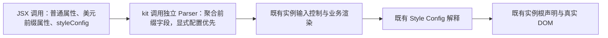

本计划为组件的 Style Config 增加 `$` 前缀属性写法，降低高频样式配置的阅读和书写成本。用户已授权实施；本轮将聚合 Parser 固定在独立文件，由 kit() 调用。

本计划持有下方[规划全局图](#规划全局图)，负责从 Kit 组件调用入口到统一配置消费的连续区段；接收 JSX 属性，交付原有 Style Config 解释链。内部字段改为 `_` 前缀已在提交 `ca53119` 完成，是本计划的前置结果。

# 目标与依据

当前调用：

```tsx
<Flow styleConfig={{ direction: 'column' }}>
  <Heading level={1}>Markdown 阅读与定制</Heading>
</Flow>
```

目标调用：

```tsx
<Flow $direction="column">
  <Heading level={1}>Markdown 阅读与定制</Heading>
</Flow>
```

两者交给同一份方向解释函数，得到相同排列效果。`$direction` 是组件配置字段 `direction` 的直接入口，不单独解释 CSS。

用户已经确定：

- `$` 表示样式相关名称，`_` 表示内部字段的命名约定。
- `kit()` 自动聚合 `$` 开头的 props，去掉开头一个 `$` 后作为 Style Config 的键。
- 原有 `styleConfig` 继续成立，并且同名字段的优先级高于 `$` 属性。
- 业务组件与底层样式解释沿用已有职责，不要求逐组件增加前缀解析。
- 用户补充：Parser 必须位于独立文件，kit() 只引用和调用它，不承载解析细节。

例如：

```tsx
<Flow
  $direction="column"
  $gap="2rem"
  styleConfig={{ direction: 'row' }}
/>
```

交付给原解释链的有效配置为：

```ts
{ direction: 'row', gap: '2rem' }
```

当前源码依据：

- [KitStyleConfigProps 与 kit()](../../src/components/tools/kit.ts) 分别声明配置值域和组织实例创建；初始存在 `ref` 时才建立 Props Director，随后形成 `renderProps`。
- [bindStyleConfig()](../../src/components/tools/styleConfig.ts) 读取整体及字段的 Source，按定义字段调用解释函数；值为 `undefined` 时不解释，并撤销此前的实例覆盖。
- [Flow 样式](../../src/components/kits/Flow/Flow.style.ts) 已独立拥有方向解释。`column` 同时调整方向、换行和交叉轴，不能替换成直接写单条 CSS。
- [根声明](../../src/components/Piv/elementDeclarations.ts) 将实例样式交给真实根，保留同根组合优先级，并在子内容边界终止传播。

# 规划全局图



图中 `kit` 输入归一是拟增加的职责，其余环节为已有能力。本计划同时覆盖公开类型与归一结果的接入，验收到真实 Flow 排列效果；不把效果验证交给其他 Plan。没有相邻的新计划或独立后续目标。

# 范围与保留行为

- 入口为通过 `kit()` 创建的组件。公共类型从组件独立声明的 Style Config 契约生成 `$` 属性及其值域，不维护第二份字段表。
- 运行时归一只处理前缀和配置合并，不依赖当前根解释函数的字段集合。一个公共配置可能由根与内部节点分别绑定，不能按某一根的解释子集裁掉输入。
- 保留 `styleConfig` 的整体 Source、字段 Source、响应式更新及实例清理。新入口提供相同字段能力，不复制状态、不靠 Effect 同步配置。
- 普通业务 props、`ref`、候选分组、原生声明和组件生命周期保持原职责。`$` 属性在输入边界消费，不再作为另一份业务字段继续转发。
- 保留 ComponentIdentityMarker、现有组件依赖、根节点数量与样式所有权。Flow 样式仍归 `Flow.style.ts`，Piv 和 Dode 不增加配置解释。
- 已有 `styleConfig` 调用继续使用；本轮不批量迁移所有调用。以 Flow 的现有示例展示新写法即可。
- 不增加共享 UI 组件，不改变 Token 能力，不引入任意 CSS 属性袋，也不把插件内部的样式 options 当成 Kit props 再次归一。

# 聚合与输入控制

## 统一配置视图

在 `parseStyleConfigProps.ts` 中实现 Parser，由 `kit()` 在接收调用属性后、进入 Props Director 前调用，建立惰性归一视图。视图保留普通属性，向后只交付一份 `styleConfig`，使有无 `ref` 的实例走同一聚合规则。

读取配置时，从 `$` 属性取得低优先级字段，再以显式 `styleConfig` 的同名字段覆盖。去掉一个起始 `$`，不改键名大小写、不转换 CSS 名称、不增加别名。类型依据配置契约限制可用键；运行时归一不承担另一个字段校验系统。

聚合必须保留来源的动态读取能力。整体配置替换、字段 Source 更新、`$` 属性更新后，真实消费点应取得当前结果；不能在组件创建时展开成固定快照。字段合并保留原 Source，由已有消费链按原契约取值。

属性的读取、存在性和枚举结果须一致：只传 `$direction` 时，后续消费能识别存在 `styleConfig`；完全没有两类配置时，不因组件定义了样式解释就伪造实例配置。普通属性及上游对象不被改写。

## 本轮采用的实现语义

以下语义由实现者依据“显式配置优先”和“归一后沿用原链”确定；它们是本轮实现选择，不伪称用户逐项指定：

- **显式字段为 `undefined`**：按字段存在性覆盖。`styleConfig={{ direction: undefined }}` 遮盖 `$direction`，随后由原解释链跳过该字段并恢复默认；只有显式配置不含该字段时才采用 `$direction`。整体 `styleConfig` 为 `undefined` 时没有显式字段，仍采用 `$` 输入。这使“高优先级配置主动清空字段”和“未提供该字段”可区分。
- **Controller 的统一入口**：Controller 继续只公开可写的 `props.styleConfig`，不为 `$direction` 再建独立 State。Controller 写入替换当前有效配置，清空写入沿用原有清除语义；原始 `$` 输入不会在 Controller 干预之后被另一个聚合层自动补回。上游来源与干预写入的后续关系沿用现有 State 契约。

这些选择保留单一配置和原输入控制，不额外构建别名状态。公共类型怎样区分调用属性与规范化输入、惰性视图内部声明和测试夹具由实施者在既定边界内确定。

# 领域与载体

## 改前结构

```text
src/components/tools/【目录】：组件定义、输入控制与实例样式接入。
    kit.ts【文件】：组合公开契约并创建组件实例。
        KitStyleConfigProps【类型】：由独立配置契约声明 styleConfig 输入。
        kit【函数】：组织输入控制、组件身份、业务渲染和根声明绑定。
    componentPropsDirector.ts【文件】：按字段协议提供输入视图和可写 State。
        createComponentPropsDirector【函数】：连接上游来源与实例干预。
    styleConfig.ts【文件】：拥有配置解释和实例样式消费。
        bindStyleConfig【函数】：读取配置并调用本作用域的字段解释。
src/components/kits/Flow/【目录】：顺序内容排列。
    Flow.prop.ts【文件】：声明 Flow 输入与字段读取协议。
    Flow.style.ts【文件】：拥有方向、间距等配置契约和样式解释。
    Flow.tsx【文件】：通过 kit 装配并将公共节点输入交给 Piv 根。
```

现有链路没有 `$` props 的统一归一职责；本计划将它放在 Kit 输入边界，而不是业务组件或样式系统。

## 目标结构

```text
src/components/tools/【目录】：集中承担组件调用语法到规范化输入的转换。
    kit.ts【更新，文件】：组合调用契约并在实例输入边界调用独立 Parser。
        KitComponent【更新，类型】：从既有配置契约派生美元前缀调用字段，保持内部 Props 与字段协议只拥有规范化输入。
        kit【更新，函数】：调用 Parser 后把规范化输入交给既有控制和渲染链。
    parseStyleConfigProps.ts【新增，文件】：拥有美元前缀属性与显式配置的惰性聚合及归一输入类型。
        parseStyleConfigProps【新增，函数】：去掉开头一个美元符号并按显式配置优先交付统一视图。
    kit.test.ts【更新，文件】：验证公开字段值域及规范化输入的契约约束。
    kit.browser.test.tsx【更新，文件】：验证响应式聚合、优先级、Controller 与真实根效果。
src/components/kits/Flow/【目录】：提供高频排列配置的真实消费场景。
    examples/【更新，目录】：在现有场景中展示美元前缀写法，具体场景由施工盘点确定。
Architecture.md【更新，文件】：在实现验证后记录输入归一的实际职责和单一消费链。
```

聚合解析由 `parseStyleConfigProps.ts` 唯一拥有，`kit.ts` 仅接入其类型和函数，不内联解析细节，也不另立业务协议。`componentPropsDirector.ts`、`styleConfig.ts`、Flow 业务核心与 `.style.ts` 是复用的消费者或领域拥有者，目标方向不要求它们分别解析 `$`。若施工发现必须调整这些主体的职责，先回查输入边界方案，不直接扩大改造。

公开调用类型增加的前缀字段，须在 Kit 通用类型层接管完整字段协议的校验关系。不能要求每个组件手写 `$` 字段读取模式，也不能用宽泛字符串索引或断言掩盖契约缺口。无配置字段的组件不凭空获得任意 `$` 属性。

# 实施顺序与交付

## 阶段一：闭合语义与类型边界

- 按上述实现语义明确公开调用类型、规范化输入、Controller 三者的关系。
- 先验证 Flow 能接受 `$direction="column"` 并拒绝错误值；原有 `styleConfig` 值域、Controller/ref 约束及无配置组件约束仍成立。
- 阶段通过条件是字段类型由同一契约导出，现有组件不需要新增前缀字段表；出现逐组件补偿或扩大任意键值域时，返回 Kit 类型边界重审。

## 阶段二：接入单一配置链

- 由独立 Parser 完成惰性归一，kit 调用后交给既有 Director 或直接输入路径，再由原 `bindStyleConfig` 消费。
- 核对单独 `$`、单独 `styleConfig`、两者组合的读取与形状；同时覆盖有无初始 `ref` 的实例。
- 阶段通过条件是同名字段按显式配置优先，来源更新持续生效，不重建业务核心或真实节点，不增加第二次解释或独立配置状态。

## 阶段三：验证真实使用并更新说明

- 使用现有 Flow 示例验证新调用与对象配置得到相同方向、换行、对齐和间距；保留两种写法的混合示例以展示优先级。
- 核对同根组合及后代隔离，检查各层 Marker、实际组件依赖和样式所有权；不以类型通过或页面可运行代替。
- 验证后更新 Architecture 的现役链路。施工期间的命令、实际差异和结果放入实施详情，不回填进本 Plan 当成已完成事实。
- 阶段通过后以原需求验收整条链路；完成所需检查后停止，不批量改写无关业务页面。

# 验证与退出条件

实现必须用可观察行为证明下列结果，测试数量不作为完成标准：

| 验证对象 | 必须看到的结果 | 不通过的反例 |
| --- | --- | --- |
| 普通调用 | `$direction="column"` 与对象配置产生相同 Flow 排列 | 只改 flex-direction，遗漏原方向解释的其他效果 |
| 优先级 | 同名字段由显式 styleConfig 决定，不同名字段同时保留 | `$` 覆盖显式配置，或整组替换丢失低优先级其他字段 |
| 动态来源 | 两类输入及整体/字段 Source 更新被真实根消费 | 创建时快照、Effect 复制，或核心/节点重建 |
| 清除与空值 | 按字段存在性覆盖处理 undefined；false、0、空字符串及契约允许的 null 不被真值判断丢弃 | 清空后遗留覆盖，或合法值被当成缺省 |
| Controller | 有无 ref 聚合一致，写入和清空沿用归一后的单一 State，实例及 ref 生命周期保持原语义 | 前缀新增一套状态，或控制写入被再次聚合静默覆盖 |
| 输入形状 | 只有前缀输入也能启用样式消费；无输入时不伪造声明 | 值读取正常但 has/ownKeys 不一致导致实际绑定缺失 |
| 组件边界 | 前缀不落到 DOM，实例不串值，同根顺序与后代隔离保持 | 父配置污染后代、共享 Token 默认值被修改 |
| 类型与职责 | 值域来自原配置契约，业务核心无需识别前缀，原字段协议仍完整 | 逐组件抄映射、放宽任意键、把聚合移入样式解释或把 Parser 逻辑堆进 kit |

优先复用并补充 Kit 现有单元、类型与浏览器用例，运行受影响的必需检查；具体命令和结果由实施详情记录。只通过单元测试不足以验收真实排列、生命周期和边界行为。

当实现必须改动业务解释、丢失原配置能力、放宽类型或增加同步状态才能工作时，停止当前方法并回查 Kit 归一边界。允许调整内部实现，不能用调整验收来维持方案。

# 规则、分工与状态

- 依据[仓库入口](../../AGENTS.md)与[AI Rules 入口](../../../ai-rules/AGENTS.md)，范围为已授权的 Plan 修订与功能实施；按本轮代码规则施工。
- 按[任务分工](../../../ai-rules/rules/Agent-任务分工.md)执行：主 Agent 修订 Plan 并组织验收，独立执行者 `/root/style_parser_implementation` 施工，独立约束检查者 `/root/plan_constraints` 在写作前取得约束，成文后检查全文并复述思想。独立实例不替作者施工，也不以作者自查替代成品检查。
- `/root/plan_constraints` 在容量限制下兼任约束、语义、精简与意图审查；能力复用与重复识别由各自独立上下文取得初查与最终复查。
- [Plan 撰写契约](../how-to-write-plan.md)、[Guide 撰写契约](../how-to-write-guide.md)约束当前文档。Plan 中两个本地写法链接失效，本轮找到并读取了 My Playground 的同名[Markdown 契约](../../../my-playground/docs/how-to-write-markdown.md)与[结构目录](../../../my-playground/docs/guide/结构目录.md)，用作补充写法依据，未修改仓库规范。标题层级按共享《技术文档质量》的零级文件身份与一级模块规定组织。
- [理解意图](../../../ai-rules/rules/Agent-理解意图.md)、[处理需求](../../../ai-rules/rules/Agent-处理需求.md)、[第一性原理](../../../ai-rules/rules/Code-第一性原理.md)约束方案必要性与决定来源；undefined 与 Controller 的实现选择须有原优先级和单一配置链的依据。
- [样式文件写法](../style/样式文件写法.md)、[组件职责与样式归属](../guide/组件职责与样式归属.md)、[组件结构查看](../guide/组件结构查看.md)约束样式、身份和真实组件边界；[代码清洁](../../../ai-rules/rules/Code-代码清洁.md)要求复用单一消费链，避免业务逐处补偿。
- 开始实施才按 Plan 契约建立 `agents/运行方案/261117_StyleConfig支持美元前缀属性_实施详情.md`，保存实际差异与验证事实；本轮不预填实施记录。临时任务材料按仓库入口写入 `agents/run/`，与稳定实施记录区分。
- 当前状态：用户已授权实施；本轮修订明确独立 Parser 和实现语义，实施前由原独立实例重新检查。
- 独立检查结论：`/root/plan_constraints` 已阅读全文，确认聚合入口、显式配置优先、单一消费链、领域边界和阶段验收承接用户要求，无方向性必修项。正式实施记录与临时材料的归属已按审查意见明确。该结论对应原审阅稿；本轮修订的复审结果另列，不以旧结论放行新内容。
- 本轮复审结论：原独立实例已阅读全文并核对当前源码，确认独立 Parser、公开调用与规范化输入分层、直接字段覆盖及原 Controller 语义符合本轮授权，可以施工。实施须盘点具有样式契约的泛型自定义调用签名，避免只验证 Flow 而遗漏其他组件的公开类型。
