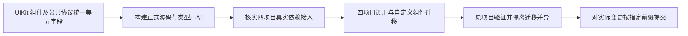

本计划完成 UIKit 全量美元样式协议，并迁移最近引用 UIKit 的四个项目。继承已验证的 Button、Flow 行为，退出试点期间的双协议接线；既有已完成 Plan 与实施记录保留。

# 目标与范围

用户明确：其他组件也迁移，不再需要普通 `styleConfig`；处理最近引用 UIKit 的四个项目并允许 Git 提交。UIKit 提交以 `✨` 开头，引用项目提交以 `👽` 开头。本轮不推送远端。

按依赖声明盘点，再以最新 Git 提交时间排序，四个消费者为：

- `D:/mycode/bcoin-strategy-viewer`：2026-11-16。
- `D:/mycode/my-playground`：2026-11-16。
- `D:/mycode/data-viewer`：2026-11-16。
- `D:/mycode/ai-empire-server`：2026-11-02。

其余已查到的引用项目提交更早，不在本轮迁移。目录活跃程度不作为接口已接入的证据，实际依赖解析路径须单独核对。

常规布局直接声明：

```tsx
<Grid $columns={3} $responsive={false}>内容</Grid>
<Table $compact $columnMinWidths={{ summary: 240 }} data={rows} />
```

整组来源或覆盖使用唯一逃生舱：

```tsx
<Table $styleConfig={{ $compact: compact }} data={rows} />
```

显式配置的同名字段优先，包含显式 undefined。`summary` 等嵌套业务数据键不加前缀；样式领域内部的具体 Token 名称不变。

# 全局图与本轮定位



本计划覆盖整条链。UIKit 交付唯一协议和发布声明；消费者沿原引用方式接入，不为本轮顺带更换包管理或框架。没有其他计划承接本轮未完成的验收。

# 领域结构与退出责任

改前关键载体：

```text
D:/mycode/uikit/src/components/tools/【目录】：两套现役配置入口的公共接线。
    kit.ts【文件】：按组件定义选择配置入口并接入实例控制。
    parseStyleConfigProps.ts【文件】：按入口决定同名聚合或去前缀聚合。
    styleConfig.ts【文件】：按传入的入口读取并解释实例配置。
D:/mycode/uikit/src/components/kits/【目录】：Button/Flow 已迁移，Grid/Table 仍使用旧入口。
```

目标关键载体：

```text
D:/mycode/uikit/src/components/tools/【目录】：唯一美元配置入口。
    kit.ts【更新，文件】：公共 Props、字段表和类型校验只保留 $styleConfig，去掉入口选择。
    parseStyleConfigProps.ts【更新，文件】：只聚合同名美元字段，排除 $styleConfig 容器，无需聚合时返回原对象。
    styleConfig.ts【更新，文件】：固定读取 $styleConfig，解释与实例覆盖算法不变。
D:/mycode/uikit/src/components/kits/【目录】：所有组件采用相同公共配置协议。
    Button/Button.prop.ts【更新，文件】：退出剔除旧字段的阶段补偿，复用统一公共表。
    Flow/Flow.prop.ts【更新，文件】：退出剔除旧字段的阶段补偿，复用统一公共表。
    Grid/Grid.prop.ts【更新，文件】：公开配置与 Controller 接入统一美元字段。
    Grid/Grid.tsx【更新，文件】：组件定义使用美元配置入口。
    Grid/Grid.style.ts【更新，文件】：配置与 handler 的一级键统一美元前缀。
    Table/Table.prop.ts【更新，文件】：公开配置、Controller 与泛型调用保留列键值域并使用美元入口。
    Table/Table.style.ts【更新，文件】：根与内部单元格配置一级键统一美元前缀。
    Table/Table.tsx【更新，文件】：同名读取公开配置并交给原单元格解释。
D:/mycode/bcoin-strategy-viewer/【更新，目录】：迁移实际 UIKit 调用和本地组件配置协议。
D:/mycode/my-playground/【更新，目录】：迁移实际 UIKit 调用和本地组件配置协议。
```

`D:/mycode/data-viewer` 与 `D:/mycode/ai-empire-server` 已核实引用 UIKit，但当前未发现受影响的配置调用，先作为依赖接入与验证对象，不预设源码更新；后续发现的必要修改按实际事实记录。

消费者具体文件由调用方盘点决定，记录在实施详情；不为简单命名迁移新增包装组件或工具层。现役 Guide、Architecture、Example 与测试随实际协议同步，历史材料不批量改写。

原普通入口和 configKey 参数不再保留别名、fallback 或开关。其唯一有效职责由 `$styleConfig` 接管；`$styleTokens` 已完成统一，保留现有能力即可。Source、Controller、Token、Marker、同根顺序、后代隔离和根 DOM 结构均保留。

# 实施顺序与停止条件

- 先固定五个仓库的 HEAD、工作区和暂存基线。UIKit 前几轮关联修改纳入最终 UIKit 提交；消费者无关工作不混入。
- UIKit 先统一公共协议及所有生产配置/调用，再运行类型、相关单元与真实浏览器测试和发布构建。拒绝旧容器/内部普通键及双美元错误拼法的测试保留，不能用兼容取得通过。
- 确认消费者实际解析 UIKit 新源码或新声明，再迁移各自调用、公共 Kit 定义与必要现役说明。优先直接美元字段，不递归改业务数据，不修无关前后端问题。
- 按各项目脚本运行相关检查。若基线已有失败，保留原因、位置和可区分本次影响的证据；不能默默扩大修复范围或把失败报告成通过。
- 提交前对照原基线核对完整差异。消费者脏文件若无法隔离迁移与原工作，先保持工作区成果并继续可隔离部分，不把用户无关内容纳入提交。具体提交覆盖范围和剩余未提交迁移必须明示，不声称五仓干净。
- 某消费者若没有受本次协议影响的调用或定义，仅验证实际接入并记录结果，不为凑提交数修改自有同名组件、增加占位文件或创建空提交。
- 以指定 emoji 和有含义的中文说明提交；不全仓盲目暂存、不提交临时材料、不改远端。完成必要验证及提交后停止，不扩展到第五个消费者。

# 验收

- UIKit 的现役代码和公开声明只认 `$styleConfig`；Parser、绑定层与类型中不存在双协议分支或入口名参数。
- Grid/Table 的直接属性与配置对象同名，内部字段 Source、Controller 清空和真实 DOM 样式效果继续成立；无直接字段时保留原 props 身份。
- 四个消费者的实际调用不依赖旧协议，真实依赖解析与运行/编译证据可核对。构建成功不能替代调用方盘点，源码替换也不能替代实际接入。
- 提交内容能逐项对应迁移要求，既有用户功能、未跟踪文件和暂存状态不被回退或混入无关提交。

# 规则、分工与状态

按[仓库入口](../../AGENTS.md)、[共享入口](../../../ai-rules/AGENTS.md)、[统一分工](../../../ai-rules/rules/Agent-任务分工.md)、[Plan 撰写](../how-to-write-plan.md)及[Plan 落地](../how-to-apply-plan.md)执行。消费者读取各自入口和负责的架构/边界文档；用户本轮明确授权覆盖旧的 Git 只读及跨仓默认限制，仅限当前对象和动作。

主 Agent 组织范围、接入与最终提交；`/root/style_parser_implementation` 实施 UIKit，`/root/consumer_style_migration` 实施四个消费者；`/root/plan_constraints` 独立审查约束、语义、精简与最终提交范围。公共能力只是已有职责收束，不新增组件或抽象；实际新机制若出现，重新进入必要性与能力复用审查。

正式实施事实记录于 `agents/运行方案/261117_统一美元样式入口与四项目迁移_实施详情.md`；临时差异快照位于各仓允许的 `agents/run/`，不进入产品提交。

当前写前独立约束已取得，用户已授权实施和指定提交风格；成文后复审通过再开始写代码。原项目脏状态及验证缺口如实保留，不用 Plan 的通过代替代码验收。
