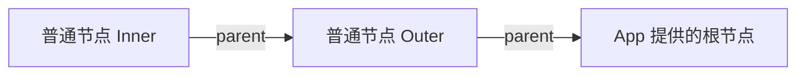

# KitContext 使用与设计规范

KitContext 在组件树中建立具名祖先链，供后代读取共享数据。它不收集子节点，也不向父组件注册子组件。

## 根与普通节点

KitContextRoot 是无默认值的原生 Solid Context，直接保存 KitContextNode。宿主 App 提供的 value 本身就是唯一根，不在其下再插入 Root；每个应用实例独立创建自己的根。

节点用 isRoot 区分：根只有 `isRoot: true`，没有 parent、业务 name 或 payloads；普通节点具有 `isRoot: false`、name、parent 和 payloads。缺少 Context 提供者时按原生契约抛错，不自动创建根或返回空值。



## 初始化与作用域

KitContext 初始化时读取当前父级、name 与 payloads 引用，创建稳定节点并提供给 children。后续 props 的字段替换不会自动更新这些节点字段；payloads 内部可以携带 State 等响应式能力，其自身更新仍按原契约传播。

上下文沿原生 children 作用域生效，嵌套提供者结束后恢复外层上下文，子树卸载时其作用域结束。任意 payload 资源不会因此自动释放，资源仍由创建它的主体登记清理。

## 祖先查询

useKitContext 从当前可见节点向上查询，返回第一个匹配节点的 payloads：

| 调用 | 匹配条件 |
| --- | --- |
| `useKitContext()` | 最近的普通节点 |
| `useKitContext({ target })` | name 与 target 相等 |
| `useKitContext({ payloadKey })` | payloadKey 存在于 payloads 中 |

查询到 App 根即停止；根不参与业务数据匹配，未找到返回 undefined。读取必须处于原生上下文作用域内；查询未命中与缺少提供者是不同情况。

## 父组件提供能力，子组件使用能力

以下 Card 和 Title 是演示组件。Card 将修改标题的能力放入 payloads，Title 按名称找到它，用 Effect 同步标题来源，结束本轮动作时清空标题。数据变化来自显式调用 setTitle；读取上下文本身不会登记 Title，也不会让 Card 自动获知子组件是否存在。

```tsx
import {
  KitContext, KitContextRoot, Piv, createEffect, createState, useKitContext, val,
  type KitContextNode, type StateView,
} from '@edsolater/uikit'

interface CardPayloads {
  setTitle(text: string | undefined): void
}

function App() {
  const rootNode: KitContextNode = { isRoot: true }
  const text = createState('账户')
  return <KitContextRoot value={rootNode}>
    <Card><Title text={text} /></Card>
  </KitContextRoot>
}

function Card(props: { children?: any }) {
  const title = createState<string | undefined>(undefined)
  const payloads: CardPayloads = { setTitle: text => { title.set(text) } }
  return <KitContext name="Card" payloads={payloads}>
    <Piv class="card">
      <h2>{val(title, '未设置标题')}</h2>
      {props.children}
    </Piv>
  </KitContext>
}

function Title(props: { text: StateView<string> }) {
  const card = useKitContext<CardPayloads>({ target: 'Card' })
  createEffect(props.text, text => {
    card?.setTitle(text.trim())
    return () => { card?.setTitle(undefined) }
  })
  return <span>{val(props.text)}</span>
}
```

Effect 直接订阅 text 这一来源，在动作阶段调用父级能力；每轮新动作执行前清理上一轮；Title 卸载时执行本轮清理。

组件与能力的关系决定查询方式。已知要操作 Card 时按 target 查找；只要求某种能力时按 payloadKey 查找；明确使用最近节点时不传 query：

```ts
const nearest = useKitContext() // 最近节点的全部 payloads。
const card = useKitContext<CardPayloads>({ target: 'Card' })
const titleOwner = useKitContext<CardPayloads>({ payloadKey: 'setTitle' })
```

payloadKey 是属性名，不是匹配函数；泛型只描述预期 payload 类型，不做运行时类型校验。若没有对应祖先，返回 undefined，由调用方决定是否执行可选动作。
