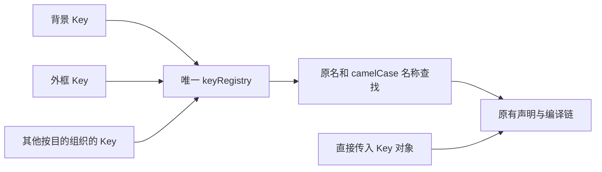

本文记录 **现役 Key 注册表文件结构**，供阅读和维护时判断每个属性的归属。
当前源码已按以下用途组织为 87 个属性文件；文末保留原 54 个分类文件的接管对照。
实施顺序与验收由 [Key 按用途归类与收录筛选](../../../docs/plans/261026_Key按用途归类与收录筛选.md)负责。

# 文件按什么划分

一个文件负责一个可直接描述的目的。规范模块用于查证属性含义，不直接决定文件边界。
同一目的的物理/逻辑方向及多种实现方式放在一起；目的不同，不能因为同属“视觉”或“交互”而混放。
Background 独立；Border、Outline、Box Shadow 与角形共同表达盒子外框。

分类只改变定义的位置。每个属性仍只有一个 Key 实例，变量与分类字面量引用同一对象。
对象输入、数组输入及重复声明聚合不是目录分组自动产生的能力；不能以建表完成代替它们的接口设计。

# 核心文件

以下路径相对 `src/style-system/`。它们承接构造、名称查找及公开汇总，保持已实现的职责。

| 文件 | 职责 |
| --- | --- |
| `key-definition.ts` | 定义 Key 协议和纯 `key()` 构造，不登记全局名称。 |
| `key.ts` | 识别声明目标、查找原名/别名、显式登记自定义 Key；保持冲突拒绝与首对象优先。 |
| `key-registry/index.ts` | 静态汇总分类字面量为唯一注册表，公开 Key 变量；自身不是一种属性用途。 |
| `index.ts` | Style System 公共出口，继续公开 Key、Rules、Token 等现役能力。 |

# 属性文件列表

以下文件均位于 `src/style-system/key-registry/`，保持同级文件，不新增仅用于分类的目录入口。
每个文件同时导出具名 Key 及原名到该 Key 的字面量映射。
文件名不要求新建同名函数或修改 `$Key` API。

本版逐项归属结果为 **87 个属性文件、545 个属性**，原候选中的 24 项已排除。
数量由本版具体边界得到，不作为追求更多或更少文件的指标。

| 文件名 | 单一目的 | 职责与边界 | 属性数 |
| --- | --- | --- | ---: |
| `alignment.ts` | 布局对齐 | 用 align/justify/place 表达项目或内容在可用空间中的对齐；不改变项目间距。 | 9 |
| `animation.ts` | 时间线动画 | 统一动画效果、时间参数、滚动/视图时间线及触发范围；运动路径几何另有归属。 | 33 |
| `appearance.ts` | 原生控件外观 | 控制原生控件绘制方式与强调色；不混入任意交互行为。 | 2 |
| `background.ts` | 背景绘制 | 组织背景各层的材料、位置、铺排及层内混合；不接管外框。 | 12 |
| `baseline.ts` | 基线对齐 | 控制行内/SVG 内容采用哪条基线及其对齐和偏移。 | 5 |
| `boundary.ts` | 盒子外框 | 组织 border、outline、box-shadow 与圆角/角形，支持同一外框目的下选择不同表达。 | 83 |
| `caret.ts` | 插入光标 | 控制文本插入光标的颜色、形态与闪烁；不把子属性支持当作 shorthand 已支持。 | 3 |
| `color-adjustment.ts` | 颜色呈现策略 | 控制配色环境、强制色、打印色及动态范围下的颜色呈现；不定义实际前景/背景颜色。 | 4 |
| `color.ts` | 前景颜色 | 提供 color 及 currentColor 的继承来源；不包含整体透明度或颜色环境策略。 | 1 |
| `columns.ts` | 多栏流排版 | 组织栏数、宽度、填充及跨栏；栏间装饰另由 gap-decoration 表达。 | 7 |
| `compositing.ts` | 整元素合成 | 控制整体透明度、与下层的混合及混合隔离；不处理背景内部各层混合。 | 3 |
| `container.ts` | 查询容器声明 | 确定哪些元素充当什么查询容器及其名称；不实现条件规则本身。 | 3 |
| `containment.ts` | 子树渲染隔离 | 声明布局/绘制等隔离边界及子树是否需要参与渲染。 | 2 |
| `content.ts` | 生成内容 | 声明生成内容及引号配对，不拥有计数器的状态更新。 | 2 |
| `counter.ts` | 计数状态 | 声明计数器的重置、赋值与递增，供列表及其他生成内容使用。 | 3 |
| `cursor.ts` | 指针外观 | 控制鼠标指针图形，不决定事件命中。 | 1 |
| `decoration-break.ts` | 分片装饰方式 | 决定一个盒子被拆成多个片段后，背景和外框怎样延续或逐片绘制；不决定断片位置。 | 1 |
| `display.ts` | 布局盒生成 | 决定是否生成布局盒以及采用哪种格式化模式。 | 1 |
| `filter.ts` | 图像过滤 | 控制元素/背景过滤及滤镜的颜色、灯光输入。 | 6 |
| `flex.ts` | 弹性布局 | 组织轴向、换行、伸缩与基础尺寸以形成弹性布局。 | 8 |
| `float.ts` | 浮动绕排 | 共同组织 float/clear 与绕排形状，回答相邻行内容怎样绕开浮动区域。 | 5 |
| `font.ts` | 字形选择 | 选择字体、字号、字重及字形变体/合成/可变字体轴，以确定实际使用的字形。 | 26 |
| `fragmentation.ts` | 内容断片 | 约束内容在页、栏等片段间的断开位置及孤行寡行。 | 5 |
| `gap-decoration.ts` | 间隙分隔线 | 统一 column-rule、row-rule、rule 的线条、交点、端点和显隐；不接管间距或盒子外框。 | 30 |
| `gap.ts` | 项目间距 | 定义布局项目之间的行/列间距；不绘制分隔线。 | 3 |
| `grid.ts` | 网格布局 | 组织轨道、区域与网格项目放置。 | 15 |
| `hit-testing.ts` | 指针命中 | 控制指针事件能否命中元素。 | 1 |
| `image-rendering.ts` | 图像呈现 | 控制图像方向和像素重采样；不决定替换内容在盒内怎样适配。 | 2 |
| `initial-letter.ts` | 首字下沉 | 定义段首字母的下沉与尺寸关系。 | 1 |
| `interactivity.ts` | 子树交互可用性 | 控制子树的交互可用性，不等同于指针命中或文字选择。 | 1 |
| `interest.ts` | 兴趣触发时序 | 规定兴趣触发进入和退出的延迟。 | 3 |
| `line-box.ts` | 行框尺寸 | 定义行高以及文字盒上下缘和修剪，回答一行文字占据怎样的垂直空间。 | 4 |
| `list.ts` | 列表标记 | 组织列表标记的内容、图像与位置。 | 4 |
| `margin.ts` | 外部留白 | 定义盒子外的留白及其裁切规则；物理和逻辑方向同处。 | 12 |
| `mask.ts` | 可见区域 | 通过几何裁剪或透明度遮罩限定元素可见部分；mask-border 是遮罩，不是边框绘制。 | 19 |
| `math.ts` | 数学排版 | 控制数学内容的样式、深度与偏移。 | 3 |
| `motion-path.ts` | 运动路径 | 定义沿路径定位时的路径、距离、锚点和朝向。 | 6 |
| `object-fit.ts` | 替换内容适配 | 控制图片、视频等替换内容的适配、位置和可视裁切区域。 | 3 |
| `order.ts` | 视觉排列顺序 | 规定布局中的视觉排序，不将其冒充辅助技术的阅读顺序。 | 1 |
| `overflow.ts` | 盒内溢出 | 控制各方向溢出的裁剪和滚动容器形成；不包含文字截断与滚动导航。 | 6 |
| `overscroll.ts` | 滚动边界行为 | 控制到达边界后的滚动传播及反馈。 | 5 |
| `padding.ts` | 内部留白 | 定义内容与盒子边界之间的留白；物理和逻辑方向同处。 | 11 |
| `page.ts` | 分页上下文 | 选择命名页；不继续收录已废弃的 page-break 别名。 | 1 |
| `position.ts` | 位置 | 统一普通定位、各边/逻辑 inset、锚点引用和定位回退，回答盒子放在哪里。 | 20 |
| `reading-order.ts` | 阅读顺序 | 声明阅读流及阅读次序，不重写视觉布局。 | 2 |
| `reset.ts` | 声明重置 | 通过 all 重置整组声明，遵循其排除项。 | 1 |
| `resize.ts` | 用户缩放尺寸 | 控制用户可否拖动调整元素尺寸，不声明静态宽高。 | 1 |
| `ruby.ts` | 旁注排版 | 控制旁注的对齐、位置和越界方式。 | 3 |
| `scroll-anchor.ts` | 滚动位置稳定 | 控制内容变化时是否通过滚动锚定维持视觉位置。 | 1 |
| `scroll-behavior.ts` | 程序滚动方式 | 规定滚动操作采用平滑还是即时方式。 | 1 |
| `scroll-margin.ts` | 滚动目标外扩区 | 定义目标参与滚动对齐时的外扩区域，保留物理/逻辑方向。 | 11 |
| `scroll-navigation.ts` | 滚动导航目标 | 组织滚动标记组、活动目标组与初始目标。 | 3 |
| `scroll-padding.ts` | 滚动容器预留区 | 定义滚动容器内用于对齐的预留区域，保留物理/逻辑方向。 | 11 |
| `scroll-snap.ts` | 滚动吸附 | 声明吸附方式、对齐目标及停止策略。 | 3 |
| `scrollbar.ts` | 滚动条呈现 | 统一滚动条颜色、宽度与空间预留。 | 3 |
| `selection.ts` | 文字选择 | 控制用户能否及怎样选择文字。 | 1 |
| `size-interpolation.ts` | 尺寸插值 | 规定内在尺寸关键字是否参与插值；不设置静态宽高，也不拥有动画时间线。 | 1 |
| `size.ts` | 占据尺寸 | 统一物理/逻辑宽高、上下限、比例、盒尺寸算法及内在尺寸估算，包括字段和嵌入帧的尺寸策略。 | 21 |
| `stacking.ts` | 叠放顺序 | 管理 z-index 与顶层过渡中的 overlay 叠放控制；不定义混色。 | 2 |
| `svg-color.ts` | 矢量颜色插值 | 控制矢量颜色运算所采用的插值空间。 | 1 |
| `svg-fill.ts` | 矢量填充 | 定义封闭区域的填充颜色、透明度与填充规则。 | 3 |
| `svg-geometry.ts` | 矢量几何 | 定义路径、坐标、半径及轮廓几何。 | 8 |
| `svg-gradient.ts` | 渐变色标 | 定义渐变色标颜色和透明度。 | 2 |
| `svg-marker.ts` | 路径标记 | 定义路径起点、中点和终点上的标记引用。 | 4 |
| `svg-paint-order.ts` | 矢量绘制顺序 | 规定填充、描边和标记的绘制先后。 | 1 |
| `svg-rendering.ts` | 矢量渲染取舍 | 提示图形及文字绘制时在速度、清晰度、精度之间采用哪种策略。 | 2 |
| `svg-stroke.ts` | 矢量描边 | 定义轮廓线的宽度、端点、连接、虚线和随变换缩放方式。 | 9 |
| `svg-text.ts` | 矢量文字锚定 | 控制文字相对于定位点的锚定关系；基线配置仍统一归 baseline。 | 1 |
| `table.ts` | 表格网格 | 组织表格布局、单元格间隔/边框合并、空单元格及标题位置；不接管普通盒子外框。 | 5 |
| `text-align.ts` | 行内文字对齐 | 控制行内文字的对齐与两端对齐分配策略。 | 3 |
| `text-decoration.ts` | 文字装饰线 | 组织装饰线、下划线位置、粗细与避让。 | 9 |
| `text-emphasis.ts` | 文字强调标记 | 组织文字旁的强调标记及其颜色和位置。 | 4 |
| `text-indent.ts` | 行边缘排版 | 控制首行缩进及标点悬挂，表达文本行在容器边缘的进出。 | 2 |
| `text-overflow.ts` | 文字截断 | 控制文字溢出提示及行数截断，不接管通用盒子溢出。 | 2 |
| `text-shadow.ts` | 字形阴影 | 定义文本字形的阴影，不与盒子外框阴影混放。 | 1 |
| `text-sizing.ts` | 文字尺寸适配 | 控制文字随可用空间或设备阅读环境进行尺寸适配；不替代基础 font-size。 | 2 |
| `text-spacing.ts` | 文字间距 | 组织字间、词间、自动空隙及制表符间距。 | 5 |
| `text-transform.ts` | 文字形态转换 | 控制大小写等显示形态转换，不修改原文本。 | 1 |
| `text-wrap.ts` | 断行与空白处理 | 组织换行、词/连字符断开与参与断行的空白处理。 | 11 |
| `touch-action.ts` | 触摸手势许可 | 声明触摸操作允许触发哪些浏览器手势。 | 1 |
| `transform.ts` | 空间变换 | 组织变换、基点、透视与三维参与方式。 | 10 |
| `transition.ts` | 属性过渡 | 定义属性值变化时的自动过渡。 | 6 |
| `view-transition.ts` | 视图快照过渡 | 声明快照配对身份及作用域，不把普通属性过渡混入这一生命周期。 | 3 |
| `visibility.ts` | 可见性 | 控制已有布局盒是否可见，保留 visibility 自身的布局/折叠语义。 | 1 |
| `will-change.ts` | 渲染准备提示 | 提示未来可能变化的属性，不与其他性能相关 Key 混成杂项。 | 1 |
| `writing-mode.ts` | 书写方向 | 组织书写轴、双向文字与字形朝向的关联配置。 | 5 |
| `zoom.ts` | 元素缩放 | 声明元素的布局缩放，不将其误称为视口配置。 | 1 |

# 容易再次分错的边界

- `boundary.ts` 表达盒子外框，包含 Border、Outline、Box Shadow 和角形。
  `table.ts` 中的 `border-collapse/spacing` 决定表格网格模型；`mask-border` 限定可见区域，仍归 `mask.ts`。
  `gap-decoration.ts` 绘制项目之间的分隔线，不是盒子外框。
- `background.ts` 内的混合只作用于背景各层；`compositing.ts` 处理整元素与下层的合成。
  `svg-fill.ts` 填充矢量轮廓内部，不与盒子背景混放。
- `size.ts` 接管逻辑和物理尺寸、`field-sizing` 及内在尺寸策略。
  `resize.ts` 是用户拖动调整尺寸的许可，`size-interpolation.ts` 是尺寸插值策略。
- `animation.ts` 接管普通及滚动/视图时间线；`motion-path.ts` 拥有路径几何。
  `view-transition.ts` 拥有视图快照身份及作用域，不能因名称里也有 transition 就当成普通属性过渡。
- `baseline.ts` 统一基线配置，即使部分属性也能用于 SVG。
  `svg-text.ts` 的 `text-anchor` 负责文字相对定位点的锚定，不重复基线声明。
- `scroll-margin.ts` 作用于目标外扩区，`scroll-padding.ts` 作用于滚动容器预留区。
  `scroll-snap.ts` 决定吸附，`scroll-anchor.ts` 在内容变化时维持位置，不能互相替代。
- 一个属性影响多个结果时，按其主要契约保留一个声明位置，并在关联处说明。
  例如 `decoration-break.ts` 同时影响分片后的背景与外框，但不因此构造两份 Key。

# 收录筛选与排除项

下面记录本次已核实的筛选依据，核对日期为 2026-10-26。
以下 24 项已从预置定义与导出中退出；不将未知实现状态写成“规范已放弃”。

| 处理 | 属性与理由 |
| --- | --- |
| 排除 14 个 deprecated | `box-align`、`box-direction`、`box-flex`、`box-flex-group`、`box-lines`、`box-ordinal-group`、`box-orient`、`box-pack`、`clip`、`page-break-after`、`page-break-before`、`page-break-inside`、`text-decoration-skip`、`user-modify`。 |
| 暂不收录 9 个实验属性 | `background-repeat-x/y`、`font-synthesis-position`、`link-parameters`、`path-length`、`speak-as`、`caret`、`image-resolution`、`line-height-step`；未取得当前 Chrome 无前缀可用或明确近期发货的充分证据。不是断言将来不会实现。 |
| 排除 `font-smooth` | 非标准；Chrome 对应的是带厂商前缀且值域不同的属性，不能把它当作无前缀实现。 |
| 保留 `font-stretch` | 当前规范仍保留为 `font-width` 的旧别名，不能因旧 metadata 写 obsolete 就误判为明确废弃。 |
| 不预置前缀及 CSS variable | 不产生 `-webkit-*` 等厂商 Key，也不预置 `--*` 或具体自定义属性；已有 Token 和自定义属性声明能力继续保留。 |

实验标签本身不是排除理由。本轮数据中已有 77 个实验属性取得 Chrome 无前缀支持证据，继续收录。
仅 Proposed、历史版本号、开发开关或同名 descriptor，不足以证明普通属性即将稳定支持。
后续调整收录范围时，应刷新有争议项的发布证据，再在本篇更新归属。

依据：[MDN 属性兼容性数据](https://github.com/mdn/browser-compat-data/tree/main/css/properties)、
[Chromium 属性定义](https://github.com/chromium/chromium/blob/main/third_party/blink/renderer/core/css/css_properties.json5)、
[Chrome 功能发布阶段](https://developer.chrome.com/docs/web-platform/blink-intents)、
[font-stretch 现役别名](https://developer.mozilla.org/en-US/docs/Web/CSS/Reference/Properties/font-stretch)。

# 全部旧文件的接管对照

括号内为本版属性数量；迁移接收数与排除数之和覆盖原 569 项。
这张表用于核查旧职责是否全部接管，不保留旧目录转发层。

| 当前文件 | 目标文件与处理 |
| --- | --- |
| `anchor-positioning.ts` | `position.ts`（8） |
| `animations.ts` | `animation.ts`（25） |
| `backgrounds-and-borders.ts` | `background.ts`（12）、`boundary.ts`（78）、已排除 2 项 |
| `basic-user-interface.ts` | `appearance.ts`（2）、`boundary.ts`（5）、`caret.ts`（3）、`cursor.ts`（1）、`hit-testing.ts`（1）、`interactivity.ts`（1）、`interest.ts`（3）、`resize.ts`（1）、`selection.ts`（1）、`size.ts`（1）、已排除 1 项 |
| `box-alignment.ts` | `alignment.ts`（9）、`gap.ts`（3） |
| `box-model.ts` | `margin.ts`（12）、`padding.ts`（11） |
| `box-sizing.ts` | `size.ts`（14） |
| `cascading-and-inheritance.ts` | `reset.ts`（1） |
| `color.ts` | `color-adjustment.ts`（4）、`color.ts`（1）、`compositing.ts`（1） |
| `compositing-and-blending.ts` | `compositing.ts`（2） |
| `conditional-rules.ts` | `container.ts`（3） |
| `containment.ts` | `containment.ts`（2） |
| `display.ts` | `display.ts`（1）、`order.ts`（1）、`reading-order.ts`（2）、`visibility.ts`（1） |
| `filter-effects.ts` | `filter.ts`（6） |
| `flexible-box-layout.ts` | `flex.ts`（8） |
| `fonts.ts` | `font.ts`（26）、已排除 2 项 |
| `fragmentation.ts` | `decoration-break.ts`（1）、`fragmentation.ts`（5） |
| `gaps.ts` | `gap-decoration.ts`（30） |
| `generated-content.ts` | `content.ts`（2） |
| `grid-layout.ts` | `grid.ts`（15） |
| `images.ts` | `image-rendering.ts`（2）、`object-fit.ts`（3）、已排除 1 项 |
| `inline.ts` | `baseline.ts`（5）、`initial-letter.ts`（1）、`line-box.ts`（4） |
| `lists-and-counters.ts` | `counter.ts`（3）、`list.ts`（4） |
| `logical-properties-and-values.ts` | `size.ts`（6） |
| `masking.ts` | `mask.ts`（19）、已排除 1 项 |
| `mathml.ts` | `math.ts`（3） |
| `mobile-text-size-adjustment.ts` | `text-sizing.ts`（1） |
| `motion-path.ts` | `motion-path.ts`（6） |
| `multi-column-layout.ts` | `columns.ts`（7） |
| `non-standard.ts` | 已排除 9 项 |
| `overflow.ts` | `overflow.ts`（6）、`scroll-behavior.ts`（1）、`scroll-navigation.ts`（2）、`scrollbar.ts`（1）、`text-overflow.ts`（2） |
| `overscroll-behavior.ts` | `overscroll.ts`（5） |
| `paged-media.ts` | `page.ts`（1）、已排除 3 项 |
| `pointer-events.ts` | `touch-action.ts`（1） |
| `positioned-layout.ts` | `float.ts`（2）、`position.ts`（12）、`stacking.ts`（2） |
| `rhythmic-sizing.ts` | 已排除 1 项 |
| `ruby.ts` | `ruby.ts`（3） |
| `scroll-anchoring.ts` | `scroll-anchor.ts`（1） |
| `scroll-driven-animations.ts` | `animation.ts`（8） |
| `scroll-snap.ts` | `scroll-margin.ts`（11）、`scroll-navigation.ts`（1）、`scroll-padding.ts`（11）、`scroll-snap.ts`（3） |
| `scrollbars-styling.ts` | `scrollbar.ts`（2） |
| `shapes.ts` | `float.ts`（3） |
| `speech.ts` | 已排除 1 项 |
| `svg.ts` | `svg-color.ts`（1）、`svg-fill.ts`（3）、`svg-geometry.ts`（8）、`svg-gradient.ts`（2）、`svg-marker.ts`（4）、`svg-paint-order.ts`（1）、`svg-rendering.ts`（2）、`svg-stroke.ts`（9）、`svg-text.ts`（1）、已排除 1 项 |
| `table.ts` | `table.ts`（5） |
| `text-decoration.ts` | `text-decoration.ts`（9）、`text-emphasis.ts`（4）、`text-shadow.ts`（1）、已排除 1 项 |
| `text.ts` | `text-align.ts`（3）、`text-indent.ts`（2）、`text-sizing.ts`（1）、`text-spacing.ts`（5）、`text-transform.ts`（1）、`text-wrap.ts`（11） |
| `transforms.ts` | `transform.ts`（10） |
| `transitions.ts` | `transition.ts`（6） |
| `values-and-units.ts` | `size-interpolation.ts`（1）、已排除 1 项 |
| `view-transitions.ts` | `view-transition.ts`（3） |
| `viewport.ts` | `zoom.ts`（1） |
| `will-change.ts` | `will-change.ts`（1） |
| `writing-modes.ts` | `writing-mode.ts`（5） |

本篇是文件职责与收录范围的唯一目标清单。当前未设计统一简写解析器，
也未批准重命名 `valueList`、`shadowValue` 或显式登记函数；这些接口问题不通过移动文件顺手修改。
