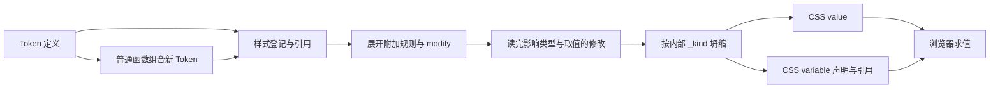

# Style System 的行为目标

Style System 让业务定义、复用和组合样式，同时明确谁控制什么、变化在哪里发生。业务不应为了使用一份颜色或尺寸，先了解其内部所有 state，或替编译器补齐声明。

本目录按 Token 模型描述行为，源码已完成 Token 迁移。设计决定见 [Token设计.md](../Token设计.md)。这里保存领域目的和必要生成规则，不以现有类型、辅助字段或测试断言反过来证明需求成立。

## 一个 Token 统一内容与状态

Token 的第一个参数是基础内容，第二个参数是配置；普通对象和数组作为原始数据，不解析其 default、hover 等字段。直接 token(source) 创建新 Token 并继承来源配置，追加配置覆盖顶层字段、按条件软合并 state；default 默认引用 source。名称不继承来源；普通定义显式提供语义 name，生成器已有语义 prefixName 时使用前缀与自动编号。state 支持对象、Map、条件 entry 及其嵌套组合，按顺序展开容器并保留 entry 配对。生产函数只为明确的延迟生产目的提供，不能用作继承开关；计算表达式内部的 Token 按内容消费。创建结果统一为 default、name、state、address、registration、onFirstScan、compileWaveIndex，消费端不再复制配置。

组合定义由普通函数读取信息并返回新 Token。Token 不内置 Variant；用途函数同样返回 Token。没有 RuleToken、独立 adjust 或用于重放加工的来源记录。函数返回后，使用方只处理 Token 定义和实际引用，不识别它怎么创建。

## 坍缩前确定内部 _kind

name、state、address、registration 或 modify 需求使 Token 输出 CSS variable；需要时自动生成名称。没有这些需求则直接输出 CSS value，例如 2px。内部 _kind 由系统决定，外部不配置，不加入 parser 的固定字段。

构造定义、表达式或引用时不即时坍缩。onFirstScan 可以提供包含 modify 的规则；在所有会影响相关 Token 的修改读取完毕后才进行坍缩，不限定第一波或激活次数。compileWaveIndex 继续约束内容可处理的时机。

## 地址、条件与贡献保持明确

正常定义由 Token 自身 default、state、address 表达，rules 自动声明属性；手动 declare 与 Token 重声明保留为 dangerous 操作，不作运行时或类型拦截，也不作为业务默认模板。

1. **地址明确计算位置。** 显式 address 固定 default 与 state 的位置；未指定时，需要 CSS variable 的定义随每个 AST 消费地址建立，不锁定首次地址或写回配置。全局材料显式指定 root。
2. **CSS 决定提交后的动态结果。** 引用、条件、层叠和继承由浏览器执行，后代覆盖输入不使显式固定在祖先的公式搬到当地重新求值。
3. **定义组合与条件修改分开。** 普通函数创建新 Token；modify 在明确范围改变目标，并使其具有 CSS variable 身份。
4. **Token 不储存声明处理账本。** 不保存 priority、definitionKey、declarations 或 resultSource 系列字段。声明顺序交给声明系统，实际依赖由内容引用表达，附加规则由 onFirstScan 表达。
5. **贡献有归属，资源按需存在。** 一处退出不删除其他来源；替换撤回旧独占需求，保留共享需求。
6. **失败保护已成功的结果。** 无法完成时明确失败，不留半份 CSS，不破坏宿主和上次成功提交。

## 按问题查契约

| 需要理解的责任                   | 行为文档                                                 |
| -------------------------------- | -------------------------------------------------------- |
| 创建、引用、统一结构与命名       | [Token的创建与复用.md](Token的创建与复用.md)             |
| state 属于谁，同时成立时怎样选择 | [states与条件选择.md](states与条件选择.md)               |
| 表达式组合与内容求值             | [Token与表达式.md](Token与表达式.md)                     |
| 函数组合和当地修改               | [Token的定义组合与modify.md](Token的定义组合与modify.md) |
| 条件、目标、内容的登记和撤销     | [rule与rules的登记和撤销.md](rule与rules的登记和撤销.md) |
| 浏览器求值位置与层叠             | [CSS作用域与层叠.md](CSS作用域与层叠.md)                 |
| 按需激活、退出和同名资源接管     | [按需资源与同名替换.md](按需资源与同名替换.md)           |
| 消费隔离与 AST 编辑              | [内容扩展与AST编辑.md](内容扩展与AST编辑.md)             |
| CSS 读取、提交和失败保护         | [Compile与挂载.md](Compile与挂载.md)                     |
| 全局材料与组件局部控制           | [共享主题与组件颜色控制.md](共享主题与组件颜色控制.md)   |

验收依据实际计算值、状态切换、局部覆盖、撤销和失败后的页面结果。不得要求与旧实现相同的字段、辅助变量或内部节点数量；也不能只以文档迁移证明源码已经具备目标能力。
