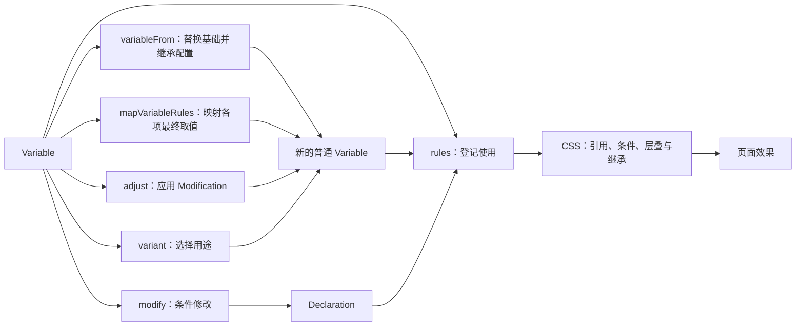

Style System 让业务定义、复用和组合样式，同时明确谁控制什么、变化在哪里发生。业务不应为了使用一份颜色或尺寸，先了解其内部所有 state，或替编译器补齐声明。

本目录保存这个领域的原始目的和最少必要生成规则。即使实现全部消失，读者也应能据此重建效果等价的引擎。这里不要求相同的数据结构、辅助变量或编译步骤；当前代码和测试也不能反过来证明某条需求成立。

# 定义是骨骼，CSS 承担运行

Variable 保存基础内容、states 和 variants。单独规则不能在 CSS 系统中独立存在，因此它是一份有意义的半成品：先描述可复用的样式骨骼，实际使用才生成所需声明。组件改变基础时，不必逐一重写反馈；需要完整改变所有结果时，也不必枚举内部规则。

CSS 接管已提交的引用、条件、层叠和继承。系统保留这份动态能力，但不模拟 CSS 没有的跨作用域公式重新绑定。JS 定义复用发生在创建时，不等于持续观察和同步 JS 对象。

# 能生成系统的基本规则

1. **Variable 与 VariableName 各负其责。** Variable 提供定义和使用行为，VariableName 标识 CSS 自定义属性。使用 Variable 时按其名称和 address 查询 declaration；同名查询不等于从另一 JS 对象借入 states、variants 或资源。
2. **根据地同时决定存在与 state 归属。** 创建时指定地址，省略为根；使用时仅在根据地缺声明的情况下自动提供创建内容。已有声明保留，state 只随根据地展开。不存在独立于根据地的默认值兜底系统。
3. **替换基础与映射取值分别表达两种变化。** variableFrom 换基础，原样继承来源的 states 和 variants；mapVariableRules 对默认、state、variant 各自的最终取值表达式映射一次。两者未指定的公开配置均继承来源，显式项覆盖；返回结果都是普通 Variable，不重放创建历史。variant 选择一种用途，保留 states、消掉父层 variants。
4. **adjust 与 modify 的结果边界明确。** adjust 对来源的完整定义应用 Modification，返回普通 Variable，不改变来源；modify 返回 Declaration，在显式条件内修改目标。两者覆盖 default、state、variant 及 variant 的 state 结果，不能漏掉固定值。
5. **求值位置遵循 CSS。** 保留 CSS 当前值引用；后代只读取祖先结果，不使祖先公式在当地重新绑定。另一处计算必须来自显式地址或当地 modify，不来自消费动作。
6. **贡献有归属，资源按需要存在。** 一处退出不删除其他来源；内容替换撤回旧独占依赖。失败不留下半批贡献，也不损坏宿主或上次成功提交。

这些规则共同约束结果，而不是为每个 API 各立一套例外。自动声明只免除“根据地没有定义”，不能扩张为推测局部依赖、自动搬运公式或在每个消费者展开 state。普通业务不靠无值 declare 或重传创建值补偿这些缺口。

# 从基本规则推导复杂效果

先读 [Variable的创建与复用.md](Variable的创建与复用.md)，理解基础、states 和 variants；再读 [adjust与modify.md](adjust与modify.md)，理解它们如何使用这些公开材料并交付结果。先依据各自契约处理，再沿明确的输入输出组合，不增加跨领域的隐藏规则。

[CSS作用域与层叠.md](CSS作用域与层叠.md) 用同一个尺寸公式解释祖先与后代，包括 modify 配方输入的边界；[共享主题与组件颜色控制.md](共享主题与组件颜色控制.md) 将同样规则用于主题和组件。组合不能另行恢复被基本规则排除的隐式能力。

| 需要重建的责任 | 生成规则与关键反例 |
| --- | --- |
| 条件、目标、内容怎样形成样式，谁能撤销 | [rule与rules的登记和撤销.md](rule与rules的登记和撤销.md) |
| 定义怎样存在、换基础、选择用途 | [Variable的创建与复用.md](Variable的创建与复用.md) |
| state 属于谁，同时成立时怎样解释 | [states与条件选择.md](states与条件选择.md) |
| 哪些动态变化由 CSS 自己完成 | [CSS作用域与层叠.md](CSS作用域与层叠.md) |
| 整份结果怎样独立调整或局部累计 | [adjust与modify.md](adjust与modify.md) |
| 业务材料怎样保留含义并组合 | [Value与Expression.md](Value与Expression.md) |
| 引用所需资源何时进入、退出、接管 | [按需资源与同名替换.md](按需资源与同名替换.md) |
| 扩展怎样保持消费隔离、位置和来源 | [内容扩展与AST编辑.md](内容扩展与AST编辑.md) |
| 读取、提交与失败怎样保护页面 | [Compile与挂载.md](Compile与挂载.md) |
| 全局控制和组件例外怎样共存 | [共享主题与组件颜色控制.md](共享主题与组件颜色控制.md) |

# 领域通过契约组合，不通过创建历史组合

variable、variableFrom、variant 和 adjust 都交付 Variable。后续 variableFrom、declare 或 rules 只按 Variable 契约处理，不识别它此前由哪个 API 创建。adjust 形成的基础内容、states 和 variants 属于结果定义，后续操作按相同规则读取和复用。

因此，variableFrom 改的是这份结果定义的基础，继承的是它已有的 states 和 variants；declare 给它赋值，也遵循普通 Variable 的规则。不能因为来源曾经经过 adjust，就额外对新基础或新声明执行一次旧 Modification。

资源和 CSS 引用关系同样由实际内容表达：新的 Variable 若引用来源，CSS 可以继续响应来源变化；这是内容依赖，不是后续 API 追踪 adjust 的创建历史。

# 如何检验是否保留了原意

重建者应先依据这些规则推导页面结果，再选择实现。验收观察实际计算值、state 切换、主题变化、撤销与失败；不能用同一份实现产生的旧断言为需求作证。关键反例用于排除另一种看似合理却违背目的的引擎，不要求相同 CSS 排版或内部节点数量。

下文代码片段使用当前调用名称，省略 import；文字算法明确标为伪代码。精确签名、别名、默认优先级及 AST 回调协议另见 [当前接口与扩展协议](../当前接口与扩展协议.md)。它负责兼容当前接口，不是重建领域思想的前置阅读。实现若与这里不符，应报告差距，不能静默改写规则来配合实现。
