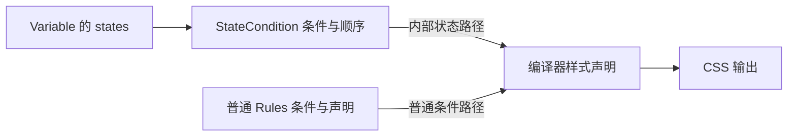

# State Condition

State Condition 是约束当前主体自身的条件，包括 hover、active，也可以是 `&[data-tone="danger"]`。业务保证条件作用于自身；登记与否不决定它是不是 State Condition。

## 名称与顺序

[state-conditions.ts](../pieces/state-conditions.ts) 提供 focus、focusWithin、focusVisible、hover、active、disabled 等快捷名称。定义者可以通过 stateCondition(name, condition) 增加快捷匹配，也可以直接写条件；业务保证条件约束同一主体，条件组合的路径可以交换。

`states.focus` 内置匹配浏览器判定需要显示焦点提示的 `:focus-visible`，无需额外登记。已有 focusVisible 名称同样匹配该条件；直接选择器 whenFocus 仍表达原生 `:focus`。鼠标获得焦点不等于显示轮廓。focus 的中央优先级低于 hover／active，同一 Variable 同时命中时按统一顺序选择内容。

Variable 的 `states` 保存约束自身的条件，是否符合这一约定由业务保证，不以登记为准入条件。创建时匹配快捷名称：匹配到便使用对应条件，未匹配便将输入直接作为条件，不要求预先登记。快捷名称登记的空名称、default 和重复名称报错。

公开 Rule 地址只接受普通条件语义：`rules([...target, '&:hover'], declarations)` 保留该选择器，字符串 `'hover'` 表示字面标签选择器，不查询快捷表。Variable 创建后直接保存已解析条件到状态内容的映射；自动展开使用这些条件构造内部路径，不再查表解释名称。快捷条件统一附加条件权重，按中央顺序决定优先级；直接条件随后按配置书写顺序生成声明，实际覆盖仍遵循其 CSS 选择器权重与层叠。

## Variable 自己负责状态

```ts
const feedbackColor = variable(baseColor, {
  name: 'feedback-color',
  states: {
    hover: hoverColor,
    active: activeColor,
  },
})
```

编译器只为 feedbackColor 生成常态、hover、active 三项声明，使用它的 color 或 colorMix 不获得分支。自动状态不枚举交集；显式 Rule 的嵌套条件仍然保留。



状态内容中的来源读取沿用同名状态或创建默认值。需要保留局部颜色来源时，让强度等参数持有状态，把颜色来源放在普通混色组合中消费。组件选择材料与参数贡献，Mixin 不展开状态。

登记时，当前主体选择器的附加条件统一包进 `:where()`，保留主体地址权重，让中央顺序决定状态优先级。例如 A 的 `&[data-a]` 与 B 的 `&:where([data-b])` 都不增加权重，后登记的 B 可以直接覆盖 A。原条件已使用 `:where()` 时允许嵌套，不为删除冗余包装引入选择器解析。At Rule 条件保持原样。

## Cluster 成员继承状态

```ts
const local = clusterFrom(feedbackColors, {
  default: {
    name: 'local-color',
    states: { active: source => colorMix(source, 'white') },
  },
  soft: { name: 'local-soft-color' },
})
```

`local` 的 default 成员自己定义 active；未覆盖的状态由 `clusterFrom` 明确配置为引用 `feedbackColors` 的 default 成员。soft 成员也按同名来源创建。active 回调中的 source 是原 default Variable；编译该状态内容时读取来源的 active 内容，缺失则读默认内容。调用者无需手工读取 `config.states`。

继续从 `local` 创建 Cluster 时仍遵循相同规则。自身明确给出的 0 等有效值不会被当成缺失。

## Value 不拥有状态

普通 Value 仅表达稳定内容。普通混色属性即使使用多个有状态 Variable，也只输出一次消费属性，浏览器分别解析各 Variable 当前的值；若混色函数是某个 Variable 的状态内容，其多个来源在编译时分别按这项内容的状态取值。Variable 自身状态、Cluster 成员继承和普通值组合各自承担自己的职责。
