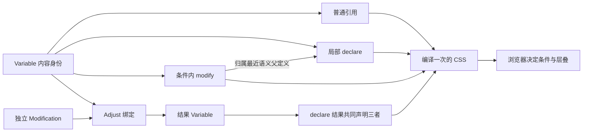

# Variable

Variable 的目的是让业务用同一个内容身份表达引用、局部基础值与可组合的相对变化，而不枚举状态交集结果。本文是 Variable 稳定目的与能力的负责文档；具体展开算法见 [StyleSystem变量修改与AST改写.md](../../../docs/plans/StyleSystem变量修改与AST改写.md)，实施证据见其链接。

Variable 只有一种；它可以直接保存可 CSS 化内容，也可以保存一个在编译时产生这类内容的函数。

`Variable` 类型直接包含创建配置 `config`；`defaultValue`、自身状态内容、注册配置与 `definitionKey` 归于其中。`config.definitionKey` 在使用时按当前 `name` 生成 Key。自动状态声明用通用产物标识保留所属 Variable 身份，状态展开范围仍由 Variable 自身记录，不依赖 Key 对象身份。Cluster 直接代理默认成员的对象属性。

Variable 从已有事实投影 Declare、Adjust Target、Modify Target 所需的自然材料；Modification 持有独立变化配方材料。协议用 FNKit DataShape 描述操作所需形状，使用端通过 `matchShape` 识别材料并组织声明、绑定和条件修改；对象不需要认识协议或提供外部操作方法。

创建时可在 `VariableOptions.onActive` 提供普通 JSSContent 按需回调。Variable 与回调一次构造完成；`onActive` 直接属于内容对象，不复制到 `config`。回调创建时不执行，实际消费时才返回普通 Rules；这些规则随消费者退出。回调可惰性引用正在声明的 Variable，例如 `const color = variable('red', { name: 'color', onActive: () => [[[condition(':where(:root)')], color, 'red']] })`。根位置和环境条件仍由返回的普通 Condition Rules 表达。

当前实现支持直接内容、Variable 引用、JSS 内容组织工具或 Atom Creator 构造的内容，以及 `() => ValueInput` 形式的 defaultValue 生产函数。函数在创建 Variable 时不执行，编译实际消费该 Variable 时才执行。

# 只有一种 Variable

Variable 不区分“原始 Variable”和“派生 Variable”。两者拥有相同的对象身份与使用方式，差别只在保存的 defaultValue：

```ts
const toneColorDefault = variable('blue', {
  name: 'tone-color',
})

const toneColorLine = variable(
  () => toneColorDefault,
  { name: 'tone-color-line' },
)

const toneColorSoft = variable(
  () => colorMix([toneColorDefault, 0.2], 'white'),
  { name: 'tone-color-soft' },
)
```

`toneColorDefault` 保存直接内容；`toneColorLine` 的函数返回另一个 Variable；`toneColorSoft` 的函数返回可继续编译的颜色内容。三者都是普通 Variable，不增加派生类型、基础层或结果层。

每个 Variable 只生成自己 `states` 中的状态。创建时将匹配到的快捷名称替换为对应条件，未匹配的输入直接作为条件，编译时直接展开已解析条件。业务保证这些条件约束自身，无须登记才能使用。状态回调按配置书写顺序求值；快捷条件按中央顺序输出，直接条件随后按书写顺序输出；默认值生产函数仍在消费时惰性执行。

`config.states` 直接保存“已解析 StateCondition → ValueInput”的映射，不包装额外状态记录。键使用已有状态条件对象，值就是该状态内容；条件中的名称用于来源 Variable 的同名状态匹配，不在编译时再次查询中央登记表。

普通属性引用输出 CSS `var()`，由浏览器处理局部赋值和该 Variable 自身的状态。

当一项状态内容引用来源 Variable，编译时按这项状态读取来源：有同名状态就取其内容，没有就取默认内容。嵌套引用和同一表达式里的多个来源都沿用这项状态；来源的其他状态不会加入外层 Variable。

例如 palette 为 gray／hover blue／active red，surface 为 default white／hover palette。surface 只生成 default 与 hover，hover 内容是 blue。即使外层普通 Rule 使用 `&:active`，surface.hover 仍是 blue；palette 独立普通消费时，active 仍是 red。若 palette 只配置 active，surface.hover 则读取默认 gray。

来源没有配置任何 states 时，状态内容同样读取默认内容。来源默认 5px、局部赋值 7px，外层 hover 状态内容将它乘以 2 得到 10px；普通 Rule 直接引用来源仍读到局部赋值 7px。需要当前作用域局部值时，把状态变化放到独立参数 Variable，来源留在普通组合中消费；组件不为每个状态登记消费 Rule。基于前序结果继续变化时，用 `declare/modify` 与独立 Modification 表达。引用与修改由 Style System 生成 CSS，组件不手写 `var()` 或调用 `toCSSString()` 拼接引用。

Variable 原方法只按指定状态读取内容；复杂状态覆盖与跨 Variable 切换留给未来的 Variable Tools。

# 默认值契约

Variable 的 defaultValue 接受直接内容或内容生产函数：

```ts
type VariableDefaultValue =
  | ValueInput
  | (() => ValueInput)
```

`ValueInput` 表示可继续读取的内容，包括字符串、数字、Value、Variable、内容构造函数的产物和 `undefined`。Value 与 Variable 在组合时统称 Atom；这不是新的类型或编译协议，对象内容仍遵守 `JSSContent` 约定。Value 只是其中一种包装。

直接传入内容时，调用方允许这个表达式在定义阶段构造：

```ts
variable(
  colorMix([toneColorDefault, 0.2], 'white'),
  { name: 'tone-color-soft' },
)
```

传入生产函数时，Variable 只保存函数；编译器需要读取这个 Variable 时才执行整个表达式：

```ts
variable(
  () => colorMix([toneColorDefault, 0.2], 'white'),
  { name: 'tone-color-soft' },
)
```

后者不能依赖 `colorMix()` 恰好怎样实现延迟。`colorMix()` 的返回值是黑盒：生产函数返回它以后，编译器只按统一的 ValueInput 协议继续读取。

# 编译过程

Variable 在自身 `onCompile` 方法中按以下顺序处理 defaultValue：

1. 已经是内容对象的 defaultValue 保持原身份，Variable Cluster 即使可调用也不会被执行为生产函数。
2. 普通函数在实际消费时执行，返回结果接回内容链。
3. 直接内容进入同一条编译与输出链。

这一区分不能只检查 `typeof defaultValue === 'function'`：可调用的内容对象与普通 defaultValue 生产函数承担不同职责。Cluster 带有 FNKit 的 `Unresultable` 属性；自定义可调用内容也须带此属性，`result()` 才会原样返回。编译器仍按 JSSContent 能力识别和编译内容。JSS 内容组织工具和 Atom Creator 的产物按内容对象识别，不作为 defaultValue 生产函数执行。

生产函数的稳定契约是推迟到实际消费。当前每个局部 declare 在展开基础值时执行一次，修改不会额外读取一次 defaultValue；普通引用仍按各自消费位置求值，不承诺同一 Variable 全编译只执行一次。`declare(variable, value)` 明确提供局部内容时，基础声明消费该内容。

# Cluster 中的派生关系

Variable Cluster 只聚合多个 Variable，不拥有另一套成员值：

```ts
const toneColors = variableCluster({
  default: toneColorDefault,
  soft: toneColorSoft,
  strong: variable(
    () => colorMix([toneColorDefault, 0.8], 'black'),
    { name: 'tone-color-strong' },
  ),
  foreground: variable('white', {
    name: 'tone-color-foreground',
  }),
  line: toneColorLine,
})
```

`soft` 和 `strong` 不是状态，也不是特殊成员。它们是普通 Variable，其 defaultValue 生产函数读取 `toneColorDefault`。

若来源 Cluster 只有 `default`、`foreground` 和 `line`：

```ts
rules('.Button[data-tone="accent"]', [
  [toneColors, accentColors],
])
```

编译器只为双方已有的三个同名成员生成局部声明：

```css
.Button[data-tone="accent"] {
  --tone-color: var(--accent-color, red);
  --tone-color-foreground: var(--accent-color-foreground, white);
  --tone-color-line: var(--accent-color-line, darkred);
}
```

`soft` 和 `strong` 没有被复制，也不需要重写。消费它们时，原有生产函数仍读取当前作用域的 `toneColorDefault`：

```css
.Button {
  background-color: var(
    --tone-color-soft,
    color-mix(in oklab, var(--tone-color, blue) 20%, white)
  );
}
```

若来源 Cluster 也提供 `soft` 或 `strong`，现有整组声明规则会赋值这些同名成员；该作用域便采用来源成员，而不是目标成员自己的 fallback 配方。

# 普通引用与 Cluster 成员继承

普通引用和计算直接创建 Variable：

```ts
variable(() => sourceVariable, options)
variable(() => colorMix(sourceVariable, 'white'), options)
```

一组成员要沿用另一组的状态时，由 `clusterFrom(sourceCluster, changes)` 按同名成员创建新 Variable。`changes` 中的配置以来源成员为默认值；来源成员已有的状态仍引用该成员，当前配置的同名状态优先。未配置的成员复用来源对象；直接提供 Variable 时，已有成员被整体替换，不继承旧状态，也可加入新成员。

```ts
const nextColors = clusterFrom(toneColors, {
  default: { name: 'next-tone-color', states: { active: source => colorMix(source, 'white') } },
  soft: { name: 'next-tone-soft-color' },
  line: variable('blue', { name: 'next-tone-line-color' }),
})
```

直接使用 `nextColors` 代理新 default；`nextColors('soft')` 取得新成员。只有实际消费的成员才进入样式结果。

defaultValue 生产函数与 `states` 中的回调位于不同配置位置，也承担不同职责。本篇只确定 defaultValue 生产函数在编译时产生 ValueInput；状态回调怎样接收 defaultValue、何时求值，仍由 Variable 状态契约负责，不能由相同的函数语法顺带推断。

# 实现验收

这项契约已经通过以下条件验收：

- 创建 Variable 时不执行 defaultValue 生产函数。
- 编译实际消费的 Variable 时才执行生产函数，并继续编译其返回的 Variable、Value 或其他内容对象。
- Variable 不会把可调用的 Variable Cluster 误当 defaultValue 生产函数执行。
- Cluster 局部声明改变 `default` 后，未被赋值的 `soft`、`strong` 保留原配方并读取当前 `default`。
- 循环引用仍然终止编译，不因增加生产函数绕过检测。


# 局部定义与相对修改

`declare(variable, value?)` 和 `modify(variable, modification, options?)` 是统一声明入口。前者给当前位置一个可被修改的基础定义；后者表达“在当前 CSS 条件成立时，对这个局部定义再做一次变化”。它们都返回 Declaration，可以和普通声明放在同一份 Rules 中。

```ts
const amount = variable(1, {
  name: 'amount',
  states: { hover: 10 },
})
const increase = (delta: number): ExpressionModification => ({
  type: 'expression',
  detail: current => add(current, delta),
})

rules('.Button', [declare(amount), [key('z-index'), amount]])
rules(['.Button', '&:hover'], [modify(amount, increase(3))])
rules(['.Button', '&:focus'], [modify(amount, increase(2))])

rules('.Panel', [declare(amount, 20), [key('z-index'), amount]])
rules(['.Panel', '&:focus'], [modify(amount, increase(4))])
```

Button 的常态为 1；hover 先选基础值 10，再应用 +3，得到 13；hover 与 focus 同时成立得到 15。Panel 的 focus 得到 24。这里的 `&:hover`、`&:focus` 是普通选择条件，示例验证条件内相对修改，不是组件状态配方的推荐写法。可复用状态变化应交给 Variable 的 `states`，由一次普通消费自动展开。

`declare(variable)` 每次编译读取当前 defaultValue，`declare(variable, value)` 明确提供这个定义的基础内容。普通 `[amount, 20]` 仍是 CSS 覆盖赋值，不自动成为相对修改的基础定义。修改沿原始 Condition 父链查找最近的同一 Variable 定义，不能仅凭相同 CSS 名字匹配另一对象。

创建首参数是 Variable 的 `defaultValue`，普通引用把它输出为 `var()` fallback；局部 `declare(variable, value)`、`modify(variable, change)` 和 `adjust(variable, change)` 都不改写它。Adjust 返回新的结果 Variable，保存来源与独立颜色配方的 CSS 引用。`declare(result)` 共同声明来源、配方与结果；当前或祖先作用域已有的依赖声明优先，自动声明只补缺项。消费结果时在当地重算组合，使局部来源或配方覆盖生效。

`registration.initialValue` 是独立的 CSS `@property` 描述符，由调用方明确提供；不会从默认值自动推断类型或初始值。Variable 不负责根位置和环境分支；需要根声明、主题或动效条件时，由使用方用普通 Rule、Condition 或按需 `onActive` 表达。



# 组合能力与边界

独立修改默认叠加，不需要调用方分配通道。需要相互覆盖的条件使用同一个 ID：

```ts
rules(['.Button', '&:hover'], [modify(amount, increase(3), { id: 'interaction' })])
rules(['.Button', '&:focus'], [modify(amount, increase(5), { id: 'interaction' })])
```

两者都成立时由 CSS 层叠选择同一步的赋值；不同 ID 或不提供 ID 则是独立步骤。非交换操作按 AST 中的声明位置确定顺序，生成名称中的数字只表示唯一身份。后续编译才出现的内容仍按其实际位置参与，不要求调用方预知修改数量。

`modification({ name: '--change', type: 'color', detail: ... })` 保存变化领域与通道描述，返回可独立声明和引用的 `Modification<Detail, Type>`。Modification 是通用定义，颜色只是按 type 路由的一种源无关转译策略；通用主体不继承颜色类型。name 使用完整 CSS 自定义属性名，省略时生成匿名名称；构造时不执行通道回调。内置转译在配方编译时使用通道符号生成 CSS 内容。数字及任意 CSS 表达式变化直接使用 `{ type: 'expression', detail: current => add(current, delta) }` 材料，由 Modify 应用于前序表达式；这种材料不承诺可独立声明。

[variable-modify.ts](../variable-modify.ts) 的 `modify(target, change)` 按 type 选择当前支持的应用，读取双方材料，在使用端组织条件声明和修改顺序；颜色应用保留独立配方引用。[variable-adjust.ts](../variable-adjust.ts) 的 `adjust(target, change)` 按 type 选择领域组合，读取来源与变化材料，建立结果 Variable 并保留三者绑定；当前颜色实现复用 `relativeOKLCH`。绑定不求 JS 默认数据，也不修改共享来源。Declare 的材料为 `key/content`；Adjust、Modify 目标的 key 须为 CSS 自定义属性，还可携带已解析的 states Map 与 registration 配置，颜色变化材料包含 `type: 'color'` 与配方 key/content。对象只持有信息，不要求有协议品牌、协议登记或特定构造来源。

`modify` 可用于颜色、尺寸和数值等内容，前提是变化回调能为当前来源构造有效 Expression，或来源与颜色配方能组成有效的相对颜色；变化描述并不保证适用于所有值。无修改的局部定义保持普通形态；使用修改不要求 Variable Cluster 参与。Cluster 只选择成员及代理默认成员，不承担组合算法。

修改写到子元素时，在当地重新发布结果，并重新应用必要的后续规则；它不修改父元素。父位置的条件仍在原宿主匹配，子位置规则在子元素匹配。

不承诺浏览器能求值无限表达式。已有明确类型 registration 可用于内部计算；数值、长度、颜色长链已有测试，无类型或 `syntax: '*'` 仍可能达到浏览器表达式上限。这个运行边界与业务端无需手工分配固定槽位是两件事。

# 完整颜色修改规则

颜色使用普通 Variable，变化通过 [modification.ts](../modification.ts) 的 `modification({ type: 'color', detail })` 独立定义。固定通道和相对回调保存在 `detail`；内置转译以 l/c/h/alpha 表达式生成与来源无关的完整配方。Modify 使用配方引用构造相对 OKLCH 表达式；Adjust 创建绑定双方的结果 Variable，不预先计算通道数值。

```ts
const surface = variable(baseColor, 'surface')
const hoverChange = modification({
  name: '--hover-change',
  type: 'color',
  detail: {
    lightness: current => add(current, 0.05),
    chroma: current => multiply(current, 0.8),
  },
})
const activeChange = modification({ type: 'color', detail: { alpha: 0.7 } })
rules('.Button', [declare(surface), declare(hoverChange), declare(activeChange), [key('background-color'), surface]])
rules(['.Button', '&:hover'], [modify(surface, hoverChange)])
rules(['.Button', '&:active'], [modify(surface, activeChange)])
```

hover 和 active 同时成立时，浏览器按步骤应用两条变化，不需要 JS 预先合并状态。固定通道和相对变化属于同一份配方：`modification({ type: 'color', detail: { lightness: 0.6 } })` 设置亮度，其余通道保持来源值。

```ts
const merged = adjust(surface, hoverChange)
rules('.Adjusted', [declare(merged), [key('background-color'), merged]])
```

声明 merged 会共同声明 surface、hoverChange 与 merged；它保留 `Source + Modification → mergedResult` 的 CSS 引用关系。一份 Modification 可以被多个 Source 共享，子元素覆盖来源或配方后，结果使用当地值。控制器修改变化描述、通知与自动重编译属于后续能力；Size 的具体转译参数与表达尚未定义。

## 完整修改规则的继承与消费

条件选择由原 CSS 地址上的选择门完成，共享 `id` 的候选按选择器优先级与源顺序层叠；没有输出的候选不参与赋值。

普通消费地址会当地求修改链，因此子元素局部覆盖 Modification 配方后，无需再写一次 `modify` 就能得到当地颜色。未显式声明的后代按 CSS 继承祖先的规则选择，不因使用同一个 class 而自动隔离；需要独立基础和规则归属时写 `declare(variable, value)`。注册明确 `inherits: false` 时，子元素只读注册初值；有当地修改才从当地基础继续应用。

每一步只有一个结果 CSS 变量，并引用前序结果；规则不拆成 lightness、chroma、hue 或 alpha 的独立存储，长链也不把前序表达式复制到两个分支中。选择门是编译器保存条件选择的内部元数据，完整颜色配方由一个独立 Modification 声明承载。
