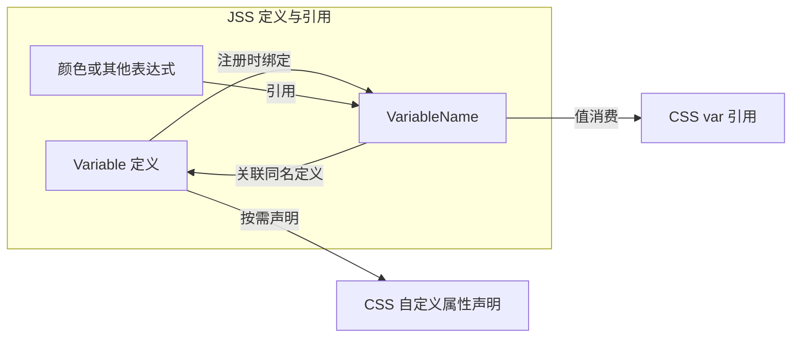
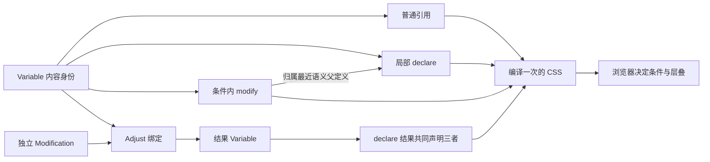

# Variable

Variable 的目的是让业务用同一个内容身份表达引用、局部基础值与可组合的相对变化，而不枚举状态交集结果。本文是 Variable 稳定目的与能力的负责文档；具体展开算法见 [StyleSystem变量修改与AST改写.md](../../../docs/plans/StyleSystem变量修改与AST改写.md)，实施证据见其链接。

Variable 只有一种；它可以直接保存可 CSS 化内容，也可以保存一个在编译时产生这类内容的函数。

`Variable` 类型直接包含创建配置 `config`；`defaultValue`、自身状态内容、注册配置与 `definitionKey` 归于其中。`name` 是注册时绑定的 `VariableName`，不支持后续替换；`config.definitionKey` 从该身份取得声明地址。自动状态声明用通用产物标识保留所属 Variable 身份，状态展开范围仍由 Variable 自身记录，不依赖 Key 对象身份。Cluster 直接代理默认成员的对象属性。

Variable 从已有事实投影 Declare、Adjust Target、Modify Target 所需的自然材料；Modification 持有独立变化配方材料。协议用 FNKit DataShape 描述操作所需形状，使用端通过 `matchShape` 识别材料并组织声明、绑定和条件修改；对象不需要认识协议或提供外部操作方法。

创建时可在 `VariableOptions.onActive` 提供普通 JSSContent 按需回调。Variable 与回调一次构造完成；回调保存在该定义唯一的消费材料中，声明和 Name 引用共享其普通 JSSContent 生命周期，不在 `config` 再保存一份。回调创建时不执行，实际消费时才返回普通 Rules；这些规则随消费者退出。回调可惰性引用正在声明的 Variable，例如 `const color = variable('red', { name: 'color', onActive: () => [[[condition(':where(:root)')], color, 'red']] })`。根位置和环境条件仍由返回的普通 Condition Rules 表达。

当前实现支持直接内容、Variable 引用、JSS 内容组织工具或 Atom Creator 构造的内容，以及 `() => ValueInput` 形式的 defaultValue 生产函数。函数在创建 Variable 时不执行，编译实际消费该 Variable 时才执行。

# 只有一种 Variable

Variable 不区分“原始 Variable”和“派生 Variable”。两者拥有相同的对象身份与使用方式，差别只在保存的 defaultValue：

```ts
const toneColorDefault = variable('blue', {
  name: 'tone-color',
})

const toneColorLine = variable(
  () => toneColorDefault,
  { name: 'tone-color-line' },
)

const toneColorSoft = variable(
  () => colorMix([toneColorDefault, 0.2], 'white'),
  { name: 'tone-color-soft' },
)
```

`toneColorDefault` 保存直接内容；`toneColorLine` 的函数返回另一个 Variable；`toneColorSoft` 的函数返回可继续编译的颜色内容。三者都是普通 Variable，不增加派生类型、基础层或结果层。

创建时将 `states` 的快捷名称解析为条件，未匹配输入直接作为条件；业务保证条件约束自身。状态规则保留原样，在每次声明时以本次基础内容绑定 `base`。快捷条件按中央顺序输出，直接条件随后按书写顺序输出；默认生产函数在消费时惰性执行。

`config.states` 保存“已解析 StateCondition → 内容或 base 回调”的映射。声明直接使用这些条件与原始规则，不再次查询中央登记表，也不把状态归属登记成 Variable 依赖边。

普通属性引用输出 CSS `var()`，由浏览器处理局部赋值和该 Variable 自身的状态。

状态配方中的 Variable 同样输出 CSS `var()`，引用来源当前值；嵌套引用和同一表达式里的多个来源各自响应浏览器状态、局部声明和修改结果。外层状态只决定配方何时生效，不替来源选择状态，也不把来源状态加入外层配置。

例如 palette 为 gray／hover blue／active red，surface 为 default white／hover palette。surface 自身仍只有 default 与 hover；hover 时读取 palette 当前值 blue，hover 与 active 同时成立时读取 red。surface 的 hover 不成立时仍为 white，palette 的 active 不会单独激活 surface.hover。

来源默认 5px、局部赋值 7px，外层 hover 配方将来源乘以 2 得到 14px；普通引用和 `variable(source, name)` 也读取局部 7px。引用只输出 `var(--name)`。实际使用且最终整棵 AST 中没有同对象声明时，编译器将创建内容补成 `:root` 声明；未使用的 Variable 不输出。已有声明即使位于别的选择器，也不再补根默认，读不到该声明的元素按 CSS 无值规则处理。基于前序结果继续变化时，用 `declare/modify` 与独立 Modification 表达。引用与修改由 Style System 生成 CSS，组件不手写 `var()` 或调用 `toCSSString()` 拼接引用。

## 名称、继承与声明联动

`VariableName` 是连接定义和引用的身份，可以先于具体 Variable 独立创建：

```ts
const surfaceName = variableName('surface-color')
const lineColor = variable(colorMix([surfaceName, 0.18], 'transparent'), 'line-color')
const surfaceColor = variable('white', { name: surfaceName })
surfaceColor.name === surfaceName // true
```

也可以用 `variable('white', 'surface-color')` 或 `{ name: 'surface-color' }` 快捷创建，再通过 `.name` 取得名称引用。引用 Variable 与引用其 Name 都输出 `var(--surface-color)`，并按同一名称激活默认、状态、资源和依赖；声明地址仍为 `--surface-color`。需要操作 DOM 自定义属性时从 `surfaceColor.key.toCSSString()` 取得声明地址，不把 `.name` 当字符串拼接。



以下逐项给出这条链的行为与伪代码。伪代码用于表达输入、判断和结果，不是可调用 API；省略 AST 队列与节点记录的实现细节。

### 创建与名称绑定

`VariableName` 是引用对象；`VariableNameAddress` 是它绑定的完整 CSS 名称字符串，例如 `'--surface-color'`。不同 Name 对象可以绑定同一名称，连接同一组定义。名称本身没有默认值、状态或 priority。

```text
创建 Name：
  将输入规范化为完整 CSS 名称
  保存 Name → CSS 名称的对应关系

创建 Variable：
  绑定传入的 Name；字符串简写先创建 Name
  保存默认内容、状态及资源配置
  将该定义材料加入 definitions[Name 对应的 CSS 名称]
  保留此前的同名定义，不在注册时选择胜者
  不执行默认生产函数，不产生 CSS
```

绑定后不再替换名称。Name 只有引用能力，不推断 `declare(name)` 或 `modify(name, ...)` 的对象归属；这些操作仍使用具体 Variable 或天然 key/content 材料。

### 引用激活与编译时机

值位置引用 Variable 或它的 Name 进入同一条链。同名的 `surface` 与 `accent` 都会被访问，随后由声明规则决定有效值。

```text
值位置访问 Variable：
  转交其 Name

值位置访问 Name：
  输出 var(Name 对应的 CSS 名称)
  将该名称下的全部定义材料作为依赖访问
  没有 JSS 定义时仍保留 var() 引用，允许 CSS 声明提供值

访问一份定义材料：
  按普通 JSSContent 生命周期通知 onActive
  到达 compileWaveIndex 后执行定义的 onCompile：
    选择同对象声明的基础；没有相应声明时使用 defaultValue
    将所选内容交给通用内容访问，不额外执行默认函数
    处理共同声明、注册资源及当前声明归属
    记录真实消费者及配方实际编译的位置
    继续访问配方中的结构化依赖

声明键访问 Variable：
  输出其 CSS 名称，仅访问自身定义材料
  不转入 Name 的全部同名定义
```

例如使用 `lineColor`，会沿 `lineColor → lineColor.name → lineColor 定义 → surfaceName → 全部同名来源定义` 继续访问。`onActive` 在首次访问时通知；编译波次只推迟定义的 `onCompile`，不额外延迟资源通知。

### 默认声明与同名覆盖

激活让定义参与编译；覆盖发生在实际声明上。没有同对象声明时才补根默认；整棵 AST 已有该对象声明，即使位于其他选择器，也不再补根默认，读不到该声明的元素按 CSS 无值规则处理。

```text
对每个已消费的 Variable：
  若最终 AST 没有该对象的声明：请求 :root 默认声明
  从该消费位置的展开记录读取 Name 依赖，按需补当地配方或状态
  自动基础投影读取该位置的已编译视图，不重新求值原配方
  当地已有显式声明时，不用自动投影重复覆盖它

选择同一 CSS 名称、同一完整条件地址的声明：
  排除没有有效 CSS 输出的候选
  保留最高 priority 的候选，维持原声明顺序
  Variable 的连接规则选择最后一个有效值
  普通 Key 继续使用原有 join

不同条件地址的声明：交给浏览器层叠、条件匹配和继承
```

Variable 声明键等级为 `specifiedPriority ?? (extend ? extend.priority + 1 : 0)`，显式0有效；普通 Key 为999。自动默认及联动声明使用所属 Variable 等级减1，状态产物沿用其基础声明键等级。名称注册顺序不代替声明等级和书写顺序。

### 名称依赖与当地派生

只有真实 CSS 属性消费才取得名称联动资格；访问定义与取得这项资格是两件事。独立 declare、Active 资源本身以及 `@property`、`@font-face`、CSS `@function` 描述符不提供这项资格；动画帧中的 CSS 属性提供资格。

```text
记录配方消费：
  若消费位置不是原生 CSS 属性：不建立名称联动资格
  否则将该 Variable 加入已消费的同名材料集合
  从配方实际编译位置的替代结果与已访问依赖收集结构化 Variable / Name 引用：
    Variable 取自身 Name 的 CSS 名称，Name 直接取 CSS 名称
    登记 来源 CSS 名称 → 当前 Variable 配方
    状态配方同样读取实际展开记录，边同时保留该状态条件
    状态资格直接读取已消费的同名材料集合，不借用其他消费记录
    声明创建时交付真实基础来源；联动和基础／状态投影继续沿用
    失效核对该来源的当前编译记录，不反查产物，也不把自身重建当作新失效源
    不要求来源已经有 JSS Variable 定义
    不为建图再次执行生产函数，也不扫描手写 CSS 字符串

对每处来源声明，包括自动来源状态声明：
  查找依赖其 CSS 名称且仍有真实消费的配方
  排除向自身名称建立的联动
  在来源声明的完整条件地址，合并该边的状态条件后补入配方声明
  联动声明的 priority = 配方所属 Variable 的 priority - 1
  新声明继续进入普通编译与同名覆盖流程，直至关系稳定
```

例如 `.Child` 嵌套于 `.Parent`，父元素消费 line，子元素通过另一个 `accent` 对象声明同名 surface，子位置也要声明 line。只在根上声明 line 会继承根上已计算的颜色；当地重新声明配方，才能读取子元素覆盖后的来源：

```css
:root {
  --surface-color: white;
  --line-color: color-mix(in oklab, var(--surface-color) 18%, transparent);
}
.Parent, .Child {
  border-color: var(--line-color);
}
.Child {
  --surface-color: blue;
  --line-color: color-mix(in oklab, var(--surface-color) 18%, transparent);
}
```

父元素得到白色派生，子元素得到蓝色派生。这是说明当地重算所需声明的 CSS 示意，不固定编译器的选择器排列。来源可以由 `declare(variable, value)`、`declare(key('--surface-color'), value)` 或原始二元声明提供；即使只有前置 Name、没有对应 JSS 定义，也保留相同的联动行为，不推断缺失的默认值。

### 自身状态与同名状态借用

每次声明用当地基础内容绑定状态规则。自身明确配置的同名状态优先；同完整地址已有独立显式声明的材料由自己的键发布状态，不借其他 Key 的等级重复贡献。

```text
为一处声明选择状态规则：
  先收集本会话已被真实消费的同名材料
  排除在同完整地址已有独立显式声明的其他材料
  按既有材料顺序合并同地址状态，自身规则最后覆盖
  当前状态地址已明确提供值时，不用借用规则改写它

发布选中的状态：
  将状态规则绑定到本次声明的 base，而不是同名 var() 自引用
  每个状态地址发布一份贡献，沿用本次声明键的 priority 与 join
  声明和同址消费共用产物；子地址仍按需建立当地状态
  撤销已经退出或被替换的状态产物
```

因此，一处普通 Key 声明借用多个材料，不会让它的 join 被模板数量重复调用；两个真实 Key 声明仍是两个贡献。状态归属本身不是 Variable 依赖边，状态配方实际内容里的 Name／Variable 来源引用才是。联动状态若在当地展开出另一 Name，该引用也参与后续条件联动。

### extend 的内容与状态继承

普通创建必须提供名称与默认内容。extend 沿用来源名称、默认内容及原始状态规则，明确给出的内容和同名状态覆盖来源配置。

```text
创建 extend Variable：
  未提供 name / defaultValue 时，沿用来源配置
  合并原始 states，仅覆盖明确提供的同名状态
  priority 未指定时使用来源 priority + 1，显式0仍有效

在每次声明展开状态时：
  base = 本次声明提供的基础内容
  若状态规则是回调：以 base 求得状态内容
```

例如原规则是 `base => multiply(base, 2)`，新默认20px得到40px，局部 `declare(target, '7px')` 得到14px；继承不把规则提前算成固定结果。

### 消费退出与关系重算

所有记录只在本次编译会话的 AST 中有效。来源或消费退出后，失去依据的联动及资源不能继续影响结果。

```text
消费者节点撤销，或 key / content / revision 改变：
  删除旧消费记录，以新角色记录中的实际展开配方重建名称依赖
  自动视图和来源联动同时核对实际基础来源的记录身份，不只比较原函数是否相同

重新核验来源与消费：
  若任一端已退出：撤销对应联动产物
  若配方改变：撤销旧产物，回到稳定核验重新读取队列，再按新配方建立
  其他仍有消费者的共享产物继续保留

编译稳定后：输出静态 CSS，不生成浏览器运行时观察者
```

# 默认值契约

Variable 的 defaultValue 接受直接内容或内容生产函数：

```ts
type VariableDefaultValue = ValueInput
```

`ValueInput` 表示可继续读取的内容，包括字符串、数字、Value、Variable、内容构造函数的产物、普通内容生产函数和 `undefined`。Value 与 Variable 在组合时统称 Atom；这不是新的类型或编译协议，对象内容仍遵守 `JSSContent` 约定。Value 只是其中一种包装。

直接传入内容时，调用方允许这个表达式在定义阶段构造：

```ts
variable(
  colorMix([toneColorDefault, 0.2], 'white'),
  { name: 'tone-color-soft' },
)
```

传入生产函数时，Variable 只保存函数；编译器需要读取这个 Variable 时才执行整个表达式：

```ts
variable(
  () => colorMix([toneColorDefault, 0.2], 'white'),
  { name: 'tone-color-soft' },
)
```

后者不能依赖 `colorMix()` 恰好怎样实现延迟。`colorMix()` 的返回值是黑盒：生产函数返回它以后，编译器只按统一的 ValueInput 协议继续读取。

# 编译过程

Variable 的值消费转交 Name；Name 关联的定义材料通过 `consumeVariableDefinition()` 按以下规则处理 defaultValue，定义材料不再生成值引用：

1. 先选择同对象声明的基础；存在明确覆盖时，不访问未使用的 defaultValue，明确的 `undefined` 也不回退。
2. 原始内容连同其真实编译位置进入统一消费链，普通函数由角色访问求值。已有声明的多个消费者共享该声明的展开结果；不同声明位置独立。
3. 可调用 JSSContent 保持原协议；默认与状态没有额外求值通道。

编译波次由定义材料持有：`compileWaveIndex` 仅控制定义的 `onCompile`，该阶段交付所选基础，普通生产函数随后在同一角色访问中展开；`onActive` 沿用普通 JSSContent 首次访问即通知的生命周期，不被额外延迟。引用 Variable 与其 Name 的资源激活时点和定义展开时点一致。Name 统一输出具名引用；天然 key/content 材料仍由自身引用入口输出。

这一区分不能只检查 `typeof defaultValue === 'function'`：可调用的内容对象与普通 defaultValue 生产函数承担不同职责。编译器先按 JSSContent 能力识别可调用内容，不要求自定义内容添加标记。Cluster 仍带有 FNKit 的 `Unresultable` 属性，以便直接使用 `result()` 时保留对象。JSS 内容组织工具和 Atom Creator 的产物按内容对象识别，不作为 defaultValue 生产函数执行。

普通生产函数也适用于直接声明、Value 及嵌套数组、list / sequence、withContent、表达式操作数、onCompile 替代结果和 Key.join 生成的内容。Value 暴露其中的函数依赖，编译器在现有角色替代记录中保存结果；名称依赖收集读取这份结果，不重新执行函数。Variable 负责选择当前声明基础及状态参数。状态在基础完成编译后的统一稳定核验中绑定，回调收到展开后的 base；函数求值及其返回内容继续交给通用访问。可调用 JSSContent 保留原协议。

```text
访问内容：
  若具有 JSSContent 能力：按内容协议激活、编译并访问依赖
  否则若为普通生产函数：
    在本次声明的角色记录中求得结果
    将结果接回同一内容链，继续访问
    循环与递归上限沿用内容链约束
  Value 将嵌套数组中的内容对象及生产函数交给这条链
  依赖 getter 在该访问阶段读取后存入同一角色记录，图和当地物化只读此记录
  波次门前已访问的输入依赖，在 onCompile 完成后重新取得完成阶段依赖
  输入或 revision 失效时替换角色记录，旧视图与联动产物随之重建

输出内容：
  读取角色记录中的已编译结果，不在输出阶段执行生产函数
  resolve(child) 读取通过 dependencies 暴露的子内容
  未编译的生产函数被 resolve 时明确报错
  toCSSString 只允许字符串或 undefined；Key 输出必须是字符串
  Condition、动画名称等固定文本在插值前检查类型
  registration.syntax 必须是字符串，inherits 必须是 boolean
  registration.initialValue 是内容位置，继续走普通内容编译
```

函数不会通过 String、模板插值或 JSON 序列化变成 CSS。固定协议字段中的函数会报错，不执行函数体；state(base)、join(values)、dependencies(content) 与 onActive 的回调入参约定保持原职责。

生产函数的稳定契约是推迟到实际消费。同一声明基础由自己的角色访问展开，引用、状态和自动投影读取其已完成结果，修改不会额外读取 defaultValue；普通引用仍按各自消费位置求值，不承诺同一 Variable 全编译只执行一次。`declare(variable, value)` 明确提供局部内容时，基础声明消费该内容。

# Cluster 中的派生关系

Variable Cluster 只聚合多个 Variable，不拥有另一套成员值：

```ts
const toneColors = variableCluster({
  default: toneColorDefault,
  soft: toneColorSoft,
  strong: variable(
    () => colorMix([toneColorDefault, 0.8], 'black'),
    { name: 'tone-color-strong' },
  ),
  content: variable('white', {
    name: 'tone-color-content',
  }),
  line: toneColorLine,
})
```

`soft` 和 `strong` 不是状态，也不是特殊成员。它们是普通 Variable，其 defaultValue 生产函数读取 `toneColorDefault`。

若来源 Cluster 只有 `default`、`content` 和 `line`：

```ts
rules('.Button', [declare(toneColorDefault)])
rules('.Button[data-tone="accent"]', [
  [toneColors, accentColors],
])
```

常态先显式声明基础语气色，使未匹配 accent 的 Button 也有值；整组替换只为双方已有的三个同名成员生成局部声明：

```css
.Button[data-tone="accent"] {
  --tone-color: var(--accent-color);
  --tone-color-content: var(--accent-color-content);
  --tone-color-line: var(--accent-color-line);
}
```

`soft` 和 `strong` 没有被复制，也不需要重写。消费它们时，原有生产函数仍读取当前作用域的 `toneColorDefault`：

```css
.Button {
  --tone-color-soft: color-mix(in oklab, var(--tone-color) 20%, white);
  background-color: var(--tone-color-soft);
}
```

若来源 Cluster 也提供 `soft` 或 `strong`，现有整组声明规则会赋值这些同名成员；该作用域便采用来源成员。保留的派生配方在消费处读取当前来源，不让根上已经计算的结果冻结局部覆盖。

# 普通引用与 Cluster 成员继承

普通引用和计算直接创建 Variable：

```ts
variable(() => sourceVariable, options)
variable(() => colorMix(sourceVariable, 'white'), options)
```

一组成员要沿用另一组的状态时，由 `clusterFrom(sourceCluster, changes)` 按同名成员创建新 Variable。`changes` 中的配置以来源成员为默认值；来源成员已有的状态仍引用该成员，当前配置的同名状态优先。未配置的成员复用来源对象；直接提供 Variable 时，已有成员被整体替换，不继承旧状态，也可加入新成员。

```ts
const nextColors = clusterFrom(toneColors, {
  default: { name: 'next-tone-color', states: { active: source => colorMix(source, 'white') } },
  soft: { name: 'next-tone-soft-color' },
  line: variable('blue', { name: 'next-tone-line-color' }),
})
```

直接使用 `nextColors` 代理新 default；`nextColors('soft')` 取得新成员。只有实际消费的成员才进入样式结果。

普通函数只负责推迟内容产生。defaultValue 的基础选择、state 回调的 base 参数绑定属于 Variable 领域；状态返回的内容也进入同一通用访问链，不建立第二套求值或依赖分析。

# 实现验收

这项契约已经通过以下条件验收：

- 创建 Variable 时不执行 defaultValue 生产函数。
- 编译实际消费的 Variable 时才执行生产函数，并继续编译其返回的 Variable、Value 或其他内容对象。
- Variable 不会把可调用的 Variable Cluster 误当 defaultValue 生产函数执行。
- Cluster 局部声明改变 `default` 后，未被赋值的 `soft`、`strong` 保留原配方并读取当前 `default`。
- 循环引用仍然终止编译，不因增加生产函数绕过检测。


# 局部定义与相对修改

`declare(variable, value?)` 和 `modify(variable, modification, options?)` 是统一声明入口。前者给当前位置一个可被修改的基础定义；后者表达“在当前 CSS 条件成立时，对这个局部定义再做一次变化”。它们都返回 Declaration，可以和普通声明放在同一份 Rules 中。

```ts
const amount = variable(1, {
  name: 'amount',
  states: { hover: 10 },
})
const increase = (delta: number): ExpressionModification => ({
  type: 'expression',
  detail: current => add(current, delta),
})

rules('.Button', [declare(amount), [key('z-index'), amount]])
rules(['.Button', '&:hover'], [modify(amount, increase(3))])
rules(['.Button', '&:focus'], [modify(amount, increase(2))])

rules('.Panel', [declare(amount, 20), [key('z-index'), amount]])
rules(['.Panel', '&:focus'], [modify(amount, increase(4))])
```

Button 的常态为 1；hover 先选基础值 10，再应用 +3，得到 13；hover 与 focus 同时成立得到 15。Panel 的 focus 得到 24。这里的 `&:hover`、`&:focus` 是普通选择条件，示例验证条件内相对修改，不是组件状态配方的推荐写法。可复用状态变化应交给 Variable 的 `states`，由一次普通消费自动展开。

`declare(variable)` 每次编译读取当前 defaultValue，`declare(variable, value)` 明确提供这个定义的基础内容。普通 `[amount, 20]` 仍是 CSS 覆盖赋值，不自动成为相对修改的基础定义。修改沿原始 Condition 父链查找最近的同一 Variable 定义，不能仅凭相同 CSS 名字匹配另一对象。

创建首参数是 Variable 的 `defaultValue`，用于基础声明，不作为 `var()` 第二参数；局部 `declare(variable, value)`、`modify(variable, change)` 和 `adjust(variable, change)` 都不改写它。Adjust 返回新的结果 Variable，保存来源与独立颜色配方的 CSS 引用。`declare(result)` 共同声明来源、配方与结果；当前或祖先作用域已有的依赖声明优先，自动声明只补缺项。消费结果时在当地重算组合，使局部来源或配方覆盖生效。

`registration.initialValue` 是独立的 CSS `@property` 描述符，由调用方明确提供；不会从默认值自动推断类型或初始值。自动补根只提供缺少声明的基础内容；Variable 自身状态仍在实际消费位置触发。指定根配方、主题或动效环境分支时，使用方继续用普通 Rule、Condition 或按需 `onActive` 表达。



# 组合能力与边界

独立修改默认叠加，不需要调用方分配通道。需要相互覆盖的条件使用同一个 ID：

```ts
rules(['.Button', '&:hover'], [modify(amount, increase(3), { id: 'interaction' })])
rules(['.Button', '&:focus'], [modify(amount, increase(5), { id: 'interaction' })])
```

两者都成立时由 CSS 层叠选择同一步的赋值；不同 ID 或不提供 ID 则是独立步骤。非交换操作按 AST 中的声明位置确定顺序，生成名称中的数字只表示唯一身份。后续编译才出现的内容仍按其实际位置参与，不要求调用方预知修改数量。

`modification({ name: '--change', type: 'color', detail: ... })` 保存变化领域与通道描述，返回可独立声明和引用的 `Modification<Detail, Type>`。Modification 是通用定义，颜色只是按 type 路由的一种源无关转译策略；通用主体不继承颜色类型。name 使用完整 CSS 自定义属性名，省略时生成匿名名称；构造时不执行通道回调。内置转译在配方编译时使用通道符号生成 CSS 内容。数字及任意 CSS 表达式变化直接使用 `{ type: 'expression', detail: current => add(current, delta) }` 材料，由 Modify 应用于前序表达式；这种材料不承诺可独立声明。

[operations/modify.ts](../operations/modify.ts) 的 `modify(target, change)` 按 type 选择当前支持的应用，读取双方材料并构造操作内容；颜色应用保留独立配方引用。[修改链编译](../variable/modify.ts) 接收已选应用，组织条件步骤、顺序和撤销。[operations/adjust.ts](../operations/adjust.ts) 的 `adjust(target, change)` 按 type 选择领域组合，读取来源与变化材料，建立结果 Variable 并保留三者绑定；当前颜色实现复用 `oklch(source, channels)`。绑定不求 JS 默认数据，也不修改共享来源。Declare 的材料为 `key/content`；Adjust、Modify 目标的 key 须为 CSS 自定义属性，还可携带已解析的 states Map 与 registration 配置，颜色变化材料包含 `type: 'color'` 与配方 key/content。对象只持有信息，不要求有协议品牌、协议登记或特定构造来源。

`modify` 可用于颜色、尺寸和数值等内容，前提是变化回调能为当前来源构造有效 Expression，或来源与颜色配方能组成有效的相对颜色；变化描述并不保证适用于所有值。无修改的局部定义保持普通形态；使用修改不要求 Variable Cluster 参与。Cluster 只选择成员及代理默认成员，不承担组合算法。

修改写到子元素时，在当地重新发布结果，并重新应用必要的后续规则；它不修改父元素。父位置的条件仍在原宿主匹配，子位置规则在子元素匹配。

不承诺浏览器能求值无限表达式。已有明确类型 registration 可用于内部计算；数值、长度、颜色长链已有测试，无类型或 `syntax: '*'` 仍可能达到浏览器表达式上限。这个运行边界与业务端无需手工分配固定槽位是两件事。

# 完整颜色修改规则

颜色使用普通 Variable，变化通过 [modification.ts](../modification.ts) 的 `modification({ type: 'color', detail })` 独立定义。固定通道和相对回调保存在 `detail`；内置转译以 l/c/h/alpha 表达式生成与来源无关的完整配方。Modify 使用配方引用构造相对 OKLCH 表达式；Adjust 创建绑定双方的结果 Variable，不预先计算通道数值。

```ts
const surface = variable(baseColor, 'surface')
const hoverChange = modification({
  name: '--hover-change',
  type: 'color',
  detail: {
    lightness: current => add(current, 0.05),
    chroma: current => multiply(current, 0.8),
  },
})
const activeChange = modification({ type: 'color', detail: { alpha: 0.7 } })
rules('.Button', [declare(surface), declare(hoverChange), declare(activeChange), [key('background-color'), surface]])
rules(['.Button', '&:hover'], [modify(surface, hoverChange)])
rules(['.Button', '&:active'], [modify(surface, activeChange)])
```

hover 和 active 同时成立时，浏览器按步骤应用两条变化，不需要 JS 预先合并状态。固定通道和相对变化属于同一份配方：`modification({ type: 'color', detail: { lightness: 0.6 } })` 设置亮度，其余通道保持来源值。

```ts
const merged = adjust(surface, hoverChange)
rules('.Adjusted', [declare(merged), [key('background-color'), merged]])
```

声明 merged 会共同声明 surface、hoverChange 与 merged；它保留 `Source + Modification → mergedResult` 的 CSS 引用关系。一份 Modification 可以被多个 Source 共享，子元素覆盖来源或配方后，结果使用当地值。控制器修改变化描述、通知与自动重编译属于后续能力；Size 的具体转译参数与表达尚未定义。

## 完整修改规则的继承与消费

条件选择由原 CSS 地址上的选择门完成，共享 `id` 的候选按选择器优先级与源顺序层叠；没有输出的候选不参与赋值。

普通消费地址会当地求修改链，因此子元素局部覆盖 Modification 配方后，无需再写一次 `modify` 就能得到当地颜色。未显式声明的后代按 CSS 继承祖先的规则选择，不因使用同一个 class 而自动隔离；需要独立基础和规则归属时写 `declare(variable, value)`。注册明确 `inherits: false` 时，子元素只读注册初值；有当地修改才从当地基础继续应用。

每一步只有一个结果 CSS 变量，并引用前序结果；规则不拆成 lightness、chroma、hue 或 alpha 的独立存储，长链也不把前序表达式复制到两个分支中。选择门是编译器保存条件选择的内部元数据，完整颜色配方由一个独立 Modification 声明承载。
