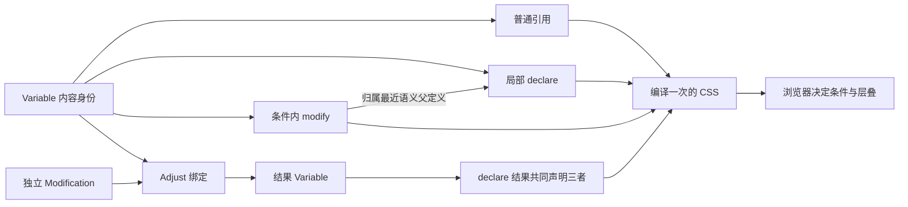

# Variable

Variable代表一个可声明、引用、按作用域覆盖并拥有自身状态的CSS实体。规则算法用普通JavaScript函数表达；函数调用返回Variable，才得到样式中需要控制的具体对象。

开始写业务样式可先完成[真实Button教程](从按钮需求组合样式.md)。本页说明自己的变量与规则怎样复用。

## 以指定内容为基础

先定义“以表面色生成线条”的函数，再传入不同表面。函数是有意义的半成品和骨骼：它预先组织转换方式，调用后才创建具体CSS实体；不需要另一种框架规则类型。

```ts
import { colorMix, declare, key, rules, variable, type Variable } from '@/style-system'

const lineStrength = variable(0.18, 'example-line-strength')
const lineColor = (base: Variable) => variable(
  { default: colorMix([base, lineStrength], 'transparent') },
  `${base.name}-line`,
)
const surface = variable('red', 'example-surface')
const anotherSurface = variable('blue', 'example-another-surface')
const surfaceLine = lineColor(surface)
const anotherLine = lineColor(anotherSurface)
rules('.Example', [declare(surface), declare(anotherSurface), declare(lineStrength)])
rules('.First', [[key('border-color'), surfaceLine]])
rules('.Second', [[key('border-color'), anotherLine]])
rules('.Local', [declare(surface, 'green'), declare(lineStrength, 0.5)])
```

效果：Example内First使用红色18%线条，Second使用蓝色18%线条；First同时带Local时使用绿色50%线条。修改共享强度影响读取它的位置，Local的显式0.5保持当地选择。两个转换结果分别引用各自的表面，不会因为后来创建了同名JS对象而换绑。

这里也可以直接导入库提供的lineColor、lineStrength；示例自行命名仅为展示完整函数。规则若只调用一次，直接写colorMix即可；变化本身需要单独声明与覆盖时才使用Modification/adjust。

```text
要让不同表面沿用同一转换：写普通函数
调用时传具体表面：取得各自的线条Variable
需要区域换色：declare该表面或强度
消费仍引用原结果：浏览器计算当地颜色
```

## derive的定义与状态复用

转换函数决定“怎样从输入产生实体”；derive决定“另一个定义怎样沿用已有默认与状态”。两者可以组合，不能相互替代。

```ts
import { key, multiply, rules, variable } from '@/style-system'

const width = variable({ default: '4px', hover: base => multiply(base, 2) }, 'example-width')
const copied = width.derive()
const wider = width.derive('7px', name => `wide-${name}`)
const fixedHover = width.derive(width.content, { name: 'fixed-hover-width', states: { hover: '12px' }, priority: 0 })
rules('.Original', [[key('width'), width]])
rules('.Wider', [[key('width'), wider]])
rules('.FixedHover', [[key('width'), fixedHover]])
```

效果：Original为4px、悬停8px；Wider为7px、悬停14px；FixedHover为4px、悬停12px。copied沿用原名称，适合同名定义；需要两份独立CSS内容时像wider一样指定新名字。

derive在创建时复用来源默认内容与状态，当前states按条件覆盖继承规则。未提供priority时为来源priority+1，显式0保留。随后修改母体JS配置不会自动改派生体。registration、onActive、compileWaveIndex不会因为派生自动继承，需在新定义的options中明确提供；状态回调在实际声明时读取本次基础。

仅配置差异用derive(source.content, options)，覆盖默认内容用derive(value, nameOrOptions)。单参对象始终是内容，不猜测它是否是配置。默认内容可以是无参延迟函数或JSS内容对象；

```text
新定义只改状态或等级：derive(source.content, options)
新定义也换基础：derive(value, name或options)
需要独立CSS身份：显式新名字
继承的是创建时规则：不承诺之后自动跟随JS配置
```

## 名称、继承与声明联动

### 创建与名称绑定

Variable.name仍是VariableName对象。String(name)、name.toString()和模板字符串输出不带--的逻辑名，例如surface；CSS声明地址仍为--surface，内容引用为var(--surface)。字符串输入可带--，沿原有规范化处理。名称在创建时绑定，后续不能替换。

### 引用激活与编译时机

引用具体Variable会消费它自己的默认内容、状态与按需资源。单独引用Name只输出CSS引用，不查找或激活同名Variable；因此需要定义和状态时直接引用Variable对象。普通无参生产函数仍只在构建消费时执行，失败从编译处报告。state(base)回调接收本次声明基础，其实参语义保留。

### 默认声明与同名覆盖

普通使用处需要明确基础时写declare(variable)，区域需要换值时写declare(variable, value)。如果最终全树没有该对象的声明，使用会补缺失的根基础；有其他位置声明时不要依赖这一补缺行为给所有位置提供默认值。

多个对象可以有同一CSS名字，CSS仍按地址、等级、顺序和浏览器作用域层叠。但同名不会自动关联JS定义、借用另一对象状态或切换依赖来源。名称相同不等于对象相同。

### 对象依赖与当地派生

转换内容直接引用哪个Variable，依赖就属于哪个具体对象。默认内容、状态与延迟函数实际展开的引用都按这一事实处理，是否为函数不决定依赖资格。当地重新声明基础或强度时，依赖结果在当地建立表达式，保留后代覆盖的动态响应；纯Name引用不提供这一JS关系。

### 自身状态

每个声明只使用所属对象的状态。状态里的Variable引用读取来源当前CSS值，外层状态仅决定该配方何时生效，不把来源状态合并进自身配置。不按名称借入其他对象状态。

### 消费退出与关系重算

撤销消费或替换声明后，退出的默认、状态、联动与按需资源随其实际来源释放；剩余消费者保留需要的产物。下一次编译重新读取当前规则。提交后的CSS由浏览器运行，不生成JS运行时观察网络。

## 默认值契约

普通创建必须给默认内容和名称。默认内容可以是值、具体Variable、Value、Expression或无参生产函数；生产函数返回的内容继续遵守原内容协议。可调用JSSContent按自身协议消费，不当普通生产函数调用。不执行未消费的默认生产函数。显式局部基础覆盖时，不为取得无用默认值再次执行生产函数。

## 编译过程

构建消费默认内容与自身状态，将具体对象依赖转为正确作用域的CSS声明；输出仍保留var()引用。应用通过compileCSS读取文本或cssRoot.mount提交。业务端无需读取AST或手工枚举状态交集。

## 实现验收

具体对象隔离、派生默认/状态/等级、无参延迟、局部物化与撤销、注册资源、modify/adjust和真实Button浏览器用途由现役测试覆盖；实现职责见[架构](../architecture.md)。

# 局部定义与相对修改

`declare(variable, value?)` 和 `modify(variable, modification, options?)` 是统一声明入口。前者给当前位置一个可被修改的基础定义；后者表达“在当前 CSS 条件成立时，对这个局部定义再做一次变化”。它们都返回 Declaration，可以和普通声明放在同一份 Rules 中。

完整可运行的数值例子及结果见[使用入口：局部定义与修改](样式系统对象与行为.md#局部定义与修改)。它演示一个基础值在不同元素与条件下分别变化；本节继续说明精确边界。

`declare(variable)` 每次编译读取当前 defaultValue，`declare(variable, value)` 明确提供这个定义的基础内容。普通 `[amount, 20]` 仍是 CSS 覆盖赋值，不自动成为相对修改的基础定义。修改沿原始 Condition 父链查找最近的同一 Variable 定义，不能仅凭相同 CSS 名字匹配另一对象。

创建首参数是 Variable 的 `defaultValue`，用于基础声明，不作为 `var()` 第二参数；局部 `declare(variable, value)`、`modify(variable, change)` 和 `adjust(variable, change)` 都不改写它。Adjust 返回新的结果 Variable，保存来源与独立颜色配方的 CSS 引用。`declare(result)` 共同声明来源、配方与结果；当前或祖先作用域已有的依赖声明优先，自动声明只补缺项。消费结果时在当地重算组合，使局部来源或配方覆盖生效。

`registration.initialValue` 是独立的 CSS `@property` 描述符，由调用方明确提供；不会从默认值自动推断类型或初始值。自动补根只提供缺少声明的基础内容；Variable 自身状态仍在实际消费位置触发。指定根配方、主题或动效环境分支时，使用方继续用普通 Rule、Condition 或按需 `onActive` 表达。



# 组合能力与边界

独立修改默认叠加，不需要调用方分配通道。需要相互覆盖的条件使用同一个 ID：

```ts
rules(['.Button', '&:hover'], [modify(amount, increase(3), { id: 'interaction' })])
rules(['.Button', '&:focus'], [modify(amount, increase(5), { id: 'interaction' })])
```

两者都成立时由 CSS 层叠选择同一步的赋值；不同 ID 或不提供 ID 则是独立步骤。非交换操作按 AST 中的声明位置确定顺序，生成名称中的数字只表示唯一身份。后续编译才出现的内容仍按其实际位置参与，不要求调用方预知修改数量。

`modification({ name: '--change', type: 'color', detail: ... })` 保存变化领域与通道描述，返回可独立声明和引用的 `Modification<Detail, Type>`。Modification 是通用定义，颜色只是按 type 路由的一种源无关转译策略；通用主体不继承颜色类型。name 使用完整 CSS 自定义属性名，省略时生成匿名名称；构造时不执行通道回调。内置转译在配方编译时使用通道符号生成 CSS 内容。数字及任意 CSS 表达式变化直接使用 `{ type: 'expression', detail: current => add(current, delta) }` 材料，由 Modify 应用于前序表达式；这种材料不承诺可独立声明。

[operations/modify.ts](../operations/modify.ts) 的 `modify(target, change)` 按 type 选择当前支持的应用，读取双方材料并构造操作内容；颜色应用保留独立配方引用。[修改链编译](../variable/modify.ts) 接收已选应用，组织条件步骤、顺序和撤销。[operations/adjust.ts](../operations/adjust.ts) 的 `adjust(target, change)` 按 type 选择领域组合，读取来源与变化材料，建立结果 Variable 并保留三者绑定；当前颜色实现复用 `oklch(source, channels)`。绑定不求 JS 默认数据，也不修改共享来源。Declare 的材料为 `key/content`；Adjust、Modify 目标的 key 须为 CSS 自定义属性，还可携带已解析的 states Map 与 registration 配置，颜色变化材料包含 `type: 'color'` 与配方 key/content。对象只持有信息，不要求有协议品牌、协议登记或特定构造来源。

`modify` 可用于颜色、尺寸和数值等内容，前提是变化回调能为当前来源构造有效 Expression，或来源与颜色配方能组成有效的相对颜色；变化描述并不保证适用于所有值。无修改的局部定义保持普通形态；修改由具体目标和变化材料组合。

修改写到子元素时，在当地重新发布结果，并重新应用必要的后续规则；它不修改父元素。父位置的条件仍在原宿主匹配，子位置规则在子元素匹配。

不承诺浏览器能求值无限表达式。已有明确类型 registration 可用于内部计算；数值、长度、颜色长链已有测试，无类型或 `syntax: '*'` 仍可能达到浏览器表达式上限。这个运行边界与业务端无需手工分配固定槽位是两件事。

# 完整颜色修改规则

颜色使用普通 Variable，变化通过 [modification.ts](../modification.ts) 的 `modification({ type: 'color', detail })` 独立定义。固定通道和相对回调保存在 `detail`；内置转译以 l/c/h/alpha 表达式生成与来源无关的完整配方。Modify 使用配方引用构造相对 OKLCH 表达式；Adjust 创建绑定双方的结果 Variable，不预先计算通道数值。

```ts
const surface = variable(baseColor, 'surface')
const hoverChange = modification({
  name: '--hover-change',
  type: 'color',
  detail: {
    lightness: current => add(current, 0.05),
    chroma: current => multiply(current, 0.8),
  },
})
const activeChange = modification({ type: 'color', detail: { alpha: 0.7 } })
rules('.Button', [declare(surface), declare(hoverChange), declare(activeChange), [key('background-color'), surface]])
rules(['.Button', '&:hover'], [modify(surface, hoverChange)])
rules(['.Button', '&:active'], [modify(surface, activeChange)])
```

hover 和 active 同时成立时，浏览器按步骤应用两条变化，不需要 JS 预先合并状态。固定通道和相对变化属于同一份配方：`modification({ type: 'color', detail: { lightness: 0.6 } })` 设置亮度，其余通道保持来源值。

```ts
const merged = adjust(surface, hoverChange)
rules('.Adjusted', [declare(merged), [key('background-color'), merged]])
```

声明 merged 会共同声明 surface、hoverChange 与 merged；它保留 `Source + Modification → mergedResult` 的 CSS 引用关系。一份 Modification 可以被多个 Source 共享，子元素覆盖来源或配方后，结果使用当地值。控制器修改变化描述、通知与自动重编译属于后续能力；Size 的具体转译参数与表达尚未定义。

## 完整修改规则的继承与消费

条件选择由原 CSS 地址上的选择门完成，共享 `id` 的候选按选择器优先级与源顺序层叠；没有输出的候选不参与赋值。

普通消费地址会当地求修改链，因此子元素局部覆盖 Modification 配方后，无需再写一次 `modify` 就能得到当地颜色。未显式声明的后代按 CSS 继承祖先的规则选择，不因使用同一个 class 而自动隔离；需要独立基础和规则归属时写 `declare(variable, value)`。注册明确 `inherits: false` 时，子元素只读注册初值；有当地修改才从当地基础继续应用。

每一步只有一个结果 CSS 变量，并引用前序结果；规则不拆成 lightness、chroma、hue 或 alpha 的独立存储，长链也不把前序表达式复制到两个分支中。选择门是编译器保存条件选择的内部元数据，完整颜色配方由一个独立 Modification 声明承载。
