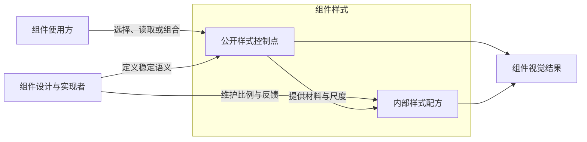

组件独有、具有稳定视觉含义且可由外部独立控制的量，应独立命名并公开。组件维护默认配方、比例与状态，调用方通过这些 Token 读取、引用、组合或调整组件样式。

# 使用方与组件设计者的职责

使用方负责应用的品牌、主题、排版和整体尺度；组件设计与实现者负责组件的默认布局比例、视觉平衡和交互反馈。这是职责角色，同一个应用开发者也可以同时承担两种角色，不能按是否会写代码划分。维护默认配方不排斥调用方独立控制对应的视觉量。

公开控制包括读取、引用和组合，不只表示修改。使用方可以复用组件颜色组织周围界面，也可以独立选择适合应用的字号、字重、间隔和 padding；组件保留这些控制量的默认配方与状态。纯系数和无独立语义的临时计算不因此成为公开接口。

# 公开控制点的成立依据

先判断控制量属于哪个组件、表达什么稳定视觉含义，以及外部能否独立选择、读取或组合它。Button 的 padding、gap、字重属于 Button 自己的控制量，应具名公开；已有 size、density 等分类维护默认组合，不替代这些控制量本身。

计算短、只在本组件消费、暂无外部调用，或者默认值由组件内部比例得出，都不能单独作为隐藏控制量的理由。公开定义与属性引用应保持一致排列，不为缩短单个调用把具名控制量改成匿名内联。

Source 表达独立的来源阶段。例如 buttonOpacitySource 保存强调选择后、禁用缩放前的透明度，buttonOpacity 再组合禁用缩放；两个对象的职责不同，均保留公开引用。是否存在阶段应由真实计算链说明，不能仅凭 Source 字样创造阶段，也不能因它只供下一步使用就删去或隐藏。

# 按视觉职责权衡

下表给出默认倾向，例外依据组件目的和使用方需求判断，不按 CSS 属性名称固定分类。

| 视觉职责                       | 默认倾向                   | 理由与边界                                                              | 需要重新权衡的情况                                                             |
| ------------------------------ | -------------------------- | ----------------------------------------------------------------------- | ------------------------------------------------------------------------------ |
| 颜色、主题、语义反馈           | 往往适合公开               | 覆盖界面较广，使用方容易有品牌、配色或语义表达需求                      | 公开完整颜色角色，不因此公开每个 alpha 或混色系数                              |
| 字号、组件整体尺度             | 具名公开                   | 需要适配应用排版、信息密度和整体视觉规模                                | size、density 组织默认状态，保留独立控制量                                     |
| 字重、阴影、圆角、边界风格     | 有稳定视觉身份时公开       | 表达组件自身可独立选择的视觉效果                                        | 不因实现属于默认配方就隐藏，也不把纯修正系数当作独立角色                       |
| Button 的 padding、内容 gap    | 具名公开                   | 属于 Button 自身的间隔与留白，外部可以独立控制                          | 组件继续维护默认比例与尺寸状态，不以暂无外部调用或比例计算为由收回             |
| 组件外部 margin                | 通常由父布局或业务摆放负责 | 组件在页面中的距离属于外部组合关系，不必为每个组件建立专用 margin Token | 使用方仍可通过布局或合法 CSS 设置 margin；组件确实承担外部排列职责时再判断接口 |
| cursor、按压位移和状态反馈细节 | 默认内部配方               | 通常服务于一致的交互表现，无需使用方逐项选择                            | 出现常见、稳定的定制需求时，以对应语义角色判断，而不是开放所有反馈参数         |
| 纯系数与无独立语义的临时算式   | 内部实现                   | 只参与计算，不具有独立控制量或来源阶段的职责                            | Source 独立阶段应分别定义，不能与最终结果合并判断                              |

# 外置与内联的表达边界

公开控制量统一先定义、导出，再在属性处引用，使外界能够读取、引用、组合或调整；不需要增加 setter 或专用登记机制。组件内只消费一次也不影响已经成立的公开职责。

内联限于纯系数和无独立语义的计算片段。Button 的 gap、字重即使默认计算很短，也保持具名公开定义与属性引用；复杂状态及 Source 阶段继续按各自职责分开。rules 应容易看出属性消费哪个控制量，配方应容易看出材料与差异。

具体样式写法与导出变量的单一 Token 约束见[样式文件写法](../../../docs/style/样式文件写法.md)，Token 创建和继承语义见 [Token 设计](Token设计.md)。
