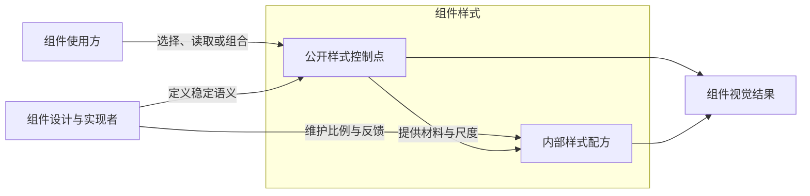

组件公开哪些样式，取决于使用方经常需要自主决定什么视觉目标。组件负责维护实现这些目标的配方和比例，公开控制点让使用方表达稳定的差异，而不是接管所有内部参数。

# 使用方与组件设计者的职责

使用方负责应用的品牌、主题、排版和整体尺度；组件设计与实现者负责组件内部的布局比例、视觉平衡和交互反馈。这是职责角色，同一个应用开发者也可以同时承担两种角色，不能按是否会写代码划分。

公开控制包括读取、引用和组合，不只表示修改。使用方可以复用组件颜色组织周围界面，也可以选择适合应用的字号和尺度；内部配方则由组件保持一致。使用方需要特别定制内部样式时，仍可使用布局或样式能力，这不要求每个内部量都成为组件的常规公开接口。

# 公开控制点的成立依据

一项样式明显影响界面，使用方经常有独立的审美、品牌、排版或尺度需求，且能够用稳定、易懂的语义表达时，是值得公开的候选。优先沿用已有主题、size、density 等语义，避免把同一个目标拆成许多底层旋钮。

常见指不同应用或使用场景经常有这类定制意图，不是同一值在运行时频繁改变；品牌色即使只设置一次，也可能值得公开。

显著影响、可读取、存在 Token、使用次数或已有 export，单独都不足以证明公开的必要性。读取和组合也需要有真实用途：Button 的 padding、gap 能被外部消费，只证明能力可行；完整的强调后、禁用前透明度也只是一个可读结果，仍需判断使用方是否常有独立控制它的理由。

# 按视觉职责权衡

下表给出默认倾向，例外依据组件目的和使用方需求判断，不按 CSS 属性名称固定分类。

| 视觉职责                                    | 默认倾向                   | 理由与边界                                                              | 需要重新权衡的情况                                                              |
| ------------------------------------------- | -------------------------- | ----------------------------------------------------------------------- | ------------------------------------------------------------------------------- |
| 颜色、主题、语义反馈                        | 往往适合公开               | 覆盖界面较广，使用方容易有品牌、配色或语义表达需求                      | 公开完整颜色角色，不因此公开每个 alpha 或混色系数                               |
| 字号、组件整体尺度                          | 往往适合公开               | 需要适配应用排版、信息密度和整体视觉规模                                | 优先已有 size、density 等语义，不随之开放全部内部尺寸                           |
| 字重、阴影、圆角、边界风格                  | 按稳定定制需求判断         | 可能体现品牌，也可能只是组件配方的一部分                                | 当应用经常需要独立选择且语义稳定时公开，不能一概开放或一概内置                  |
| Button 的 padding、内容 gap、微调与对齐补偿 | 默认内部配方               | 通常共同维持按钮比例、内容平衡和版式，使用方接受完整结果                | Stack、Layout 的 gap 本身就是布局目的，可以成为公开控制；同名属性不代表相同职责 |
| 组件外部 margin                             | 通常由父布局或业务摆放负责 | 组件在页面中的距离属于外部组合关系，不必为每个组件建立专用 margin Token | 使用方仍可通过布局或合法 CSS 设置 margin；组件确实承担外部排列职责时再判断接口  |
| cursor、按压位移和状态反馈细节              | 默认内部配方               | 通常服务于一致的交互表现，无需使用方逐项选择                            | 出现常见、稳定的定制需求时，以对应语义角色判断，而不是开放所有反馈参数          |
| 中间系数与计算阶段                          | 默认内部实现               | 表达配方怎样算，不直接表达使用方想得到的视觉目标                        | 即使阶段结果完整、可读，也须有独立使用价值才能公开                              |

# 外置与内联的表达边界

确定为公开控制点的 Token 应独立命名并导出，使外界能够读取、引用或组合；这不要求增加 setter、只读限制或专用登记机制。组件内只消费一次也不影响已经成立的公开职责。

内部配方按视觉职责就地表达。短计算和固定取值可以内联，纯计算也可以在使用位置或计算函数内部命名；不能为了文件更短，把复杂 state 和多层 Token 全塞进 rules。rules 应容易看出属性消费什么，配方应容易看出材料与差异。

现有导出记录的是当前实现，不能反过来证明公开必要性，也不能直接作为其他组件的模板。具体样式写法见[样式文件写法](../../../docs/style/样式文件写法.md)，Token 创建和继承语义见 [Token 设计](Token设计.md)。
