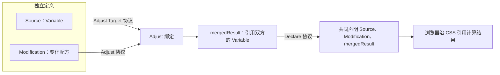
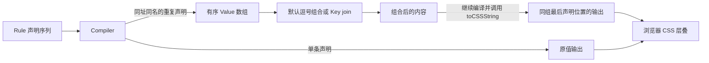

# Style System 对象与行为

Style System 提供样式定义与编译能力，业务样式选用可复用碎片并声明用途。代码文件职责与运行链见 [architecture.md](../architecture.md)。

Pieces 是可复用碎片的统称，不是 Rules 的父节点。Rule 包含 Condition 和 Declaration；Declaration 将声明目标与 JSSContent 配对。JSSKey 可直接配对内容，Variable、Modification 等对象持有 `key/content` 自然材料，declare 据此建立对应声明。`pieces/contents/` 对应内容这一侧，包含现成 Atom、内容组合操作和内容构造方法。

## 对象分别负责什么

| 对象 | 职责 |
| --- | --- |
| JSSKey | 表达一个 CSS 属性或描述符的声明目标，可自带同址重复声明的聚合规则 |
| Value | 包装内容、按需依赖与 CSS 输出；withContent 以原配置包装新内容，不选择或传播状态 |
| Variable | 拥有内容身份、创建配置、引用、局部定义和状态基础，投影 Declare、Adjust Target、Modify Target 所需的自然材料；见 [变量定义与消费.md](变量定义与消费.md) |
| Atom | Value 与 Variable 在组合时作为一块使用的称呼；不是独立类型，底层仍是 JSSContent |
| Variable Cluster | 聚合已有 Variable；直接使用代表 default，调用选择成员 |
| JSS 内容组织工具 | 位于 functions，用已有输入组织混色、计算等 Expression；边界见 [SPEC.md](../pieces/contents/functions/SPEC.md) |
| Expression | 只承担自身依赖与输出，不提供消费位置通知、AST 操作或资源定义 |
| CSSFunction | 与 Variable 平级的定义主体，按需提供函数体；调用返回依赖主体和实参的 Expression |
| Atom Creator | 由配置构造可作为一块内容使用的 JSSContent，例如阴影或动画 |
| JSSContent | 内容对象共同遵守的可选编译、生命周期与输出约定 |
| Modification | 保存变化自身的 type/detail，内置转译颜色配方，持有 Declare、Adjust、Modify 所需材料；来源绑定和条件应用由使用方组织 |
| State Condition | 表达同一主体的状态条件及优先级 |
| Condition | 表达有序 CSS 地址，包括选择器和 At Rule |
| Declaration | 一对声明目标与内容，由 Key 配对或 declare 读取自然材料建立 |
| Mixin | 将完整效果配置转换成声明组合 |
| Rule | 保存普通 CSS 条件、声明目标及内容，不解释状态名称 |
| CSSRoot | 保存源规则，统一编译并提交 CSS |

```text
Condition + Declaration(声明目标, JSSContent) → Rules
Rules → JSSStyleNode[] → JSSContentNode[] → CSS 字符串
```

## 创建与延伸

Variable 的稳定目的、引用、declare/modify、defaultValue 生产函数及 Cluster 关系见 [变量定义与消费.md](变量定义与消费.md)。本节说明状态内容与成员继承。

```ts
const surfaceColor = variable(baseColor, {
  name: 'surface-color',
  states: {
    hover: hoverColor,
    active: source => colorMix([source, 0.48], neutralColor),
  },
})

const surfaceColorDefault = variable(surfaceColor, {
  name: 'button-surface-color-default',
  states: {
    active: source => colorMix([source, 0.48], neutralColor),
  },
})
```

`variable()` 的首参数是 defaultValue；它是什么，状态回调就收到什么。状态回调在定义时取得该原始参数，返回内容。混色组合函数返回内容对象；Variable 按对象的通用能力识别它，不把它当作生产函数。

普通 Variable 只拥有自身配置的状态；状态配方中的来源 Variable 保留 CSS 引用，读取来源当前状态与局部覆盖，不把来源状态加进自己。Cluster 的成员集合需要继承时调用 `clusterFrom(sourceCluster, changes)`；它给同名新成员明确配置来源引用和状态，当前配置覆盖同名状态。状态回调直接使用 source，调用者无需手工取 active 值。

Variable 的名字用于最终 CSS Custom Property。创建首参数保存默认内容，在输出引用时成为 CSS fallback；局部声明、CSS 修改和 Adjust 绑定不改变它。根声明及主题、减少动效分支由普通 Rule 和 Condition 表达，具体 Atom 可在创建选项中提供通用 `onActive`，实际消费时才按需返回这些规则。registration 按需提供 CSS @property，其 `initialValue` 与默认值独立，不能自动推断。新对象的显式注册使用新名字，来源对象不被修改。

## 独立变化与来源绑定

```ts
const source = variable(oklch({ lightness: 0.5, chroma: 0.1, hue: 240 }), 'source')
const change = modification({
  name: '--change',
  type: 'color',
  detail: { lightness: 0.3, chroma: current => add(current, 0.3) },
})
const merged = adjust(source, change)

rules('.item', [declare(merged), color({ foreground: merged })])
```

`Modification<Detail, Type>` 自身就是通用变化定义，可声明和引用，不需要包装为 Variable。type 选择描述转译，name 是完整 CSS 名称；两者职责独立。通用主体及声明生命周期在前，Color 的参数、材料形状和转译在后；当前内置策略是 Color，没有运行时安装或注册入口。单个配置中的 `name` 使用完整 CSS 自定义属性名（例如 `--change`），省略时生成匿名名称；`type` 选择内容领域，`detail` 保存变化：固定通道设为给定值，回调在配方编译时收到 l/c/h/alpha 表达式，未指定通道保持来源。上例的变化声明为 `--change: 0.3 calc(c + 0.3) h / alpha`。内置转译只负责配方内容，不建立独立 Adapter 层；颜色之外的 Size 参数与表达尚未定义。



`adjust(source, change)` 返回 mergedResult。结果使用 `oklch(from var(--source) var(--change))` 组合双方，`declare(merged)` 一并声明三者。当前或祖先作用域已经声明的来源与配方优先，自动声明只补缺项；当子元素局部覆盖来源或配方时，结果在消费地址重新组合，使用该处的 CSS 值。多个 Source 可共享同一 Modification。

`modify(target, change)` 按 type 选择具体应用，返回条件修改 Declaration。颜色材料通过独立配方引用参与组合；数字及其他 CSS 表达式变化使用 `modify(target, { type: 'expression', detail: current => add(current, 2) })`。这种回调材料直接描述对前序表达式的变化，不是独立可声明的 Modification。Modification 持有变化方材料，Variable 持有目标侧材料；具体组合、顺序和条件由外部 Modify 使用端组织。

协议是操作所需的数据形状；`AdjustProtocol<Type>` 描述可声明的配方，`adjust` 入口另限制当前支持的 type，绑定主体不继承颜色定义。Declare 描述 `key/content`，Adjust、Modify 的目标 key 须为 CSS 自定义属性，还可携带 states（已解析状态条件到内容的 Map）与 registration（CSS @property 配置），颜色变化材料包含 `type: 'color'`、配方 key 与 content。

Declare 还允许可选的 `declarations?: DeclareProtocol[]` 保存共同声明的依赖材料。Adjust 结果用它保留来源与配方，即使 `declare(merged, replacement)` 显式覆盖结果内容，依赖关系仍会共同声明；普通材料无需提供这个字段。

使用端通过 FNKit 的 DataShape 和 `matchShape` 识别材料并执行操作；信息体不必知道协议，不需要协议登记、品牌或外部操作方法。

控制器修改变化参数、更新通知及自动重编译属于后续能力，当前没有对应操作方法。

例如 `declare({ key: key('--surface'), content: 'red' })` 直接声明普通信息体的材料；它不需要 Variable 身份。`content` 可以是可编译内容或消费时执行的生产函数，显式 `undefined` 表示不输出；缺少 content 字段不等同于显式 undefined。

## 聚合已有成员

```ts
const accentColors = variableCluster({
  default: variable0,
  soft: variable1,
  strong: variable2,
})

accentColors
accentColors('soft')
```

普通值消费 Cluster 时采用 default 成员，调用则选择对应成员 Variable。选择参数可以是描述词，也可以是基础色阶的数字。选择语气不切换状态；soft 成员自己处理 hover、active 等状态。未定义成员报错，不临时生成或静默回退。

声明的目标与内容都是 Cluster 时，例如 `[toneColors, accentColors]`，编译器只为双方已有的同名成员产生局部 Variable 声明。未匹配目标不增加声明，保留原有默认值或作用域覆盖；来源额外成员不参与，也不激活依赖。多个成员只有目标对象与来源对象分别相同时才视为同一条声明；不同目标对象同名报错，以免遗漏对象的依赖。成员赋给自身不输出，不同对象的目标与来源同名则报错，避免 CSS 自循环。展开只有一层，不深度合并，也不修改共享成员；普通 Variable 目标接收 Cluster 内容时仍使用来源 default。

## 声明与作用域

```ts
rules(button, [
  [$alignSelf, 'center'],
  declare(surfaceColor, surfaceColorDefault),
  color({ background: surfaceColor }),
])
```

rules 的公开输入是声明序列及 Mixin 组合；普通声明对象和裸字符串目标不在公开类型中。JSSKey 对象直接携带属性名，不依赖名称预注册。Mixin 自己解释配置对象，Compiler 只读取生成的声明。

声明不修改共享 Variable 的 JS 对象。局部覆盖、继承及层叠由 CSS 作用域决定。普通声明保留书写顺序与重复目标，undefined 内容跳过；迭代失败或输入无效时不登记部分结果。同址同名的重复 Key 默认合成逗号数组；如果组合值不符合该 CSS 属性的文法，浏览器会忽略整条声明。

同一目标与状态地址的同名 Key 重复声明时，Compiler 按声明顺序形成一组 Value。每项 Value 的 `content` 保留原值与对象身份，`toCSSString` 惰性读取该节点已编译的内容。默认把这组 Value 作为逗号数组输出；Key 的 `join` 可以改为数值等其他组合，并返回普通内容继续 `onCompile` 和输出。结果位于同组最后一条声明的位置，其他地址和状态各自处理。组内唯一显式 `join` 接管默认规则；多个不同显式规则报冲突。单条声明直接输出。

`join` 保留输入 Value 对象时，该项继续读取原声明位置的编译结果；改写 Value 的 `content` 引入新内容时，新内容在结果节点编译。



`$boxShadow` 不提供专属 `join`，使用相同的默认逗号组合；已有逗号列表与重复项按原顺序保留。它不检查 `none` 或 CSS 全局关键字；混合后的声明是否有效由浏览器判断。编译期不据此创造清空历史贡献的语义。

rule 返回的句柄可以替换或删除自己的源条目；rules 返回批量删除句柄。句柄不直接提交 DOM，应用通过 cssRoot.mount() 统一提交。

## 状态与内容输出

状态只产生 Variable 自身的 Custom Property 声明，外部混色、计算或 Value 包装不获得状态分支。一个表达式组合多个有状态 Variable，消费属性仍输出一次。

Variable 创建时展开 `states` 中匹配到的快捷名称，其他输入直接作为条件，保存条件到内容的映射；业务保证这些条件约束自身，不要求登记。公开 Rules 中的字符串统一是普通条件，例如 `'&:hover'`，含义不随快捷名称登记变化。普通内容与状态配方都直接引用来源 Variable，组件只选择分类材料和贡献。

每个 Variable 只生成常态与各项有效状态，不自动枚举状态交集。状态选择器的附加权重统一归零，确保中央顺序不被选择器特异性反转；显式嵌套条件保留。Variable 只检查自身状态；`clusterFrom` 创建成员时保留来源成员的状态选择，不收集普通内容依赖图的状态。具体边界见 [主体状态条件.md](主体状态条件.md)。

焦点轮廓由 focusOutline 的 focus 状态（匹配 `:focus-visible`）与通用 clickable Mixin 组成；配色来自当前 toneColors 的 line 成员。组件只选择整组配色，不另外绑定焦点成员。line 表示轮廓颜色用途，焦点仍是 State Condition，因此普通背景和前景不会为了轮廓反馈而改变自身颜色。

内容完成编译后仍可保持对象形态，到最终输出阶段才通过 `toCSSString` 得到文本。循环引用终止编译；共享但无环的内容可以重复消费。`onActive` 提供的依赖只参与本次编译，不写回源账本。函数定义的局部 Variable 与 result 保持在同一份定义中，避免同名函数的后定义覆盖前定义。
